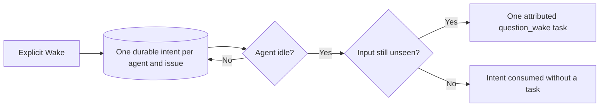

# ADR-0022: An accepted Wake waits durably for the agent

- Status: accepted, supersedes ADR-0020
- Date: 2026-10-16
- Supersedes: ADR-0020

## At a glance

| Kind | Name | Change | Path |
|---|---|---|---|
| Decision | Accepted wake lifetime | new | `adr/0022-an-accepted-wake-waits-durably-for-the-agent.md` |
| Persistence | Waiting wake intent | new | `server/pkg/db/queries/question_wake_pending.sql` |
| Selection | Unseen answers and ask-backs | changed | `server/pkg/db/queries/question.sql` |

## Context

**Binds:** question mutations, task scheduling, terminal reconciliation and claim-time input.

**Prevents:** an accepted Wake disappearing while the active run ends, a retry silently discarding its input, or more than one follow-up task for the same wait.

ADR-0020 keeps explicit Wake and receipt-based handling authoritative. The answer/run-ending cases in WORK-1177 require that explicit request to outlive the run that blocks it. The moving claim boundary also needs to retain the input covered by that accepted request while a retry without question input intervenes.

## Decision

**Rule:** Wake is durable intent, not a second queued task. A waiting intent is unique per workspace, agent and issue. Answer with Wake checked and ask-back use the same path. An unchecked answer and a member's question create no intent.

A single transaction consumes an idle intent by creating one `question_wake` task, its attributed activity and question event, or by finding that all in-scope input was seen. Terminal handling and restart recovery call that same transaction. Availability and unfinished retry work block task creation.

Enclosing issue deletions and comment replacements hold shared issue-scoped PostgreSQL advisory transition locks, including through synchronous nested callbacks. Wake consumption tries the exclusive counterpart before row locks and never waits on a lifecycle holder. A fenced explicit Wake persists acceptance; terminal callbacks and recovery retain waiting intent. Each enclosing operation releases its holder and drains after deletion, replacement or failure recovery settles; consumption waits until all holders are released. Deleted targets lose their waiting intent without a task; a replacement keeps the wait blocked. Transaction-scoped locks release on connection loss, leaving recovery able to resume durable intent.

Unseen input keeps the current live question scope and event-receipt rules: only `handled_at`, not delivery or seen marks, removes an answer or ask-back event. A handled answer edited later has an unseen current event. The accepted wait retains its pre-wait claim boundary through retries that carry no question input; count, drain and claim hydration use the same effective boundary. Claims that actually include the input still make it seen. Tasks retain the boundary through their own retry chain. Answer content is always loaded fresh at claim.

Wake preserves question status. Archived agents or agents without runtimes start no task. Card visibility and target availability stay governed by their existing rules.

## Consequences

- Waiting intent is stored in PostgreSQL and survives process restarts; no process-local timer owns it.
- The woken activity names the member whose first coalesced request initiated the wait, with the answer count at task creation.
- An accepted HTTP wake can have no task yet; its existing string `task_id` is empty in that case.
- ADR-0019 still owns live delivery and receipts; this decision changes neither daemon steering nor comment follow-up behavior.
