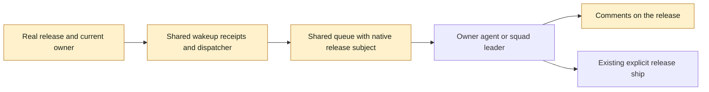

# ADR-0022: Releases coordinate as native task subjects

- Status: accepted
- Date: 2026-10-16
- Supersedes: none

## At a glance

| Kind | Name | Change | Path |
|---|---|---|---|
| Contract | Native release coordination | new | `adr/0022-releases-coordinate-as-native-task-subjects.md` |
| Boundary | Release, task, comment and wakeup subjects | changed | `server/pkg/db/queries/release.sql`, `server/pkg/db/queries/agent.sql`, `server/pkg/db/queries/comment.sql`, `server/pkg/db/queries/wakeup.sql` |

## Context

[ADOPTED] A release can have an optional agent or squad owner without becoming an issue. The owner coordinates its fixed issue scope through the existing workflow, reports on the release and ships only through the guarded release command.

Binds: release writes, task and wakeup dispatch, daemon execution and agent tooling.

Prevents: independently implemented proxy issues, duplicate schedulers, pinned former-owner wakeups and implicit shipping.

## Decision

Rule: a release is a native subject of the existing task queue, comment store and wakeup engine. A release-scoped row references the real release, never a surrogate issue. The dispatch target is the release's current agent owner or current squad leader. Source facts use the existing durable wakeup receipts and dispatch lifecycle.

Owner replacement, shipping and removal fence unstarted coordination through the same repository transaction boundary as the release. Started work keeps its ordinary task lifecycle and may report; it grants no future coordination to a previous owner. Claim and start recheck the current subject and target.

Release coordination changes no issue placement, assignee, parent or order and supplies no dependency scheduler. Workflow gates and publication decisions stay in agent instructions and skills. The existing explicit ship endpoint remains the only operation that records shipment.

## Consequences

- Shared stores distinguish issue and release subjects explicitly; issue-only loaders and daemon quick-create handling cannot interpret a release as an issue or an empty task.
- Release comments and waits reuse existing storage, permissions and lifecycle mechanisms rather than parallel subsystems.
- Removing or shipping a release cleans its waits and unstarted coordination in application transactions, with no new foreign keys or cascades.
- This decision does not extend issue question scope, running-run input receipts or release publication policy.
