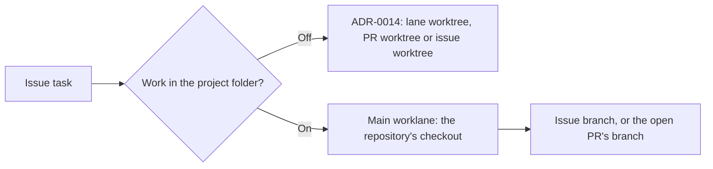

# ADR-0031: A repository can work only in its checkout

- Status: accepted
- Date: 2026-10-17
- Supersedes: none (amends where tasks work in ADR-0014)

## At a glance

|Kind|Name|Change|Path|
|---|---|---|---|
|Column|`repository.work_in_checkout`|new|`server/migrations/800_repository_work_in_checkout.up.sql`|
|Claim|`ClaimWorklane.InCheckout`|new|`server/pkg/protocol/messages.go`|

## Context

ADR-0014 sends a task to its worklane's worktree, to its open pull request's `.pull-requests/{branch}` worktree, or for an issue in no worklane to the UJ-2 issue worktree. A big repository such as appboypov/multica cannot afford a worktree per issue or per pull request. Brian wants a repository setting under which every task works in the repository's checkout, while worklanes keep their issues and order.

## Decision

- `repository.work_in_checkout` is off by default. With it on, the claim gives every issue task of the repository the repository's `main` worklane with `in_checkout`, whichever worklane the issue is in, and for an issue in no worklane only on the checkout's machine.
- The daemon runs such a task as a task of `main`: it holds the checkout's path lock, switches the checkout to the issue's branch or to the open pull request's branch, and refuses a branch that holds uncommitted or unpushed work as ADR-0014 says. It makes no issue worktree and no pull-request worktree.
- The daemon reports the switched branch with the `main` worklane's id, and the server records it on `main`.
- With the setting off, ADR-0014 applies unchanged.

## Consequences

- Tasks of such a repository run one at a time, whatever their worklane.
- A worklane other than `main` keeps its issues and order, but its worktree gets no agent work while the setting is on.
- A pull request branch still held by an older pull-request worktree fails its task with git's message until that worktree goes.
