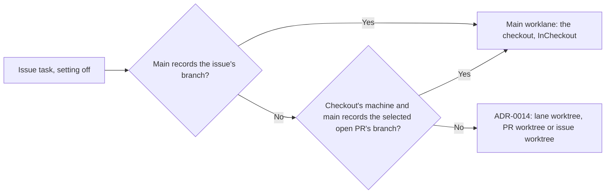

# ADR-0032: A checkout keeps the branch it holds with the setting off

- Status: accepted
- Date: 2026-10-18
- Supersedes: none (amends what applies with the setting off in ADR-0031)

## At a glance

## Context

ADR-0031 says that ADR-0014 applies unchanged while Work in the project folder (`repository.work_in_checkout`) is off. The claim already did more than that. git checks a branch out in one place only. A checkout that a task switched to an issue's branch still holds that branch after Brian turns the setting off. ADR-0014's route would send the issue's next task to a worktree where git refuses that branch, so the claim keeps the task in the checkout instead. WORK-1330 (PR #107) extended this to the branch of the issue's open pull request, and its round-2 review found that ADR-0031 records neither case.

## Decision

- With `repository.work_in_checkout` off, the claim still gives an issue task the repository's `main` worklane with `InCheckout` in two cases. Each holds whichever worklane the issue is in.
  - Issue branch: `main` records the issue's branch, its key in lowercase. The claim checks this case first.
  - Pull request branch: `main` records the branch of the issue's linked open pull request that the claim selects for that repository in the issue's workspace. This case holds only for a runtime on the checkout's machine.
- The machine gates of ADR-0014 stay in force. A task on another machine whose issue branch the checkout holds fails with `worklane_elsewhere` when the issue's worklane belongs to that repository. Otherwise it takes its ordinary route.
- Any other branch in the checkout leaves the task on its ordinary route: ADR-0014's lane worktree, pull-request worktree or issue worktree.
- The daemon runs a held task as ADR-0031 says for a task with `InCheckout`. The server records its branch on `main`.

## Consequences

- Turning the setting off moves no issue whose branch the checkout holds. Its tasks run in the checkout one at a time with the checkout's other tasks.
- A held issue keeps its worklane and its place in that worklane's order. Its worklane's worktree gets no work for it while the checkout holds its branch.
- `InCheckout` in a claim means the task works in the checkout. It no longer means that the setting is on.
