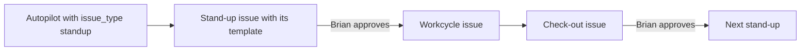

# ADR-0032: Stand-up, workcycle and check-out are issue types

- Status: accepted
- Date: 2026-10-19
- Supersedes: none (extends the eight types of ADR-0012)

## At a glance

|Kind|Name|Change|Path|
|---|---|---|---|
|Constraint|`issue_type_known`|widened to eleven types|`server/migrations/803_issue_type_workcycle.up.sql`|
|Column|`autopilot.issue_type`|new|`server/migrations/803_issue_type_workcycle.up.sql`|
|Templates|`standup`, `workcycle`, `checkout`|new|`server/internal/issuetemplate/templates.go`|
|Filter, grouping, sort and column|`type`|new on Issues|`packages/views/issues/`|

## Context

Each organisation's work runs per release as a stand-up, a workcycle and a check-out (MadSpec `madspec-workcycles`). These issues were plain issues told apart by their title only. Brian wants to see them as their own kind of issue, with their own template, and wants an autopilot to make each stand-up with that template. He also wants to filter, group, sort and show Issues by type.

## Decision

- `standup`, `workcycle` and `checkout` join the eight types of ADR-0012, each with its own icon, colour and template. The rule that an issue's type never changes once set stays.
- An autopilot takes an optional `issue_type`. A `create_issue` run makes its issue with that type, and the issue's description holds that type's template for the run to fill in.
- The migration gives every existing issue whose title starts with `Stand-up `, `Workcycle ` or `Check-out ` its type, and every autopilot whose title template starts with `Stand-up ` the type `standup`.
- Issues offers a Type filter, Type grouping on Board, List and Table, Type sorting in template order with No type last, and a Type column in Table. A type column on Board only reorders, since a type never changes.

## Consequences

- Agents and the CLI name the eleven types where they named eight.
- A saved view keeps its Type filter, grouping and sort.
- An issue of these types made by hand starts from its template in New issue like any other type.
