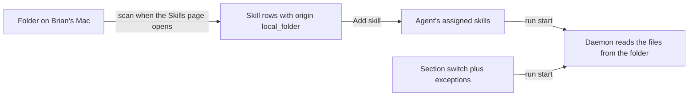

# ADR-0033: Skill folders feed the library, and the section switch sets every skill

- Status: accepted
- Date: 2026-10-20
- Supersedes: ADR-0017 (`0017-runtime-skill-switches-exist-only-where-the-run-enforces-them.md`)

## At a glance

|Kind|Name|Change|Path|
|---|---|---|---|
|Column|`agent.runtime_skill_exceptions`|renamed from `disabled_runtime_skills`, now exceptions to the section switch|`server/migrations/804_skill_folder.up.sql`|
|Table|`skill_folder`|new|`server/migrations/804_skill_folder.up.sql`|
|Skill origin|`local_folder`|new, read-only|`server/internal/handler/skill_folder.go`|
|Skill bundle source|`folder`|new, read from disk at run start|`server/pkg/skillbundle/hash.go`|

## Context

Brian keeps his skills in folders on his Mac and wants agents to use them without copying them into Multica, so an edit counts at the next run. The workspace library was empty, so Add skill stayed greyed out. An agent's runs inherit the skills installed on its runtime machine. Brian turns them off per agent, as a whole section and one skill at a time, on the agent's Skills tab. He wants to turn the section off and then turn a few skills back on, which the locked rows did not allow. Each provider keeps a skill out in its own way: Claude through a task-local `--settings` file, Codex through its task `config.toml`, omp through a task-local `--config` overlay with `skills.ignoredSkills`. Other providers have no such mechanism. A switch for a provider whose run ignores it would tell Brian a skill is off while the run still has it.

## Decision

- A skill folder is a row per workspace, machine (`daemon_id`) and path. Only the owner of a local runtime on that machine adds one. The folder's creator, or a workspace owner or admin, removes it, and its skill rows go with it.
- Each direct subfolder with a `SKILL.md` is a library skill whose `config.origin` is `local_folder` with the folder, machine, key and path. Its `content` is the `SKILL.md` of the last scan, so the library shows its name and description. It has no `skill_file` rows and cannot be edited, refreshed or deleted in Multica.
- The Skills page asks each machine's daemon to scan its folders each time it opens, through the local-skill list request. The server brings the library in line: it updates a skill by key, creates one whose name is free, deletes one whose subfolder is gone, and reports a taken name as skipped.
- A run sends an assigned folder skill as a `folder` reference with its path. The daemon reads the files from disk at run start, for every provider, and never caches them.
- The section setting stays one boolean, `inherit_runtime_skills`. The per-skill list holds the exceptions to it: while it is on they are the skills a run leaves out, and while it is off they are the skills a run takes. Each flip clears the list. At each run start the daemon expands the section state and its exceptions into the skills to keep out, from every skill the runtime skill listing (`listRuntimeLocalSkills`) returns, and passes that list to the provider's enforcement. When the listing fails while the section is off, the task fails before the agent starts.
- A runtime skill switch, section or per skill, shows and is accepted only for local runtimes of a provider whose task environment keeps a turned-off skill out. The set is one function per Go package: `runtimeSkillControlsSupported` in `server/internal/handler`, `runtimeSkillsCanDisable` in `server/internal/daemon`, which also sets each listed skill's `can_disable`. A missing section setting, from an older server or claim, counts as on.

## Consequences

- A folder skill reaches only runs on the machine that holds its folder.
- A subfolder created or deleted on the machine changes the library the next time someone opens the Skills page, not before.
- A skill installed on the runtime later follows the section switch with no stored change; the listing walk runs once more per section-off task.
- Adding a provider to the switches means adding its enforcement in `server/internal/daemon/execenv` and the provider to both functions, in one change.
