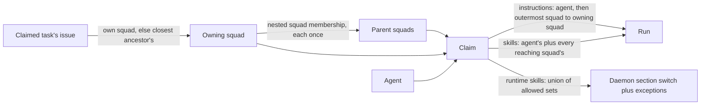

# ADR-0034: Squads reach every run on their issues, and a runtime skill any reaching policy allows is allowed

- Status: accepted
- Date: 2026-10-20

## At a glance

|Kind|Name|Change|Path|
|---|---|---|---|
|Query|`ListIssueContributingSquads`|new, the squads reaching an issue, outermost first|`server/pkg/db/queries/squad.sql`|
|Query|`ListAgentSkills`, `ListAgentSkillsByIDs`|take the reaching squads' ids and add their enabled skills|`server/pkg/db/queries/skill.sql`|
|Claim|squad reach|resolved once in the shared claim builder, for single and batch claims|`server/internal/handler/squad_reach.go`, `server/internal/handler/daemon.go`|
|Skill bundle resolve|squad skills|authorized for the run like the agent's own|`server/internal/handler/daemon.go`|

## Context

Squads now carry assigned workspace skills and a runtime skill policy of their own (WORK-1958). Squad instructions reached only the squad leader, inside the leader briefing, so a worker on a sub-issue never saw the rules of the squad that owns the work. Squads nest through `squad_member` rows of type `squad`, so one squad can sit inside several parents. The claim sends an agent's runtime skill policy as one section switch plus exceptions (ADR-0033), and the daemon expands that against the runtime's skill listing at run start.

## Decision

- The squads reaching a run are the owning squad and every squad above it. The owning squad is the live squad assigned to the task's issue or, when the issue has none, to its closest ancestor issue. Every live squad holding the owning squad through nested membership, at any depth, also reaches the run, each once however many paths lead to it. The walk stays in the claimed workspace, skips archived squads, and stays finite on a malformed issue cycle or membership loop.
- Runs without an issue, such as quick-create and release runs, are reached by no squad and stay as they were.
- The order is outermost first: a squad sorts by its longest membership path down to the owning squad, so every parent comes before the squads it holds, and the owning squad comes last.
- Each reaching squad's user instructions are appended after the agent's instructions under `## Squad Instructions (<squad>)`, in that order, so the most specific rule reads last. The squad leader keeps the operating protocol and roster in its briefing. The briefing leaves out the instructions of a squad that already reaches the issue, so the leader reads them once.
- A reaching squad's enabled workspace skills join the agent's, each skill once, on both the full-content and the reference claim paths. The skill bundle resolve request authorizes them for that run, and a squad that does not reach the run authorizes nothing.
- A runtime skill is allowed when the agent's policy or any reaching squad's policy allows it, on the claimed runtime and provider. The claim sends that union in the section switch plus exceptions form the daemon already expands: on as soon as one policy is on, keeping out only the skills every on policy keeps out and no off policy takes; otherwise off, taking every skill any policy takes. Exceptions stored for another runtime or provider never count.

## Consequences

- Assigning a squad to an issue changes what every run on it and its sub-issues gets from the next claim, with no change to the agents.
- A squad cannot take a skill away from an agent: adding a squad only widens what a run may use.
- A skill installed on the runtime later follows the combined section switch, as it does for an agent alone.
- The claim and the bundle resolve request each run one recursive query over the issue chain and squad membership.
