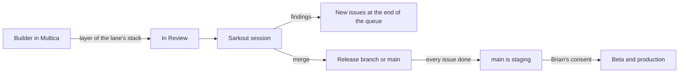

# ADR-0036: Sarkout reviews from outside Multica

- Status: accepted
- Date: 2026-10-21

## At a glance

## Context

Sarkout, the verifier, ran as a Multica agent. He reviewed each release pull request in rounds with its fixes made on that pull request. So he reviewed the same large pieces of code several times for small changes. Brian decided on 2026-10-21 that Multica only builds and that Sarkout reviews afterwards from outside Multica.

## Decision

- Multica builds. A builder delivers the function with its unit tests and the project's lint and type checks. Then it opens the issue's pull request, sets the issue to In Review and starts its next issue. A builder never merges.
- The issues of a lane form one GitHub stacked pull request. Each issue is a layer on the layer below it. The bottom layer targets the release branch, or `main` for an issue in no release. Building never waits for a review.
- Sarkout is no Multica agent. He works in omp sessions that Brian starts, each with the focus Brian gives it. He takes the In Review issues within that focus one by one.
- For each layer Sarkout runs the local cross-family review himself through the CLI of the other model family. One tester subagent checks in parallel that the function works. Each finding he agrees with becomes a new issue at the end of the queue in the same project, release and lane. That issue links the original issue and carries its dependencies. Sarkout fixes nothing.
- An issue never moves back. A reviewed layer may fail to merge because of a conflict or failing checks. Only then Sarkout starts one builder subagent that resolves just that conflict or check on the same branch. Then he runs the review and the tester again.
- Sarkout merges each reviewed layer and sets its issue to done. His comments go on the pull request so that no builder wakes. Once every issue of a release is done he merges the release branch into `main`. `main` is staging. Beta and production each need Brian's consent, as WORK-2006 builds it.
- A gate holds only its own lane. Sarkout asks Brian's pass with a Multica check to-do. Its link is a session task that holds all context to do the pass with an agent. A Pencil design opens in Pencil. Sarkout merges that work after Brian's Approve.
- The full check is no Multica task.

## Consequences

- Multica's agent list loses Sarkout. His instructions live in his office in `~/Repos/Agents/sarkout`.
- The full check task WORK-2022 and the fork's rule that assigns it to Sarkout go.
- In Review no longer gives the issue's creator a "Waiting for your review" to-do. Multica needs that change.
- GitHub's stacked pull requests replace the hand-made stack rules: the manual `--update-refs` rebase, the fast-forward pushes and the unused merge buttons. Stacks merge with the rebase method under the lock on `main`.
