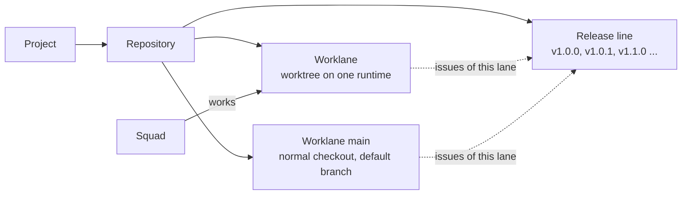

# Adding a repository, a worklane and a release

How the prototype's three creation flows work, built on what Multica and MadSpec actually do today. Where Multica has no data model yet, this is what we will have to build.

## What exists today

- **Repositories in Multica.** A workspace keeps a list of repositories, picked from the GitHub App installation or entered as a URL (`packages/views/settings/components/repositories-section.tsx`). A project links repositories as project resources (`server/migrations/065_project_resources.up.sql`): a GitHub repository with an optional base branch, or a local folder on one machine (an absolute path plus the runtime it lives on), chosen with the desktop folder picker and checked to be a git checkout (`project-resources-section.tsx`).
- **Worktrees in Multica.** The daemon makes a throwaway worktree per task or per issue, on a branch `agent/{agent}/{issue}`. There are no long-lived worktrees and no worklanes (`server/internal/daemon/execenv/local_worktree.go`).
- **Lanes in MadSpec.** A lane belongs to a team and has a Folder, its Repositories and an Order. Lane `main` works in the repository's normal checkout under `~/Repos` and holds planning and releases. Every other lane has one worktree per repository at `~/Worktrees/{team}/{lane folder}/{repo}`, which keeps the branch of the lane's active item. After a merge it switches to the next item's branch, cut from the freshly fetched default branch, but only when nothing in it would be lost (`madspec-git` "Core Rule", `lane_worktree.py`).
- **Releases in MadSpec.** A release is a version of a product. Its version comes from the repository's version policy. It is cut after the work has merged, or at the end of a cycle for teams that work in cycles, and then gets its issues, a release note, a changelog, a git tag and a GitHub release (`madspec-releases`). Nothing is planned ahead, and Multica has no releases at all.

## The model

- **Repository** (in one project): a GitHub repository (`owner/name`, default branch), its checkout on a runtime (machine plus path), and its version policy: where the version lives (for example `pubspec.yaml`, `package.json` or tags only) and the tag pattern (`v{version}`). Adding a repository adds its worklane `main` at the same time.
- **Worklane** (in one repository): a name, a folder, the runtime its worktree lives on, the squad that works it, and an order. Its worktree path follows from these: `~/Worktrees/{project key}/{folder}/{repo}`. Its state follows from its line: Busy with the active issue's branch, or Free. A worklane without a worktree does not exist, so creating a worklane creates its worktree.
- **Release** (in one repository): a version, a title, a description and its issues. Each worklane's timeline shows the repository's releases with that lane's issues in them, each under its version, title and description. The squad board's next releases and an issue's release card show the title too. The version is the repository's because a repository has one tag sequence, and a release is cut from the default branch with everything merged into it, whichever lane did the work. A planned release's version comes from its bump (patch, minor or major) after the release before it, or is set by hand; a version set by hand is marked "Set by hand" on the timeline.
- **Issue**: has at most one worklane and at most one release, and the release must belong to that worklane's repository.

## Add repository

Opened from a project's "Add repository" button. It is a dialog, not an inline field.

1. **Repository**: a searchable list of the repositories the GitHub App can see, each showing `owner/name`, Private or Public, and its default branch. A repository already in another project shows which one it is in and cannot be picked; there is no URL field to type into. If the repository is missing, a "Give Multica access on GitHub" link opens the GitHub App installation.
2. **Checkout**: the runtime (for example "Brian's Mac · online") and the path to its normal checkout. The path is filled in with `~/Repos/{name}` when that folder exists, and can be changed with the folder picker. It is checked to be a git checkout whose `origin` is this repository and that sits on its default branch. If the folder does not exist, "Clone it there" clones the repository into it.
3. **Releases**: the version policy Multica found, for example "Version in `pubspec.yaml` · tags `v{version}` · last tag v1.0.0". It can be changed to "Tags only" or "This repository does not release".
4. **Add repository** creates the repository with worklane `main` on its checkout. The project page then shows the new repository open, with `main` Free.

The button stays disabled until the repository is picked and the checkout is valid. Each check failure is shown under the field it belongs to, with how to fix it.

## New worklane

Opened from a repository's "+ Worklane" button. It is a dialog.

1. **Name**: for example "Fan app". The folder is filled in from it (`fan-app`) and can be edited: one folder name, unique among the project's worklanes.
2. **Squad**: the squad that works the worklane, for example Frontend.
3. **Runtime**: the machine the worktree lives on; only online runtimes that can make worktrees are offered.
4. **Worktree** (read only, follows from the fields above): `~/Worktrees/rebl/fan-app/rebl`, branched from `origin/main`, with the repository's install command (for example `pnpm install`).
5. **Create worklane** shows each step as it runs on the runtime: fetching `origin/main`, adding the worktree, installing dependencies. When it is done, the worklane opens on its empty timeline, with state Free. If a step fails, the error stays in the dialog with "Try again", and no worklane is saved.

Brian's yes is the click, and it is recorded on the worklane's activity.

## Plan release

Opened from a worklane timeline's "Plan release" button, at the end of the timeline. It is a dialog.

1. **Version**: Patch, Minor or Major, each showing the version it gives after the repository's last planned release (for example v1.0.2, v1.1.0 or v2.0.0), or Custom, which opens a field to type the version by hand. Patch is preselected. A version set by hand must be higher than the release before it; when it is not, the field turns red with "Must be higher than v1.0.1 Membership hardening, the release before it." and the button stays disabled.
2. **Title**: a short name for the release, for example "Account and profile". Required.
3. **Description**: what the release brings, in a few sentences. Optional.
4. **Issues**: this worklane's issues that are in no release yet, with their type icon, ID, title and status, to tick. Issues can also be added later from the timeline.
5. **Ships**: a read-only line about what happens when it ships. When all its issues are done and merged, Multica tags `v1.1.0` on `main`, writes the release note, publishes the GitHub release, and asks you to pass it. A release has no date until it ships.
6. **Plan release** adds the release to the end of the repository's release line. On this worklane's timeline it appears in place with the chosen issues, and on the other worklanes of the repository it appears empty.

The button stays disabled until the release has a title and a valid version.

## Edit and move a release

Each release on a worklane's timeline has a menu: Add issue to release, Edit release, Move earlier and Move later.

1. **Edit release** opens the same dialog as Plan release, filled in, with "Save release". Version, title and description can be changed. Setting a version by hand shows which later releases renumber, for example "Later releases renumber: v1.2.0 → v1.3.0, v1.3.0 → v1.4.0." Choosing Patch, Minor or Major again drops the version set by hand.
2. **A shipped release** keeps its version: it shows read only with "Shipped: its tag is fixed." Its title and description can still change, here and on the GitHub release; the tag stays. No issue can be added to it: "Add issue to release" is disabled with "Shipped: add it to a later release", and New issue shows it disabled as "Shipped".
3. **Move earlier** and **Move later** swap the release with its neighbour on the repository's release line. Releases with a computed version renumber to their new place; a release set by hand keeps its number. Each issue follows its release to the new number.
4. **A move or edit that breaks the line is refused.** The menu item is disabled with its reason: "It is the first release", "It is the last release", "The release before it has shipped" or "Shipped: its tag is fixed". When a release set by hand would end up not higher than the release before it, the move is disabled and Save stays disabled, naming both releases, for example "Then v1.5.0 Event push is not higher than v1.6.0 Agenda and publication, the release before it."

## Decisions

1. **Releases belong to the repository.** A repository has one version line and one tag sequence. Each worklane's timeline shows the repository's releases with that lane's issues in them.
2. **A planned release keeps its bump, and its number follows its place, unless it is set by hand.** If a planned release is moved before another, the computed versions renumber; for example v1.1.0 and v1.0.2 swap. A version set by hand keeps its number when releases move, and must stay higher than the release before it. Every number becomes fixed once its release ships.
