# Client access - UX design

A client contact, such as Nasir of IVGA Vastgoed, gets a read-only account. A client belongs to one or more organisations. Staff invite the contact for their organisations and put a client wait on their name. The client reads their own waits and the planned work of their organisations. Brian sees what waits on each client and what work can still go ahead. The screens are in `client-access.pen`, built from the components of `../systems/multica.lib.pen`.

## At a glance

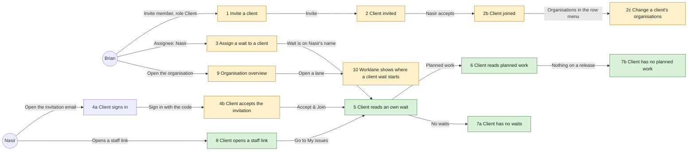

Screen 4a is today's sign-in, unchanged.

| 1 Invite a client | 2 Client invited |
|---|---|
| 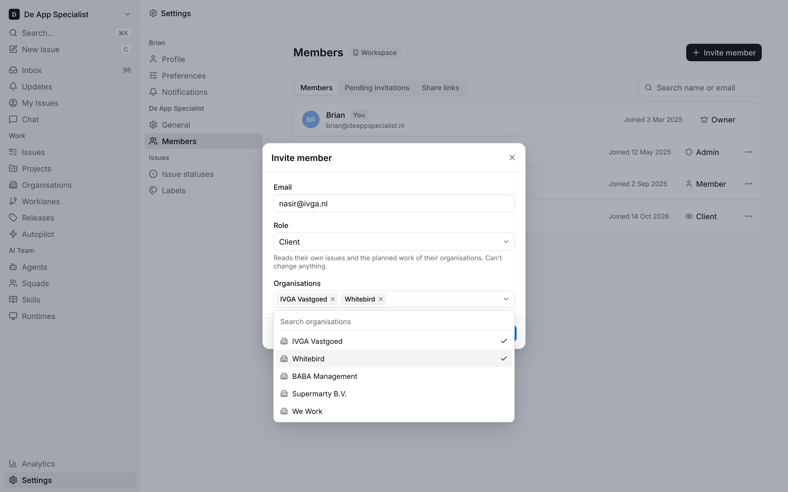 | 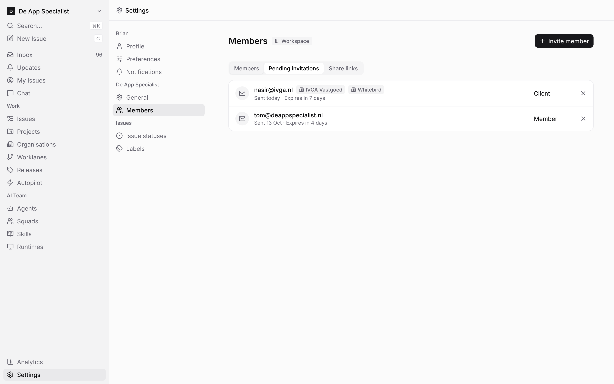 |
| **2b Client joined** | **2c Change a client's organisations** |
| 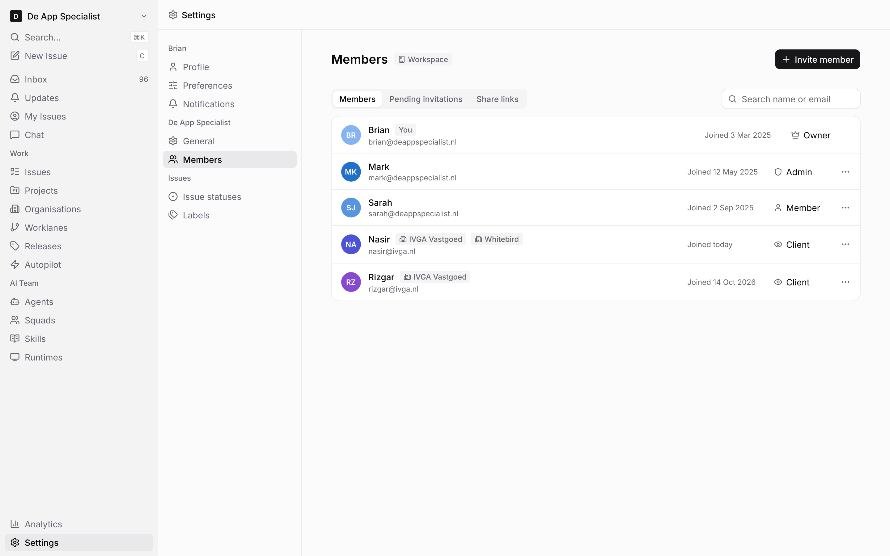 | 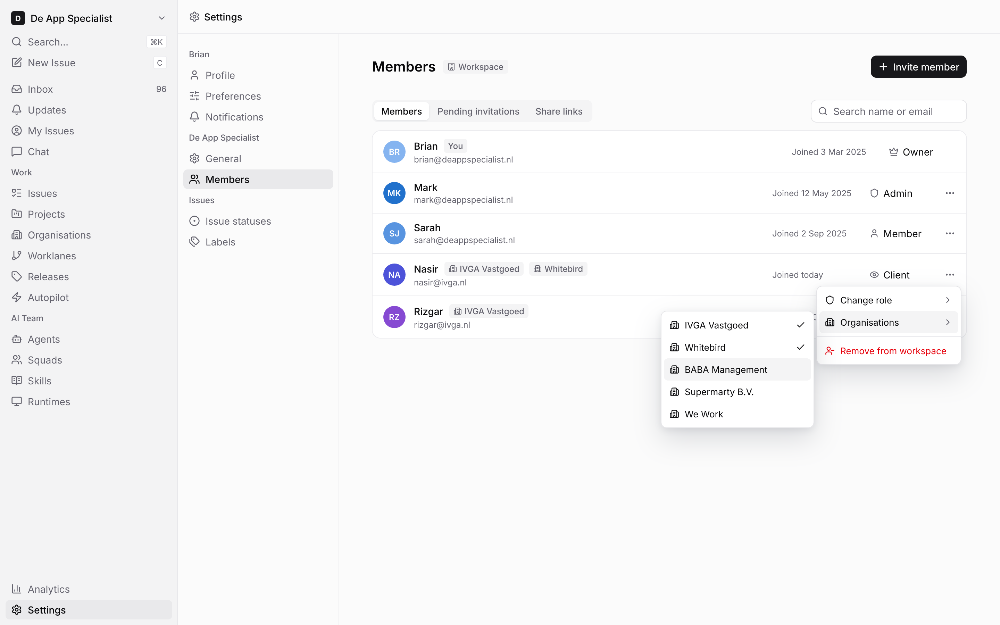 |
| **3 Assign a wait to a client** | **4a Client signs in** |
| 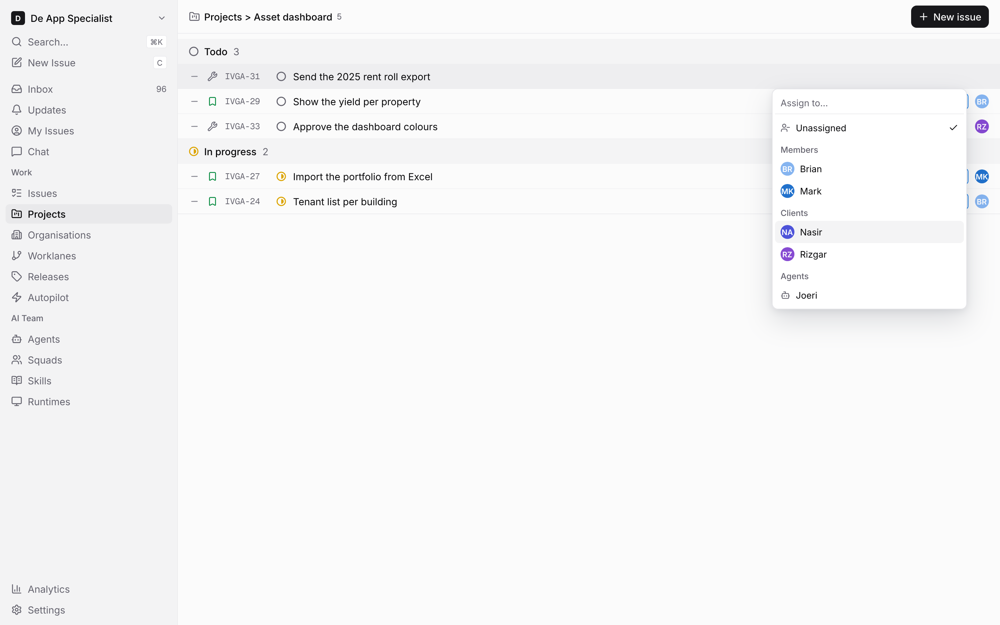 | 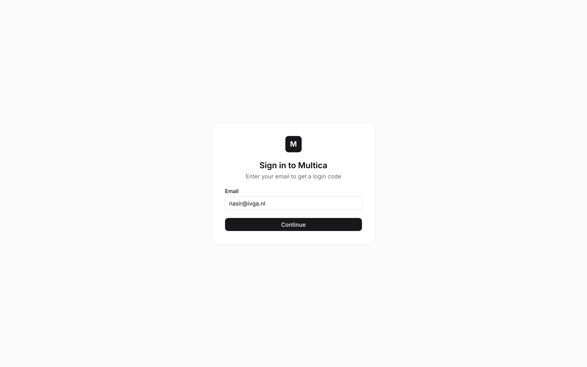 |
| **4b Client accepts the invitation** | **5 Client reads an own wait** |
| 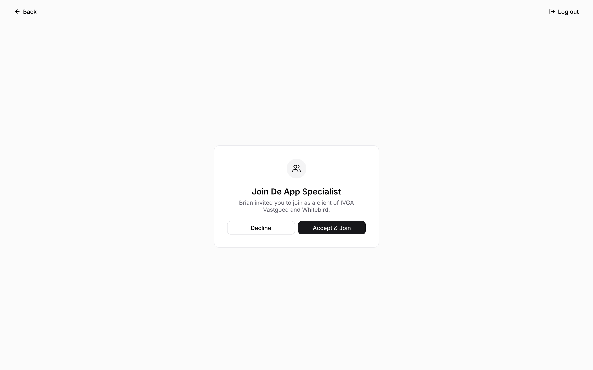 | 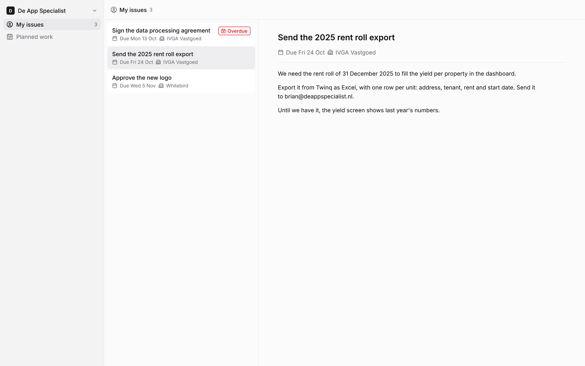 |
| **6 Client reads planned work** | **7a Client has no waits** |
| 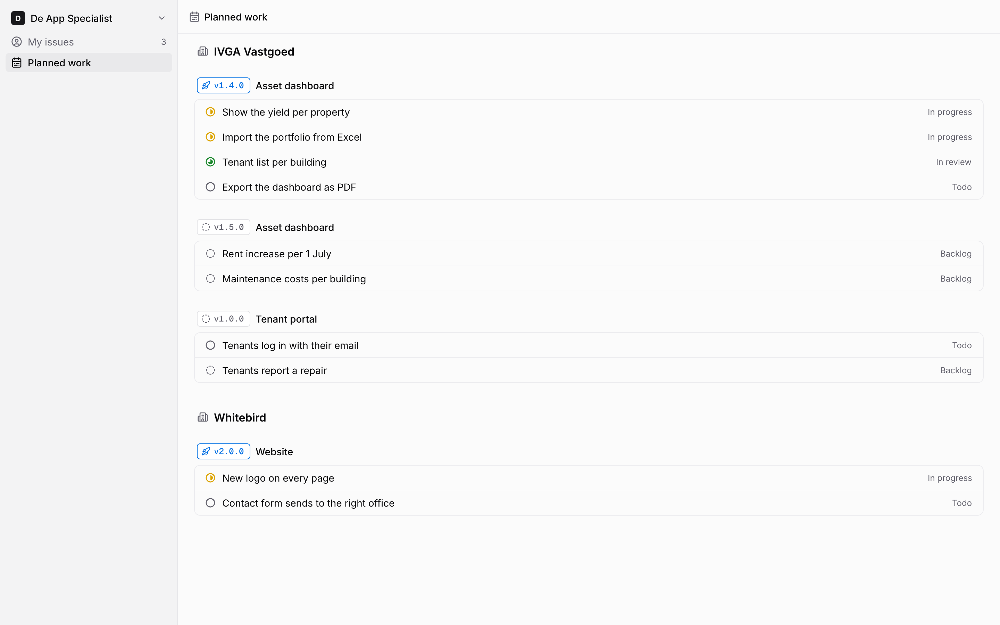 | 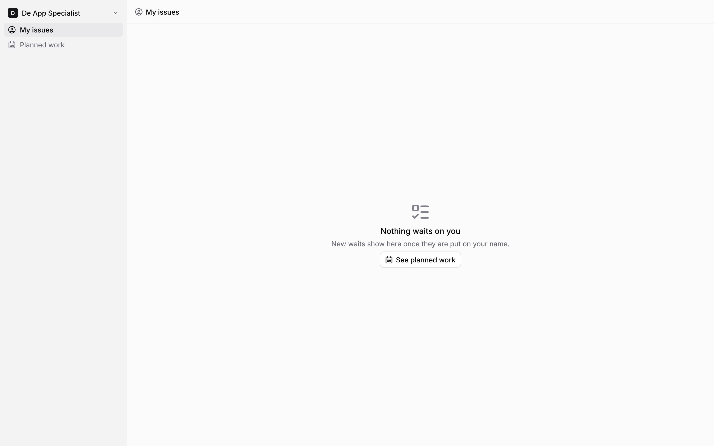 |
| **7b Client has no planned work** | **8 Client opens a staff link** |
| 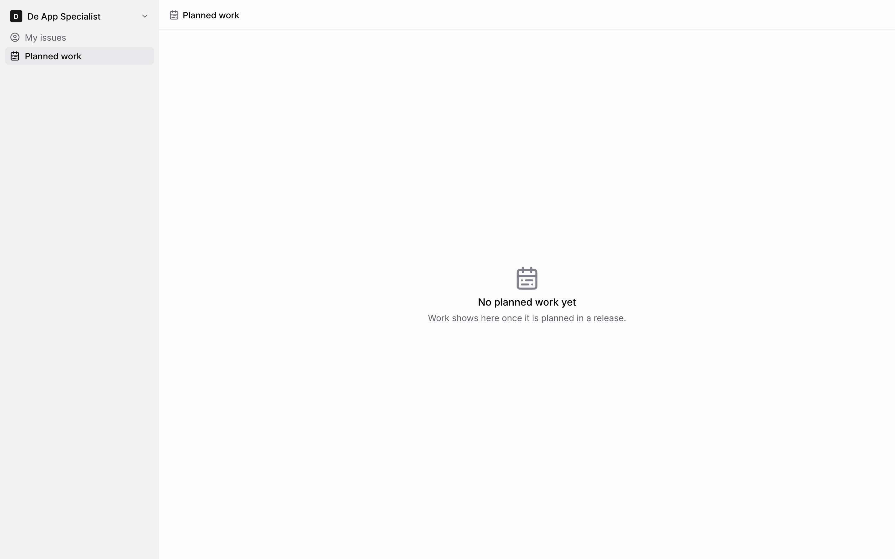 | 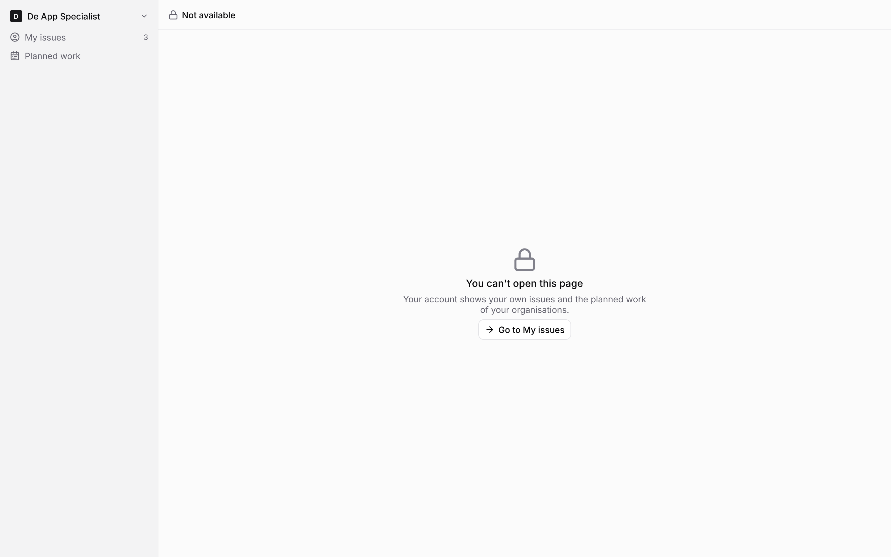 |
| **9 Organisation overview** | **10 Worklane shows where a client wait starts** |
| 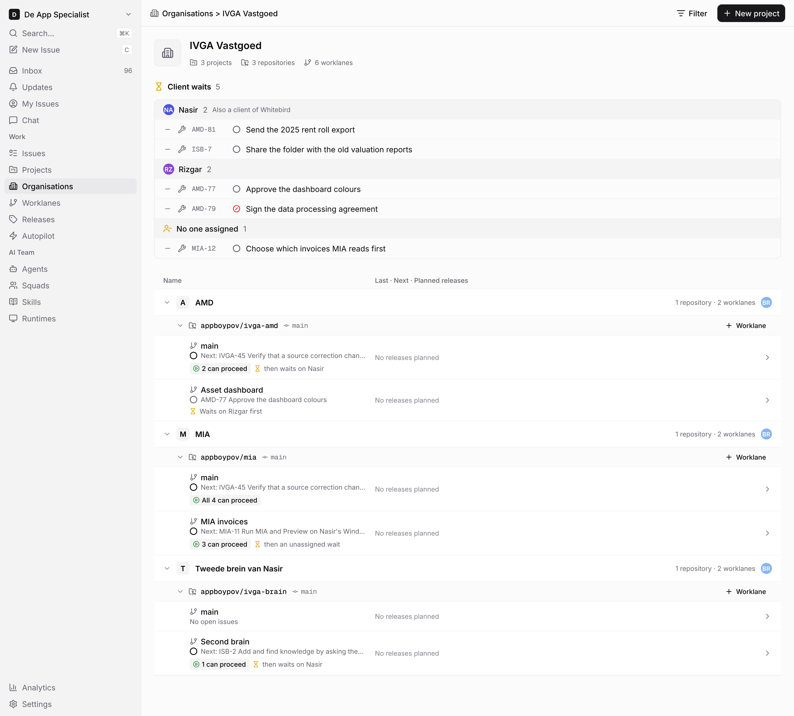 | 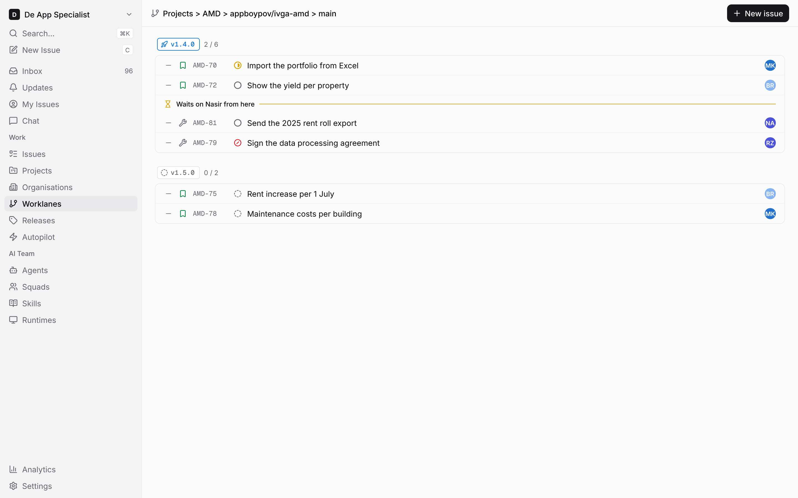 |

| Wait row: default | Wait row: selected |
|---|---|
|  |  |
| **Planned row** | **Lane cut** |
| 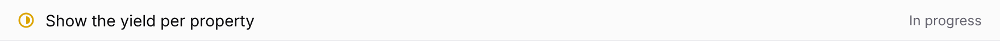 | 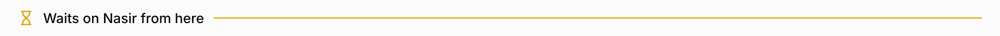 |
| **Empty state** | **Chip** |
| 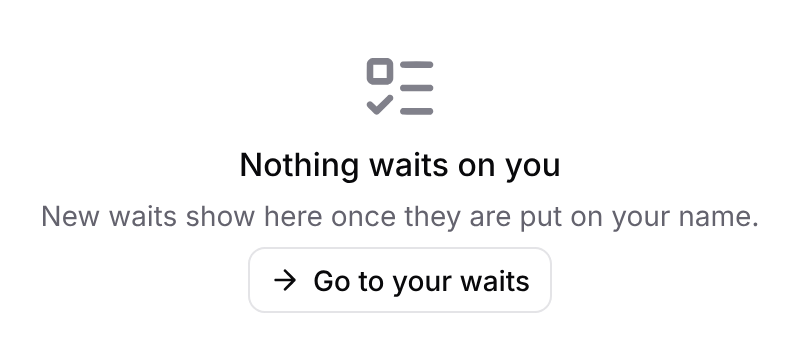 |  |
| **Multi select** | **Worklane row** |
| 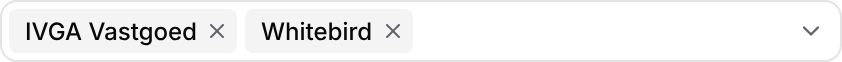 | 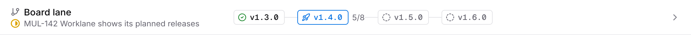 |

| Kind | Name | Change | Path |
|---|---|---|---|
| Design | Screens of client access and the staff overview, 14 frames | new | `designs/screens/client-access.pen` |
| Design | One PNG per screen | new | `designs/screens/exports/client-*.png` |
| UX spec | Client access | new | `designs/screens/client-access.md` |
| Component | Wait row (Default, Selected) with organisation, Planned row, Lane cut, Empty state, Chip, Multi select | new | `designs/systems/multica.lib.pen` |
| Component | Worklane row: Client wait row, off by default | changed | `designs/systems/multica.lib.pen` |
| Design | PNG of each client access component and the component sheet | new | `designs/systems/exports/client-*.png` |

No token or colour is added.

## Staff: invite and members (screens 1, 2, 2b, 2c)

- **Invite member** keeps its dialog. **Role** gets a fourth option, **Client**, with its permission under the field: "Reads their own issues and the planned work of their organisations. Can't change anything."
- With **Client** chosen, an **Organisations** field follows: a multi select with one chip per organisation and a searchable list of the workspace's organisations. A client needs at least one organisation; the field is absent for the other roles.
- A pending client invitation and a client member show each of their organisations as a badge (`building-2`) after the email or name. The role reads **Client** with an `eye` icon.
- A client member's row menu gets **Organisations**, a submenu next to **Change role**, with every organisation of the workspace and a check on the client's own. Picking one adds or removes it at once, as **Change role** does. The last organisation can't be removed.

## Staff: assign a wait (screen 3)

- The assignee picker gets a **Clients** group between Members and Agents. It lists only the clients of the issue's organisation, whatever other organisations they also belong to.
- A client wait is an ordinary issue assigned to the client. The client's name is the assignee; the title does not repeat it.

## Client: sign in and join (screens 4a, 4b)

- Sign-in is today's email and code flow.
- The invitation page names every organisation: "Brian invited you to join as a client of IVGA Vastgoed and Whitebird." **Accept & Join** opens My issues.

## Client: navigation

The client's sidebar holds only **My issues** (with the number of open waits) and **Planned work**. The workspace switcher stays for sign-out. No search, new issue, inbox, chat, settings or keyboard shortcuts.

## Client: My issues (screen 5)

The client's own open waits from all their organisations, in one list, oldest due date first.

| Part | What it shows |
|---|---|
| Row | Title, due date, organisation, and **Overdue** (`Badge/Destructive`) once the due date has passed. |
| Detail | Title, due date, organisation and description. |

No status, key, comments, Points, runs, properties or actions.

## Client: Planned work (screen 6)

The issues on a release in the projects of the client's organisations, grouped by organisation, then by release, each release group named by its release chip and project.

| Part | What it shows |
|---|---|
| Row | Status icon, title and status. |

Rows do not open. Work without a release does not show.

## Client: empty and refused (screens 7a, 7b, 8)

- **No waits:** "Nothing waits on you", with **See planned work**.
- **No planned work:** "No planned work yet", "Work shows here once it is planned in a release."
- **Any other link**, such as a staff issue URL: "You can't open this page", "Your account shows your own issues and the planned work of your organisations.", with **Go to My issues**. The page shows nothing of what the link points to.

## Staff: organisation overview (screen 9)

The organisation page gets a **Client waits** section above its projects.

- Grouped by person: avatar, name and number of open waits in this organisation, then one issue row per wait. A client who also belongs to other organisations shows "Also a client of Whitebird" after the number; their waits there show only on those organisations' pages.
- Waits with no assignee group under **No one assigned**, with a `user-minus` icon in `warning`.
- Each lane row gets one line under its next issue:
  - **2 can proceed** then "then waits on Nasir": open work before the lane's first open wait, and who it waits on.
  - "Waits on Rizgar first": the lane's next open issue is the wait.
  - **All 4 can proceed**: no open wait in the lane.
  - "then an unassigned wait": the first wait has no assignee.
  - **No open issues**: an empty lane has no next-issue status, proceed count or wait line.

The Worklanes page shows the same line on its lane rows.

## Staff: worklane (screen 10)

In the lane's ordered issue list, a **Lane cut** line, "Waits on Nasir from here", sits right above the first open wait. Issues above it can proceed. Screen 10 has two open waits: AMD-81 for Nasir, followed by AMD-79 for Rizgar. The cut stays before AMD-81.
