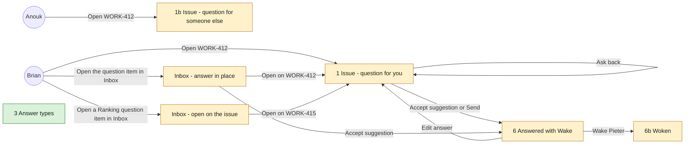
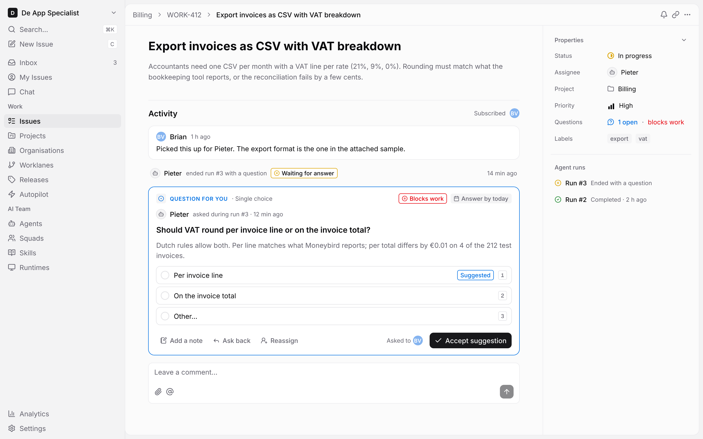
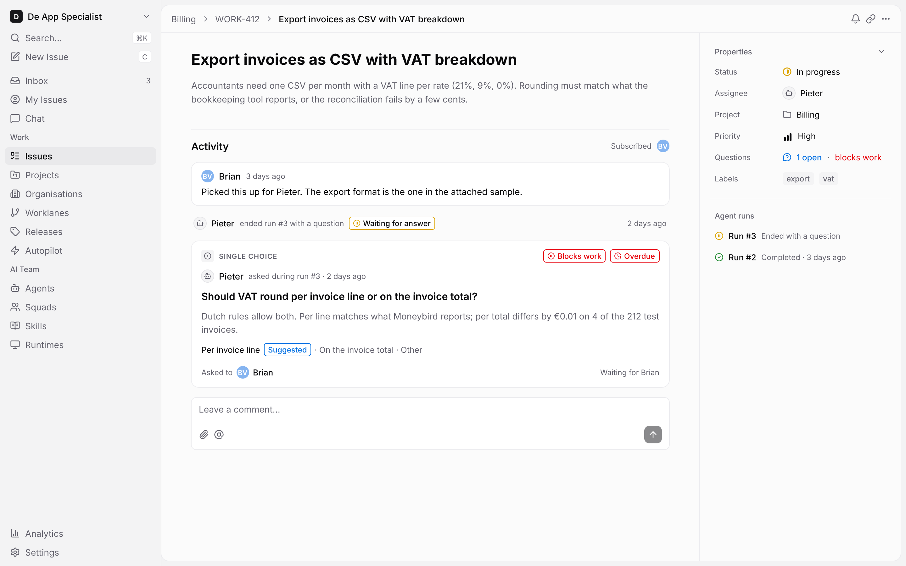
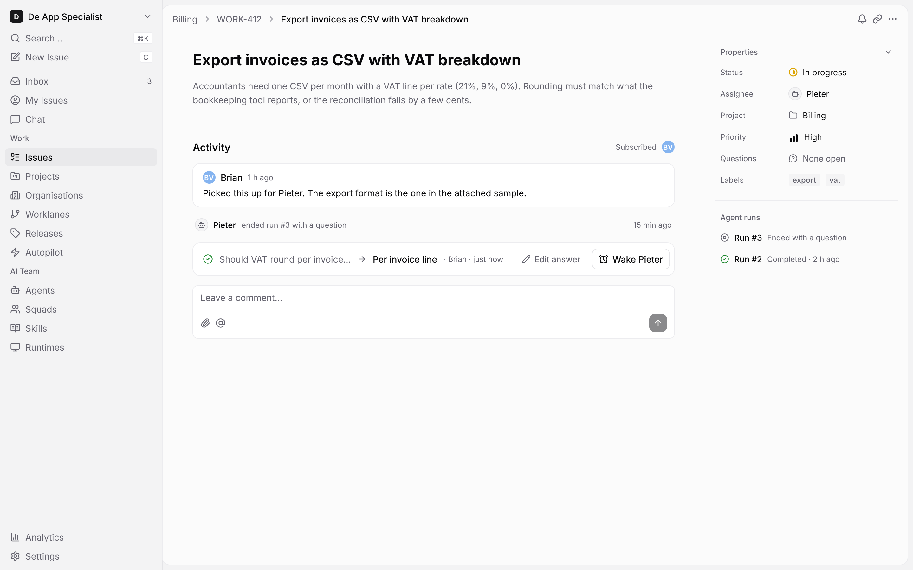
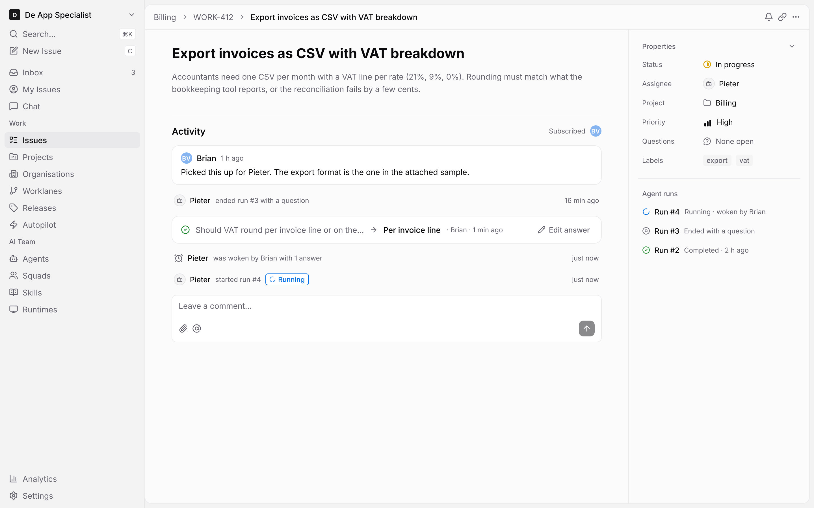
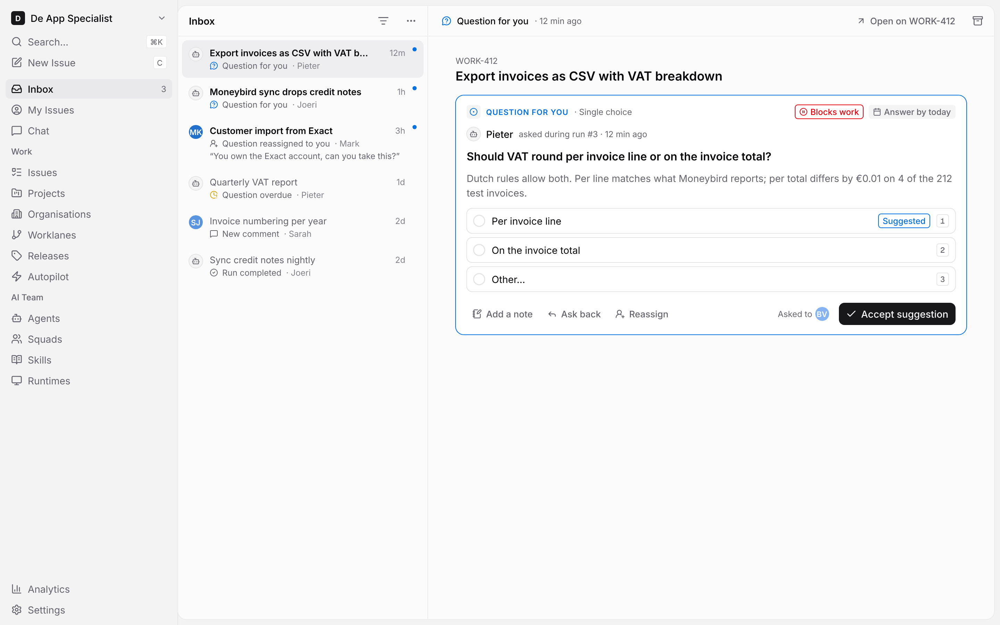
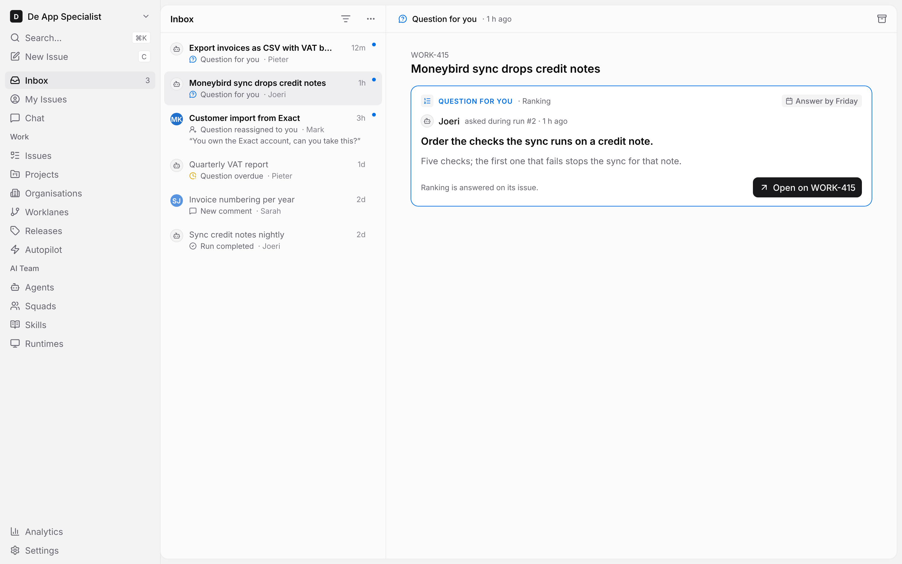
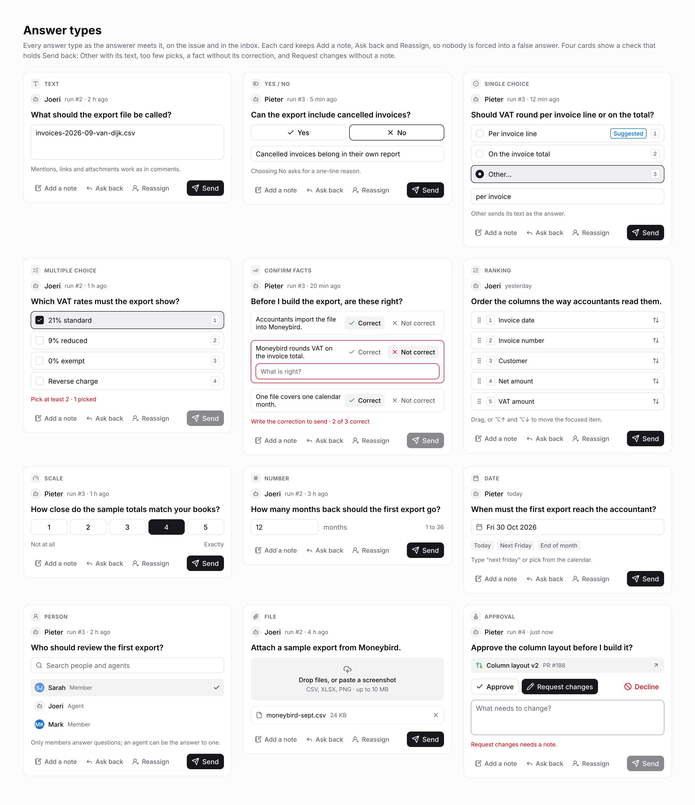

# Issue questions - UX design

The screens of journey UJ-1 "Answer an agent's question and wake it", change `answer-an-agents-question-and-wake-it`. An agent asks a person a question during a run; the person answers on the issue or in the inbox; the answer reaches the agent at once, and nothing runs until a person presses **Wake**. The screens are in `issue-questions.pen`, built only from the components of `../systems/multica.lib.pen`.

## At a glance

Screen 3 is not a step: it is the reference sheet of the card's body per answer type. The card on screens 1, 1b and the inbox shows the body of its own type from that sheet; a Ranking question opened from the inbox (`IN2`) lands on its issue with the Ranking body.

| 1 Issue - question for you | 1b Issue - question for someone else |
|---|---|
|  |  |
| **6 Answered with Wake** | **6b Woken** |
|  |  |
| **Inbox - answer in place** | **Inbox - open on the issue** |
|  |  |

**3 Answer types**

| Kind | Name | Change | Path |
|---|---|---|---|
| Design | Screens of UJ-1, 7 frames | new | `designs/screens/issue-questions.pen` |
| Design | One PNG per screen | new | `designs/screens/exports/` |
| UX spec | This document | new | `designs/screens/issue-questions.md` |
| Screen | Issue detail: question card, run row, Questions row, wake row | changed | `packages/views/issues/components/` |
| Screen | Inbox: question item types and the detail pane's card | changed | `packages/views/inbox/components/` |

No library component, token or colour is added: every screen uses the components J5 put in `multica.lib.pen`. Out of these screens: the composer's Question toggle, the screens to ask a question (2a, 2b) and the `question_answered` inbox item, which Brian's answers on WORK-366 removed; and #6's question sets, Questions page and questions setting, which this change's specs do not name.

## The question card

A question shows as a card in the issue's activity timeline, at the place it was asked.

| Part | What it shows |
|---|---|
| Overline | For an answerer: `TypeIcon` with its icon in `brand`, **QUESTION FOR YOU** in `brand`, then the type name. For anyone else: `TypeIcon` in `muted-foreground` and the type name. Right side: **Blocks work** (`Badge/Destructive`) when set, the due date (`Badge`), or **Overdue** (`Badge/Destructive`) once an open question passes it. |
| Asker | The agent's avatar and name, "asked during run #3" and the age. Only agents ask. |
| Prompt and context | The prompt in `text-title-sm` 600; the context line in `muted-foreground`. |
| Body | The control of its answer type, as "Answer types" below. |
| Footer | **Add a note**, **Ask back** and **Reassign** (`Button/Ghost/Small`), then "Asked to" with the answerers, then the primary action. |

States:

- **Open, for you** (screen 1): outlined in `brand`, with controls. While nothing is picked or typed and the asker gave a suggestion, the primary action is **Accept suggestion**, which sends the suggested answer; once something is picked or typed it is **Send**.
- **Open, for someone else** (screen 1b): outlined in `border`, without the overline and without controls; the options read as one line and the footer says who it waits for.
- **Answered** (screen 6): folds to one line: prompt (truncated) → answer · who · when, with **Edit answer**. Once the asking agent has an answer it has not seen, the line ends with **Wake Pieter**, named after the agent.
- **Woken** (screen 6b): the folded line keeps **Edit answer** but no **Wake**, until a new answer arrives.
- **Closed**: the folded line without **Edit answer**.

**Ask back** replies in the question's thread and keeps the question open; **Reassign** hands it to another member with a note.

## Answer types

Every card keeps **Add a note**, **Ask back** and **Reassign** next to its control, so nobody is forced into a false answer. **Send** stays disabled (`Button/Primary` at 50%) while the answer breaks the asker's settings, and the line above the footer says why in `destructive`.

| Type | Icon | Settings the asker gives | A valid answer | Control | Keys |
|---|---|---|---|---|---|
| Text | `type` | short or long, placeholder | non-empty rich text, with mentions and attachments | `Textarea` | `⌘↵` sends |
| Yes / No | `toggle-left` | optional "why" on No | Yes, or No with its why when asked for | two `Button/Outline`; No opens an `Input` for the reason | `Y` `N` |
| Single choice | `circle-dot` | options, optional suggested one, optional Other | one option, or Other with its text | `Option/Default` and `Option/Selected` with radios; Other opens an `Input`; the suggested option carries `Badge/Brand` "Suggested" | `1`-`9` |
| Multiple choice | `list-checks` | options, min and max | between min and max options | `Option` with `Checkbox/Checked` and `Checkbox/Unchecked` | `1`-`9` |
| Confirm facts | `check-check` | statements | each statement Correct, or Not correct with its correction | per statement **Correct** / **Not correct** (`Button/Ghost/Small`); Not correct opens `Input/Error` for the correction | |
| Ranking | `list-ordered` | items to order | every item in an order | rows with a grip, `Kbd` position and move icon | `⌥↑` `⌥↓` |
| Scale | `gauge` | range such as 1-5 or 0-10, end labels | one point in the range | one `Button/Outline` per point, the picked one `Button/Primary`, end labels below | |
| Number | `hash` | unit, min, max | a number from min to max | `Input` with the unit and the range | |
| Date | `calendar` | date, date and time, or range | a value of that kind | `Input` with calendar icon and `Badge` shortcuts | |
| Person | `user-round` | members, agents or both | one of the allowed people | search `Input` and a list of `Avatar/Member` and `Avatar/Agent` rows | |
| File | `paperclip` | accepted kinds | one or more files of those kinds | drop zone and file rows; a pasted screenshot counts | `⌘V` |
| Approval | `stamp` | what is to be approved, with a link | Approve, Request changes with a note, or Decline | link row, **Approve** (`Button/Outline`), **Request changes**, **Decline** (`Button/Ghost` in `destructive`); Request changes opens a `Textarea` for the note | |

Screen 3 shows the checks of the spec: Single choice with Other and its text "per invoice" (Send enabled), Multiple choice with min 2 and one pick ("Pick at least 2 · 1 picked"), Confirm facts with a Not correct fact without its correction, and Approval with Request changes and no note.

## Run row, wake row and Questions property

- **Run row.** The run of an agent that asked reads "ended run #3 with a question" and carries `Badge/Warning` "Waiting for answer" until the question is answered (screen 1); after the answer the badge is gone (screen 6).
- **Wake row.** Pressing **Wake Pieter** adds "Pieter was woken by Brian with 1 answer" to the timeline, then the new run's row with `Badge/Brand` "Running" (screen 6b). Sending, partly sending or editing an answer starts nothing.
- **Questions property.** After Priority: "1 open" in `brand` and "blocks work" in `destructive` while a question is open, "None open" after. Selecting the row scrolls the timeline to the first open card. The agent runs list mirrors the run row.

## Inbox

- An answerer gets an item when a question is asked of them ("Question for you"), reassigned to them ("Question reassigned to you", with the note as its second line) and when an open question of theirs passes its due date ("Question overdue", `warning` icon). There is no item for the asking agent.
- **Answer in place.** For Yes / No, Single choice and Approval the detail pane shows the card with its controls and the same rules; accepting or sending there folds the card on the issue (screen 6). The header's **Open on WORK-412** opens the issue at the card.
- **Other types.** The detail pane shows the card without controls, with "Ranking is answered on its issue." and **Open on WORK-415** as its primary action, which opens the issue at the card.
