# Steer all work screens (steer-all-work.pen)

Source: [steer-all-work.pen](file:///Users/codaveto/Repos/Forks/multica/designs/screens/steer-all-work.pen)

On GitHub: [designs/screens/steer-all-work.pen](https://github.com/appboypov/multica/blob/main/designs/screens/steer-all-work.pen), merged in [PR #7](https://github.com/appboypov/multica/pull/7) as `7c09e70ab`; [PR #10](https://github.com/appboypov/multica/pull/10) adds the Organisations, Worklanes and Releases screens and removes the squad board and the worklane's Squad field. Its creation flows and version rules: [designs/creation-flows.md](https://github.com/appboypov/multica/blob/main/designs/creation-flows.md). [PR #44](https://github.com/appboypov/multica/pull/44), open, changes screen 5 New issue: a Markdown toggle and a copy button replace the Fields / Markdown tabs, and the template note is gone.

## What it shows

Brian's approved "steer all work" design for the Multica fork, light mode only (PR #7, changed in [PR #10](https://github.com/appboypov/multica/pull/10)). Sixteen screens: Projects, a Project with its repositories and worklanes, a worklane's release timeline and its release actions, the Organisations page and an organisation's page with its projects, the Worklanes and Releases pages, a new issue from a template, and the flows to add a repository, make a worklane and plan or edit a release. Squads, Multica's groups of members and agents, are not part of it. It uses the components of [Multica component library (multica.lib.pen)](../systems/multica.lib.md).

## Screens

### 1 Projects

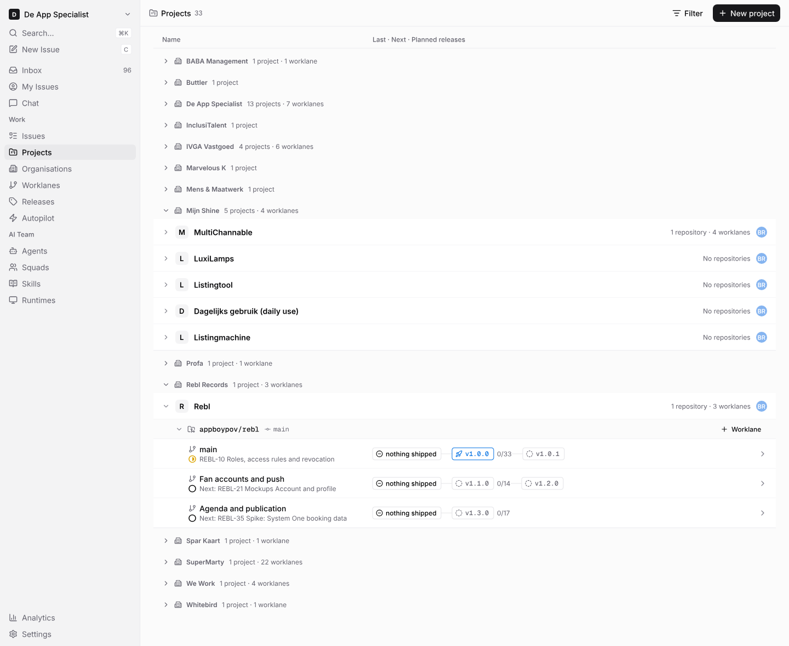

### 2 Project

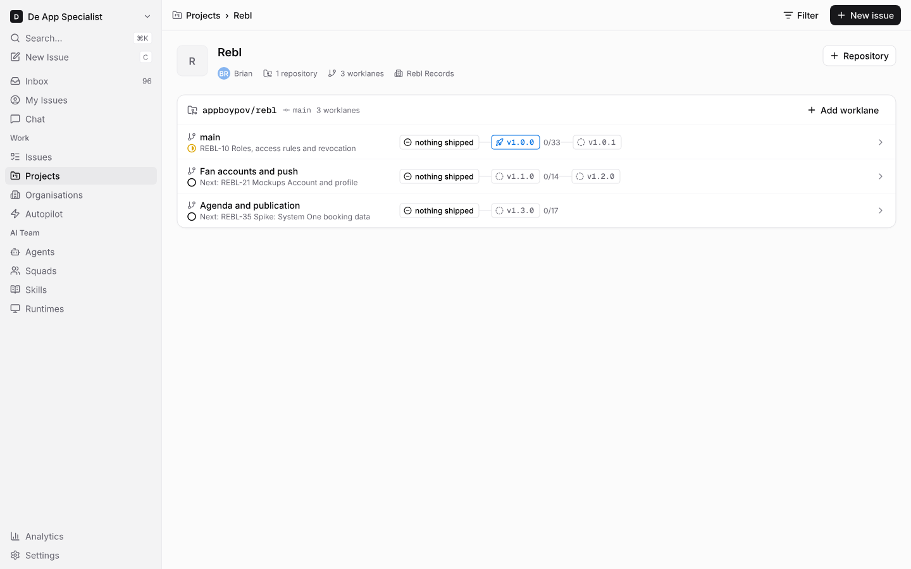

### 3 Worklane timeline

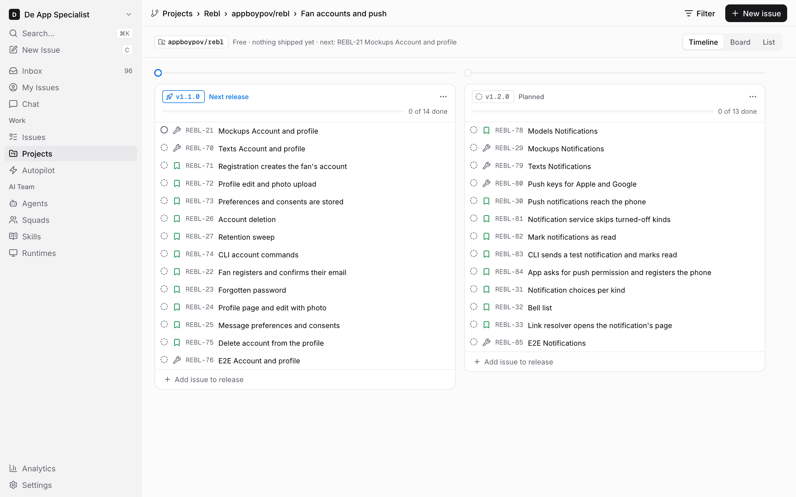

### 3b Release actions

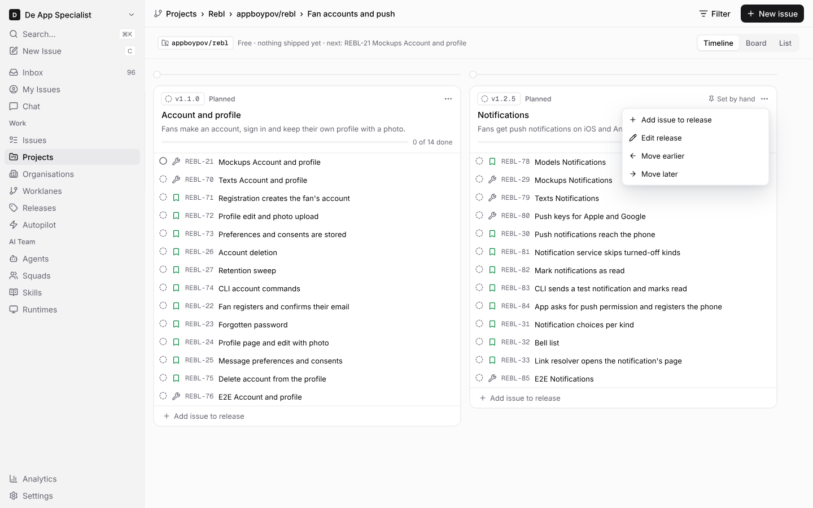

### 4 Organisations

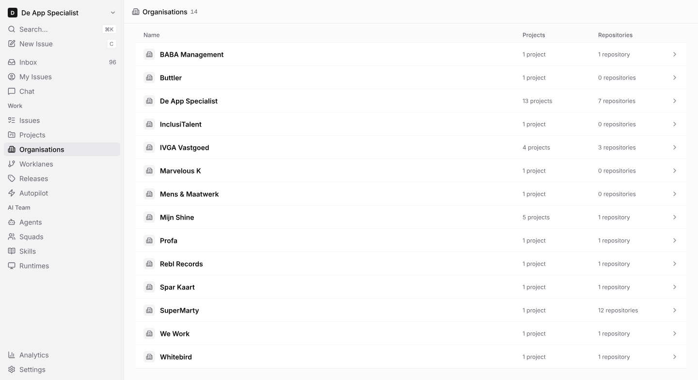

### 4b Organisation

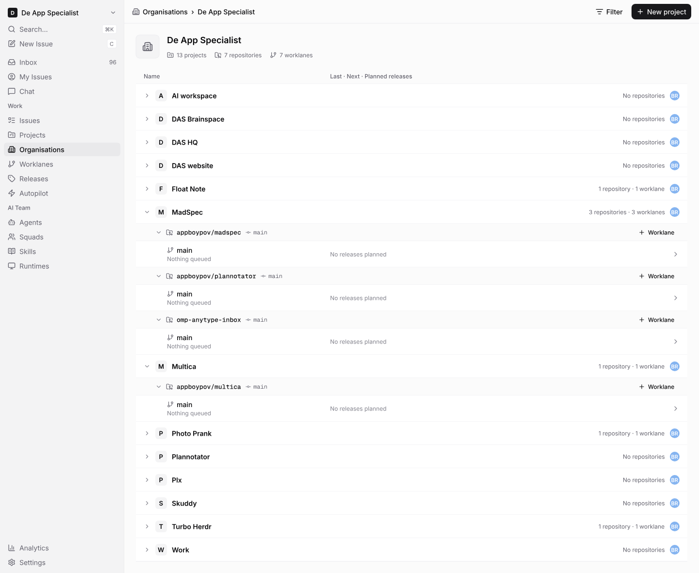

### 4c Worklanes

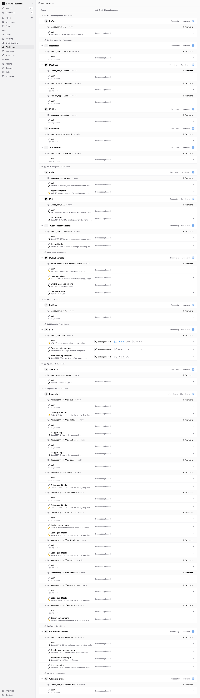

### 4d Releases

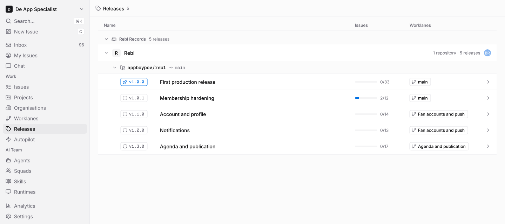

### 5 New issue from a template

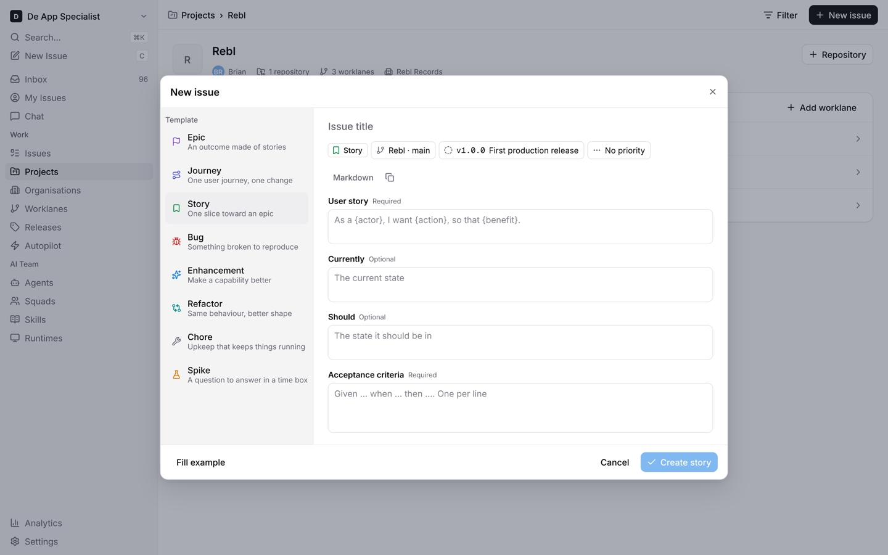

### 6 Add repository

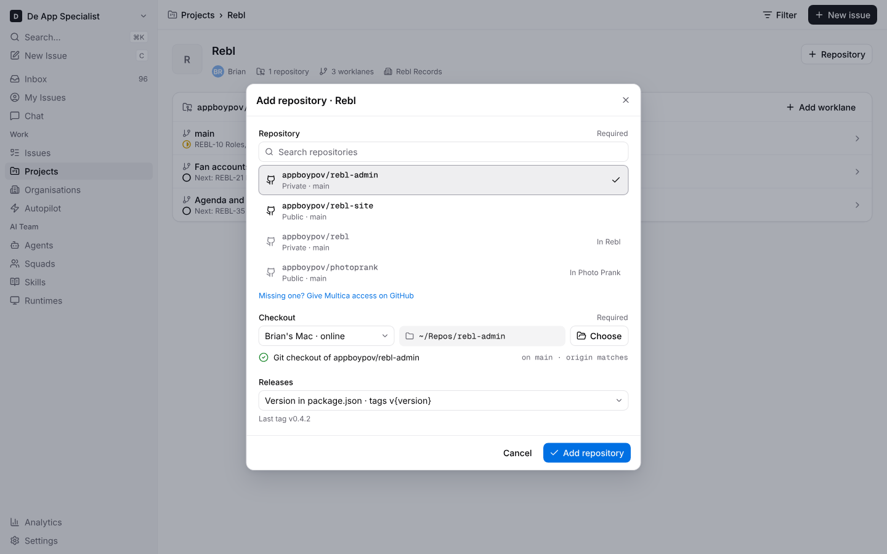

### 7 New worklane

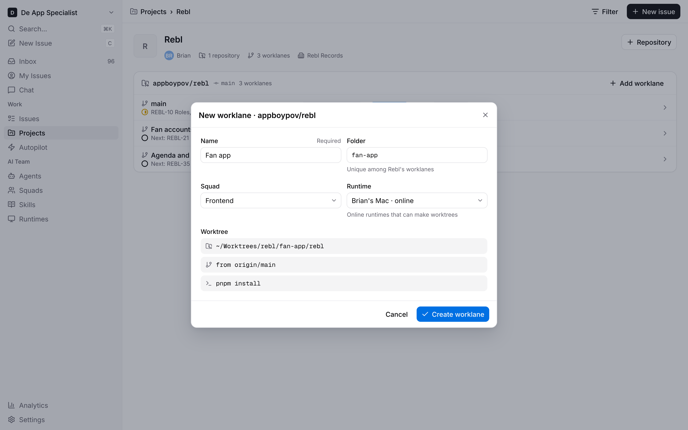

### 7b New worklane, creating

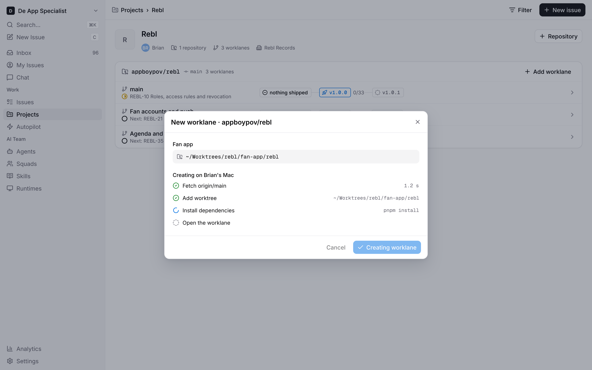

### 7c New worklane, failed

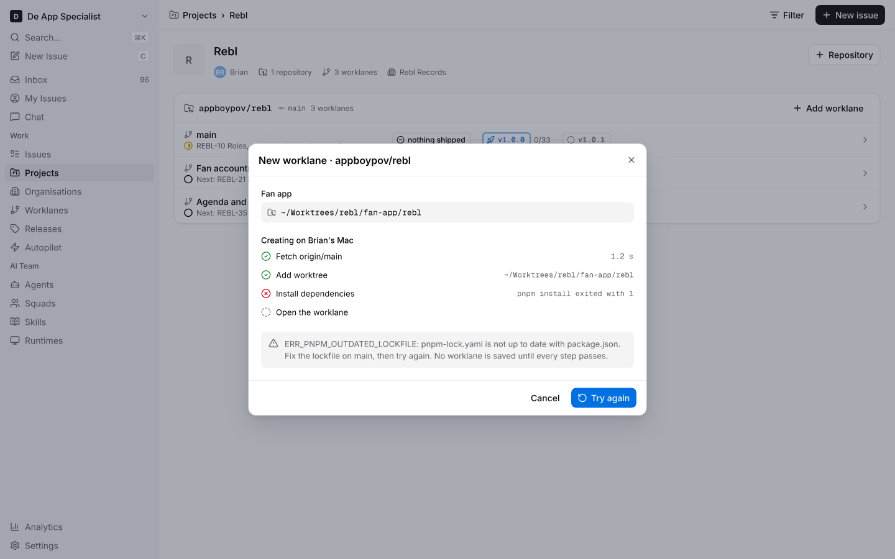

### 8 Plan release

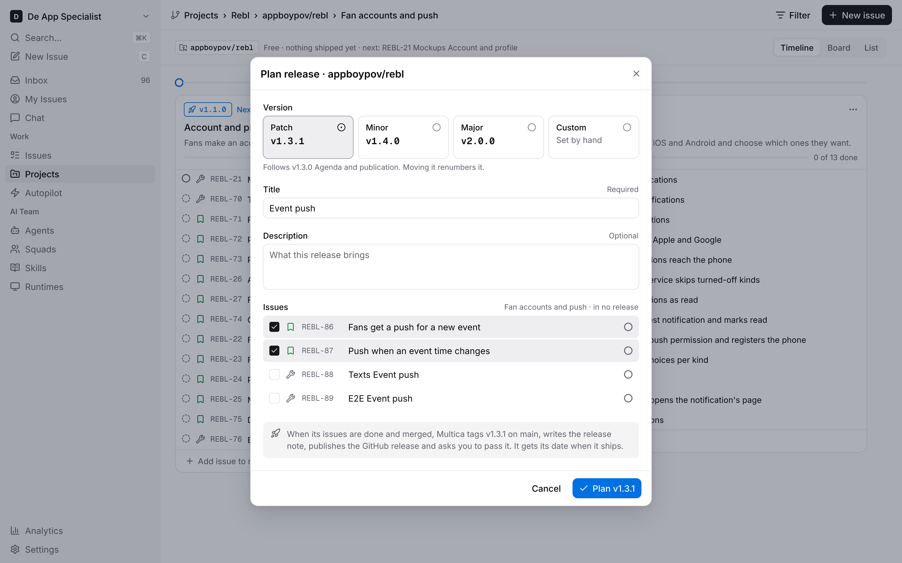

### 8b Edit release, version set by hand

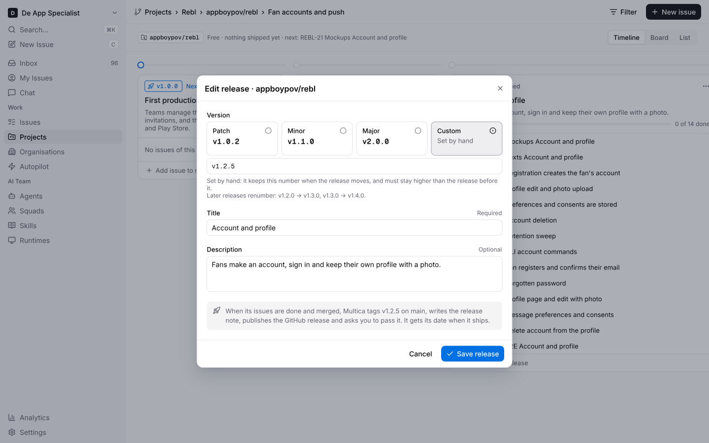

### 8c Edit release, version too low

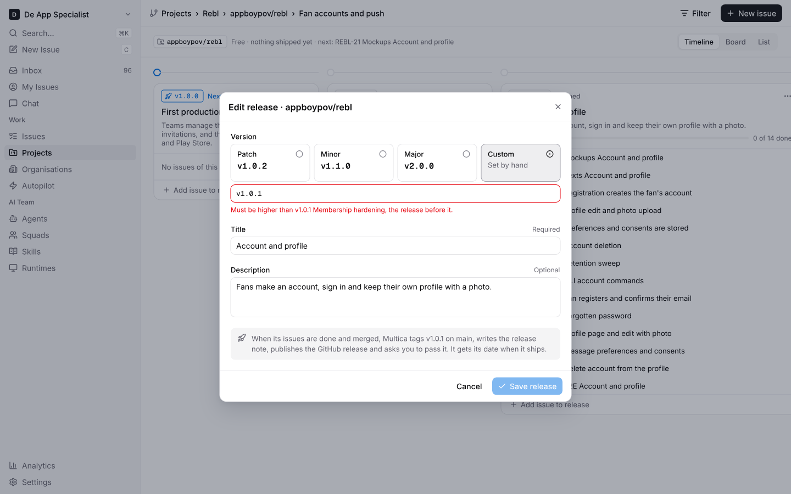
