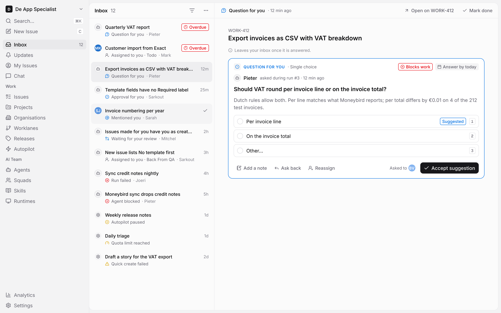
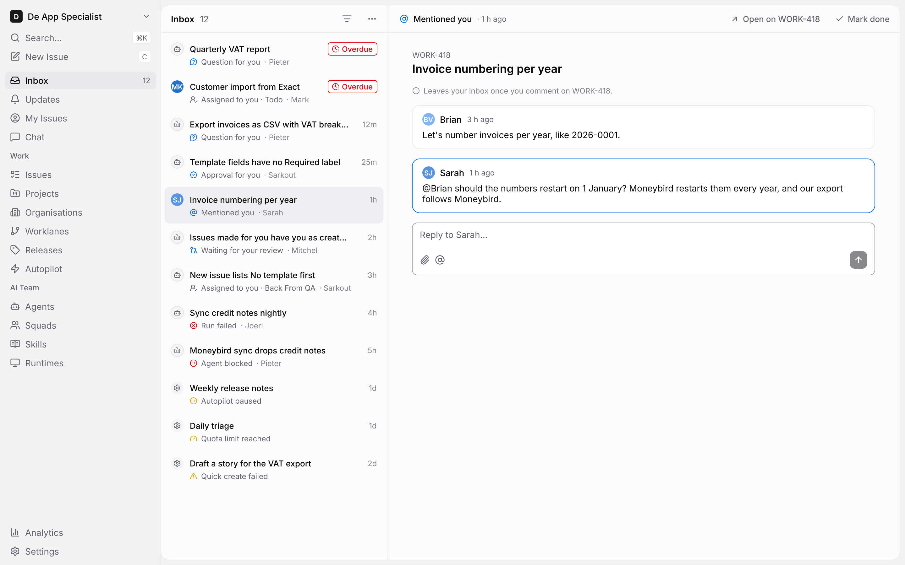
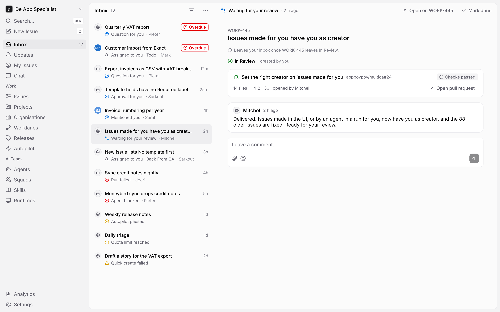
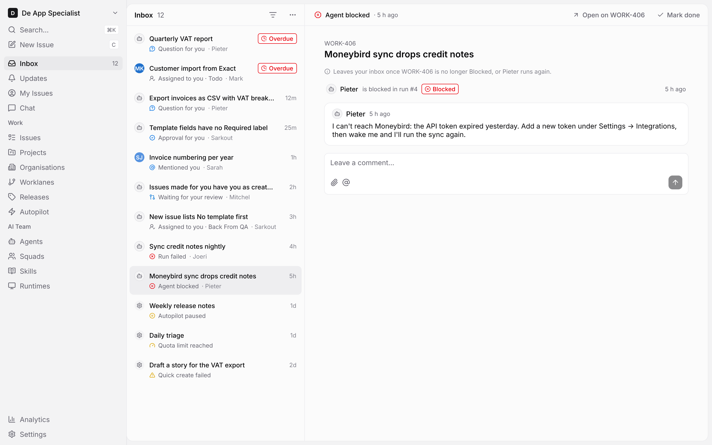
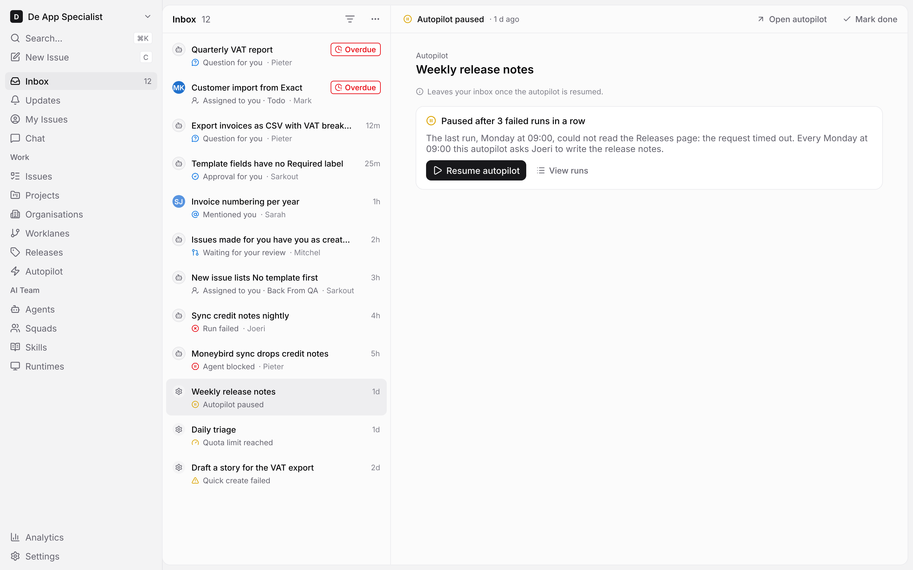
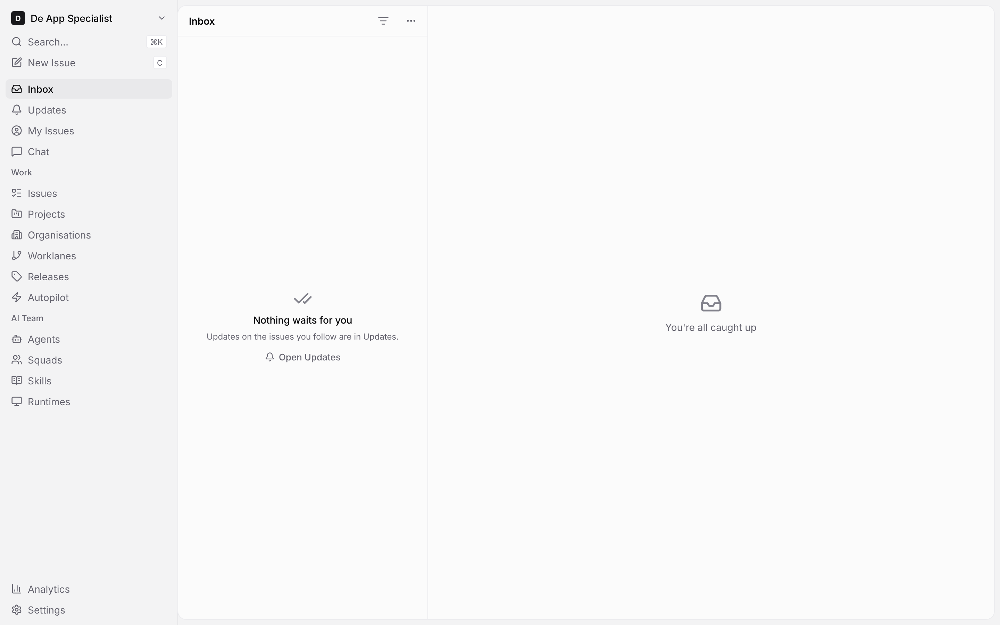
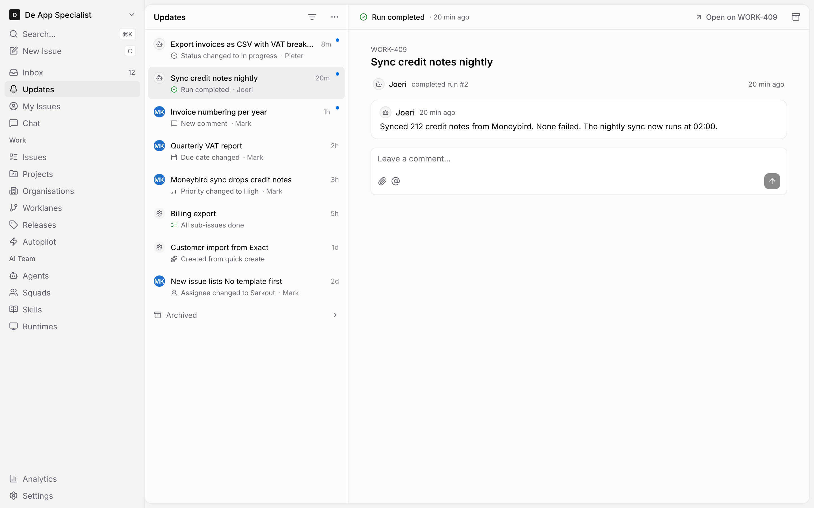
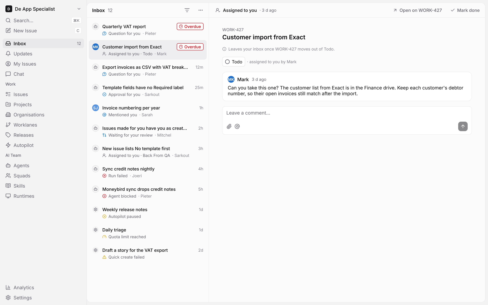

# To-do inbox screens (todo-inbox.pen)

Source: [todo-inbox.pen](file:///Users/codaveto/Repos/Forks/multica/designs/screens/todo-inbox.pen)

On GitHub: [designs/screens/todo-inbox.pen](https://github.com/appboypov/multica/blob/todo-inbox-design/designs/screens/todo-inbox.pen), added by [PR #48](https://github.com/appboypov/multica/pull/48) (`14b911078`), open until Brian's merge pass. Its UX spec: [designs/screens/todo-inbox.md](https://github.com/appboypov/multica/blob/todo-inbox-design/designs/screens/todo-inbox.md). In the brain: multica #48: design(inbox): to-do inbox and Updates list and the OpenSpec change [todo-inbox](https://github.com/appboypov/multica-docs/blob/main/openspec/changes/todo-inbox.md).

## What it shows

The screens of the to-do inbox and the Updates list, from the scope Brian settled with Mitchel on WORK-449 ([PR #48](https://github.com/appboypov/multica/pull/48)), light mode only, built from the components of [Multica component library (multica.lib.pen)](../systems/multica.lib.md) ([todo-inbox.md](https://github.com/appboypov/multica/blob/todo-inbox-design/designs/screens/todo-inbox.md)):

- **Inbox** lists only what waits for you: questions and approvals, mentions, issues assigned to you, blocked agents and failed runs, system problems, and your issues waiting for your review. Each to-do leaves by itself once handled, or with **Mark done**.
- **Updates** is a new sidebar item under Inbox, without a number. It holds everything else and works like today's inbox.
- Each detail pane says in one line what makes the to-do leave.

No token or colour is added; the only library change is the **Updates** item in the App sidebar ([todo-inbox.md](https://github.com/appboypov/multica/blob/todo-inbox-design/designs/screens/todo-inbox.md)).

## Screens

What each screen shows follows [todo-inbox.md](https://github.com/appboypov/multica/blob/todo-inbox-design/designs/screens/todo-inbox.md) "Detail pane", "Empty" and "Updates".

### 1 To-do inbox - question

A question or approval for you, answered in place in the detail pane.

Permalink: [todo-1-question.png](https://github.com/appboypov/multica/blob/14b9110783ddd186e123e9d7460161b2198d862e/designs/screens/exports/todo-1-question.png?raw=true)

### 2 To-do inbox - mention

A comment that mentions you, outlined, under the comment before it, with a reply box. Sending the reply handles the to-do.

Permalink: [todo-2-mention.png](https://github.com/appboypov/multica/blob/14b9110783ddd186e123e9d7460161b2198d862e/designs/screens/exports/todo-2-mention.png?raw=true)

### 3 To-do inbox - waiting for your review

An issue you created that is In Review: its status, the pull request with its checks and **Open pull request**, the latest comment and a comment box.

Permalink: [todo-3-waiting-for-your-review.png](https://github.com/appboypov/multica/blob/14b9110783ddd186e123e9d7460161b2198d862e/designs/screens/exports/todo-3-waiting-for-your-review.png?raw=true)

### 4 To-do inbox - agent blocked

A blocked agent: the run row with **Blocked**, the agent's last comment and a comment box.

Permalink: [todo-4-agent-blocked.png](https://github.com/appboypov/multica/blob/14b9110783ddd186e123e9d7460161b2198d862e/designs/screens/exports/todo-4-agent-blocked.png?raw=true)

### 5 To-do inbox - system problem

A paused autopilot: what went wrong and **Resume autopilot**. It leaves once the autopilot is resumed.

Permalink: [todo-5-system-problem.png](https://github.com/appboypov/multica/blob/14b9110783ddd186e123e9d7460161b2198d862e/designs/screens/exports/todo-5-system-problem.png?raw=true)

### 6 To-do inbox - empty

No open to-dos: **Nothing waits for you**, with **Open Updates**. The sidebar shows Inbox without a number.

Permalink: [todo-6-empty.png](https://github.com/appboypov/multica/blob/14b9110783ddd186e123e9d7460161b2198d862e/designs/screens/exports/todo-6-empty.png?raw=true)

### 7 Updates

Everything that asks nothing of you, with today's inbox behaviour: unread dots, archive per row, the **Archived** list and the filters, and no number.

Permalink: [todo-7-updates.png](https://github.com/appboypov/multica/blob/14b9110783ddd186e123e9d7460161b2198d862e/designs/screens/exports/todo-7-updates.png?raw=true)

### 8 To-do inbox - assigned to you

An issue assigned to you: its status as a pill that changes it in place, who assigned it, the latest comment and a comment box. It leaves once the issue moves to another status.

Permalink: [todo-8-assigned-to-you.png](https://github.com/appboypov/multica/blob/14b9110783ddd186e123e9d7460161b2198d862e/designs/screens/exports/todo-8-assigned-to-you.png?raw=true)
