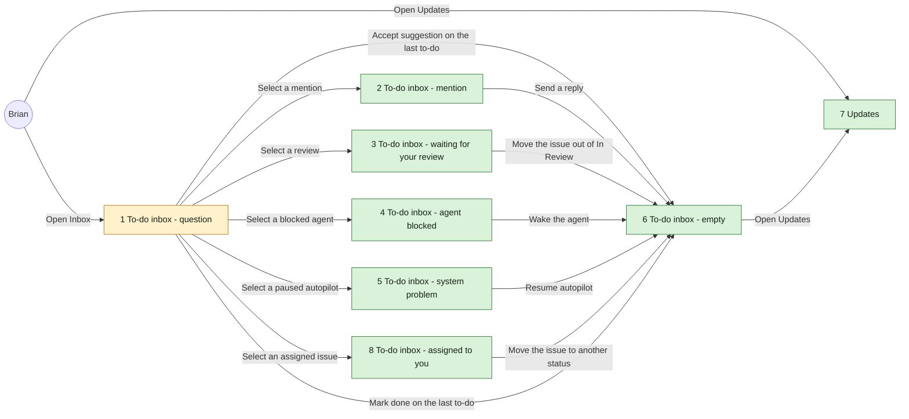
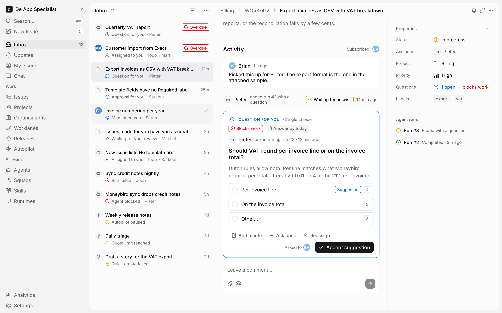
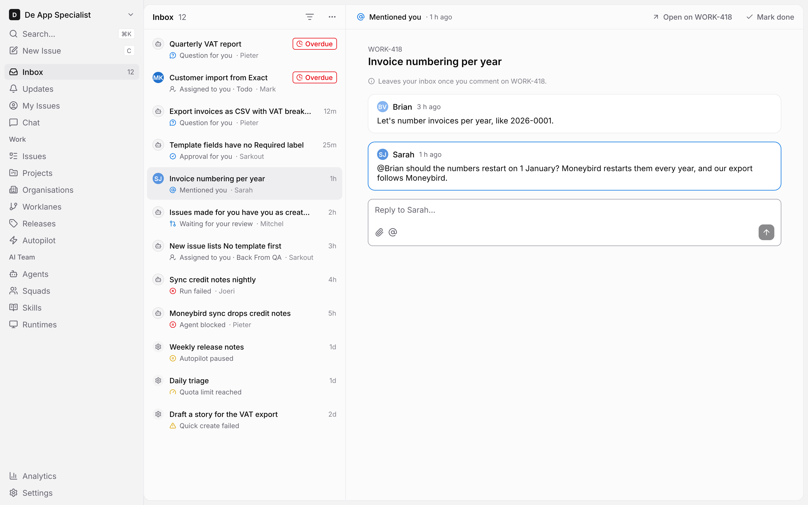
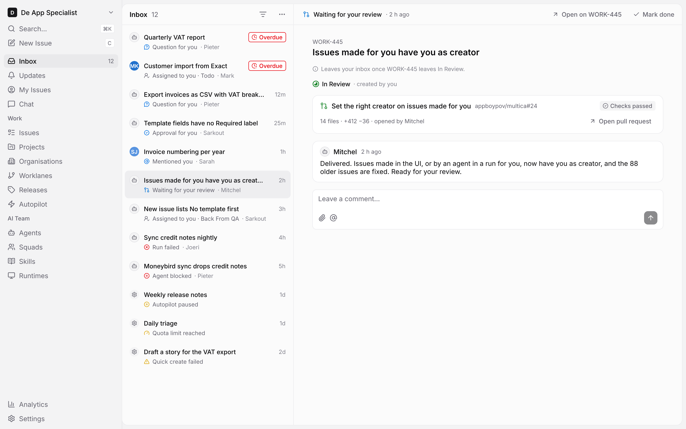
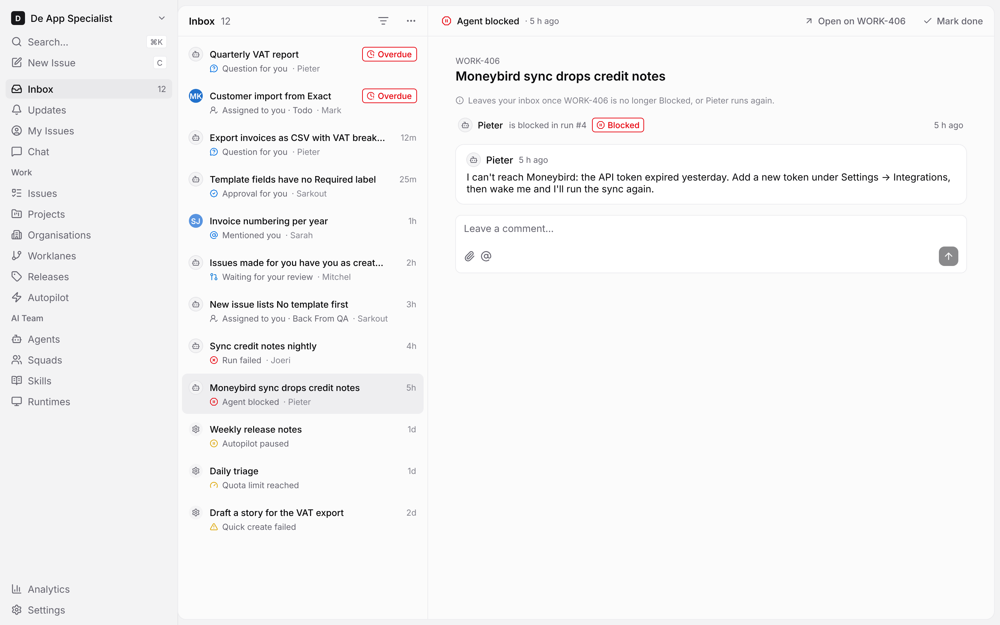
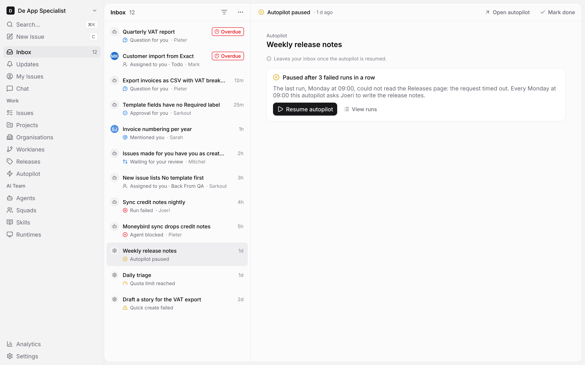
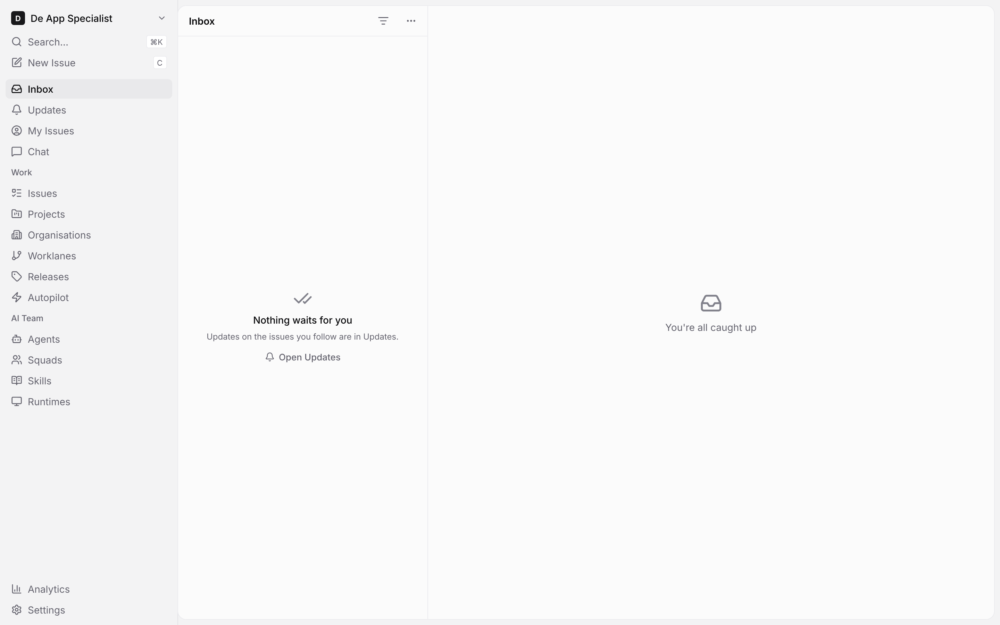
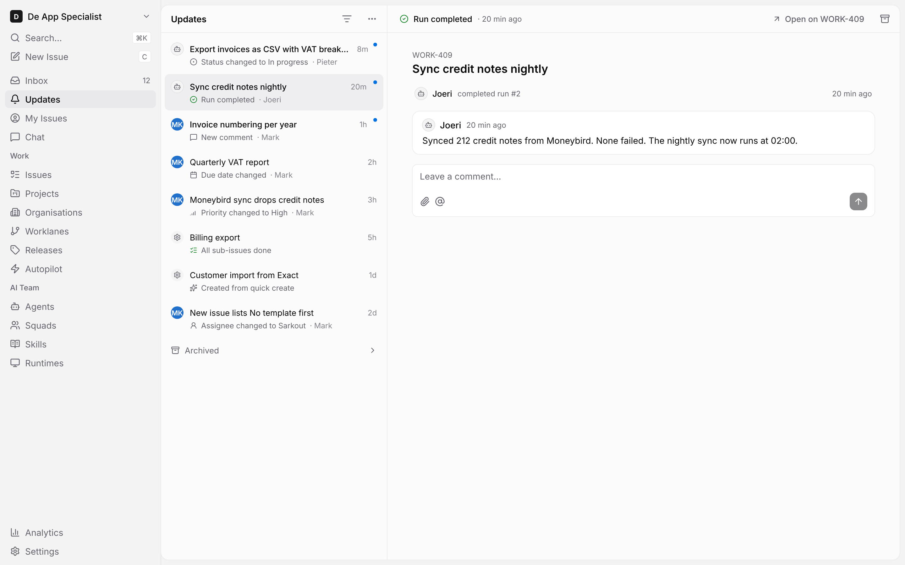
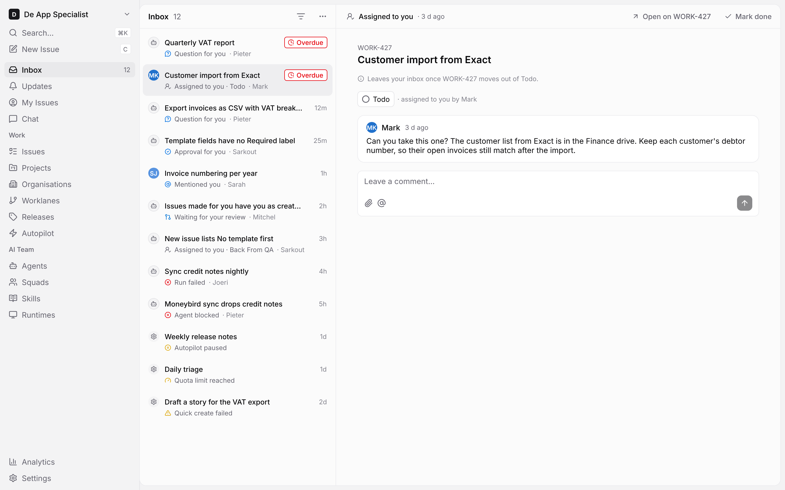

# To-do inbox - UX design

The Inbox lists only what waits for the member to act. Everything else on the issues they follow moves to a separate **Updates** list. The screens are in `todo-inbox.pen`, built from the components of `../systems/multica.lib.pen`.

## At a glance

The arrows into screen 6 show the last open to-do leaving; with more to-dos open, the list keeps the rest and selects the next one.

| 1 To-do inbox - question | 2 To-do inbox - mention |
|---|---|
|  |  |
| **3 To-do inbox - waiting for your review** | **4 To-do inbox - agent blocked** |
|  |  |
| **5 To-do inbox - system problem** | **6 To-do inbox - empty** |
|  |  |
| **7 Updates** | **8 To-do inbox - assigned to you** |
|  |  |

| Kind | Name | Change | Path |
|---|---|---|---|
| Design | Screens of the to-do inbox and Updates, 8 frames | new | `designs/screens/todo-inbox.pen` |
| Design | One PNG per screen | new | `designs/screens/exports/` |
| UX spec | This document | new | `designs/screens/todo-inbox.md` |
| Component | App sidebar: **Updates** item under Inbox | changed | `designs/systems/multica.lib.pen` |
| Design | PNG of the App sidebar | changed | `designs/exports/library-app-sidebar.png` |
| Screen | Inbox: to-do rows, detail pane per kind, Mark done, empty state | changed | `packages/views/inbox/components/` |
| Screen | Updates: the current notification list on its own page | new | `packages/views/inbox/components/` |
| Navigation | Sidebar item **Updates**, without a number | new | app sidebar |

No token or colour is added. The only library change is the **Updates** item in the App sidebar.

## Sidebar

- **Inbox** keeps its place and its number. The number counts all open to-dos.
- **Updates** sits right under Inbox, with a `bell` icon and no number.
- The Questions page stays as it is.

## To-do rows

A to-do is something that waits for the member to act. It shows only while it does, and leaves by itself once handled.

| Part | What it shows |
|---|---|
| Avatar | Who it waits on: the asking agent or member. A system problem shows a `settings` mark. |
| Title | The issue title. A system problem shows the autopilot's name, or the prompt of a failed quick create. |
| Right side | The age, or **Overdue** (`Badge/Destructive`) once the to-do passes its due date. On hover, the age makes way for **Mark done** (`check`). |
| Meta line | The kind's icon and label, then the actor's name. |

The kinds, their icon and when they leave:

| Kind | Icon | Leaves when |
|---|---|---|
| Question for you, Approval for you (also reassigned to you, or overdue) | `message-circle-question-mark`, `badge-check`, in `brand` | It is answered |
| Mentioned you | `at-sign` in `brand` | The member posts any comment on that issue after it |
| Assigned to you · Todo, Back From QA, Blocked or In Review | `user-round-check` | The issue moves to another status |
| Agent blocked, Run failed | `octagon-pause`, `circle-x`, in `destructive` | The issue is no longer Blocked, or the agent runs again |
| Autopilot paused, Quota limit reached, Quick create failed | `circle-pause`, `gauge`, `triangle-alert`, in `warning` | It is solved, such as a paused autopilot that is resumed |
| Waiting for your review: an issue the member created that is In Review, also with a pull request | `git-pull-request` in `info` | The issue leaves In Review |

- One row per to-do, also when several are on the same issue.
- When an In Review issue also has an open approval question for the member, such as a merge pass, it shows as one row: the question.
- Order: overdue first, then newest first.
- Rows have no unread dot: a row in the Inbox always waits for the member.
- The Inbox has no Archived list. A to-do leaves once handled or marked done.

## Detail pane

Selecting a row opens its detail on the right.

| Part | What it shows |
|---|---|
| Head | The kind's icon and label, the age, **Open on WORK-…** (or **Open autopilot**) and **Mark done**. |
| Issue | The issue key and title. |
| Leaves line | One line in `faint-foreground` that says what makes the to-do leave, such as "Leaves your inbox once you comment on WORK-418." |
| Body | What the member acts on, per kind, below. |

- **Question or approval** (screen 1): the question card, answered in place. Yes / No, Single choice and Approval questions can be answered here; the other types open on the issue.
- **Mention** (screen 2): the comment that mentions the member, outlined in `brand`, under the comment before it, with a reply box. Sending the reply handles the to-do.
- **Waiting for your review** (screen 3): the issue's status and that the member created it, the pull request with its checks and **Open pull request**, the latest comment and a comment box.
- **Agent blocked or run failed** (screen 4): the run row with **Blocked** or **Failed**, the agent's last comment and a comment box.
- **System problem** (screen 5): what went wrong and the action that solves it, such as **Resume autopilot**.
- **Assigned to you** (screen 8): the issue's status as a pill that changes it in place, who assigned it, the latest comment and a comment box. The leaves line names the status the issue is in: "Leaves your inbox once WORK-427 moves out of Todo.", and so on for Back From QA, Blocked and In Review. Moving the issue to another status handles the to-do.

## Mark done

**Mark done** sits on the hovered row and in the detail head. It removes the to-do at once and lowers the Inbox number. The next row is selected.

## Empty (screen 6)

With no open to-dos, the list says **Nothing waits for you**, points to Updates and offers **Open Updates**. The sidebar shows Inbox without a number.

## Updates (screen 7)

Updates is today's inbox list for everything that asks nothing of the member: status, priority, assignee and date changes, new comments, finished runs, sub-issues done, quick creates done.

- It keeps today's behaviour: unread dots, read and unread, archive per row, the **Archived** list at the bottom, and the filters.
- It has no number, in the sidebar and in its header.
- The detail pane shows the issue, with **Open on WORK-…** and **Archive** in its head.
