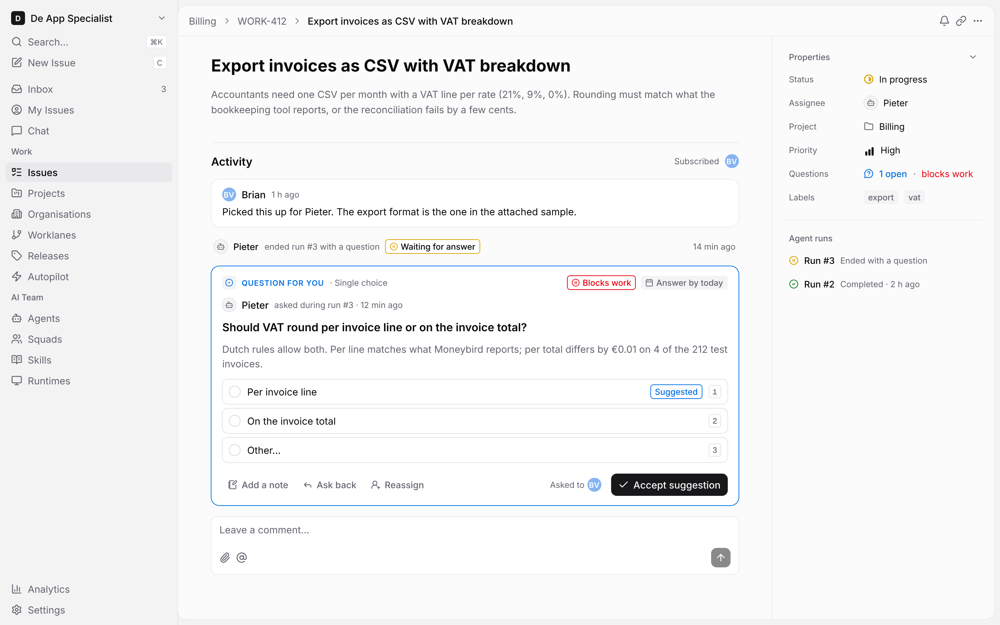
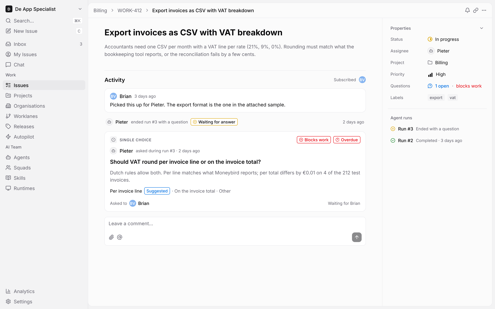
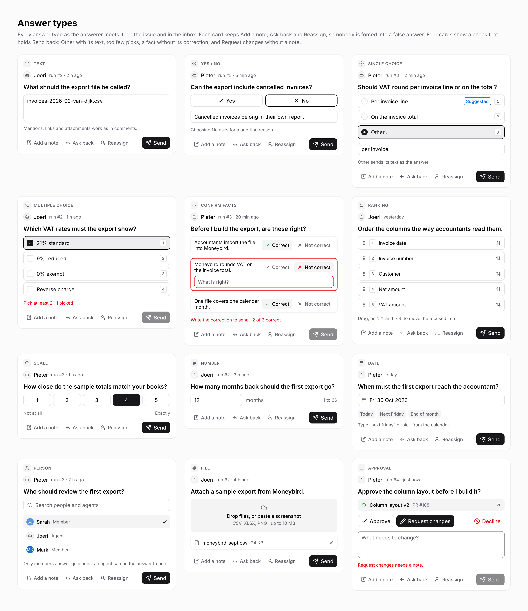
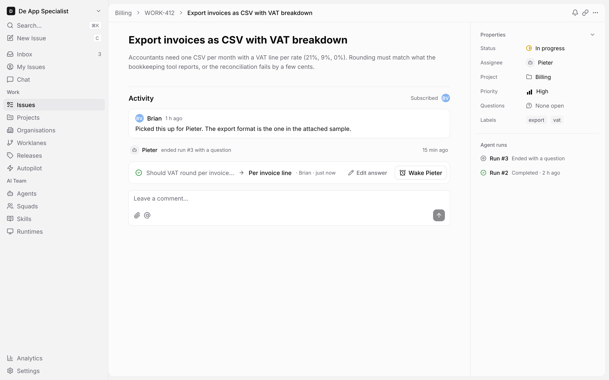
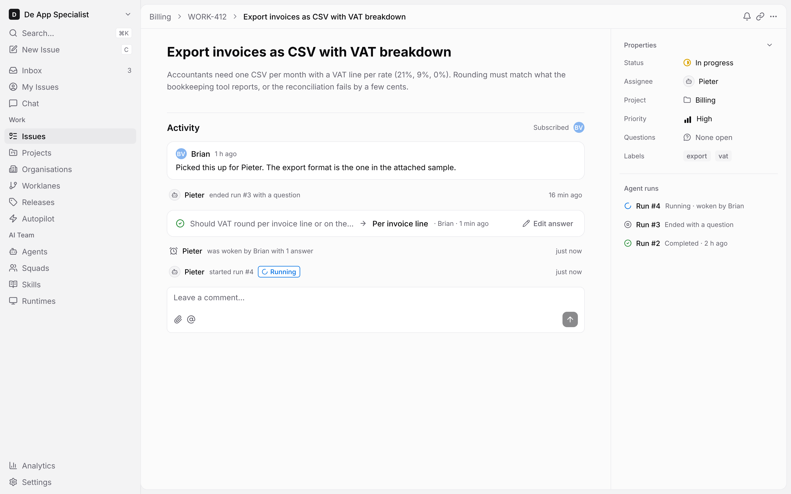
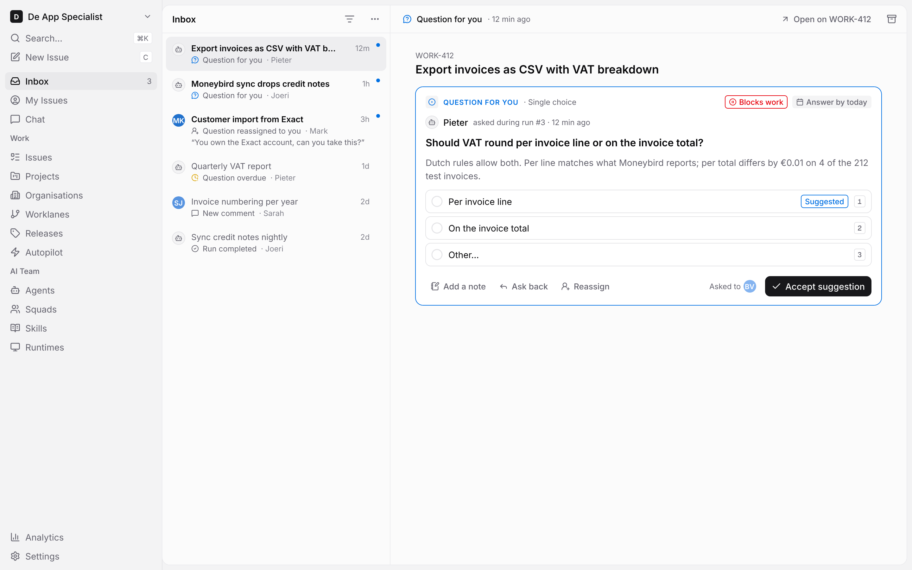
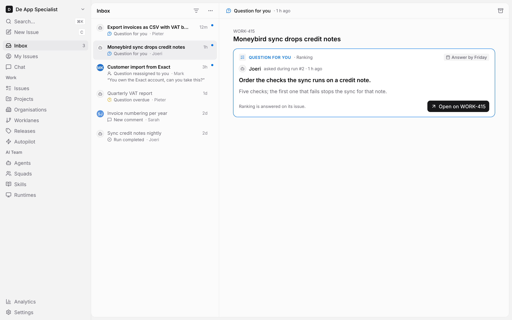

# UJ-1 question screens (issue-questions.pen)

Source: [issue-questions.pen](file:///Users/codaveto/Repos/Forks/multica/designs/screens/issue-questions.pen)
On GitHub: [designs/screens/issue-questions.pen](https://github.com/appboypov/multica/blob/das-460-uj-1-j6-screens/designs/screens/issue-questions.pen), added by [PR #16](https://github.com/appboypov/multica/pull/16) (`1e8411079`), open until Brian's merge pass. Its UX spec: [designs/screens/issue-questions.md](https://github.com/appboypov/multica/blob/das-460-uj-1-j6-screens/designs/screens/issue-questions.md).

## What it shows

The screens of journey DAS-432 UJ-1 Answer an agent's question and wake it, step DAS-460 UJ-1 J6 Screens, light mode only, built only from components of [Multica component library (multica.lib.pen)](../systems/multica.lib.md) (its UJ-1 question components came in PR #15), in the style of [Steer all work screens (steer-all-work.pen)](steer-all-work.md). Seven screens:

- 1: an issue with a question for you.
- 1b: the question card for a member who is not an answerer, with the Overdue badge.
- 3: the card's body for each of the 12 answer types, with the four validation states.
- 6: the question answered, with **Wake Pieter**.
- 6b: the issue's timeline after **Wake**.
- Inbox: a question item answered in place.
- Inbox: a Ranking question item that opens its issue.

## Screens

### 1 Issue, question for you

Permalink: [1-issue-question-for-you.png](https://github.com/appboypov/multica/blob/1e8411079a447941699dae63da7da82dd217298c/designs/screens/exports/1-issue-question-for-you.png?raw=true)

### 1b Issue, question for someone else

Permalink: [1b-issue-question-for-someone-else.png](https://github.com/appboypov/multica/blob/1e8411079a447941699dae63da7da82dd217298c/designs/screens/exports/1b-issue-question-for-someone-else.png?raw=true)

### 3 Answer types

Permalink: [3-answer-types.png](https://github.com/appboypov/multica/blob/1e8411079a447941699dae63da7da82dd217298c/designs/screens/exports/3-answer-types.png?raw=true)

### 6 Answered with Wake

Permalink: [6-answered-with-wake.png](https://github.com/appboypov/multica/blob/1e8411079a447941699dae63da7da82dd217298c/designs/screens/exports/6-answered-with-wake.png?raw=true)

### 6b Woken

Permalink: [6b-woken.png](https://github.com/appboypov/multica/blob/1e8411079a447941699dae63da7da82dd217298c/designs/screens/exports/6b-woken.png?raw=true)

### Inbox, answer in place

Permalink: [inbox-answer-in-place.png](https://github.com/appboypov/multica/blob/1e8411079a447941699dae63da7da82dd217298c/designs/screens/exports/inbox-answer-in-place.png?raw=true)

### Inbox, open on the issue

Permalink: [inbox-open-on-the-issue.png](https://github.com/appboypov/multica/blob/1e8411079a447941699dae63da7da82dd217298c/designs/screens/exports/inbox-open-on-the-issue.png?raw=true)
