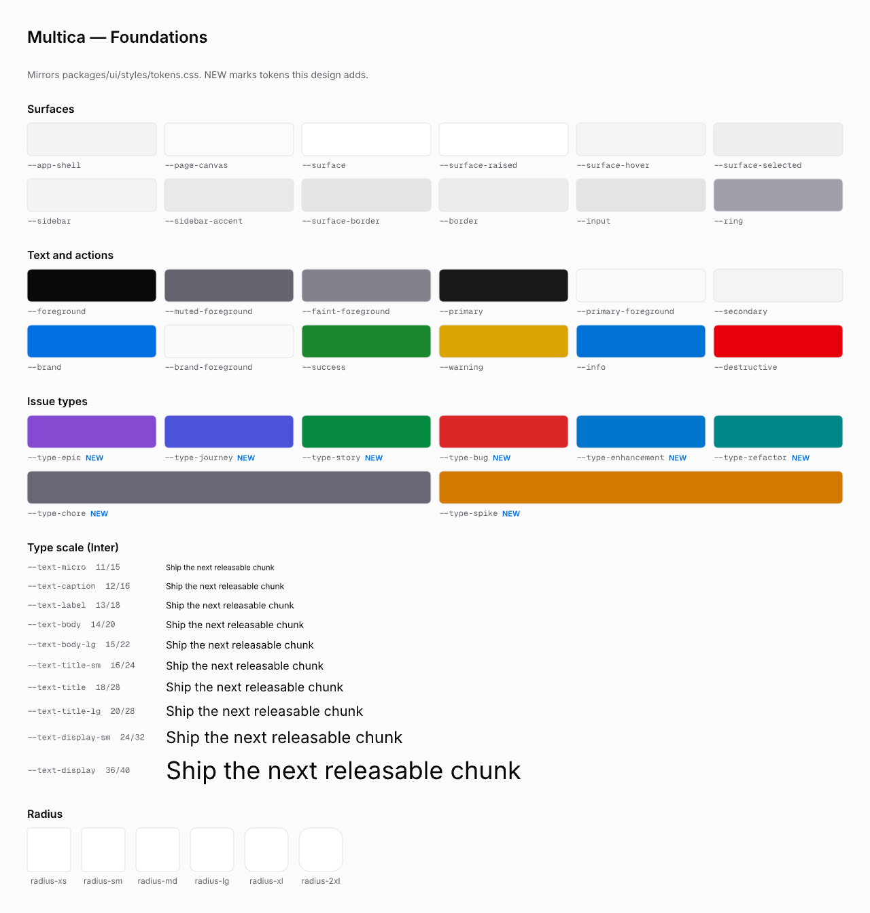
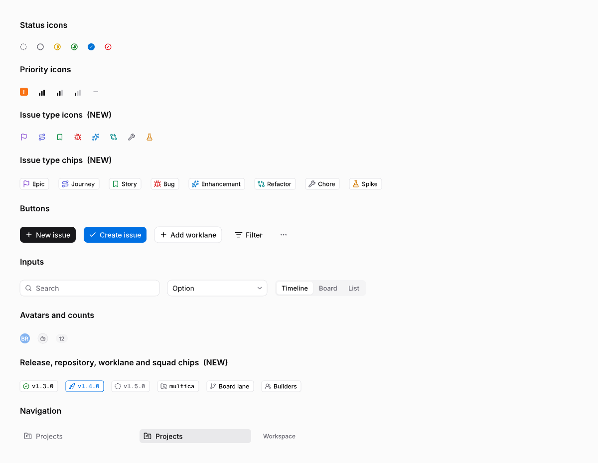
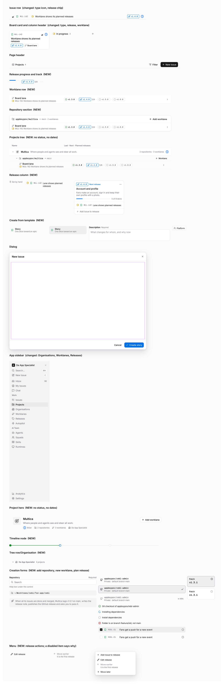
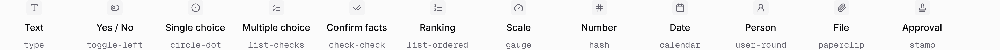
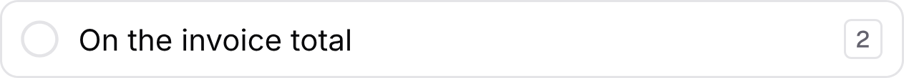
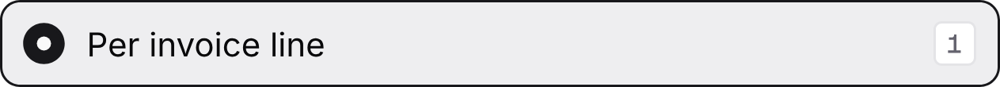
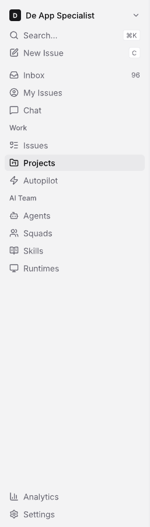

# Multica component library (multica.lib.pen)

Source: [multica.lib.pen](file:///Users/codaveto/Repos/Forks/multica/designs/systems/multica.lib.pen)

On GitHub: [designs/systems/multica.lib.pen](https://github.com/appboypov/multica/blob/main/designs/systems/multica.lib.pen), merged in [PR #7](https://github.com/appboypov/multica/pull/7) as `7c09e70ab`. [PR #10](https://github.com/appboypov/multica/pull/10) adds the sidebar's Organisations, Worklanes and Releases items and removes the Squad chip. [PR #15](https://github.com/appboypov/multica/pull/15) adds the UJ-1 question components, open until Brian's merge pass. [PR #48](https://github.com/appboypov/multica/pull/48) adds the sidebar's **Updates** item under Inbox, open until Brian's merge pass.

## What it shows

The component library the "steer all work" screens are built from, light mode only (PR #7): foundations (colours, type, spacing), atoms, components and the app sidebar. Dark colours exist in `packages/ui/styles/tokens.css` but are not designed here.

## Frames

### Foundations

### Atoms

### Components

### UJ-1 question components (PR #15)

The 15 components journey UJ-1 "Answer an agent's question and wake it" uses, built from the library's existing tokens only, in [PR #15](https://github.com/appboypov/multica/pull/15) (`8db0253e5`).

`Badge`

`Badge/Warning`

`Badge/Destructive`

`Badge/Brand`

`Kbd`

`Radio/Unchecked`

`Radio/Checked`

`Checkbox/Unchecked`

`Checkbox/Checked`

`Switch/Off`

`Switch/On`

`TypeIcon`

The 12 answer types (TypeIcon reference row)

`Button/Ghost/Small`

`Option/Default`

`Option/Selected`

### App sidebar

