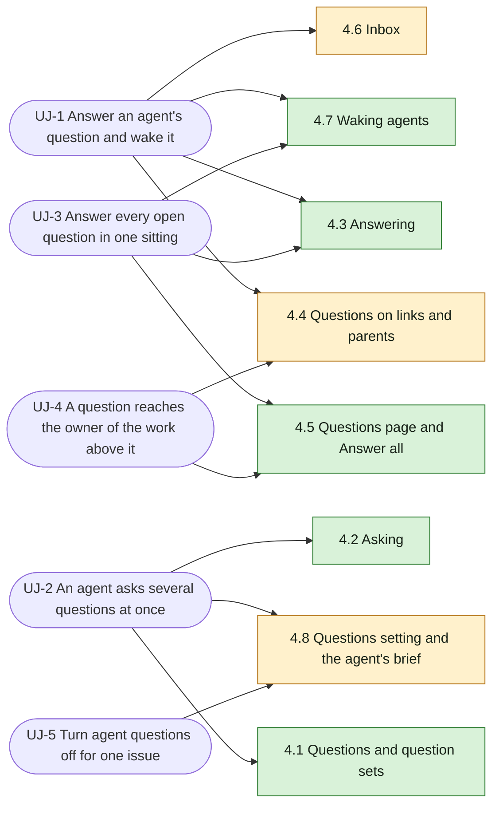

Source: [appboypov/multica#6](https://github.com/appboypov/multica/pull/6) (design and UX spec, WORK-366) · Prototype: [boldly-road-6664](https://designs.magicpath.ai/v1/boldly-road-6664), source in [appboypov/multica#8](https://github.com/appboypov/multica/pull/8) · Answers: [Plannotator Review b8b3060eec0c8d52](https://ctas.de-appspecialist.nl/plannotator/session/b8b3060eec0c8d52/)

## At a glance



| Kind | Name | Change | Path |
|---|---|---|---|
| Model | Question, question set, answer, link | new | `server/` (to build) |
| Screen | Issue detail: question card, Questions and Agent questions properties | changed | `packages/views/issues/components/issue-detail.tsx` (to build) |
| Screen | App sidebar: Questions item with count | changed | `packages/views/layout/app-sidebar.tsx` (to build) |
| Screen | Questions page and Answer all | new | `packages/views/questions/` (to build) |
| Screen | Settings: Questions, in Issues & workflow | new | `packages/views/settings/components/questions-tab.tsx` (to build) |
| Type | Inbox item types for questions | changed | `packages/core/types/inbox.ts` (to build) |
| Agent brief | Questions section, only while questions are on | changed | `server/internal/daemon/execenv/runtime_config_sections.go` (to build) |
| CLI | `multica question`, listed only while questions are on | new | `server/cmd/multica/cmd_question.go` (to build) |

## 0. Document Purpose

This PRD states what questions in Multica must do, for whoever writes the OpenSpec changes per journey (`P4`) and the technical design (`P5`). It builds on the design in [appboypov/multica#6](https://github.com/appboypov/multica/pull/6), whose UX spec (`designs/screens/issue-questions.md`) holds the screens, layout and keys, and on the clickable prototype in [appboypov/multica#8](https://github.com/appboypov/multica/pull/8). This PRD does not repeat their layout; it fixes the behaviour. Where the design differs from Brian's later answers, his answers win; the Addendum lists what of the design they supersede. Terms come from §3 and are used exactly. Every point is confirmed by Brian, in the WORK-366 comments or in the Plannotator Review of 2026-10-12.

## 1. Vision

A question is not a comment. It has a person who must answer, a shape the answer must take, and work that waits on it. Today an agent that needs an answer writes it into a comment, the comment sinks into the timeline, nobody is told it is theirs, and the run guesses or stops without anyone noticing. Brian has questions spread over several issues and no way to see them together.

Questions make asking and answering a first-class part of Multica. Agents ask people one question or several at the same time, linked to anything in the workspace. Only people answer, in the answer type that fits the question, with one click when the suggested answer is right. Every open question shows on the work it is about, on every parent above that work, and on one Questions page. Nothing starts by itself: a person decides when an agent is woken with its answers.

Because an agent can ask several questions at once and wait for people's answers, work that needed an interactive session can run as a task.

## 2. Target User

### 2.1 Jobs To Be Done

- As Brian, I see every question that waits for me in one place and answer them fast, without hunting through comments.
- As Brian, I answer in the shape the question needs (yes/no, a choice, a ranking, a date, an approval…) and am never forced into a false answer.
- As Brian, I decide when an agent continues with my answers; answering never starts a run.
- As an agent, I ask people one or more questions at the same time and read their answers when I am woken, instead of guessing.
- As the owner of a piece of work, I see questions asked on anything below it.
- As a workspace owner, I decide whether agents may ask questions, per workspace and per issue, and an agent that may not ask is told nothing about questions.

### 2.2 Non-Users (v1)

- People as askers. Only agents ask questions.
- Agents as answerers. Only people answer questions.

### 2.3 Key User Journeys

The protagonists are Brian (workspace owner and answerer) and Pieter, an agent that works on Multica issues.

- **UJ-1. Answer an agent's question and wake it**

    ```mermaid
    flowchart LR
      A[Pieter asks on WORK-412 during run #3]:::agent --> B[Run row: ended run #3 with a question, Waiting for answer]:::product
      B --> C[Brian gets an inbox item and opens WORK-412]:::person
      C --> D[Question card for Brian, Suggested option marked]:::product
      D --> E[Brian picks Accept suggestion or answers and sends]:::person
      E --> F[Card folds to one line, Wake Pieter offered]:::product
      F --> G[Brian presses Wake Pieter]:::person
      G --> H[Pieter's new run starts with the answer]:::product
      classDef person fill:#e3f2fd,stroke:#1565c0,color:#0d1b2a
      classDef agent fill:#f3e5f5,stroke:#6a1b9a,color:#1a0d1f
      classDef product fill:#f5f5f5,stroke:#616161,color:#212121
    ```

    Pieter is halfway through WORK-412 and needs to know whether invoices round per line or per total. He asks Brian a single-choice question with "per line" as the suggested answer and ends his run; the run row reads "ended run #3 with a question" with a "Waiting for answer" badge. Brian opens the inbox item, sees the card outlined as "Question for you", and presses **Accept suggestion**. The card folds to one line (prompt → answer · Brian · now) and offers **Wake Pieter**. Brian wakes him; the timeline reads "Pieter was woken by Brian with 1 answer", and the new run has the answer. **Edge case:** Brian does not know the answer; he uses **Reassign** with a note to another member, and the card keeps the history.

- **UJ-2. An agent asks several questions at once**

    ```mermaid
    flowchart LR
      A[Pieter's brief has the Questions section]:::product --> B[Pieter runs multica question ask with three questions for a squad]:::agent
      B --> C[One question set card on the issue, the squad's human members as answerers, Blocks work on]:::product
      C --> D[Questions property: 3 open, blocks work]:::product
      D --> E[Brian answers one question, sends it]:::person
      E --> F[Answer reaches Pieter at once, card shows 1 of 3 answered, no run starts]:::product
      F --> G[Wake Pieter offered from the first answer on]:::product
      classDef person fill:#e3f2fd,stroke:#1565c0,color:#0d1b2a
      classDef agent fill:#f3e5f5,stroke:#6a1b9a,color:#1a0d1f
      classDef product fill:#f5f5f5,stroke:#616161,color:#212121
    ```

    Pieter needs three facts confirmed before he can design an export. Agent questions are on for the issue, so his brief says `multica question` exists. One `multica question ask` call posts a question set of three questions to a squad with Any one answers; the squad's human members become the answerers and its agents are skipped. Blocks work is on because he asks during a run, and the issue's Questions property reads "3 open · blocks work". Brian answers the first question and sends it: it reaches Pieter at once, the card shows "1 of 3 answered", and **Wake Pieter** is offered. The question leaves the other members' lists. Nothing starts until a person presses **Wake Pieter**. **Edge case:** Brian sends two of three answers and leaves; the set stays open with two answered, and a woken run gets both.

- **UJ-3. Answer every open question in one sitting**

    ```mermaid
    flowchart LR
      A[Sidebar Questions shows 6]:::product --> B[Brian opens the Questions page, For me tab]:::person
      B --> C[Answer yes/no rows inline with Y and N]:::person
      C --> D[Brian presses Answer all]:::person
      D --> E{View}:::product
      E -->|One by one| F[One question at a time, issue context beside it]:::product
      E -->|One page| G[All open questions grouped by link, each answerable in place]:::product
      F --> H[Brian answers and sends each]:::person
      G --> H
      H --> I[Wake offered per agent with unseen answers]:::product
      classDef person fill:#e3f2fd,stroke:#1565c0,color:#0d1b2a
      classDef product fill:#f5f5f5,stroke:#616161,color:#212121
    ```

    On Monday morning the sidebar shows 6 open questions for Brian over four issues. On the Questions page he answers the two Yes / No rows inline, then presses **Answer all**. He switches to **One page**: every open question is listed, grouped by issue, and a question set shows all its questions open on its card. He moves with `J` / `K`, sends each answer on its own, and after each issue's cards wakes the agents that have answers they have not seen. **Edge case:** he leaves halfway; what he sent is sent, the rest stays open, and Answer all opens in the view he used last.

- **UJ-4. A question reaches the owner of the work above it**

    ```mermaid
    flowchart LR
      A[Pieter asks a question on sub-issue WORK-415]:::agent --> B[Question card on WORK-415]:::product
      B --> C[Parent issue lists it, via sub-issue WORK-415]:::product
      C --> D[Project lists it, via sub-issue WORK-415]:::product
      D --> E[Assignee of the parent sees it under On my work]:::person
      classDef person fill:#e3f2fd,stroke:#1565c0,color:#0d1b2a
      classDef agent fill:#f3e5f5,stroke:#6a1b9a,color:#1a0d1f
      classDef product fill:#f5f5f5,stroke:#616161,color:#212121
    ```

    Brian owns the parent issue of WORK-415. Pieter asks a question on WORK-415 to another member. Brian is not an answerer, but the question shows on the parent issue's and the project's Questions property, marked "via sub-issue WORK-415", and on Brian's Questions page under **On my work**. He can follow it without being asked.

- **UJ-5. Turn agent questions off for one issue**

    ```mermaid
    flowchart LR
      A[Workspace default: On]:::product --> B[Brian sets Agent questions Off on one issue]:::person
      B --> C[Next run on that issue: brief, CLI help and skills say nothing about questions]:::product
      C --> D[multica question ask refuses on that issue]:::product
      D --> E[Brian sets it back to Workspace default, next run has the Questions section again]:::person
      classDef person fill:#e3f2fd,stroke:#1565c0,color:#0d1b2a
      classDef product fill:#f5f5f5,stroke:#616161,color:#212121
    ```

    Questions are on by default in Brian's workspace. On one issue he wants an agent to work without stopping, so he sets **Agent questions** to Off in its properties. From the next run of any agent on that issue, its brief has no Questions section, `multica --help` does not list `multica question`, and its skills say nothing about questions. Later he sets it back to **Workspace default**; the next run sees the Questions section again.

## 3. Glossary

- **Question** - One thing an agent asks: a prompt, an optional context line, one answer type with its settings, an optional suggested answer, one or more answerers, one or more links, an optional due date and the Blocks work flag.
- **Question set** - Several questions asked at the same time in one ask. Shown as one card; each question in it is answered and sent on its own.
- **Ask** - An agent posting one question or one question set through `multica question ask`.
- **Asker** - The agent who asks. Only agents ask. A question asked during a run links to that run.
- **Answerer** - A member asked to answer. Only people answer.
- **Answer policy** - With several answerers: **Any one** (the first answer answers the question for all) or **Each** (every answerer answers).
- **Answer type** - The shape of an answer: Text, Yes / No, Single choice, Multiple choice, Confirm facts, Ranking, Scale, Number, Date, Person, File or Approval.
- **Suggested answer** - The answer the asker would pick, marked Suggested; accepting it is one action.
- **Answer** - The typed value, an optional note, optional attachments, who answered and when.
- **Link** - What a question is about: an issue, a sub-issue, a project, a comment, an agent run or another workspace object. The first link is where it was asked.
- **Parent** - Every object above a link: a comment's issue, an issue's parent issues, their project.
- **Indirect audience** - The assignees of a question's links and parents.
- **Blocks work** - A flag that marks the linked work as waiting on the answer.
- **Wake** - A person starting an agent with the answers it has not seen. The only way an answer leads to a run.
- **Agent questions** - Whether agents may ask questions on an issue: **Workspace default**, **On** or **Off**.
- **Questions default** - The workspace setting that Agent questions follows while an issue is on Workspace default.
- **Questions page** - The page behind the sidebar item **Questions**.
- **Answer all** - Answering the viewer's open questions in one flow, in the view **One by one** or **One page**.

## 4. Features

### 4.1 Questions and question sets

**Description:** A question is its own object, not a comment. It belongs to one ask, which holds one question or a question set. It has one or more links and one or more answerers. Its states are open → answered (partly answered under the Each policy) → closed by the asker, with withdrawn by the asker; overdue is a badge while open past the due date. Counts of open questions count questions, not asks: a set of three open questions is 3 open. Realizes UJ-1, UJ-2.

### FR-1: Ask one or several questions at once

An agent can post one question or a question set in a single ask. Realizes UJ-2.

**Consequences (testable):**

- One ask with three questions produces one card holding three questions.
- Each question in a set can be answered and sent without answering the others.

### FR-2: Link a question to anything

A question can link to an issue, a sub-issue, a project, a comment, an agent run or another workspace object, and to more than one of them. Realizes UJ-4.

**Consequences (testable):**

- A question asked during a run links to that run and to the issue.
- The asker can add links after the first.

### FR-3: Only people answer

Answerers are members only. Asking a squad adds its human members one by one and skips its agents. Realizes UJ-2.

**Consequences (testable):**

- An agent cannot be an answerer.
- Asking a squad with 3 members and 2 agents adds 3 answerers.

### FR-4: Answer policy

With more than one answerer the asker picks Any one or Each. Realizes UJ-2.

**Consequences (testable):**

- Under Any one, the first sent answer makes the question answered and takes it off the other answerers' open lists; only the asker closes it, so the answer stays editable until then.
- Under Each, the card shows progress such as "2 of 3"; the question is partly answered until every answerer has sent, then answered.

### FR-5: Due date and Blocks work

The asker can set an optional due date and the Blocks work flag. Blocks work is on by default when the agent asks during a run. Realizes UJ-2.

**Consequences (testable):**

- An open question past its due date shows an overdue badge on its card and its Questions page row.
- A blocking question shows on the Questions property of every link as "blocks work".

### FR-6: Lifecycle

The asker can close or withdraw a question; an answerer can reassign it to another member with a note. Realizes UJ-1.

**Consequences (testable):**

- A reassigned question keeps its history on the card.
- A withdrawn question leaves every open list.

### 4.2 Asking

**Description:** Only agents ask, through the CLI. People answer, reassign and wake; they have no way to ask. Asking never starts a run. Realizes UJ-2.

### FR-7: Ask from the CLI

An agent asks with `multica question ask`, one question or several in one call, with every answer type and its settings, a suggested answer, the links, the answerers (members or a squad), the answer policy, a due date and Blocks work. It reads answers and closes or withdraws its questions through `multica question`. Realizes UJ-2.

**Consequences (testable):**

- One `multica question ask` call with several questions produces one question set.
- `multica question ask` refuses while Agent questions is off for the issue the agent runs on (FR-21).
- The issue's comment composer has no way to ask a question: no Question toggle and no `/question`.

### FR-8: Asking starts nothing

Posting a question or question set starts no agent run. Realizes UJ-2.

**Consequences (testable):**

- No run is queued by any ask, whoever the answerers or assignees are.

### 4.3 Answering

**Description:** Every answer type has its own control on the same card shape, with the same escape hatches, so nobody is forced into a false answer. The full table of types, settings and keys is in the UX spec. Realizes UJ-1, UJ-2, UJ-3.

### FR-9: Twelve answer types

Answerers can answer Text, Yes / No, Single choice (with optional Other), Multiple choice (min and max), Confirm facts (each Correct or Not correct, with the correction), Ranking, Scale, Number (unit, min, max), Date (date, date and time, or range), Person, File and Approval (Approve, Request changes with a note, Decline). Realizes UJ-1, UJ-3.

**Consequences (testable):**

- Each type validates its answer against the asker's settings before it can be sent.
- Request changes on an Approval cannot be sent without a note.

### FR-10: Accept the suggested answer

While nothing is picked, a card with a suggested answer offers **Accept suggestion** as its primary action; once the answerer picks or types, it becomes **Send**. Realizes UJ-1.

**Consequences (testable):**

- Accepting the suggestion sends it as the answer in one action.

### FR-11: Escape hatches

Every card offers **Add a note**, **Ask back** (replies in the question's thread and keeps it open) and **Reassign**. Realizes UJ-1.

### FR-12: Answers reach the asker at once and stay editable

Each sent answer reaches the asker at once, also within a question set, so the asker can act on the first answer before the rest arrive. The answerer can edit an answer until the asker closes the question; an edit notifies the asker. Realizes UJ-2.

**Consequences (testable):**

- A sent answer folds the card to one line: prompt → answer · who · when, with **Edit answer**.
- A question set shows how many of its questions are answered, such as "1 of 3 answered".
- Editing an answer starts no run.

### 4.4 Questions on links and parents

**Description:** A question shows where it was asked, on every link, and on every parent above a link, so the owner of the work sees it without being asked. Realizes UJ-1, UJ-4.

### FR-13: Card on the issue

On an issue, a question is a card in the activity timeline. Answerers see it outlined as "Question for you". The run row of an agent that asked reads "ended run #N with a question" with a "Waiting for answer" badge. Realizes UJ-1.

### FR-14: Questions property

An issue's properties show a **Questions** row with its open count and whether one blocks work; it scrolls to the first open card. Realizes UJ-1, UJ-2.

### FR-15: Questions on parents

A parent issue and a project list the questions of everything below them, each marked with the link it came from, such as "via sub-issue WORK-415". Realizes UJ-4.

**Consequences (testable):**

- A question on a sub-issue shows on its parent issue and on the project.

### FR-16: Indirect audience

A member assignee of a question's link or parent sees the question under **On my work**; an agent assignee gets its answers when it is woken (FR-20). Realizes UJ-4.

### 4.5 Questions page and Answer all

**Description:** One place for every question. Realizes UJ-3, UJ-4.

### FR-17: Questions page

A **Questions** item in the sidebar shows the count of open questions for the viewer. Its page has the tabs **For me**, **On my work**, **All open** and **Answered**, grouped by link (or by due date or asker), with a filter on type, asker, answerer, link and blocking. Yes / No rows can be answered inline. Realizes UJ-3, UJ-4.

**Consequences (testable):**

- The sidebar count equals the open questions under For me.
- An empty For me tab shows "No questions waiting for you".

### FR-18: Answer all

**Answer all** answers the viewer's open questions in one flow, in **One by one** (one question at a time with its link's context beside it, progress such as 2 of 6) or **One page** (every open question on one page, grouped by link, each answerable in place, question sets shown expanded). The view is switched in its header and remembered per viewer; each answer is sent on its own; keyboard moves between questions and sends. Realizes UJ-3.

**Consequences (testable):**

- Leaving halfway keeps every sent answer and leaves the rest open.
- Answer all opens in the view the viewer used last.

### 4.6 Inbox

**Description:** Answerers hear about their questions in the existing inbox. Realizes UJ-1.

### FR-19: Question inbox items

The inbox gets items for answerers when a question is asked of them, reassigned to them, or overdue. Yes / No, Single choice and Approval can be answered inline from the inbox detail pane. Realizes UJ-1.

### 4.7 Waking agents

**Description:** An answer never starts a run. Once answers exist that an agent has not seen, a person can wake it. Realizes UJ-1, UJ-2, UJ-3.

### FR-20: Wake an agent with its answers

Once one or more answers exist that an agent has not seen, the answered card, the question set's footer, the bar under the card in One by one and the end of a link's cards in One page offer **Wake** for that agent. The agents offered are the asking agent and the agent assignees of each link and parent. Realizes UJ-1, UJ-2, UJ-3.

**Consequences (testable):**

- Answering, partly answering and editing an answer start no run.
- **Wake** is offered after the first answer of a question set, before the rest are answered.
- A woken run gets every answer given since that agent's last run on those links.
- The timeline records who woke whom with how many answers.

### 4.8 Questions setting and the agent's brief

**Description:** Whether agents may ask is a workspace default that each issue can change at any time. An agent that may ask is told only that the tool exists and how to call it; an agent that may not ask is told nothing. Realizes UJ-2, UJ-5.

### FR-21: Workspace default and issue override

Owners and admins set the Questions default in **Settings → Issues & workflow → Questions**. Each issue has **Agent questions**: Workspace default, On or Off, changeable at any time; a change applies from the next run of any agent on that issue. A single run has no setting of its own. Realizes UJ-5.

**Consequences (testable):**

- An issue on Workspace default follows the workspace switch.
- The settings row counts the open issues with their own setting.

### FR-22: What the agent is told

While questions are on for a run, its brief carries this section and `multica --help` lists `multica question`:

```text
## Questions

`multica question` asks people one or more questions at the same time and reads their answers.

`multica question --help` lists its commands, answer types and options.
```

While questions are off, the brief, the CLI help and the skills that run gets say nothing about questions. Realizes UJ-2, UJ-5.

**Consequences (testable):**

- No brief, CLI help or skill text says when or why to ask.
- With questions off, the run's brief, `multica --help` and skills contain no mention of questions.

**Out of Scope:**

- Guidance on when to ask or when to end a run. Brian: "we only explain the tooling is there. nothing else."

## 5. Non-Goals (Explicit)

- People asking questions.
- Agents answering questions.
- Any run started by asking, answering or editing an answer.
- Instructions to agents on when or why to ask.
- New design tokens or colours; questions use Multica's existing tokens and components.
- A Pencil design system of Multica's own (a separate choice for Brian, per the UX spec).

## 6. MVP Scope

### 6.1 In Scope

- Everything in §4, on web and desktop.

### 6.2 Out of Scope for MVP

- The mobile app.

Success metrics are left out: this is an internal tool and Brian set none.

## Addendum

### What Brian's answers supersede in the design

The design in [appboypov/multica#6](https://github.com/appboypov/multica/pull/6) and the prototype in [appboypov/multica#8](https://github.com/appboypov/multica/pull/8) still let people ask. Brian's answer of 2026-10-12 (only agents ask) supersedes:

- Screen 2a and 2b: the composer's **Question** toggle, `/question` and the question builder.
- The **Asked by me** tab on the Questions page.
- The inbox item `question_answered` for askers.
- "Members and agents can ask" in the UX spec's concepts.

### Build pointers from the UX spec

- Paths in the At a glance inventory are the UX spec's "to build" targets: `packages/views/issues/components/issue-detail.tsx`, `packages/views/layout/app-sidebar.tsx`, `packages/views/questions/`, `packages/views/settings/components/questions-tab.tsx`, `packages/core/types/inbox.ts`, `server/internal/daemon/execenv/runtime_config_sections.go`, `server/cmd/multica/cmd_question.go`.
- Inbox item types that stay: `question_asked`, `question_reassigned`, `question_overdue`.
- Layout, icons (lucide), per-type keys, row heights and the `CappedNumberFlow` count are in `designs/screens/issue-questions.md` on [appboypov/multica#6](https://github.com/appboypov/multica/pull/6).

### Where the prototype differs from the Pencil screens

- On the One page view the prototype groups under WORK-412, WORK-398 and the Agent runtime project, so the whole flow uses one data set; the Pencil frame names WORK-418, 421 and 399.
- Inter from Google Fonts stands in for the product's Inter Variable.

### Brian's answers this PRD rests on (2026-10-12)

WORK-366 comments:

- Questions link to anything and are relevant to all parents; a question on an issue is indirectly a question for its assignee.
- Questions never start agents when partly or fully answered; show the option to wake after one or more answers.
- Questions are answered by people only; of a squad, only its human members are asked.
- Questions get their own sidebar item.
- A global setting decides whether questions are allowed; it is the default, overridable and changeable per task at any time. Agents know they may ask and understand the tooling when allowed, and get no information about it when disabled.
- Only explain that the tooling is there; no instructions on when to ask.
- Show multiple questions on one page.
- It must be clear that multiple questions can be asked at the same time; this way interactive sessions can now be tasks.

Plannotator Review b8b3060eec0c8d52:

- Each answer in a set reaches the asker as soon as it is sent, with Wake offered after the first (already settled in the thread).
- Under Any one, the first answer takes the question off the other people's lists; only the asker closes it.
- The setting per issue is enough.
- People do not ask questions; only agents do.
- Questions can be asked on issues, sub-issues, the agent runs on them, projects, comments and other workspace objects.
- Web and desktop only.
- No success metrics.

## Memlog

- (event) started headless from WORK-366 comment 01a13193; no intent exists for questions, none created (headless runs never create intents)
- (event) baseline: passed design appboypov/multica#6 UX spec and prototype appboypov/multica#8
- (assumption) each answer in a question set reaches the asker on its own, as the design does; unconfirmed
- (assumption) agent questions setting covers agent runs only, on workspace and issue, no per-run level; unconfirmed
- (assumption) web and desktop only; mobile unconfirmed
- (assumption) success metrics left to Brian
- (change) reviewer gate: rubric walker found unconfirmed choices stated as mandatory, Any one vs edit conflict, set counting; fixed with inline ASSUMPTION tags, FR-4 wording and a count rule
- (change) input reconciliation: UX spec keys and row specs stay in the spec by design; 'overridable per task' sharpened into open question 2
- (change by coach) Plannotator answers folded in: all ASSUMPTION tags resolved; open questions section removed
- (change by coach) only agents ask: FR-7 composer question builder removed, FR-8 human asking removed, Asked by me tab and question_answered inbox item dropped; FRs renumbered to FR-1..FR-22
- (change by coach) Addendum lists design parts superseded by Brian's answers (screens 2a/2b, Asked by me, question_answered)
- (event) PRD finalized
- (event) P4 done: five changes in appboypov/multica main checkout, journeys DAS-430..434, P5 handed to Pieter as WORK-375..379
