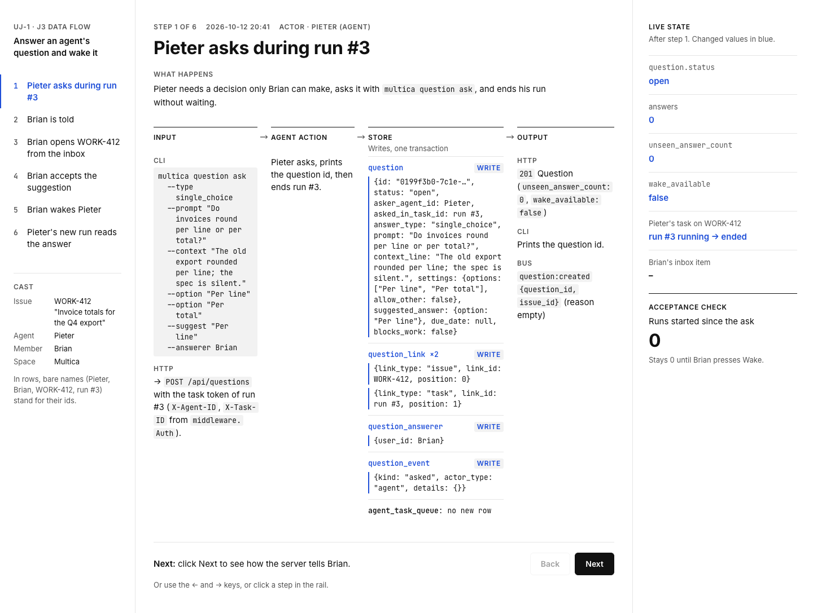
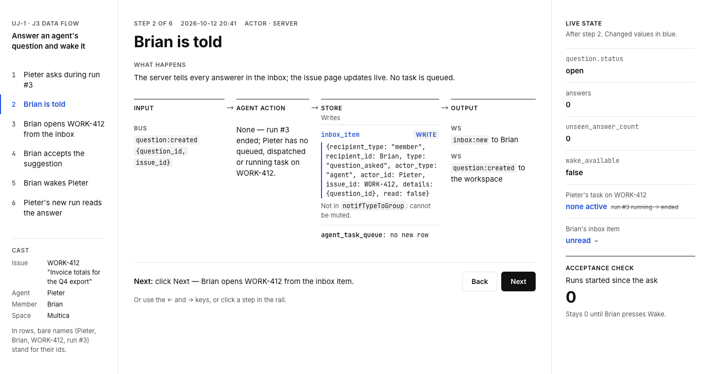
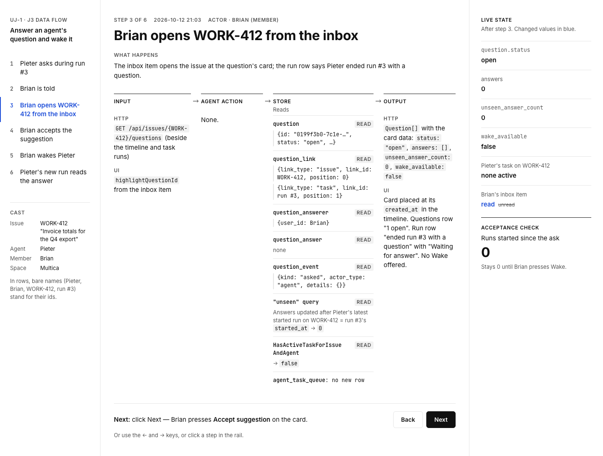
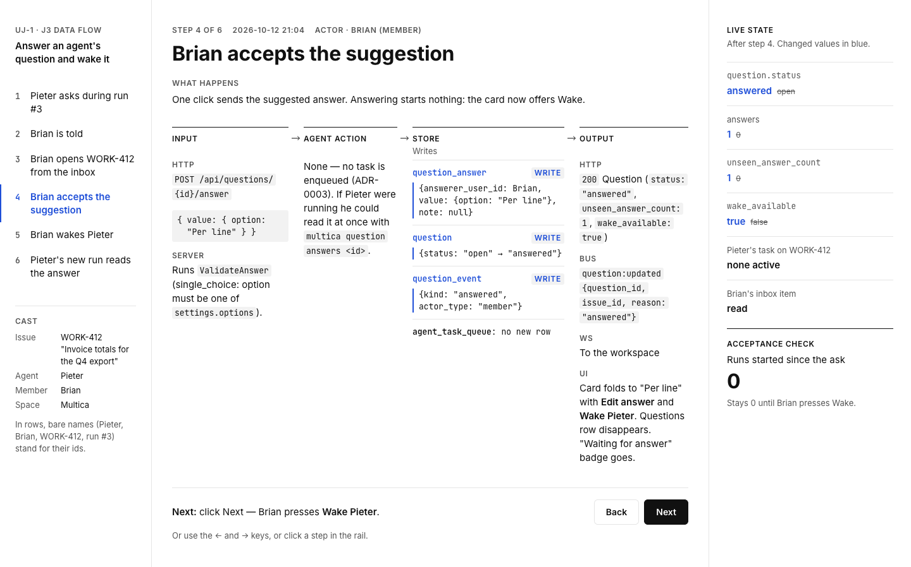
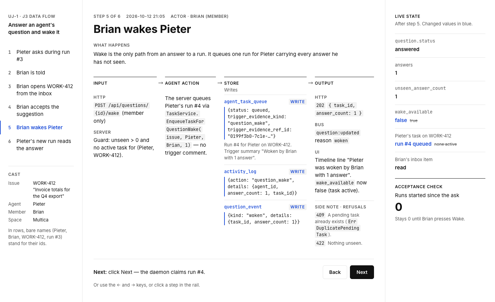
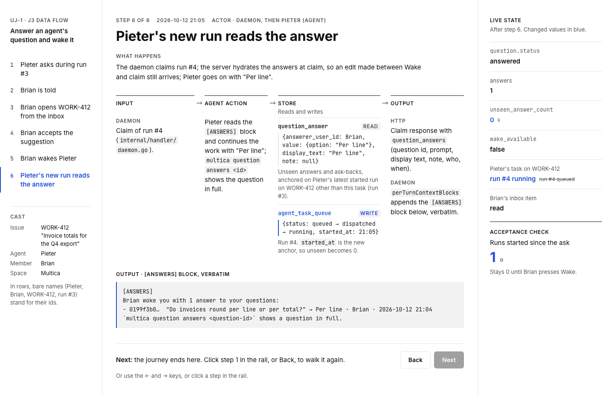

# Multica UJ-1 Data-flow prototype

Source: [UJ-1 data-flow prototype on MagicPath](https://designs.magicpath.ai/v1/keen-stone-4126)
Repository copy: [prototypes/web/issue-questions/data-flow](https://github.com/appboypov/multica/tree/das-446-uj-1-j3-data-flow-prototype/prototypes/web/issue-questions/data-flow), in [PR #14](https://github.com/appboypov/multica/pull/14)
Built for UJ-1 J3 Data-flow prototype: Build of journey UJ-1 Answer an agent's question and wake it, change `answer-an-agents-question-and-wake-it`.

## What it shows

Journey UJ-1 of Questions in Multica as data, without product UI, in six steps: Pieter asks during run #3, Brian is told, Brian opens WORK-412 from the inbox, Brian accepts the suggestion, Brian wakes Pieter, Pieter's new run reads the answer. Each step shows its input, the agent's action, the stores it writes or reads with their rows, and its output. A Live state panel follows the question; "Runs started since the ask" stays 0 until Brian presses Wake.

## Exports

