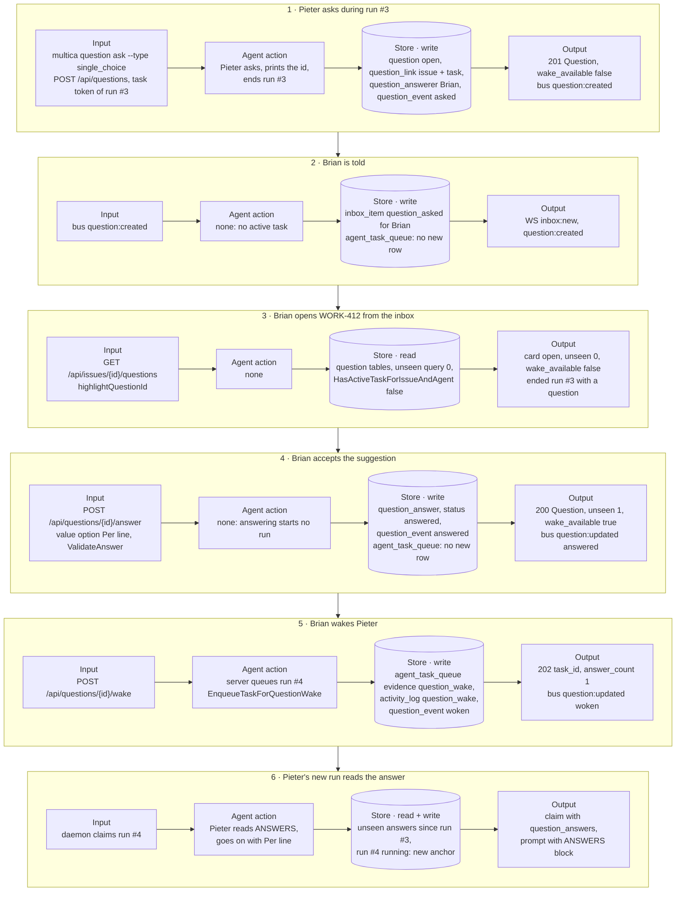

# UJ-1 data-flow prototype

## At a glance

Data flow of journey UJ-1 "Answer an agent's question and wake it", per step: its input, the agent's action, the stores it writes or reads, and its output, as the prototype shows them.

| Kind | Name | Change | Path |
|---|---|---|---|
| Prototype | UJ-1 data-flow prototype (MagicPath source) | new | `prototypes/web/issue-questions/data-flow/src/` |
| Export | One PNG per journey step | new | `prototypes/web/issue-questions/data-flow/*.png` |
| Doc | This README | new | `prototypes/web/issue-questions/data-flow/README.md` |
| Plan | Task 4.1 ticked | changed | `specs/openspec/changes/answer-an-agents-question-and-wake-it/tasks.md` |

## The prototype

MagicPath: https://designs.magicpath.ai/v1/keen-stone-4126

An interactive view without product UI. The rail on the left lists the six steps; Back, Next and the arrow keys move between them. Each step shows what happens, its input, the agent's action, the stores it writes or reads with their rows, its output, and what to click next. The Live state panel on the right follows the question through the journey and marks what the step changed. Its last row, "Runs started since the ask", is the journey's acceptance check: it stays 0 until Brian presses Wake.

`src/` is the submitted MagicPath component source; the PNGs are screenshots of the hosted build at 1440 wide, one per step: `1-ask.png`, `2-told.png`, `3-open-issue.png`, `4-accept-suggestion.png`, `5-wake.png`, `6-woken-run.png`.

The names and values come from the change's `design.md` ("Journey sequence and data flow", decisions 1 to 5 and 7) and the J2 data models merged in appboypov/multica#12: `packages/core/types/question.ts`, `packages/core/types/inbox.ts`, `server/pkg/protocol/events.go`, `server/internal/service/question_actions.go` and `server/migrations/566_question.up.sql`. The ids, issue title and times are example data.
