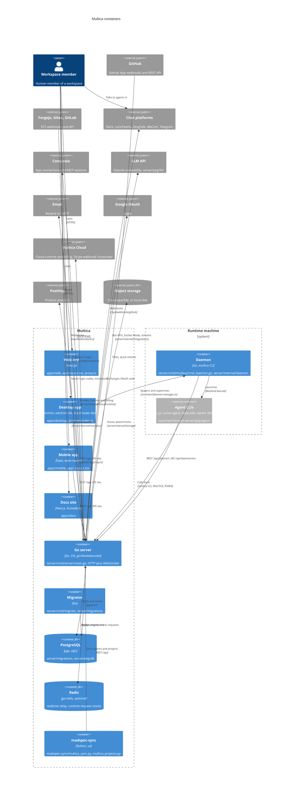
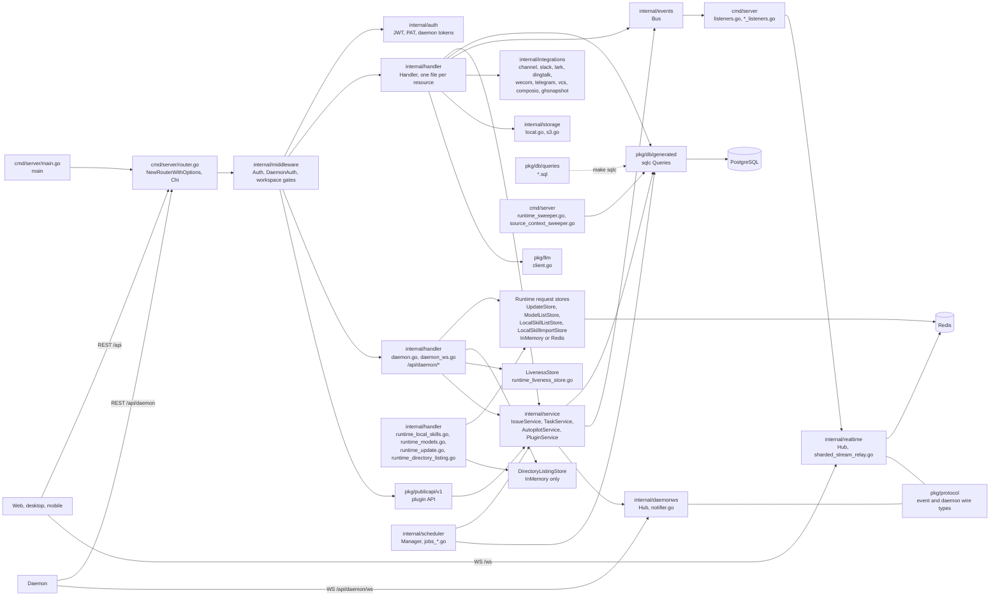
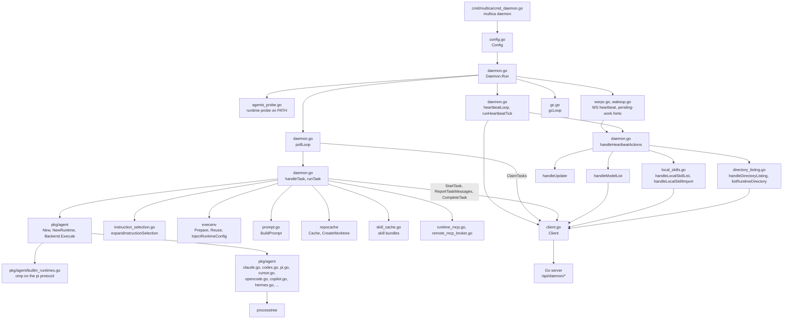
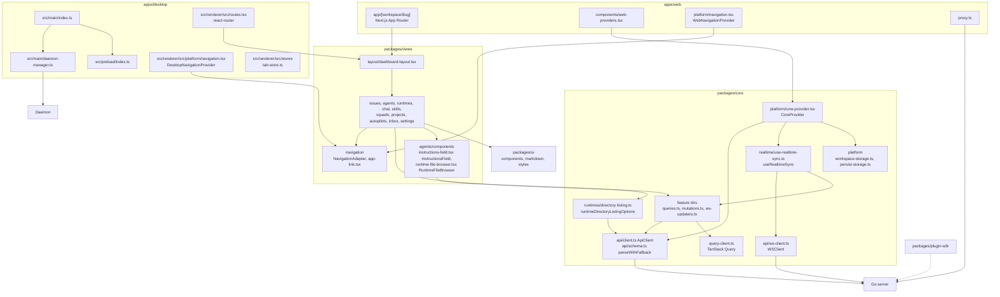
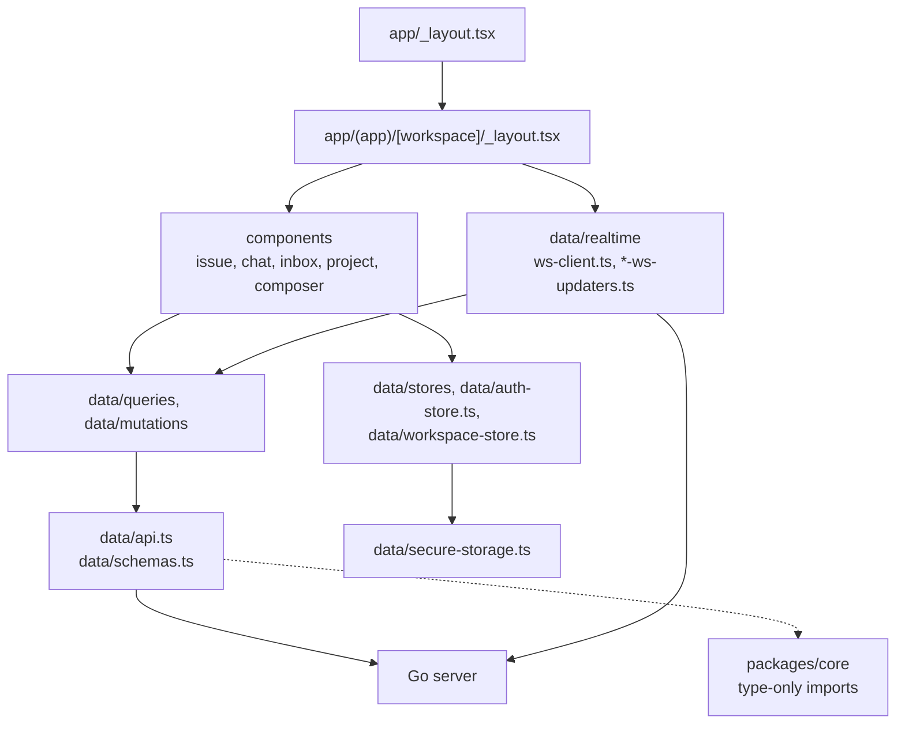
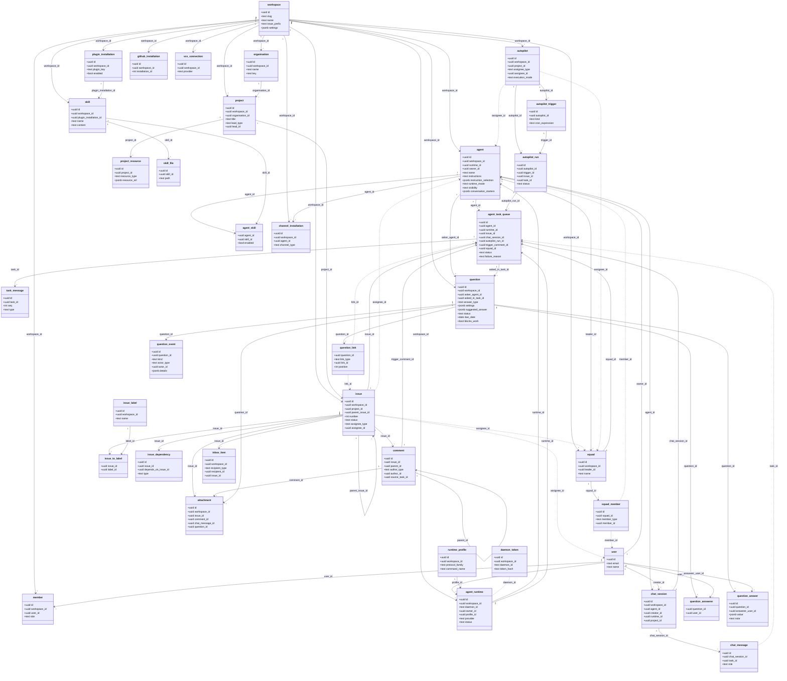

# Multica system design

Drawn from the code of the fork at `146d20e5c`.

## Context and containers

## Component maps

### Go server

### Daemon

### Web and desktop

### Mobile

## Models

## Absent

- No remote CI: `.github/` holds only `ISSUE_TEMPLATE/` and `PULL_REQUEST_TEMPLATE.md`; verification is `make check` in `Makefile`.
- No release feed: `multica update` answers `LocalReleaseUpdateMessage` (`server/internal/cli/update.go`); releases come from `make upstream-sync` and `make local-release`.
- No Redis in the self-host stack (`docker-compose.selfhost.yml`): the realtime hub and runtime request stores run in memory on one node.
- No new foreign keys or cascades (`AGENTS.md`); tables since `server/migrations/173_remove_resource_label_foreign_keys.up.sql` relate by id columns only, while early tables such as those in `001_init.up.sql` keep theirs.
- No direct server access to a runtime machine: the server reaches it only through daemon heartbeat responses and `/api/daemon/ws`.
- No bundled agent CLIs: the daemon finds them on `PATH` or `MULTICA_<ID>_PATH` (`server/internal/daemon/agents_probe.go`, `server/pkg/agent/builtin_runtimes.go`).
- No shared UI on mobile: `apps/mobile` imports `packages/core` types only and never `packages/views` or `packages/ui`.
