# Multica system design

Multica's system structure and data flow ([ADR-0017](../../adr/0017-a-to-do-is-a-row-the-server-opens-and-closes.md)).

## Context and containers

```mermaid
C4Container
  title Multica containers

  Person(member, "Workspace member", "Human member of a workspace")

  System_Boundary(product, "Multica") {
    Container(web, "Web app", "Next.js", "apps/web, app/layout.tsx, proxy.ts")
    Container(desktop, "Desktop app", "Electron, electron-vite, react-router-dom", "apps/desktop, src/main/index.ts")
    Container(mobile, "Mobile app", "Expo, expo-router", "apps/mobile, app/_layout.tsx")
    Container(docs, "Docs site", "Next.js, Fumadocs", "apps/docs")
    Container(server, "Go server", "Go, Chi, gorilla/websocket", "server/cmd/server/main.go, HTTP plus WebSocket")
    Container(migrate, "Migrator", "Go", "server/cmd/migrate, server/migrations")
    ContainerDb(pg, "PostgreSQL", "pgx, sqlc", "server/migrations, server/pkg/db")
    ContainerDb(redis, "Redis", "go-redis, optional", "realtime relay, runtime request stores")
    Container(madsync, "madspec-sync", "Python, uv", "madspec-sync/multica_sync.py, multica_projects.py")
  }

  Boundary(machine, "Runtime machine") {
    Container(daemon, "Daemon", "Go, multica CLI", "server/cmd/multica/cmd_daemon.go, server/internal/daemon")
    Container_Ext(clis, "Agent CLIs", "claude, codex, omp, pi, cursor-agent, opencode, copilot, hermes, kimi, qwen, ...", "launched through server/pkg/agent")
  }

  System_Ext(github, "GitHub", "GitHub App webhooks and REST API")
  System_Ext(vcs, "Forgejo, Gitea, GitLab", "VCS webhooks and API")
  System_Ext(chat, "Chat platforms", "Slack, Lark/Feishu, DingTalk, WeCom, Telegram")
  System_Ext(composio, "Composio", "App connections and MCP sessions")
  System_Ext(llmapi, "LLM API", "OpenAI-compatible, server/pkg/llm")
  System_Ext(typesafe, "TypeSafe", "Typed choice API, api.typesafe.ai")
  System_Ext(mail, "Email", "Resend or SMTP")
  System_Ext(google, "Google OAuth", "Login")
  System_Ext(cloud, "Multica Cloud", "Cloud runtime and billing, Stripe webhook forwarded")
  System_Ext(posthog, "PostHog", "Product analytics")
  SystemDb_Ext(s3, "Object storage", "S3-compatible, or local disk")

  Rel(member, web, "Uses", "HTTPS")
  Rel(member, desktop, "Uses")
  Rel(member, mobile, "Uses")
  Rel(member, docs, "Reads", "HTTPS")
  Rel(member, chat, "Talks to agents in")
  Rel(web, server, "REST /api, WS /ws", "proxied by proxy.ts")
  Rel(desktop, server, "REST /api, WS /ws")
  Rel(mobile, server, "REST /api, WS /ws")
  Rel(desktop, daemon, "Spawns and supervises", "src/main/daemon-manager.ts")
  Rel(daemon, server, "REST /api/daemon, WS /api/daemon/ws")
  Rel(daemon, clis, "Launches, steers notices into running runs", "Backend.Execute, Session.Supplement")
  Rel(clis, server, "Calls back", "multica CLI, MULTICA_TOKEN")
  Rel(madsync, server, "Syncs agents and projects", "REST /api")
  Rel(server, pg, "Reads and writes", "pgxpool")
  Rel(migrate, pg, "Applies migrations")
  Rel(server, redis, "Relays events, stores requests")
  Rel(server, s3, "Stores attachments", "server/internal/storage")
  Rel(github, server, "Webhooks", "/api/webhooks/github")
  Rel(vcs, server, "Webhooks", "/api/webhooks/vcs")
  Rel(server, chat, "Bot APIs, Socket Mode, streams", "server/internal/integrations")
  Rel(server, composio, "Connects apps", "server/pkg/composio")
  Rel(server, llmapi, "Titles, quick actions")
  Rel(server, typesafe, "Asks routine choices", "server/internal/service/decider_judgment.go")
  Rel(server, mail, "Sends login codes, invitations")
  Rel(server, google, "Exchanges OAuth code")
  Rel(server, cloud, "Proxies runtime and billing", "server/internal/cloudruntime")
  Rel(server, posthog, "Captures events", "server/internal/analytics")
```

## Component maps

### Go server

```mermaid
flowchart LR
  main["cmd/server/main.go<br/>main"]
  router["cmd/server/router.go<br/>NewRouterWithOptions, Chi"]
  mw["internal/middleware<br/>Auth, DaemonAuth, workspace gates"]
  clientgate["internal/middleware/client_gate.go<br/>clientGate, clientSessionRoutes"]
  membership["internal/handler/membership.go<br/>GET /api/me/memberships"]
  clientreads["internal/handler/client_read.go<br/>GET /api/me/waits, /api/me/waits/{id},<br/>/api/me/planned-work"]
  clientqueries["pkg/db/queries/client_read.sql<br/>live membership, narrow projections"]
  authpkg["internal/auth<br/>JWT, PAT, daemon tokens"]
  handlers["internal/handler<br/>Handler, one file per resource"]
  daemonapi["internal/handler<br/>daemon.go, daemon_ws.go<br/>/api/daemon/*"]
  runtimeh["internal/handler<br/>runtime_local_skills.go, runtime_models.go,<br/>runtime_update.go, runtime_directory_listing.go"]
  reqstores["Runtime request stores<br/>UpdateStore, ModelListStore,<br/>LocalSkillListStore, LocalSkillImportStore<br/>InMemory or Redis"]
  dirstore["DirectoryListingStore<br/>InMemory only"]
  liveness["LivenessStore<br/>runtime_liveness_store.go"]
  publicapi["pkg/publicapi/v1<br/>plugin API"]
  services["internal/service<br/>IssueService, TaskService,<br/>AutopilotService, PluginService"]
  sqlc["pkg/db/generated<br/>sqlc Queries"]
  sqlfiles["pkg/db/queries<br/>*.sql"]
  pg[("PostgreSQL")]
  redis[("Redis")]
  bus["internal/events<br/>Bus"]
  listeners["cmd/server<br/>listeners.go, *_listeners.go"]
  hub["internal/realtime<br/>Hub, sharded_stream_relay.go"]
  dhub["internal/daemonws<br/>Hub, notifier.go"]
  sched["internal/scheduler<br/>Manager, jobs_*.go"]
  sweepers["cmd/server<br/>runtime_sweeper.go, source_context_sweeper.go"]
  integ["internal/integrations<br/>channel, slack, lark, dingtalk,<br/>wecom, telegram, vcs, composio, ghsnapshot"]
  storage["internal/storage<br/>local.go, s3.go"]
  llm["pkg/llm<br/>client.go"]
  protocol["pkg/protocol<br/>event and daemon wire types"]
  questions["internal/service/question.go<br/>QuestionService"]
  questionrules["internal/question<br/>answer-type registry, validation, display"]
  questionwait["internal/service/question_wake_pending.go<br/>durable wake drain"]
  questiontransition["internal/service/question_wake_transition.go<br/>shared lifecycle holders / exclusive delivery"]
  questionrecovery["cmd/server/question_wake_reconciler.go<br/>startup and 30-second bounded sweep"]
  questionpending[("question_wake_pending<br/>attribution and answer_anchor")]
  questioncli["cmd/multica/cmd_question.go<br/>multica question"]
  questionjob["internal/scheduler/jobs_question_overdue.go<br/>QuestionOverdueJob"]
  runinput["internal/service/run_input.go<br/>RunInputService.Deliver"]
  supp["internal/handler/task_supplement.go<br/>steerCommentAgentTriggers,<br/>ClaimTaskSupplement, AckTaskSupplement"]
  react["internal/handler/run_input.go<br/>ReactToRunInput"]
  reactcli["cmd/multica/cmd_issue.go<br/>multica issue react, inside a run"]
  todos["internal/todo<br/>Service, Response"]
  todolisteners["cmd/server/todo_listeners.go"]
  todoh["internal/handler/todo.go<br/>GET /api/todos, /api/todos/summary<br/>POST /api/todos/{id}/done"]
  decider["internal/service/decider*.go<br/>DeciderService, TypeSafeDecider"]
  deciderlisteners["cmd/server/decider_listeners.go"]
  typesafe["TypeSafe API<br/>/v1/systemone, TYPESAFE_API_KEY"]
  checkh["internal/handler/check.go, check_record.go<br/>/api/todos/checks, /api/todos/{id}/answer,<br/>/api/todos/{id}/undo-result, /api/todos/check-settings,<br/>/api/projects/{id}/check-trust"]
  checks["internal/service/check.go, check_instruction.go,<br/>check_record.go<br/>QuestionService checks, instruction notes, records"]
  todocli["cmd/multica/cmd_todo.go<br/>multica todo"]
  orgh["internal/handler<br/>organisation.go, project.go<br/>/api/organisations, organisation_id"]
  projsync["madspec-sync/multica_projects.py<br/>organisations, Product projects,<br/>single-repo merges"]
  marks[("~/.local/state/madspec/multica<br/>brain-sync.json, repository_projects")]
  brain["Anytype brain<br/>Organisations, Products, Repositories"]
  clients["Web, desktop, mobile"]
  daemon["Daemon"]

  main --> router
  router --> mw --> authpkg
  mw --> clientgate --> handlers
  clientgate --> membership --> sqlc
  clientgate --> clientreads --> clientqueries --> sqlc
  clientgate --> sqlc
  clientgate --> daemonapi
  mw --> publicapi
  clients -->|"REST /api"| router
  questioncli -->|"REST /api/questions"| router
  projsync -->|"REST /api/organisations, /api/projects,<br/>/api/issues/batch-update"| router
  brain -->|"read only"| projsync
  projsync --> marks
  clientgate --> orgh
  orgh --> sqlc
  orgh -->|"organisation:created, organisation:updated"| bus
  clients -->|"WS /ws"| hub
  daemon -->|"REST /api/daemon"| router
  daemon -->|"WS /api/daemon/ws"| dhub
  handlers --> services
  handlers --> questions
  questions --> questionrules
  questions --> sqlc
  questions -->|"EnqueueTaskForQuestionWake,<br/>EnqueueChatTaskForQuestionWake"| services
  questions -->|"blocked Wake: persist or coalesce"| questionpending
  questionwait -->|"issue lock: blockers, live scope,<br/>unseen input and handled receipts"| sqlc
  questionwait --> questionpending
  questionwait -->|"task + activity + woken event<br/>and intent deletion in one transaction"| services
  services -->|"QuestionWakeDrainer after terminal<br/>comment and retry reconciliation"| questionwait
  handlers -->|"issue delete, comment edit/delete:<br/>shared holders through replacement/recovery<br/>and synchronous nested callbacks"| questiontransition
  questiontransition -->|"release holder, then try drain"| questionwait
  questionwait -->|"nonblocking exclusive delivery lock"| questiontransition
  questions -->|"try exclusive delivery lock;<br/>fenced: persist accepted wait"| questiontransition
  questiontransition --> sqlc
  main --> questionrecovery --> questionwait
  daemonapi -->|"loadClaimQuestionAnswers:<br/>fresh input using context anchor"| sqlc
  daemonapi --> questionrules
  questions --> bus
  handlers -->|"comment create, text edit"| supp
  mw --> supp
  supp --> runinput
  questions -->|"answered, answer_edited, ask_back"| runinput
  listeners -->|"issue-change activity rows"| runinput
  runinput --> sqlc
  runinput -->|"NotifyTaskSupplementAvailable"| dhub
  supp --> sqlc
  reactcli -->|"REST /api/tasks/{taskId}/inputs/{itemId}/reactions"| router
  mw --> react
  react --> sqlc
  react -->|"run_input:reacted"| bus
  daemonapi -->|"run end: replay comments without handled_at"| sqlc
  handlers --> sqlc
  runtimeh --> reqstores
  daemonapi --> reqstores
  runtimeh --> dirstore
  daemonapi --> dirstore
  daemonapi --> liveness
  daemonapi --> services
  publicapi --> services
  services --> sqlc
  sqlfiles -.->|"make sqlc"| sqlc
  sqlc --> pg
  reqstores --> redis
  handlers --> bus
  services --> bus
  bus --> listeners
  listeners --> hub
  services --> dhub
  hub --> redis
  sched --> services
  main --> sched --> questionjob
  questionjob --> sqlc
  questionjob --> bus
  handlers --> todoh
  todoh --> sqlc
  todoh --> todos
  bus --> todolisteners --> todos
  services --> todos
  todos --> sqlc
  todos -->|"todo:opened, todo:closed"| bus
  bus -->|"issue:created, issue:updated status_changed,<br/>issue:release_joined, task:completed/failed/cancelled"| deciderlisteners --> decider
  decider -->|"Decide: action and reason"| typesafe
  decider -->|"Decider task, fix-now lead task"| services
  decider -->|"routine_decision"| sqlc
  decider -->|"review and question to-dos"| todos
  decider -->|"issue:updated decider_applied,<br/>comment:created, question:created"| bus
  questions -->|"answered, answer_edited: reviewConfirmation"| decider
  handlers -->|"settings.decider: AuthorizeDeciderSettings"| decider
  todocli -->|"REST /api/todos/checks, /api/todos/{id}/answer,<br/>/api/todos/{id}/undo-result"| router
  handlers --> checkh --> checks
  checks --> sqlc
  checks -->|"PublishOpened, PublishClosed"| todos
  checks -->|"answer or Undo: new queued or deferred run"| services
  checks -->|"NotifyTaskSupplementAvailable"| dhub
  sched --> sqlc
  sweepers --> sqlc
  handlers --> integ
  handlers --> storage
  handlers --> llm
  hub --- protocol
  dhub --- protocol
```

Source-context object cleanup materializes one due intent before updating its lease
(`server/pkg/db/queries/source_context.sql`). Each attempt owns at most one intent;
the round limit bounds attempts, including failed object deletions.

### Daemon

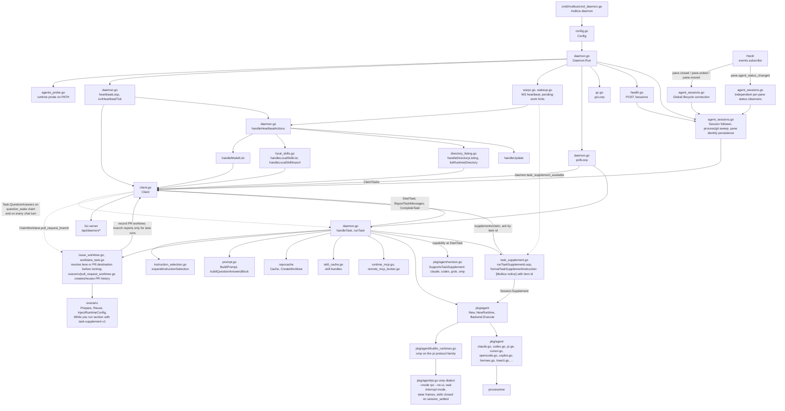

Traecli completion (`server/pkg/agent/traecli.go`) closes stdin after the ACP
notification quiet window, then drains stdout and stderr before inspecting the
final result. A bounded drain and process reap stop a lingering process without
discarding final notifications emitted after stdin EOF.

### Release coordination

```mermaid
flowchart LR
  cli["cmd/multica/cmd_release*.go<br/>assign, comment, wakeup"]
  api["internal/handler/release_owner.go,<br/>release_detail.go, release_comment*.go,<br/>release_wakeup.go"]
  capture["migrations/757_release_coordination_capture.up.sql<br/>member comments and terminal issue transitions"]
  receipts[("issue_wakeup<br/>issue_wakeup_receipt")]
  dispatch["internal/service/release_coordination*.go<br/>IssueWakeupService.dispatchRelease"]
  tasks["internal/service/task*.go<br/>native enqueue, finalize, start, result"]
  claims["internal/handler/release_claim.go<br/>hydrateReleaseClaim"]
  daemon["internal/daemon/prompt.go, execenv/<br/>release scope and release result surface"]
  report["internal/service/task_release_result.go<br/>actual result or existing source-task comment"]
  comments[("comment.release_id")]
  events["release_line:updated<br/>release_comment:created"]

  cli --> api
  api -->|"repository-locked ownership write"| capture
  api --> comments
  comments -->|"member inserts"| capture
  capture --> receipts
  receipts --> dispatch
  dispatch -->|"current owner or squad leader"| tasks
  tasks -->|"release-coordination-v1"| claims
  claims -->|"ordered issues, actors, exact comment receipts"| daemon
  daemon -->|"explicit release comment"| api
  tasks -->|"winning terminal transition"| report --> comments
  api -->|"after commit"| events
```

Owner changes cancel unstarted runs; started runs keep their result surface. Claim and start recheck the release's owner, current squad leader, existence and shipment under the repository boundary. Dispatched inputs stay immutable; later facts remain pending for a follow-up. Shipping uses the existing explicit endpoint and removes waits without cancelling its running publisher.

### Agent CLI and persona sync

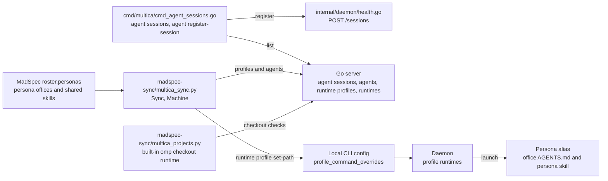
### Web and desktop

```mermaid
flowchart TB
  subgraph web["apps/web"]
    webroutes["app/[workspaceSlug]<br/>Next.js App Router"]
    webproviders["components/web-providers.tsx"]
    webnav["platform/navigation.tsx<br/>WebNavigationProvider"]
    proxy["proxy.ts"]
  end
  subgraph desktop["apps/desktop"]
    dmain["src/main/index.ts"]
    dmanager["src/main/daemon-manager.ts"]
    preload["src/preload/index.ts"]
    droutes["src/renderer/src/routes.tsx<br/>react-router"]
    dnav["src/renderer/src/platform/navigation.tsx<br/>DesktopNavigationProvider"]
    dstores["src/renderer/src/stores<br/>tab-store.ts"]
  end
  subgraph views["packages/views"]
    layout["layout/dashboard-layout.tsx"]
    pages["issues, agents, runtimes, chat, skills,<br/>squads, projects, organisations,<br/>autopilots, inbox, settings"]
    navigation["navigation<br/>NavigationAdapter, app-link.tsx"]
    instrfield["agents/components<br/>instructions-field.tsx InstructionsField,<br/>runtime-file-browser.tsx RuntimeFileBrowser"]
    skillstab["agents/components/tabs/skills-tab.tsx<br/>SkillsTab, CapabilitySection<br/>Switch"]
    projtable["projects/components<br/>project-table.tsx ProjectTable,<br/>organisation-picker.tsx OrganisationPicker"]
    questions["questions<br/>question-card.tsx QuestionCard,<br/>answer-controls AnswerControl,<br/>reassign-picker.tsx, wake-button.tsx,<br/>row-link.ts chatRowHref"]
    chatquestions["chat/components<br/>chat-question-cards.tsx ChatQuestionCards,<br/>chat/lib/question-placement.ts placeQuestionCards"]
    composer["issues/components<br/>comment-input.tsx, reply-input.tsx, comment-trigger-chips.tsx;<br/>issues/hooks/use-recipient-actions.ts"]
    marks["issues/components/run-input-marks.tsx<br/>RunInputMarks: 👀 and ✅ with the agent's name<br/>on comments, answers, activity rows"]
    checkviews["inbox/components<br/>todo-check-body.tsx TodoCheckBody,<br/>todo-instruction-body.tsx TodoInstructionBody,<br/>project-check-record.tsx ProjectCheckRecord;<br/>projects/components/project-detail.tsx"]
    releasepage["releases/components<br/>ReleaseDetailRoute, ReleaseDetail,<br/>ReleaseOwnerPicker, ReleaseComments"]
  end
  subgraph core["packages/core"]
    coreprovider["platform/core-provider.tsx<br/>CoreProvider"]
    api["api/client.ts ApiClient<br/>setAgentRuntimeSkillsInherited,<br/>setAgentRuntimeSkillEnabled<br/>api/schema.ts parseWithFallback"]
    wsclient["api/ws-client.ts<br/>WSClient"]
    features["feature dirs<br/>queries.ts, mutations.ts, ws-updaters.ts"]
    orgs["organisations<br/>queries.ts, mutations.ts"]
    group["projects/group.ts<br/>groupProjectsByOrganisation"]
    dirlisting["runtimes/directory-listing.ts<br/>runtimeDirectoryListingOptions"]
    steering["issues/run-steering.ts<br/>resolveRecipientAction, recipientRouting:<br/>Add to current run by default"]
    runinputtypes["types/run-input.ts<br/>RunInputMark, RunInputItemKind"]
    corequestions["questions<br/>queries.ts chatQuestionsOptions, mutations.ts,<br/>scope.ts QuestionScope,<br/>ws-updaters.ts, validate.ts validateAnswer"]
    corechecks["todos/checks.ts<br/>useAnswerCheckTodo, useProjectCheckTrust,<br/>useSetCheckSampling, useCheckHistory"]
    releases["releases/queries.ts, mutations.ts<br/>workspace-scoped detail, issues,<br/>comments, activity and owner writes"]
    realtime["realtime/use-realtime-sync.ts<br/>useRealtimeSync, run_input:reacted refetches<br/>the timeline and question queries"]
    platform["platform<br/>workspace-storage.ts, persist-storage.ts"]
    qc["query-client.ts<br/>TanStack Query"]
  end
  ui["packages/ui<br/>components, markdown, styles"]
  sdk["packages/plugin-sdk"]
  server["Go server"]
  daemon["Daemon"]

  webroutes --> layout
  webproviders --> coreprovider
  webnav --> navigation
  droutes --> layout
  webroutes -->|"releases/[id]"| releasepage
  droutes -->|"releases/:id workspace tab"| releasepage
  dnav --> navigation
  dmain --> dmanager --> daemon
  dmain --> preload
  layout --> pages
  pages --> navigation
  pages --> features
  pages --> instrfield
  pages --> skillstab
  skillstab --> api
  skillstab --> ui
  releasepage --> releases --> api
  releasepage --> navigation
  releasepage --> ui
  realtime -->|"release_line:updated / release_comment:created"| releases
  pages --> projtable
  pages --> orgs
  pages --> group
  instrfield --> dirlisting
  dirlisting --> api
  pages --> ui
  pages --> questions
  pages --> chatquestions
  chatquestions --> questions
  chatquestions --> corequestions
  questions --> corequestions
  questions --> ui
  pages --> composer
  composer --> steering
  pages --> marks
  questions --> marks
  marks --> runinputtypes
  marks --> ui
  pages --> checkviews
  checkviews --> corechecks
  checkviews --> ui
  corechecks --> api
  corechecks --> qc
  corequestions --> api
  corequestions --> qc
  realtime --> corequestions
  features --> api
  features --> qc
  orgs --> api
  orgs --> qc
  realtime --> wsclient
  realtime --> features
  realtime --> orgs
  coreprovider --> api
  coreprovider --> realtime
  coreprovider --> platform
  api --> server
  wsclient --> server
  proxy --> server
  sdk -.-> server
```

### Mobile

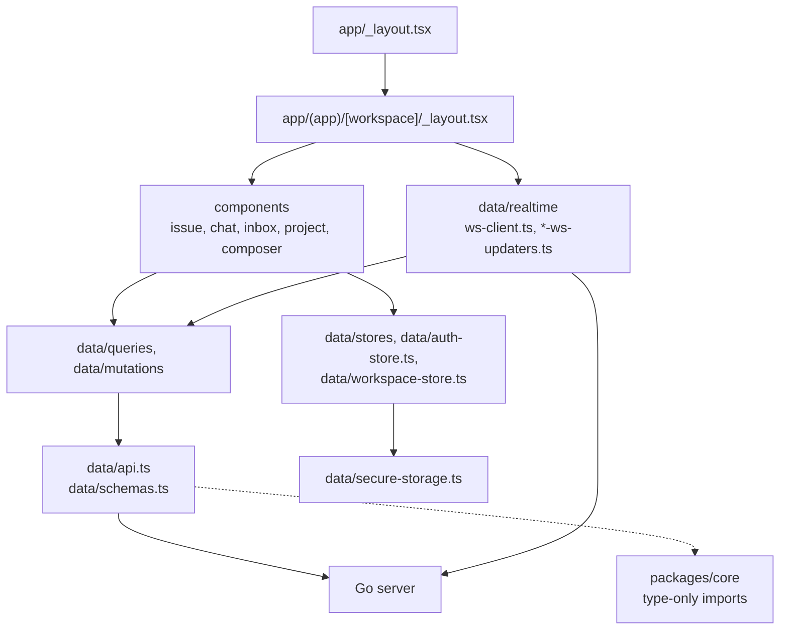

## Models

```mermaid
classDiagram
  class workspace {
    +uuid id
    +text slug
    +text name
    +text issue_prefix
    +jsonb settings
  }
  class user {
    +uuid id
    +text email
    +text name
  }
  class member {
    +uuid id
    +uuid workspace_id
    +uuid user_id
    +text role
    +uuid[] organisation_ids
  }
  class workspace_invitation {
    +uuid id
    +uuid workspace_id
    +text invitee_email
    +text role
    +uuid[] organisation_ids
    +text status
  }
  class agent {
    +uuid id
    +uuid workspace_id
    +uuid runtime_id
    +uuid owner_id
    +text name
    +text instructions
    +jsonb instruction_selection
    +jsonb disabled_runtime_skills
    +bool inherit_runtime_skills
    +text runtime_mode
    +text visibility
    +jsonb conversation_starters
  }
  class agent_runtime {
    +uuid id
    +uuid workspace_id
    +text daemon_id
    +uuid owner_id
    +uuid profile_id
    +text provider
    +text status
  }
  class agent_session {
    +uuid id
    +uuid workspace_id
    +uuid agent_id
    +text daemon_id
    +integer pid
    +timestamptz process_started_at
    +text herdr_pane_id
    +text work_dir
    +text repository
    +text branch
    +text status
    +timestamptz started_at
  }
  class runtime_profile {
    +uuid id
    +uuid workspace_id
    +text protocol_family
    +text command_name
  }
  class daemon_token {
    +uuid id
    +uuid workspace_id
    +text daemon_id
    +text token_hash
  }
  class agent_task_queue {
    +uuid id
    +uuid agent_id
    +uuid runtime_id
    +uuid issue_id
    +uuid release_id
    +uuid chat_session_id
    +uuid autopilot_run_id
    +uuid trigger_comment_id
    +uuid squad_id
    +text status
    +text failure_reason
    +uuid retry_of_task_id
    +jsonb context
  }
  class release {
    +uuid id
    +uuid workspace_id
    +uuid repository_id
    +text version
    +text title
    +text owner_type
    +uuid owner_id
    +timestamptz shipped_at
  }
  class issue_wakeup {
    +uuid id
    +uuid workspace_id
    +uuid issue_id
    +uuid release_id
    +text system_rule
    +jsonb condition
    +bigint revision
  }
  class issue_wakeup_receipt {
    +uuid id
    +uuid wakeup_id
    +text event_key
    +uuid task_id
    +timestamptz processed_at
  }
  class task_supplement {
    +uuid task_id
    +uuid item_id
    +text item_kind
    +uuid comment_id
    +uuid issue_id
    +uuid author_id
    +text content
    +text status
    +timestamptz seen_at
    +timestamptz handled_at
  }
  class activity_log {
    +uuid id
    +uuid issue_id
    +text actor_type
    +uuid actor_id
    +text action
    +jsonb details
  }
  class task_message {
    +uuid id
    +uuid task_id
    +int seq
    +text type
  }
  class issue {
    +uuid id
    +uuid workspace_id
    +uuid project_id
    +uuid parent_issue_id
    +uuid release_id
    +uuid worklane_id
    +float8 lane_position
    +int number
    +text status
    +text assignee_type
    +uuid assignee_id
  }
  class worklane {
    +uuid id
    +uuid workspace_id
    +uuid repository_id
    +bool is_main
    +text path
    +text branch
  }
  class repository {
    +uuid id
    +uuid workspace_id
    +uuid project_id
    +text full_name
  }
  class issue_worktree {
    +uuid id
    +uuid workspace_id
    +uuid issue_id
    +uuid repository_id
    +text path
    +text branch
    +text state
  }
  class comment {
    +uuid id
    +uuid issue_id
    +uuid release_id
    +uuid parent_id
    +text author_type
    +uuid author_id
    +uuid source_task_id
  }
  class issue_label {
    +uuid id
    +uuid workspace_id
    +text name
  }
  class issue_to_label {
    +uuid issue_id
    +uuid label_id
  }
  class issue_dependency {
    +uuid id
    +uuid issue_id
    +uuid depends_on_issue_id
    +text type
  }
  class organisation {
    +uuid id
    +uuid workspace_id
    +text name
    +text key
  }
  class project {
    +uuid id
    +uuid workspace_id
    +uuid organisation_id
    +text title
    +text lead_type
    +uuid lead_id
  }
  class project_resource {
    +uuid id
    +uuid project_id
    +text resource_type
    +jsonb resource_ref
  }
  class skill {
    +uuid id
    +uuid workspace_id
    +uuid plugin_installation_id
    +text name
    +text content
  }
  class skill_file {
    +uuid id
    +uuid skill_id
    +text path
  }
  class agent_skill {
    +uuid agent_id
    +uuid skill_id
    +bool enabled
  }
  class squad {
    +uuid id
    +uuid workspace_id
    +uuid leader_id
    +text name
  }
  class squad_member {
    +uuid id
    +uuid squad_id
    +text member_type
    +uuid member_id
  }
  class chat_session {
    +uuid id
    +uuid workspace_id
    +uuid agent_id
    +uuid creator_id
    +uuid runtime_id
    +uuid project_id
  }
  class chat_message {
    +uuid id
    +uuid chat_session_id
    +uuid task_id
    +text role
  }
  class autopilot {
    +uuid id
    +uuid workspace_id
    +uuid project_id
    +text assignee_type
    +uuid assignee_id
    +text execution_mode
  }
  class autopilot_trigger {
    +uuid id
    +uuid autopilot_id
    +text kind
    +text cron_expression
  }
  class autopilot_run {
    +uuid id
    +uuid autopilot_id
    +uuid trigger_id
    +uuid issue_id
    +uuid task_id
    +text status
  }
  class inbox_item {
    +uuid id
    +uuid workspace_id
    +text recipient_type
    +uuid recipient_id
    +uuid issue_id
  }
  class todo {
    +uuid id
    +uuid workspace_id
    +uuid member_id
    +text kind
    +text source_key
    +uuid issue_id
    +uuid question_id
    +uuid comment_id
    +uuid task_id
    +uuid autopilot_id
    +text actor_type
    +uuid actor_id
    +text title
    +text body
    +jsonb details
    +timestamptz created_at
    +timestamptz done_at
    +text done_by
  }
  class routine_decision {
    +text id
    +uuid workspace_id
    +uuid issue_id
    +jsonb input
    +uuid task_id
    +float jev_confidence
    +jsonb proposal
    +text decider
    +uuid question_id
    +text review_mode
    +text applied_choice
    +uuid work_task_id
    +bigint automatic_number
    +jsonb reviews
    +text outcome
    +timestamptz created_at
  }
  class check_settings {
    +uuid workspace_id
    +int sample_every
  }
  class project_check_trust {
    +uuid workspace_id
    +uuid project_id
    +text kind
    +uuid member_id
    +int passed
    +int feedback
    +int automatic_passed
    +bool sampling
    +int sample_opens
  }
  class attachment {
    +uuid id
    +uuid workspace_id
    +uuid issue_id
    +uuid comment_id
    +uuid chat_message_id
    +uuid question_id
  }
  class question {
    +uuid id
    +uuid workspace_id
    +uuid_nullable asker_agent_id
    +uuid_nullable asked_in_task_id
    +uuid_nullable asker_user_id
    +check question_one_asker
    +uuid ask_id
    +int ask_position
    +text ask_title
    +text answer_policy
    +text answer_type
    +jsonb settings
    +jsonb suggested_answer
    +text status
    +date due_date
    +bool blocks_work
  }
  class question_wake_pending {
    +uuid workspace_id
    +uuid issue_id
    +uuid agent_id
    +uuid actor_user_id
    +uuid source_question_id
    +timestamptz answer_anchor
    +timestamptz created_at
  }
  class question_link {
    +uuid question_id
    +text link_type
    +uuid link_id
    +int position
  }
  class question_answerer {
    +uuid question_id
    +uuid user_id
  }
  class question_answer {
    +uuid id
    +uuid question_id
    +uuid answerer_user_id
    +jsonb value
    +text note
  }
  class question_event {
    +uuid id
    +uuid question_id
    +text kind
    +text actor_type
    +uuid actor_id
    +jsonb details
  }
  class plugin_installation {
    +uuid id
    +uuid workspace_id
    +text plugin_key
    +bool enabled
  }
  class channel_installation {
    +uuid id
    +uuid workspace_id
    +uuid agent_id
    +text channel_type
  }
  class github_installation {
    +uuid id
    +uuid workspace_id
    +int installation_id
  }
  class vcs_connection {
    +uuid id
    +uuid workspace_id
    +text provider
  }

  workspace "1" --> "*" member : workspace_id
  user "1" --> "*" member : user_id
  workspace "1" --> "*" workspace_invitation : workspace_id
  organisation "*" --> "*" member : organisation_ids, soft references
  organisation "*" --> "*" workspace_invitation : organisation_ids, soft references
  workspace "1" --> "*" agent : workspace_id
  workspace "1" --> "*" issue : workspace_id
  workspace "1" --> "*" project : workspace_id
  workspace "1" --> "*" organisation : workspace_id
  organisation "1" --> "*" project : organisation_id
  workspace "1" --> "*" skill : workspace_id
  workspace "1" --> "*" squad : workspace_id
  workspace "1" --> "*" autopilot : workspace_id
  workspace "1" --> "*" agent_runtime : workspace_id
  workspace "1" --> "*" plugin_installation : workspace_id
  workspace "1" --> "*" channel_installation : workspace_id
  workspace "1" --> "*" github_installation : workspace_id
  workspace "1" --> "*" vcs_connection : workspace_id
  user "1" --> "*" agent : owner_id
  user "1" --> "*" agent_runtime : owner_id
  agent_runtime "1" --> "*" agent : runtime_id
  runtime_profile "1" --> "*" agent_runtime : profile_id
  daemon_token .. agent_runtime : daemon_id
  workspace "1" --> "*" agent_session : workspace_id
  agent "1" --> "*" agent_session : agent_id
  agent_runtime .. agent_session : daemon_id
  agent "1" --> "*" agent_task_queue : agent_id
  agent_runtime "1" --> "*" agent_task_queue : runtime_id
  issue "1" --> "*" agent_task_queue : issue_id
  workspace "1" --> "*" worklane : workspace_id
  workspace "1" --> "*" repository : workspace_id
  workspace "1" --> "*" issue_worktree : workspace_id
  project "1" --> "*" repository : project_id
  repository "1" --> "*" worklane : repository_id
  worklane "1" --> "*" issue : worklane_id
  issue "1" --> "*" issue_worktree : issue_id, without lane
  repository "1" --> "*" issue_worktree : repository_id
  chat_session "1" --> "*" agent_task_queue : chat_session_id
  autopilot_run "1" --> "*" agent_task_queue : autopilot_run_id
  comment "1" --> "*" agent_task_queue : trigger_comment_id
  squad "1" --> "*" agent_task_queue : squad_id
  agent_task_queue "1" --> "*" agent_task_queue : retry_of_task_id, context inherited
  release "1" --> "*" agent_task_queue : release_id
  release "1" --> "*" issue : release_id
  release "1" --> "*" comment : release_id
  release "1" --> "*" issue_wakeup : release_id
  release ..> agent : owner_id
  release ..> squad : owner_id
  issue "1" --> "*" issue_wakeup : issue_id
  issue_wakeup "1" --> "*" issue_wakeup_receipt : wakeup_id
  agent_task_queue "1" --> "*" issue_wakeup_receipt : task_id
  agent_task_queue "1" --> "*" task_message : task_id
  agent_task_queue "1" --> "*" task_supplement : task_id
  task_supplement ..> comment : item_id or comment_id
  task_supplement ..> question_event : item_id when answer
  task_supplement ..> activity_log : item_id when issue_change
  issue "1" --> "*" activity_log : issue_id
  project "1" --> "*" issue : project_id
  issue "1" --> "*" issue : parent_issue_id
  issue ..> user : assignee_id
  issue ..> agent : assignee_id
  issue ..> squad : assignee_id
  issue "1" --> "*" comment : issue_id
  comment "1" --> "*" comment : parent_id
  issue "1" --> "*" issue_to_label : issue_id
  issue_label "1" --> "*" issue_to_label : label_id
  issue "1" --> "*" issue_dependency : issue_id
  project "1" --> "*" project_resource : project_id
  skill "1" --> "*" skill_file : skill_id
  agent "1" --> "*" agent_skill : agent_id
  skill "1" --> "*" agent_skill : skill_id
  plugin_installation "1" --> "*" skill : plugin_installation_id
  agent "1" --> "*" squad : leader_id
  squad "1" --> "*" squad_member : squad_id
  squad_member ..> agent : member_id
  squad_member ..> user : member_id
  squad_member ..> squad : member_id
  agent "1" --> "*" chat_session : agent_id
  user "1" --> "*" chat_session : creator_id
  chat_session "1" --> "*" chat_message : chat_session_id
  chat_message ..> agent_task_queue : task_id
  autopilot ..> agent : assignee_id
  autopilot ..> squad : assignee_id
  autopilot "1" --> "*" autopilot_trigger : autopilot_id
  autopilot "1" --> "*" autopilot_run : autopilot_id
  autopilot_trigger "1" --> "*" autopilot_run : trigger_id
  issue "1" --> "*" inbox_item : issue_id
  workspace "1" --> "*" todo : workspace_id
  user "1" --> "*" todo : member_id
  issue "1" --> "*" todo : issue_id
  question "1" --> "*" todo : question_id
  comment "1" --> "*" todo : comment_id
  agent_task_queue "1" --> "*" todo : task_id
  autopilot "1" --> "*" todo : autopilot_id
  workspace "1" --> "0..1" check_settings : workspace_id
  project "1" --> "*" project_check_trust : project_id
  user "1" --> "*" project_check_trust : member_id
  project_check_trust ..> todo : project_id, kind in check details
  todo ..> user : actor_id when member
  todo ..> agent : actor_id when agent
  workspace "1" --> "*" routine_decision : workspace_id
  issue "1" --> "*" routine_decision : issue_id
  agent_task_queue "1" --> "*" routine_decision : task_id
  agent_task_queue "1" --> "*" routine_decision : work_task_id
  question "1" --> "0..1" routine_decision : question_id
  issue "1" --> "*" attachment : issue_id
  comment "1" --> "*" attachment : comment_id
  agent "1" --> "*" channel_installation : agent_id
  workspace "1" --> "*" question : workspace_id
  agent "1" --> "*" question : asker_agent_id
  agent_task_queue "1" --> "*" question : asked_in_task_id
  user "1" --> "*" question : asker_user_id
  question "*" --> "1" question : ask_id
  question "1" --> "*" question_link : question_id
  question_link ..> issue : link_id
  question_link ..> agent_task_queue : link_id
  question_link ..> chat_session : link_id
  question "1" --> "*" question_answerer : question_id
  user "1" --> "*" question_answerer : user_id
  question "1" --> "*" question_answer : question_id
  user "1" --> "*" question_answer : answerer_user_id
  question "1" --> "*" question_event : question_id
  question "1" --> "*" attachment : question_id
  workspace "1" --> "*" question_wake_pending : workspace_id
  issue "1" --> "*" question_wake_pending : issue_id
  agent "1" --> "*" question_wake_pending : agent_id
  user "1" --> "*" question_wake_pending : actor_user_id
  question "1" --> "*" question_wake_pending : source_question_id
  question_wake_pending ..> agent_task_queue : waits for blockers; carries answer_anchor into context
```

`routine_decision` is one receipt per rule and issue or release state. Its `id` is the SHA-256 of its input without the start period and threshold. A release decision's `issue_id` is the issue whose event made the release ready. `outcome` starts as `judging` and is `pending` while a Decider task runs. A proposal waits as `awaiting_brian` until Brian answers; every decision ends as `applied`, `stale` or `failed`. `reviews` appends Brian's agreed or corrected entries. `automatic_number` is unique per workspace and `question_id` is unique (migrations 781 and 782).

`task_supplement` holds one receipt per item and run, keyed `(item_id, task_id)`: `item_kind` is `comment`, `comment_edit`, `answer` or `issue_change`, and `comment_id` stays set for comments and their edits only. `RunInputService.Deliver` writes a `pending` receipt for every running run with `task-supplement-v1` on the item's issues, except the actor's own agent's run and runs the composer excluded; `content` snapshots the item's text at delivery, with a comment's file names and ids. `multica issue react` sets `seen_at` (👀) or `handled_at` (✅) once, on a `delivered` receipt of the reacting run only. At run end only `handled_at` counts: a comment or edit for the agent without it replays as a follow-up run, and an answer or ask-back without it stays unseen for Wake (ADR-0019, ADR-0022). Comment receipts and the `run_marks` of answers and activity entries carry these times to `packages/core/types/run-input.ts`.

### Client read contracts

`server/internal/handler/client_read.go` maps scoped query rows to these response models. Wait detail returns `ClientWaitResponse` directly; lists include the visible total before pagination.

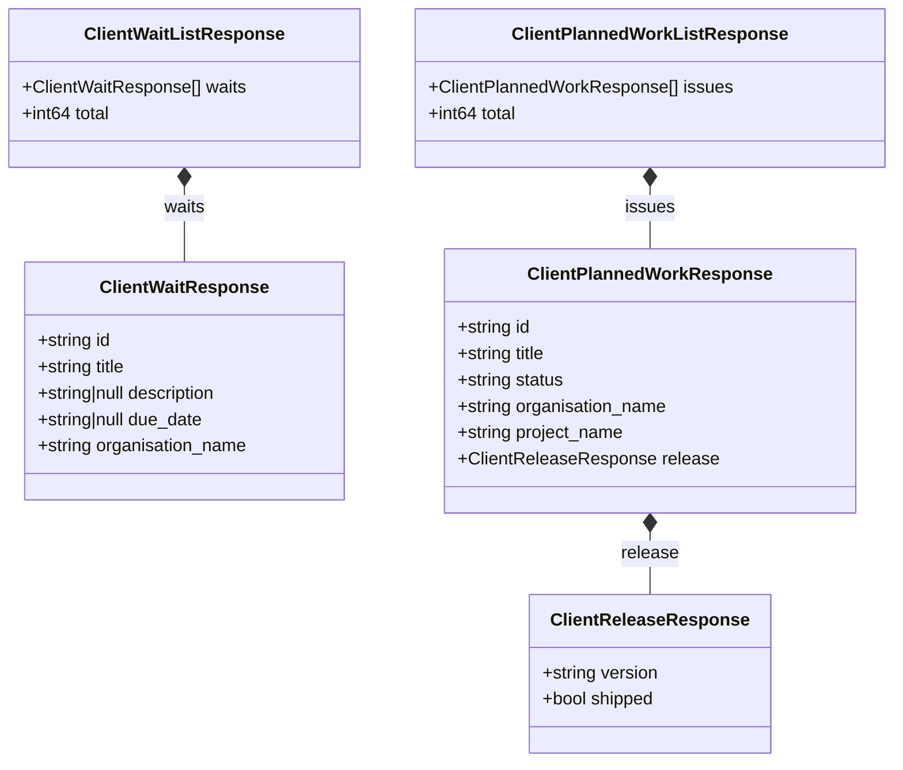

### Question contracts

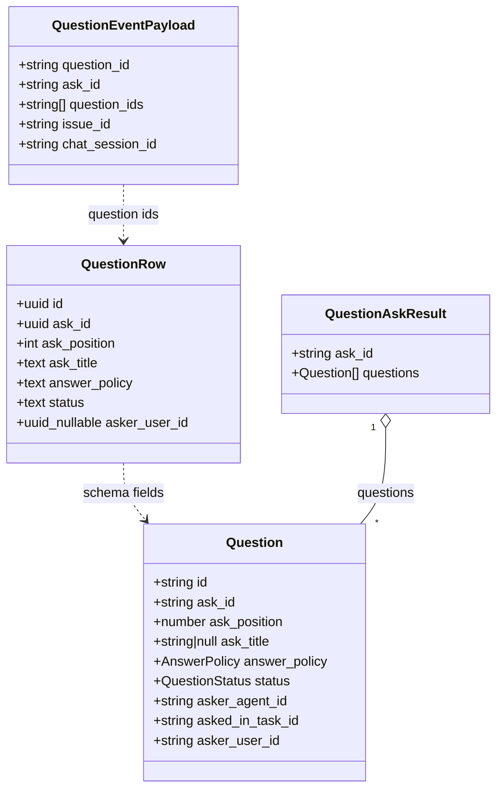

`QuestionRow` is sqlc's `db.Question` in `server/pkg/db/generated/models.go`, generated from the migrations. The client `Question` and `QuestionAskResult` contracts live in `packages/core/types/question.ts`; `packages/core/api/schemas.ts` parses question responses. The server's question and ask DTOs live in `server/internal/service/question.go`; `POST /api/questions` creates one transactional ask and returns `{ask_id, questions}`. `server/internal/question/policy.go` derives status from current answerers under `any_one` or `each`. Question events feed `cmd/server/todo_listeners.go`, which opens and closes per-answerer to-dos; the overdue sweep still stamps `overdue_notified_at` but creates no inbox notice. The event payload is declared in `server/pkg/protocol/events.go` and `packages/core/types/events.ts`.

### To-do storage and flow

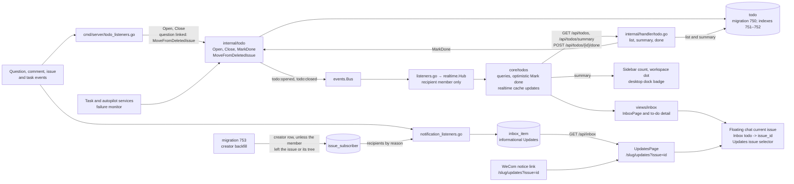

`server/pkg/db/queries/todo.sql` and its generated sqlc queries own persistence. The recipient `member_id` is a user's ID (`member.user_id`), not the membership row's ID. `OpenTodo` inserts a row only while that user is a member of the workspace. Optional source and actor IDs are logical references without foreign keys. A to-do's actor is a member or an agent; a system event opens it without one. `kind` distinguishes question, mention, assigned, agent-blocked, run-failed, autopilot-paused, quota-reached, quick-create-failed, review, check and instruction-change rows; `details` retains system-action data.

Agent-blocked and run-failed to-dos select the first non-null member ID from the run's `originator_user_id`, its `accountable_user_id`, the `delegated_from_task_id` source run's `originator_user_id`, then that source run's `accountable_user_id`. Source runs and recipients belong to the same workspace. The lifecycle listener and migration 754 use this order; unattributed work opens no to-do.

Open rows have `done_at IS NULL`. The partial unique index on `(workspace_id, member_id, kind, source_key)` makes repeated opens inert; closing changes only open rows and records `done_by` as `handled` or `member`. The second partial index supports workspace/member reads by descending `created_at`. `internal/todo.Service` runs each write and its visibility query in one transaction and publishes visible-list transitions after commit; a transactional producer publishes after its own commit. The visibility query compares the changed rows and affected reviews before and after the write, so questions hide and reveal reviews without completing them. Before it runs, the transaction locks each member and issue its question and review rows touch, so concurrent question writes see each other and a review hides and reveals once. Its `Response` projection is shared by the HTTP handler and `todo:opened`; `todo:closed` identifies the row and completion reason, or null when the row is hidden.

List and summary queries share the visible-open-row projection: live issue/question fields, no rows for missing issues, and no review row while an open question row exists for that member on the issue. Lists order overdue before newest. The list and Mark done routes are workspace-scoped; the summary is account-level across current memberships and omits zero-count workspaces. Mark done is member-private and idempotent. The summary supplies Inbox, workspace-switcher and desktop badge counts.

`packages/core/todos/` owns list and summary queries, optimistic completion with rollback, and cache updates from `todo:opened` and `todo:closed`. `packages/views/inbox/components/inbox-page.tsx` renders actionable rows and per-kind details; `updates-page.tsx` renders informational notices with read/unread and Archive. Web and desktop routes share these views. Notification banners select Inbox by `todo` or Updates by `issue`. Floating chat resolves a selected to-do's `issue_id` for its current issue. Unconfirmed quick-create outcomes use neutral copy and offer no context retry.

`inbox_item` remains the storage behind `/api/inbox` for Updates, separate from actionable to-dos. Question, mention, failed-run, paused-autopilot, quota and failed/unconfirmed quick-create notices no longer originate there. Migration 753 corrects agent-created issues to their run's originator member without changing actor/origin attribution, and makes that member's `issue_subscriber` row an active `creator` row unless they unsubscribed from the issue or a tree above it; migration 754 then seeds still-open to-dos and archives the moved notices. [ADR-0017](../../adr/0017-a-to-do-is-a-row-the-server-opens-and-closes.md) records the storage decision.

A question has exactly one asker (`question_one_asker`): an agent in a run, with `asker_agent_id` and `asked_in_task_id`, or a member outside a run, with `asker_user_id`. `Question` carries all three ids as strings; list rows carry `asker_agent_id` and `asker_user_id`. `asker_user_id` is `""` for an agent's question, and `asker_agent_id` and `asked_in_task_id` are `""` for a member's. A member asks through `POST /api/questions` or `multica question ask --on <issue>`; the first link is that issue and no run is linked, so the answers reach no run as input and the question offers no Wake (ADR-0021).

### Question Wake lifecycle

`QuestionService.Wake`, answers sent with `wake: true`, and ask-backs share the same scheduling path. `POST /api/questions/{id}/wake` returns HTTP 202 with the queued task ID for an immediate wake, or `task_id: ""` and the current `answer_count` when accepted but not queued. `QuestionWakeResult` in `packages/core/types/question.ts` and its parser in `packages/core/api/schemas.ts` accept both. Answers without Wake create no waiting intent or follow-up run; member questions wake no agent.

`question_wake_pending` is keyed by `(workspace_id, issue_id, agent_id)` and stores no answer text. Its upsert retains the first member/source attribution and the earliest `answer_anchor`. Queued, dispatched, running and waiting-local-directory tasks and deferred retry children block a wake for that agent and issue. The intent is durable state, not an extra queue task.

Workspace teardown removes `question_wake_pending` by `workspace_id` in `DeleteWorkspaceIssueRoots`, alongside the other question state. The deletion manifest classifies it as workspace-owned; other workspaces' waiting intents remain intact.

`handler.New` wires `QuestionWakeDrainer` into `TaskService`. Single and bulk finished notifications drain once per agent/issue pair after terminal comment follow-ups and retry decisions. `cmd/server/question_wake_reconciler.go` uses `runPeriodicSweep` at startup and every 30 seconds to drain bounded batches after a restart or a missed callback. Both paths first settle retry-eligible failed tails belonging to the current wait through `MaybeRetryFailedTask`; parent-row locking and the child lookup arbitrate concurrent retry decisions. Historical or superseded failures are not retried for a wake.

`question_wake_transition.go` brackets the issue and comment handlers' enclosing deletion/replacement operations with issue-scoped advisory transaction locks. Wake consumption takes a shared advisory lock before its row locks; terminal callbacks and recovery skip an active transition, while explicit Wake waits. The deferred finish releases the guard and drains waiting pairs after deletion, replacement or failure recovery. The guard uses a separate transaction so the enclosing writes can acquire issue rows. Connection loss releases it; durable intent remains recoverable.

The shared drain locks the issue, pending intent and source question in that order, rechecks blockers and availability, and selects unseen answers and ask-backs from the live question links and parent tree. An event is handled only through this agent's `answer` receipt with `handled_at` set. No unseen input means deleting the intent without a task. Otherwise the transaction creates one task through `EnqueueTaskForQuestionWake`, records the first waker's activity and `woken` event, and deletes the intent. Notifications are published only after commit. Collisions or database/retry-settlement errors retain the intent. An archived agent or one without a runtime retains the wait and unseen input; a deleted target or invalid source scope is retired without a task.

The retained input boundary travels from `question_wake_pending.answer_anchor` into the existing JSONB `agent_task_queue.context.question_wake_anchor`; merging it preserves other context keys such as `head_sha`, and retry tasks inherit context. For an accepted wait, the effective cutoff is the greater of that anchor and the latest claim of a subsequently started `question_wake`, excluding the task being hydrated and its retry ancestors. Ordinary retry claims do not advance it. Card counts, drain selection and `loadClaimQuestionAnswers` use the same calculation and handled-event checks; a changed answer has a fresh current event. The claim loads current answer text and ask-backs rather than an enqueue-time snapshot. Immediate wakes without a retained anchor use the latest-started-run cutoff.

The daemon's `Task.QuestionAnswers` contract, live notices, prompt rendering and card visibility rules remain unchanged. [ADR-0022](../../adr/0022-an-accepted-wake-waits-durably-for-the-agent.md) owns the durable-wait and retained-boundary decision; [the CLI and daemon guide](../../CLI_AND_DAEMON.md#question-wake) describes the runtime behavior.

### Checks and instruction notes

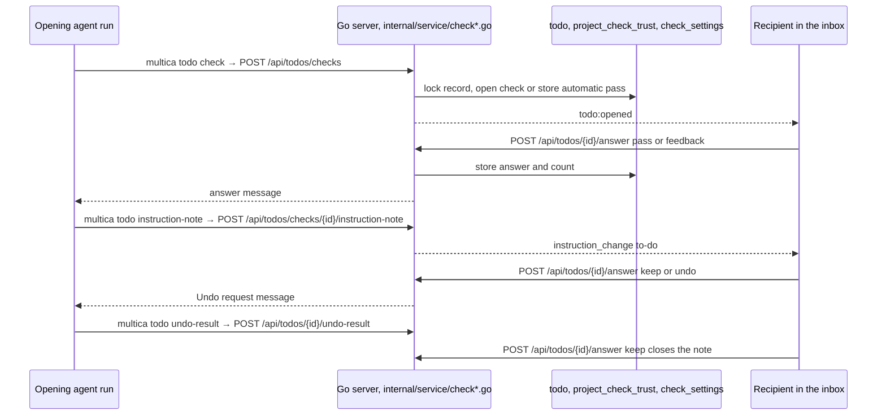

| Route | Caller |
|---|---|
| `POST /api/todos/checks` | `multica todo check` |
| `GET /api/todos/checks/{id}` | `multica todo get` |
| `POST /api/todos/{id}/answer` | `multica todo answer`; `ApiClient.answerCheckTodo` through `useAnswerCheckTodo` in `TodoCheckBody` and `TodoInstructionBody` |
| `POST /api/todos/checks/{id}/instruction-note` | `multica todo instruction-note` |
| `POST /api/todos/{id}/undo-result` | `multica todo undo-result` |
| `GET`, `PUT /api/todos/check-settings` | `multica todo settings` |
| `GET /api/projects/{id}/check-trust` | `multica todo trust`; `ApiClient.getProjectCheckTrust` through `useProjectCheckTrust` in `ProjectCheckRecord` |
| `PUT /api/projects/{id}/check-trust/{kind}` | `ApiClient.setCheckSampling` through `useSetCheckSampling` in `ProjectCheckRecord` |
| `GET /api/projects/{id}/check-trust/{kind}/history` | `ApiClient.getCheckHistory` through `useCheckHistory` in `ProjectCheckRecord` |

Check kinds are `data_model`, `data_flow`, `design`, `prototype`, `feature`, `improvement`, `agent_tool` and `release`. A check is a `todo` row of kind `check` whose `details` hold `project_id`, `check_kind`, the work link, the sample flags and the answer. An instruction note is kind `instruction_change` with `source_key` set to its check's id. `project_check_trust` holds one record per project and kind with its recipient, counts and sampling mode; `check_settings` holds the workspace's `sample_every`. The app parts ship in the shared inbox pull request; `ProjectCheckRecord` also renders on the project page.

An answer or Undo request reaches the opening agent in this order: a receipt on its running run with `task-supplement-v1`, the handoff note of its unclaimed queued or deferred run, or a new run with the message. A dispatched run's prompt is already built, so behind it the new run is deferred and `PromoteDueDeferredTasksForRuntime` queues it once the slot frees. Every check read inside a check transaction uses that transaction.

### Agent session contracts

`server/pkg/db/queries/agent_session.sql` owns the registered-session writes and the combined `ListAgentSessions` query. Its inputs are `agent_session`, `agent_runtime`, `agent_task_queue`, `worklane`, `issue_worktree`, `repository`, `agent`, `issue` and `workspace`; sqlc emits `AgentSession` and `ListAgentSessionsRow` in `server/pkg/db/generated/`. Lane runs follow `issue.worklane_id` to the workspace-scoped lane and repository, with branch derived from the workspace prefix and issue number (ADR-0014); non-lane runs follow `issue_worktree` to repository (ADR-0007). Workspace teardown removes registered sessions with the agents.

The client contract `AgentSession` and its `{sessions}` response live in `packages/core/types/agent.ts`, with boundary schemas in `packages/core/api/schemas.ts`. The `agent:sessions` event carries `{agent_id}` in `server/pkg/protocol/events.go` and `packages/core/types/events.ts`. `server/internal/handler/agent_session.go` serves the daemon's register, update, end and list routes under `/api/daemon/agent-sessions` and the member-facing `GET /api/agents/{id}/sessions`; `server/cmd/server/router.go` applies their daemon and member authentication. Writes enforce workspace and daemon ownership and publish `agent:sessions`.

`server/internal/daemon/health.go` accepts local `POST /sessions` with `workspace_id`, `agent_id`, `pid`, `cwd` and optional `herdr_pane_id`. `agent_sessions.go` registers the process through `client.go`, owns a global Herdr lifecycle connection and independent per-pane status observers for registered panes, reloads sessions per served workspace on startup, and reconciles process start time, repository and branch every 30 seconds. Its observed/persisted pane identity state feeds optional `AgentSessionUpdate.HerdrPaneID` writes through `client.go` to the handler and `UpdateAgentSession` query; see the [observer isolation and reconciliation design](../openspec/changes/archive/2026-10-16-agent-active-sessions/design.md#2-herdr-keeps-a-panes-session-current). Daemon shutdown stops observation without ending independently running sessions. Multica runs remain sourced from the task queue and never inherit the daemon's Herdr pane.

## Absent

- No remote CI: `.github/` holds only `ISSUE_TEMPLATE/` and `PULL_REQUEST_TEMPLATE.md`; verification is `make check` in `Makefile`.
- No release feed: `multica update` answers `LocalReleaseUpdateMessage` (`server/internal/cli/update.go`); releases come from `make upstream-sync` and `make local-release`.
- No Redis in the self-host stack (`docker-compose.selfhost.yml`): the realtime hub and runtime request stores run in memory on one node.
- No new foreign keys or cascades (`AGENTS.md`); tables since `server/migrations/173_remove_resource_label_foreign_keys.up.sql` relate by id columns only, while early tables such as those in `001_init.up.sql` keep theirs.
- No direct server access to a runtime machine: the server reaches it only through daemon heartbeat responses and `/api/daemon/ws`.
- No bundled agent CLIs: the daemon finds them on `PATH` or `MULTICA_<ID>_PATH` (`server/internal/daemon/agents_probe.go`, `server/pkg/agent/builtin_runtimes.go`).
- No shared UI on mobile: `apps/mobile` imports `packages/core` types only and never `packages/views` or `packages/ui`.
