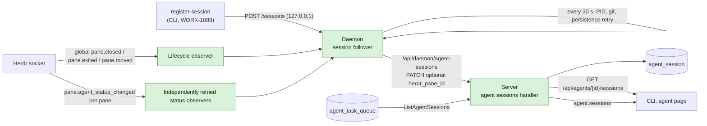
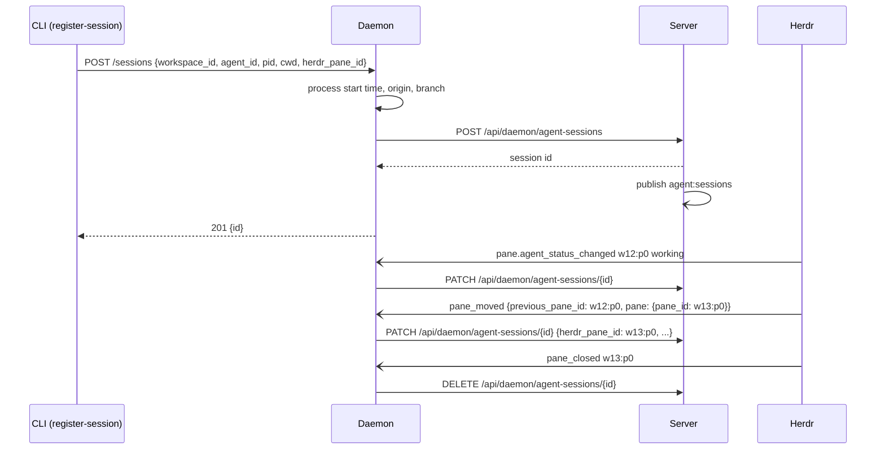

## At a glance

| Kind | Name | Change | Path |
|---|---|---|---|
| Endpoint | Daemon register, update, end, list own | new | `server/internal/handler/agent_session.go` |
| Endpoint | `GET /api/agents/{id}/sessions` | new | `server/internal/handler/agent_session.go` |
| Integration | Session follower | new | `server/internal/daemon/agent_sessions.go` |
| Local API | Session registration route | changed | `server/internal/daemon/health.go` |
| Integration | Daemon client calls | changed | `server/internal/daemon/client.go` |
| Routes | Daemon and member routes | changed | `server/cmd/server/router.go` |
| Query | Session writes, including optional pane identity update | changed | `server/pkg/db/queries/agent_session.sql` |
| Generated query | sqlc session parameters and queries | changed | `server/pkg/db/generated/agent_session.sql.go` |
| Tests | Follower lifecycle and process/git sweep regressions | new | `server/internal/daemon/agent_sessions_test.go` |
| Tests | Socket observer isolation regressions | new | `server/internal/daemon/agent_sessions_isolation_test.go` |
| Tests | Session API contract and ownership | new | `server/internal/handler/agent_session_test.go` |

## Context

- Team: Backend (lead Joeri, from `roster.py`). It builds on `agent-session-model` (WORK-1057): the table, `ListAgentSessions`, the event `agent:sessions` and ADR-0017. The CLI commands and persona sync are `agent-sessions-cli` (WORK-1088), the page `agent-page-sessions` (WORK-1089).
- The daemon serves a local listener on `127.0.0.1:<health port>` (`internal/daemon/health.go`: `/health`, `/shutdown`, `/repo/checkout`). Daemon routes live under `DaemonAuth` (`cmd/server/router.go` 1557-1617); agent routes under `/api/agents/{id}` (`router.go` 2322), next to `GET /tasks`, in the workspace-member group; a run's `mat_` task token passes them.
- Herdr's socket API (protocol 22): `events.subscribe` accepts `pane.agent_status_changed` for a specific `pane_id` and the global lifecycle subscriptions `pane.closed`, `pane.exited` and `pane.moved`. Status messages use `pane.agent_status_changed`; lifecycle messages use `pane_closed`, `pane_exited` and `pane_moved`. Close/exit messages carry `data.pane_id`; moves carry `data.previous_pane_id` and `data.pane.pane_id`. Status values are `idle`, `working`, `blocked`, `done` and `unknown`. The socket is `HERDR_SOCKET_PATH`, `~/.config/herdr/herdr.sock` on this Mac.
- Runs inherit the daemon's environment, `HERDR_PANE_ID` of the daemon's pane included (`pkg/agent` merges `os.Environ()`).

## Goals / Non-Goals

**Goals:** register sessions started by hand, keep them current, end them however they end, list an agent's sessions with its runs.

**Non-Goals:** the CLI commands, the page, the persona sync; ended sessions; status inside a run finer than its task's.

## Decisions

### 1. Registering goes through the local daemon

The daemon's listener gains `POST /sessions` with `{workspace_id, agent_id, pid, cwd, herdr_pane_id}`. The daemon reads the process start time (`ps -o lstart= -p <pid>`), the folder's `origin` as `owner/name` and its branch (`git -C <cwd> remote get-url origin`, `git -C <cwd> branch --show-current`; none when the folder is no repository), registers the row with `POST /api/daemon/agent-sessions`, starts following it and answers `201` with the id. A workspace the daemon does not serve, or a PID that does not run, is `400`.

The daemon owns this because only it outlives the session on the same machine, sees its PID and holds the Herdr socket; the server alone cannot tell that a terminal outside Herdr was closed (ADR-0017, ADR-0001).

### 2. Herdr keeps a pane's session current

The session follower connects to `HERDR_SOCKET_PATH`, else `~/.config/herdr/herdr.sock`, with one global lifecycle connection for `pane.closed`, `pane.exited` and `pane.moved`, and independently retried per-pane `pane.agent_status_changed` observers. Only non-ending sessions contribute status panes, including when a server `DELETE` fails. A missing-pane status rejection leaves the still-running process registered and other panes' observers and the lifecycle connection unaffected. It acts only on panes of sessions it follows; every other pane's event is dropped.

- `pane.agent_status_changed`: the new status, and the folder's branch and repository read again; a `PATCH` when any of them changed.
- `pane_closed`, `pane_exited`: a `DELETE`.
- `pane_moved`: match `data.previous_pane_id`, replace the observed identity (`session.pane`) with `data.pane.pane_id`, and retarget status observation. Persist the identity through `PATCH`; `persistedPane` tracks the last successful write independently, so a failed write is retried by the existing sweep even when status and git metadata are unchanged.

No socket, or a dropped observer: the follower logs unavailability and retries the affected observer every 30 s; the sweep keeps sessions correct meanwhile.

`AgentSessionUpdate.HerdrPaneID` is `*string` with `json:"herdr_pane_id,omitempty"`: a nonnil value updates identity; omission preserves the database value through `COALESCE(sqlc.narg('herdr_pane_id'), herdr_pane_id)`. The existing workspace and daemon ownership guards apply unchanged.

### 3. The sweep catches every other end

Every 30 s the follower checks each session it follows: a PID that no longer runs, or runs with another start time, ends the session; a changed branch or repository is reported. This covers a session outside Herdr, an omp crash that leaves the pane's shell open, and a branch switch between two Herdr events. On start the daemon loads its own rows (`GET /api/daemon/agent-sessions`) for each workspace it serves and sweeps them at once, so sessions that ended while it was down leave the list.

### 4. Server routes and events

Daemon routes, under `DaemonAuth`, each checking that the workspace is one the daemon serves and that the row's `daemon_id` is the caller's:

| Route | Does |
|---|---|
| `POST /api/daemon/agent-sessions` | `UpsertAgentSession`; the agent must be in the workspace |
| `PATCH /api/daemon/agent-sessions/{id}` | `UpdateAgentSession`: `status`, `repository`, `branch`, optional `herdr_pane_id` |
| `DELETE /api/daemon/agent-sessions/{id}` | `DeleteAgentSession`; an unknown id is `204` too, so a retry is harmless |
| `GET /api/daemon/agent-sessions?workspace_id=` | `ListAgentSessionsForDaemon` |

Agent route, in `/api/agents/{id}` beside `GET /tasks`: `GET /api/agents/{id}/sessions` returns `ListAgentSessions` as `{sessions: [...]}`; an agent of another workspace is `404`.

Each register, change and end publishes `agent:sessions` with `{agent_id}` to the workspace.

### 5. A run is never the daemon's pane

A run is never registered: the persona command registers only without `MULTICA_TASK_ID` (MadSpec `persona-offices`), so the inherited `HERDR_PANE_ID` is never sent. A run's session comes from the queue only (ADR-0017), and the follower acts only on panes it registered, so an event of the daemon's pane reaches no run. Nothing strips `HERDR_*` from a run's environment: that would change what Herdr's own omp hook reports, which this change leaves alone.

## Risks / Trade-offs

- A session started by hand needs a running daemon on its machine; without one it is not listed.
- The 30-second sweep leaves a session outside Herdr in the list for up to 30 s after it ends.

## Migration Plan

1. Deploy the server after the model's migration.
2. Restart the daemon: the follower starts with no sessions; sessions register once WORK-1088 and `persona-offices` ship.

Rollback: an older daemon registers and follows nothing; the routes stay unused.

## Open Questions

None.
