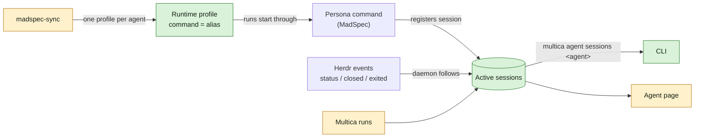

## At a glance

| Kind | Name | Change | Path |
|---|---|---|---|
| Server data and API | Active sessions of an agent | new | `server/` |
| Daemon | Herdr event follower, run entries | changed | `server/internal/daemon/` |
| CLI command | `multica agent sessions <agent>` | changed | `server/cmd/multica/cmd_agent.go` |
| Web and desktop view | Active sessions on the agent page | changed | `packages/views/`, `packages/core/` |
| Script | Persona sync: runtime profiles | changed | `madspec-sync/multica_sync.py` |
| Spec | `agent-active-sessions`, `agent-page-sessions`, `persona-runtime-profiles` | new | `specs/openspec/specs/` |

The offices, persona commands, Herdr spaces and the agents' use of the list are the change `persona-offices` in `appboypov/madspec`, on the same branch `work-1057`.

## Why

Every persona agent runs on the one shared omp runtime with its skills and model in `custom_args`, and nothing knows which sessions of an agent are active. Multica knows its own runs, Herdr knows its panes, but neither knows which persona a pane is, nor the folder and branch of a run. So two sessions of one agent can work on the same branch without knowing about each other.

Success signal: `multica agent sessions mitchel` lists every running Mitchel session, in Herdr and in Multica, each with its folder, repository and branch, and a closed pane drops out of that list and off Mitchel's page in Multica.

## What Changes

- Multica holds the active sessions of each agent: sessions its persona command registers, and Multica's own runs.
- The daemon follows Herdr's events for those sessions: status, branch, and removal when the pane closes or exits, crashes included.
- A new command `multica agent sessions <agent>` lists them, from any runtime.
- Each agent's page shows its active sessions.
- `madspec-sync` gives every agent with an office, Tika excluded, its own runtime profile whose command is the agent's alias, and moves the agent onto it. A run then starts the agent the way its alias does by hand. Paul gets his profile now; his agent, which WORK-1058 brings, goes onto it once it exists.

## Capabilities

### New Capabilities

- `agent-active-sessions`: Multica knows and lists which sessions of each agent are active, where they run and on what.
- `agent-page-sessions`: Brian sees an agent's active sessions on its page.
- `persona-runtime-profiles`: each persona agent runs on its own runtime profile, through its alias.

### Modified Capabilities

None.

## Impact

- Server: a new store and API for active sessions; runs report their work folder.
- Daemon: subscribes to Herdr's socket events (`pane_agent_status_changed`, `pane_closed`, `pane_exited`).
- CLI: `multica agent sessions`.
- Web and desktop: the agent page.
- `madspec-sync/multica_sync.py` and `madspec-sync/specs/multica-agents.md`; the 12 existing persona agents' runtimes and `custom_args`, and 13 runtime profiles, Paul's included.
- Checks for the technical design, from Pieter's open points that Brian passed on: Multica runs inherit the daemon's `HERDR_*` variables, so a run must never be matched to the daemon's pane; whether `persona-agent-selection` still applies once a run starts through the alias that already loads the persona skill.

## Constraints

- Multica is the one source of which sessions of an agent are active; no log file holds them. This replaces the daily log in the issue description, which Brian dropped on 15 Oct.
- A tag of an agent stays a headless run.
- Tika gets no runtime profile and no runs: she is a member.
- Herdr, Astra, Fable and Haiku keep their runtimes.
- The fork's own rules hold: no foreign keys, zod schemas with `parseWithFallback` at the API boundary.

## Non-goals

- Starting agents in Herdr from Multica: that is the Herdr agent's work, in `persona-offices`.
- A history of ended sessions.
- Runtime profiles of a kind other than omp.

## Sources

- The Multica issue "Persona repos in ~/Repos/Agents" (WORK-1057): Pieter's discovery result (comment of 15 Oct 16:44), Brian's approval with active sessions on each agent's page (comment of 15 Oct 18:30) and Brian's addition of Paul (comment of 15 Oct 18:50).
- No Intent object in Anytype holds this work.
