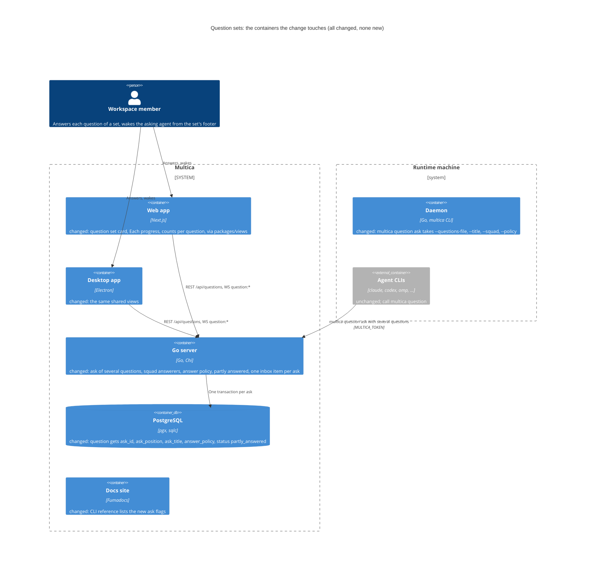
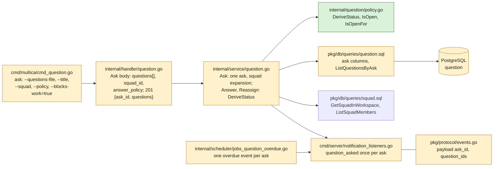
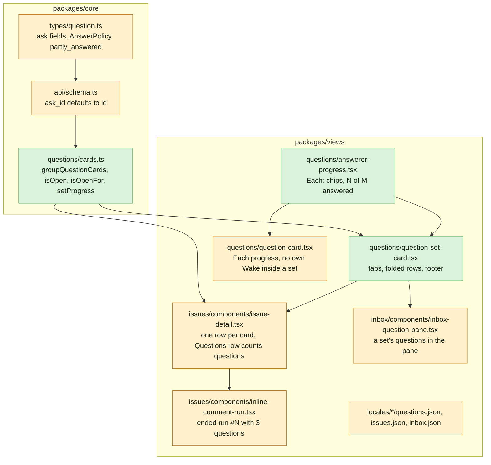
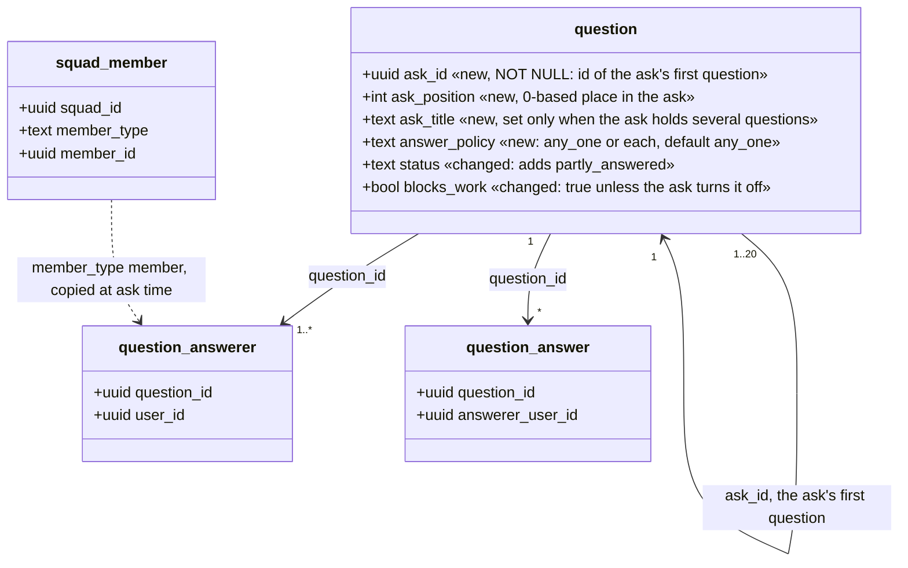
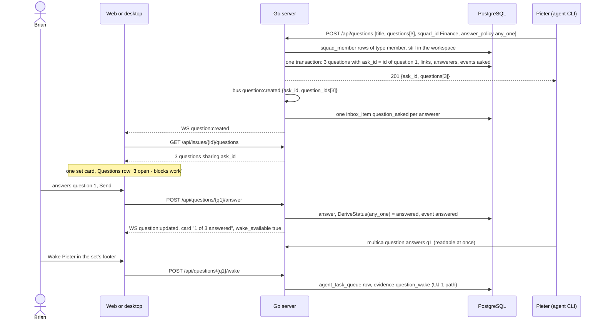

## At a glance

The delta of this change on the living system design, `specs/docs/system-design.md` as change `answer-an-agents-question-and-wake-it` (UJ-1) leaves it. Every container it touches already exists and already holds questions; the change adds no container and no table.



Go server and CLI component map, delta:



Web and desktop component map, delta:



Models, delta on UJ-1's `question` (the other four question tables are unchanged):



Journey sequence and data flow:



| Kind | Name | Change | Path |
|---|---|---|---|
| Migration | `question.ask_id`, `ask_position`, `ask_title`, `answer_policy`; status `partly_answered`; existing rows become one-question asks | new | `server/migrations/570_question_ask.up.sql`, `.down.sql` |
| Migration | `CONCURRENTLY` index on `question (ask_id, ask_position)` | new | `server/migrations/571_question_ask_index.up.sql`, `.down.sql` |
| Queries | Create with ask columns; `ListQuestionsByAsk`; overdue sweep returns `ask_id` | changed | `server/pkg/db/queries/question.sql` |
| Package | `DeriveStatus`, `IsOpen`, `IsOpenFor` | new | `server/internal/question/policy.go` |
| Service | Ask of several questions, squad expansion, Blocks work default, status from the policy | changed | `server/internal/service/question.go` |
| Handler | Ask body and response; Wake guard without a status check | changed | `server/internal/handler/question.go` |
| Events | `question:created` and overdue `question:updated` carry `ask_id`, `question_ids` | changed | `server/pkg/protocol/events.go` |
| Inbox | `question_asked` and `question_overdue` once per ask per answerer | changed | `server/cmd/server/notification_listeners.go` |
| Job | One overdue event per ask | changed | `server/internal/scheduler/jobs_question_overdue.go` |
| CLI | `multica question ask` `--questions-file`, `--title`, `--squad`, `--policy`, `--blocks-work` default on | changed | `server/cmd/multica/cmd_question.go` |
| Docs | CLI reference, five languages | changed | `apps/docs/content/docs/cli*.mdx` |
| Type and schema | Ask fields, `AnswerPolicy`, `partly_answered`; ask create result | changed | `packages/core/types/question.ts`, `packages/core/api/schema.ts` |
| Feature | `groupQuestionCards`, `isOpen`, `isOpenFor`, `setProgress` | new | `packages/core/questions/cards.ts` |
| Components | Question set card; answerer progress for Each | new | `packages/views/questions/question-set-card.tsx`, `packages/views/questions/answerer-progress.tsx` |
| Component | Question card: Each progress; no own Wake inside a set | changed | `packages/views/questions/question-card.tsx` |
| Screen | Issue detail: one timeline row per card, Questions row, run row "with 3 questions" | changed | `packages/views/issues/components/` |
| Screen | Inbox: one item per ask, a set's questions in the pane | changed | `packages/views/inbox/components/` |
| Copy | Set, policy and progress keys, five languages | changed | `packages/views/locales/` |
| Design | Library components of the set card and Each progress | changed | `designs/systems/multica.lib.pen` |
| Design | Screen 6 with an agent asking, without Remind and Close question | changed | `designs/screens/issue-questions.pen`, `designs/screens/issue-questions.md` |
| Prototype | Data-flow path and screen 6 of this journey | changed | `prototypes/web/issue-questions/` |
| ADR | A question set groups questions; open is per question and per answerer | new | `adr/0004-question-sets-group-questions-open-is-per-question.md` |

## Context

Journey UJ-2 of [PRD: Questions in Multica](anytype://object?objectId=bafyreiaviofipcl3ymgld2skld4ij6hlarsm2ra55ygufsepgk5laxjf34), journey issue [DAS-434](https://linear.app/skuddy/issue/DAS-434/uj-2-an-agent-asks-several-questions-at-once). It builds on change `answer-an-agents-question-and-wake-it` (UJ-1, [DAS-432](https://linear.app/skuddy/issue/DAS-432/uj-1-answer-an-agents-question-and-wake-it), branch `das-432-uj-1-answer-an-agents-question-and-wake-it`): its five question tables, nine endpoints, card, inbox items, Wake and ADR-0002 and ADR-0003 are the base this design changes. Its requirements hold unchanged. UJ-1 is built first; this change's migrations, code and tasks assume UJ-1's are merged.

**Journey steps.** Brian's answer on WORK-378 (2026-10-12, relayed by Skuddy) skips J1, J4 and J10 for every Questions journey, recorded on this journey as the Requests `Skip: J1`, `Skip: J4` and `Skip: J10`. As in UJ-1, the investigation agrees: J1 Project structure has nothing to change (every new file sits in an existing Go package or workspace package), nor J4 Design system (screen 6 uses no new token or colour), nor J10 Agent tooling for UI (only people answer, so the question UI gets no agent tooling; the agent's tool is the CLI at J8). Steps with work: J2 Data models, J3 Data-flow prototype, J5 Components, J6 Screens, J7 Live prototype, J8 Backend and agent tooling, J9 Frontend, J11 Acceptance test and archive.

**Design sources.** Screen 6 "Answered and question set" of [appboypov/multica#6](https://github.com/appboypov/multica/pull/6) (`designs/screens/issue-questions.md`, export `6-answered-and-question-set.png`) and `SetCard` and `EachCard` in `prototypes/web/issue-questions/src/components/generated/issue.tsx` of [appboypov/multica#8](https://github.com/appboypov/multica/pull/8). Two of its parts are superseded by Brian's answers, so J6 and J7 change them: the Each card's asker is a person (Sarah), and only agents ask; and its **Remind Eva** and **Close question** buttons have no requirement (only the asking agent closes, through the CLI). The UX spec's "any one (first answer closes it)" is superseded too: under Any one the first answer makes the question answered, and only the asker closes it (`questions` spec, Answer policy).

**Code map.** What the build reuses beyond UJ-1's code map. Paths are under `server/` unless they start with `packages/` or `apps/`.

- Squads: `squad_member` (`migrations/084_squad.up.sql`) has `member_type` `agent` or `member`, and for `member` the `member_id` is the user id (`AddSquadMember` in `internal/handler/squad.go` checks it with `GetMemberByUserAndWorkspace`). Load with `GetSquadInWorkspace` and refuse an archived squad yourself: the query does not filter `archived_at` (`internal/handler/comment.go:2866`). Members with `ListSquadMembers` (`pkg/db/queries/squad.sql:90`).
- CLI squad names: `resolveAssignee(ctx, client, name, assigneeKinds{squad: true})` (`cmd/multica/cmd_issue.go:3284`) resolves a squad by name or id; `resolveAssigneeByID` (`:3425`) for ids.
- UJ-1 parts this change edits (built at UJ-1's J2 to J9): `server/migrations/564_question.up.sql` (the status `CHECK`), `pkg/db/queries/question.sql`, `internal/question/`, `internal/service/question.go`, `internal/handler/question.go`, `cmd/multica/cmd_question.go`, `internal/scheduler/jobs_question_overdue.go`, `packages/core/types/question.ts`, `packages/core/questions/`, `packages/views/questions/question-card.tsx`, `packages/views/issues/components/issue-detail.tsx`, `inline-comment-run.tsx`, `packages/views/inbox/components/inbox-question-pane.tsx`.
- Must not change, beyond UJ-1's list: the brief's Questions section (its text already says "one or more questions at the same time"), the `[ANSWERS]` block's format, the claim, `TaskService`, the squad tables and squad behaviour (squads stay as Multica has them, as [appboypov/multica#10](https://github.com/appboypov/multica/pull/10) says).

## Goals / Non-Goals

**Goals:**

- One `multica question ask` posts one question or a set of up to 20, to members, a squad's members or both, under Any one or Each, with Blocks work on unless turned off.
- A set shows as one card; each question is answered and sent on its own, reaches the asker at once, and the footer offers **Wake** from the first unseen answer.
- Every count of open questions counts questions, and "open" means one thing everywhere (ADR-0004), so UJ-3's lists and UJ-4's parents count the same way.

**Always:**

- An ask is one transaction: every question of it is posted, or none, and a refusal names the question by its 1-based place (`question 2: suggested answer "per week" is not one of the options`).
- Status comes from `question.DeriveStatus(policy, answerers, answers)` only; no handler sets `answered` or `partly_answered` by hand.
- Squad members are copied into `question_answerer` at ask time; the answerers are people only.

**Never:**

- No new question table, no foreign keys, no cascades; no change to squad tables or squad behaviour.
- No answer of any question of a set starts a run; Wake stays the only path (ADR-0003).
- No **Remind**, no member **Close question**, no member way to ask; no mobile change; no new design token or colour.
- No brief, help or skill text about when or why to ask, or when to ask several questions.

**Non-Goals:** the Questions page, sidebar count, One by one and One page with its embedded set card (UJ-3); questions on parents and the indirect audience (UJ-4); the Agent questions setting (UJ-5); reading a whole set with one `multica question answers` call (each question id is returned by the ask).

## Decisions

### 1. An ask is a group key on `question`, not a table

Every question gets `ask_id`, the id of its ask's first question, and `ask_position`; a one-question ask has `ask_id = id`. A set's title is `ask_title` on each of its questions. The answerers, answer policy, due date and Blocks work of an ask are copied to each of its questions: a question is never edited, and reassigning, answering and counting already work per question. Migration 570 adds the columns, backfills existing rows as one-question asks (`ask_id = id`, `ask_position = 0`) and then makes `ask_id` and `ask_position` `NOT NULL`; 571 indexes `(ask_id, ask_position)` concurrently. Alternatives: a `question_ask` table (a sixth table and a join on every read, for one column of its own) or a set as a `question_link` type (a set is not where a question belongs, and UJ-4 lists links as places). Recorded with decision 3 as ADR-0004.

### 2. Ask API

`POST /api/questions` takes:

```json
{
  "title": "Three things before I build the CSV writer",
  "questions": [
    {"prompt": "…", "context_line": "…", "answer_type": "confirm_facts", "settings": {"facts": ["…"]}, "suggested_answer": null}
  ],
  "answerer_ids": ["<user id>"],
  "squad_id": "<squad id>",
  "answer_policy": "any_one",
  "due_date": "2026-10-14",
  "blocks_work": true
}
```

and returns 201 `{ask_id, questions: Question[]}`, the questions in ask order. This replaces UJ-1's one-question body and its 201 `Question`; the only caller is `multica question ask`, released with the server. Rules, each a 422 naming the field or the question:

- `questions` holds 1 to 20 entries; each passes UJ-1's `ValidateSettings` and the suggested-answer check.
- `title` (1 to 200 characters) is required with more than one question and refused with one, so a one-question card stays as UJ-1 draws it.
- `answer_policy` is `any_one` or `each`, default `any_one`, which is how UJ-1 treats several answerers; with one answerer both behave the same and the value is kept.
- `squad_id` is a squad of the workspace that is not archived. Its `member_type = 'member'` rows that are still workspace members become answerers, in squad order; its agents are skipped without an error. A squad with no such member is 422 "squad Finance has no members, only agents".
- The answerers are `answerer_ids` then the squad's members, without duplicates, and at least one. An agent id in `answerer_ids` is refused as in UJ-1.
- `blocks_work` absent means `true`: every ask runs during a run, since UJ-1 refuses an ask without a task. `false` turns it off.

Each question gets its own `asked` event, whose `details` carry `ask_id`, `answer_policy` and `squad_id` when one was asked.

### 3. Answer policy and what "open" means

`question.answer_policy` is `any_one` or `each`; `status` gains `partly_answered`. `internal/question/policy.go` has one rule, used after every answer, edit and reassignment:

| Policy | Current answerers with an answer | Status |
|---|---|---|
| any_one | none | `open` |
| any_one | one or more | `answered` |
| each | none | `open` |
| each | some, not all | `partly_answered` |
| each | all | `answered` |

`closed` and `withdrawn` are never recomputed. Answers of people who were reassigned away stay in the history but are not counted. UJ-1's lifecycle table changes only in its from-states:

| Action | From status, delta |
|---|---|
| Answer (first answer of this answerer) | `open`, `partly_answered` |
| Edit answer | `answered`, `partly_answered` |
| Ask back, Reassign | adds `partly_answered` |
| Close | adds `partly_answered`: the asker closes when it has enough |
| Withdraw | adds `partly_answered` |
| Wake | any status: the guard is UJ-1's unseen count and no active task, nothing else |

Under Any one a second answerer cannot answer an answered question; they can still ask back. Two definitions, in `internal/question/policy.go` and mirrored in `packages/core/questions/cards.ts`, serve every count and list:

- **Open:** status `open` or `partly_answered`. The Questions row, the run row's "Waiting for answer" badge and, in UJ-3 and UJ-4, every count and list use it, one per question. A set of three open questions is 3.
- **Open for a member:** open, the member is a current answerer, and the member has no answer to it. Under Any one an answered question is open for nobody, which takes it off the other answerers' lists; under Each it stays open for whoever has not answered.

Inbox items stay in place when a question stops being open for someone: the inbox is the record of what was asked of them, and its pane shows the current card. Recorded with decision 1 as ADR-0004.

### 4. The issue page

`groupQuestionCards(questions)` in `packages/core/questions/cards.ts` groups an issue's `Question[]` by `ask_id`, ordered by `ask_position`; each group is one timeline row placed by its first question's `created_at`, with the anchor `question-${first question id}`, which is UJ-1's anchor for a one-question card. `highlightQuestionId` and the Questions row's jump resolve a question to its card and open that question in it. A one-question group renders UJ-1's `QuestionCard`; a larger one renders `QuestionSetCard`, as screen 6 draws it:

- Header: overline "Question set for you · 3 questions" for a member the set is open for, else "Question set · 3 questions"; **Blocks work** when one of its open questions blocks; "Pieter asked during run #4 · 2 min ago"; the title.
- Tabs, one per question: a check once the question is no longer open for the viewer, else its number. The active question shows its answer control; an answered one folds to a row (label, display text, **Change** until closed); the others are rows with their type, which open on click. The first question open for the viewer is active at first.
- Footer: **Ask back** and **Reassign** for the active question; "1 of 3 answered", counting questions with status `answered` or `closed` over those not withdrawn; **Wake Pieter** while `wake_available`; and the primary action: **Accept suggestion** while nothing is picked and the active question has one, else **Send**, which sends the active question and opens the next one open for the viewer. The questions inside a set have no Wake of their own.

Under Each, a question with more than one answerer shows `AnswererProgress`: a "2 of 3 answered" pill and one chip per answerer with their answer or "waiting", plus "Pieter sees each answer as it arrives and closes the question when he has enough." A member the question is open for gets the answer control as in UJ-1. A viewer who is not an answerer sees no controls, as in UJ-1.

The Questions row counts open questions ("3 open · blocks work"). The run row reads "ended run #N with a question" or "with 3 questions", by the number of questions asked in that run, and keeps "Waiting for answer" while one of them is open.

### 5. Events and inbox

`question:created` is published once per ask with `{question_id: first, ask_id, question_ids, issue_id}`. The listener creates one `question_asked` per answerer per ask, with `details.question_id` (the first question), `details.ask_id` and `details.question_count`; the inbox label reads "Pieter asked you 3 questions" for a set. `QuestionOverdueJob` stamps every overdue open question as before and publishes one `question:updated` with reason `overdue` per ask, with `question_ids`; the listener creates one `question_overdue` per current answerer of those questions. `question_reassigned` stays per question.

The inbox pane of a set shows its title and each of its questions: a question open for the viewer of type Yes / No, Single choice or Approval with its inline control, as UJ-1's pane has it; any other with **Open on WORK-412**, which opens the issue at the set with that question active; a question no longer open for the viewer as its folded line.

### 6. Agent tooling

`multica question ask` keeps UJ-1's one-question flags and adds:

- `--questions-file <path>`: a JSON array of `{prompt, context_line, answer_type, settings, suggested_answer}`, the `questions` field of the API as decision 2 shows it. It excludes `--prompt`, `--prompt-file`, `--context`, `--type`, the settings flags and `--suggest`.
- `--title`: required with more than one question, as the API says; the CLI refuses before the request.
- `--squad <name or id>`: one squad, resolved as `issue assign --to` resolves squads; combinable with `--answerer`.
- `--policy any_one|each`.
- `--blocks-work`: default `true`; `--blocks-work=false` turns it off.

The text output prints the ask id and one line per question id and prompt; `--output json` prints the API response. `--help` shows the file's shape and lists the flags, and nothing about when to ask or when to ask several questions. The CLI reference in five languages lists the new flags.

## Risks / Trade-offs

- [Shared fields are copied to each question of a set] → a set cannot drift because questions are never edited; a reassignment applies to the active question only, which is what the footer's Reassign does.
- [The ask's response shape changes from UJ-1's] → only `multica question ask` calls it, and the CLI and server ship together with `make local-release`; no web or desktop client posts questions.
- [A newer client meets a server without UJ-2] → the zod schema defaults `ask_id` to the question's id and `answer_policy` to `any_one`, so every question renders as its own card.
- [ADR and migration numbers can collide with UJ-3 to UJ-5, which are designed at the same time] → each journey takes the next free numbers when it merges; nothing refers to them by number except this change's files.
- [The UX spec's "first answer closes it" differs from the spec] → the spec follows Brian's answer; J6 corrects the UX spec's wording.

## Migration Plan

`570` adds four columns, backfills existing questions as one-question asks, sets `NOT NULL` on `ask_id` and `ask_position` and swaps the status `CHECK` for one with `partly_answered`; `571` adds the concurrent index. Rollback runs the `.down.sql` files in reverse; `570`'s down refuses while a question is `partly_answered`, since UJ-1's `CHECK` cannot hold it. `make local-release` deploys.

## Open Questions

None. Brian skipped J1, J4 and J10 (see Context "Journey steps").
