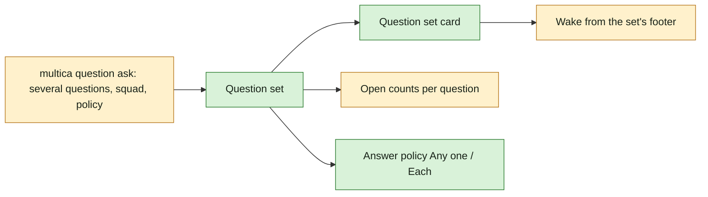

## At a glance

```mermaid
sequenceDiagram
  actor B as Brian
  participant M as Multica (web or desktop)
  participant P as Pieter (agent run)
  Note over P: brief carries the Questions section
  P->>M: one multica question ask: 3 questions, squad Finance, Any one answers
  M-->>P: one question set posted, no run started
  M-->>B: one card with 3 questions, Blocks work on; Questions property "3 open · blocks work"
  B->>M: answers question 1, Send
  M-->>P: answer 1 readable at once
  M-->>B: card "1 of 3 answered", question 1 off the other members' lists, Wake Pieter in the set's footer
  alt Brian answers the rest
    B->>M: answers questions 2 and 3
    B->>M: Wake Pieter
    M->>P: new run with 3 answers
  else Brian leaves after two
    Note over M: set stays open, 2 of 3 answered
    B->>M: Wake Pieter
    M->>P: new run with 2 answers
  end
```



| Kind | Name | Change | Path |
|---|---|---|---|
| Model | Ask holding a question set; answer policy; squad answerers | changed | `server/` |
| CLI | `multica question ask` with several questions, a squad and an answer policy | changed | `server/cmd/multica/cmd_question.go` |
| Screen | Issue detail: question set card with progress and footer | changed | `packages/views/issues/components/issue-detail.tsx` |
| Component | Question set card | new | `packages/views/questions/` |

## Why

An agent that needs several facts confirmed asks them now one by one, or stops for an interactive session. Asking them together, to whoever of a team answers first or to each of them, lets the agent's work run as a task: it posts every question it has at once, gets each answer as it comes, and a person decides when it goes on.

It is UJ-2 of [PRD: Questions in Multica](anytype://object?objectId=bafyreiaviofipcl3ymgld2skld4ij6hlarsm2ra55ygufsepgk5laxjf34) and builds on change `answer-an-agents-question-and-wake-it` (UJ-1), which holds the question, the CLI, the card, answering and Wake.

Success signal: Pieter posts three questions to a squad in one `multica question ask` call; WORK-412 shows one card and "3 open · blocks work"; Brian sends one answer, Pieter reads it at once, the card shows "1 of 3 answered", the question leaves the other members' lists, and no run starts until Brian presses **Wake Pieter**.

## What Changes

- One ask holds one question or a question set; a set shows as one card and each question in it is answered and sent on its own.
- Open counts count questions, not asks: a set of three open questions is "3 open".
- An agent can ask a squad: its human members become the answerers, its agents are skipped.
- With more than one answerer the asker picks **Any one** or **Each**.
- Blocks work is on by default when an agent asks during a run.
- Each answer in a set reaches the asker at once; the card shows how many are answered; **Wake** is offered from the first answer on.

## Capabilities

### New Capabilities

- `questions`: (adds to it) lets an agent ask several questions at once, of a squad, under an answer policy, with Blocks work on by default during a run.
- `agent-question-tooling`: (adds to it) lets one `multica question ask` call post a question set.
- `question-answering`: (adds to it) lets answerers send each question of a set on its own and see the set's progress.
- `issue-questions`: (adds to it) lets everyone on an issue see a question set as one card.
- `agent-wake`: (adds to it) lets a person wake the agent from a question set's footer once its first answer is in.

These capabilities are new to `specs/openspec/specs/`; change `answer-an-agents-question-and-wake-it` adds their first requirements, and this change adds requirements of its own.

## Impact

- Server: the ask that groups questions, squad expansion, answer policies, open counts.
- CLI: `multica question ask` takes several questions, a squad and an answer policy.
- Web and desktop: the question set card on the issue.

## Constraints

- Builds on change `answer-an-agents-question-and-wake-it`; its requirements hold unchanged.
- Only people answer: a squad's agents never become answerers.
- No answer to any question of a set starts a run; only Wake does.
- Web and desktop only; the mobile app stays unchanged.
- No new design token or colour.

## Non-goals

- The Questions page and Answer all: change `answer-every-open-question-in-one-sitting` (UJ-3).
- Questions on parents and the indirect audience: change `question-reaches-the-owner-of-the-work-above` (UJ-4).
- The Agent questions setting: change `turn-agent-questions-off-for-one-issue` (UJ-5).
- People asking question sets: only agents ask (Brian, Plannotator Review b8b3060eec0c8d52); the builder's **Add question** of design screen 2a is superseded.

## Sources

- [PRD: Questions in Multica](anytype://object?objectId=bafyreiaviofipcl3ymgld2skld4ij6hlarsm2ra55ygufsepgk5laxjf34): UJ-2; FR-1, FR-3 (squads), FR-4, FR-5 (Blocks work default), FR-7 (several questions), FR-12 (set progress), FR-20 (Wake from the set's footer); the counting rule of §4.1.
- Design and UX spec: [appboypov/multica#6](https://github.com/appboypov/multica/pull/6), `designs/screens/issue-questions.md`: screen 6 (answered and question set).
- Prototype: [appboypov/multica#8](https://github.com/appboypov/multica/pull/8), `prototypes/web/issue-questions/`.
- Brian's answers: the WORK-366 comments and [Plannotator Review b8b3060eec0c8d52](https://ctas.de-appspecialist.nl/plannotator/session/b8b3060eec0c8d52/), as the PRD's Addendum lists them.
