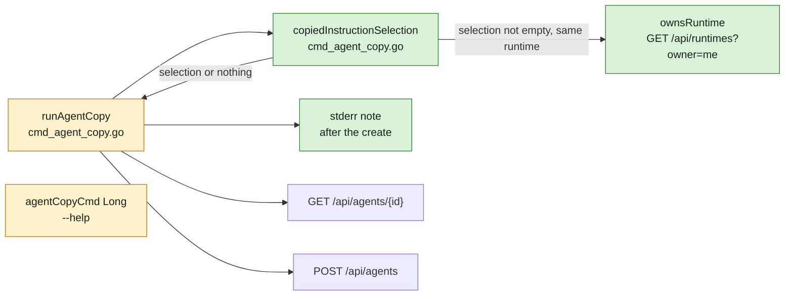
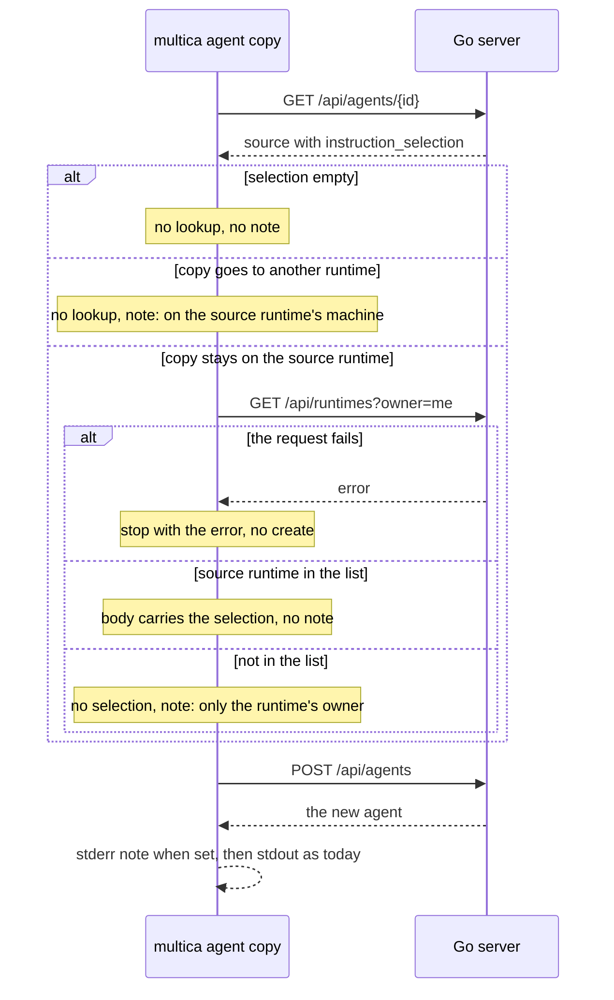

## At a glance

The delta against `specs/docs/system-design.md`: the containers, the server and every model stay as they are. The `multica` CLI already calls the Go server over REST `/api`; the copy command makes one more read there, `GET /api/runtimes?owner=me`, and only for a source with a selection that stays on its runtime.





| Kind | Name | Change | Path |
|---|---|---|---|
| CLI function | `copiedInstructionSelection`: the copy rule | new | `server/cmd/multica/cmd_agent_copy.go` |
| CLI function | `ownsRuntime`: `GET /api/runtimes?owner=me` | new | `server/cmd/multica/cmd_agent_copy.go` |
| CLI command | `runAgentCopy`: selection in the body, the stderr note | changed | `server/cmd/multica/cmd_agent_copy.go` |
| CLI help | `agentCopyCmd` Long text and file comment | changed | `server/cmd/multica/cmd_agent_copy.go` |
| Tests | copy with and without a selection | changed | `server/cmd/multica/cmd_agent_copy_test.go` |
| Docs | the paragraph under `multica agent copy` | changed | `apps/docs/content/docs/agents-create{,.zh,.ja,.ko,.fr}.mdx` |
| Built-in skill | "Copying an agent" | changed | `server/internal/service/builtin_skills/multica-platform/references/agents.md` |

## Context

- **Team:** Agent Tools (a CLI command and its skill reference). Builders: `madspec-command-builder` for the command, its tests, help text and docs; `madspec-skill-builder` for the skill reference.
- **The copy today** (`runAgentCopy`, `server/cmd/multica/cmd_agent_copy.go`): GETs `/api/agents/<id>` into `src map[string]any`, works out `sameRuntime := targetRuntimeID == srcRuntimeID` (`--runtime-id` absent or equal to the source's id is the same runtime), builds the create body field by field, POSTs `/api/agents`, then prints `cli.PrintJSON(os.Stdout, result)` or `Agent copied: %s (%s)`. It never reads `instruction_selection`.
- **The server rule** (`server/internal/handler/agent.go` `CreateAgent`): a create carrying a non-empty `instruction_selection` passes `requireRuntimeOwner(w, r, runtime.ID, ownerID)`, with `ownerID` from `requireUserID`; anyone else gets 403 `only the runtime owner can change instruction_selection`. A runtime without an owner fails that check too.
- **The web rule** (`buildDuplicateDraft`, `packages/core/agents/draft.ts`): keeps the selection when the runtime is kept and `sourceRuntime.owner_id === currentUserId`.
- **Runtimes owned by the caller:** `ListAgentRuntimes` (`server/internal/handler/runtime.go`) answers `?owner=me` with `ListAgentRuntimesByOwner(workspace, userID)`, `userID` from the same `requireUserID` as create. The web client already sends this filter (`listRuntimes({ owner: "me" })`, `packages/core/api/client.ts`).
- **Agent response:** `instruction_selection` is a JSON array of absolute paths, in order (`AgentResponse.InstructionSelection`, agent.go); `null` or `[]` means none.
- **Test harness** (`cmd_agent_copy_test.go`): `newAgentCopyTestCmd`, `fullSourceAgent` (no selection), `copyMockServer` (GET source, POST create, `t.Errorf` on any other request), `setCopyTestEnv`. The package already has `captureStderr` (`cmd_issue_test.go`) and `captureStdout` (`cmd_skill_test.go`).
- **Docs:** the paragraph right after the `multica agent copy` code block (line 177) of each `agents-create` page; the Duplicate paragraph above it (line 156) already states the owner rule in each language. Translations follow `apps/docs/content/docs/developers/conventions.mdx`.
- **Skill reference:** `references/agents.md` "Copying an agent": its opening paragraph names the requests the copy makes; the bullets list what is copied. The "Field contracts" row for `instruction_selection` already says only the runtime's owner may set it.
- **Living system design:** `specs/docs/system-design.md` draws no CLI command but the daemon, and the CLI-to-server relation already exists; the build leaves it unchanged.
- **ADR-0001** (runtime machine files are read by the daemon): the copy passes paths only and reads no machine's disk; it fits.

## Goals / Non-Goals

**Goals:**

- Always: the CLI sends `instruction_selection` exactly as read, in order, when the caller owns the source runtime and the copy stays on it.
- Always: decide before the create, so a copy the rule leaves without a selection still succeeds.
- Always: one stderr line naming the reason when a non-empty selection is left behind, written after the create succeeded.
- Never: change stdout, `Agent copied: …` or the `--output json` result.
- Never: an extra request for a source without a selection, or for a copy to another runtime.
- Never: create the agent when the ownership read fails.

**Non-Goals:**

- A flag to set, override or drop the selection.
- Any server, API, web, desktop or mobile change.
- Retrying a create after a 403.

## Decisions

### 1. Ownership from `GET /api/runtimes?owner=me`

The CLI owns the source runtime when its id is in the list `GET /api/runtimes?owner=me` returns. The server builds that list from the same user id `CreateAgent` checks, so the CLI and the server never disagree on who the owner is.

Alternative: `GET /api/runtimes` for the runtime's `owner_id` plus `GET /api/me` for the caller's id, as the Approach named. Rejected: two requests instead of one, and a member who cannot see a private runtime in the plain list would get an error instead of the copy without a selection. The behaviour Brian passed is the same either way.

### 2. Lookups only when they can change the outcome

- Empty selection: nothing to carry, no request, no note.
- `--runtime-id` names another runtime: the selection stays behind whoever owns the source runtime, so no request; the note says the paths are on the source runtime's machine.
- Same runtime: one `ownsRuntime` call. Owned: the body carries the selection. Not owned: no selection; the note says only the runtime's owner can copy them. Failed: return `check source runtime owner: <err>` before the create.

### 3. Shape in code

Two functions in `cmd_agent_copy.go`, called after `sameRuntime` is known:

```go
// copiedInstructionSelection returns the selection the copy carries, or the
// note to print once the copy exists. err stops the copy before the create.
func copiedInstructionSelection(ctx context.Context, client *cli.APIClient, src map[string]any, srcRuntimeID string, sameRuntime bool) (selection []any, note string, err error)

func ownsRuntime(ctx context.Context, client *cli.APIClient, runtimeID string) (bool, error)
```

`selection` is `src["instruction_selection"].([]any)` as read, so the order and the paths are unchanged. `runAgentCopy` puts it in `body["instruction_selection"]` when not empty, and after a successful POST prints `fmt.Fprintln(os.Stderr, note)` when `note != ""`, before the stdout output.

### 4. Wording

The two notes are package constants in `cmd_agent_copy.go`:

- `Selected files and folders (instruction_selection) were not copied: they are on the source runtime's machine.`
- `Selected files and folders (instruction_selection) were not copied: only the source runtime's owner can copy them.`

The Long help adds, after the overridable-fields paragraph: `Selected files and folders (instruction_selection) are copied only when you own the source runtime and the copy stays on it; otherwise the copy has none and a note on stderr says why.` The file comment above `agentCopyCmd` and the doc comment of `runAgentCopy` name the extra read.

### 5. Docs and skill reference

One sentence appended to the paragraph under `multica agent copy` in each language, in the terms of that page's Duplicate paragraph:

- en: `Selected files and folders come along only when you own the source runtime and the copy stays on it; otherwise the copy has none and the CLI says why on stderr.`
- zh: `只有当你是源运行时的所有者、且副本留在该运行时上时，所选文件和文件夹才会一并复制；否则副本不带所选文件和文件夹，CLI 会在 stderr 上说明原因。`
- ja: `選択したファイルとフォルダーが引き継がれるのは、元のランタイムの所有者が複製し、複製がそのランタイムに残る場合だけです。それ以外の場合、複製には選択したファイルとフォルダーがなく、CLI が stderr に理由を表示します。`
- ko: `선택한 파일과 폴더는 원래 런타임의 소유자가 복사하고 복사본이 그 런타임에 남을 때만 함께 복사되며, 그렇지 않으면 복사본에는 선택한 파일과 폴더가 없고 CLI가 stderr에 이유를 표시합니다.`
- fr: `Les fichiers et dossiers sélectionnés ne sont repris que si vous êtes propriétaire du runtime d'origine et que la copie y reste ; sinon, la copie n'en a aucun et le CLI en indique la raison sur stderr.`

In `references/agents.md`, the opening paragraph names `GET /api/runtimes?owner=me` as the read made for a source with a selection that stays on its runtime, and one bullet after the runtime-specific bullet states the rule and the two stderr notes.

## Risks / Trade-offs

- [Ownership changes between the read and the create] -> The server's 403 stays the last guard; the copy then fails with that error, as any failed create does today.
- [A workspace with many runtimes] -> `?owner=me` returns only the caller's runtimes, one small list.

## Migration Plan

None: a CLI-only change that ships with the next `make local-release`. Rollback is reverting the commit.
