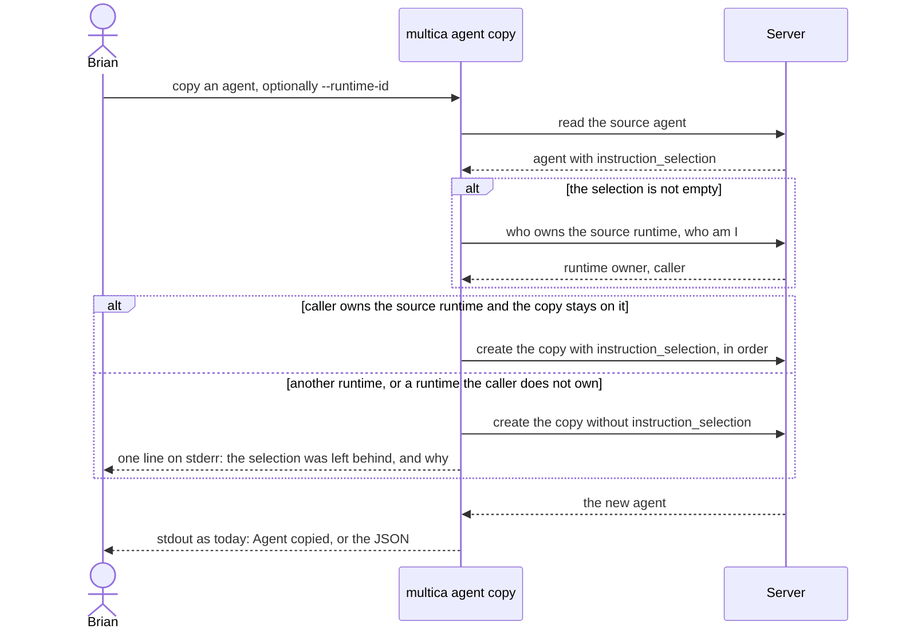
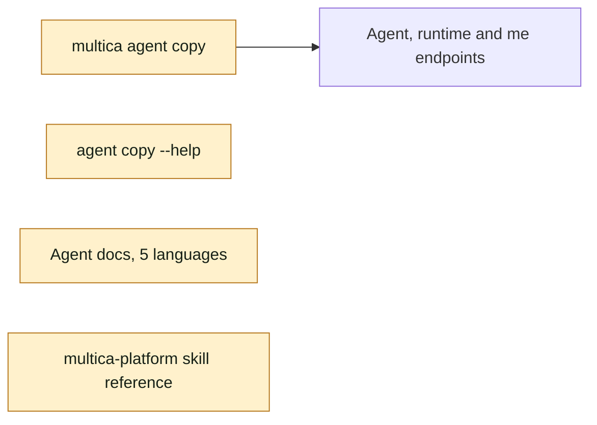

## At a glance

| Kind | Name | Change | Path |
|---|---|---|---|
| CLI | `multica agent copy`: carries the selection, the stderr note, the help text | changed | `server/cmd/multica/cmd_agent_copy.go` |
| Tests | the copy with and without the selection | changed | `server/cmd/multica/cmd_agent_copy_test.go` |
| Docs | the `multica agent copy` paragraph | changed | `apps/docs/content/docs/agents-create{,.zh,.ja,.ko,.fr}.mdx` |
| Built-in skill | "Copying an agent" | changed | `server/internal/service/builtin_skills/multica-platform/references/agents.md` |
| Spec | "A duplicate carries the selection" | changed | `specs/openspec/specs/instruction-selection-field/spec.md` |

## Why

`multica agent copy` never copies `instruction_selection`. A copy of an agent whose instructions hold `{selection}` keeps the placeholder but loads no files at task start, so the copy runs without the files and folders the original was built around. Duplicate in web and desktop already carries the selection when its runtime's owner duplicates it on the same runtime (PR #11); the CLI is the one way to copy that breaks this.

Success signal: Brian copies an agent with two selected folders with `multica agent copy`, and `multica agent get` on the copy shows the same two paths in the same order; the same copy with `--runtime-id` set to another runtime shows no paths, and stderr says why.

## What Changes

- `multica agent copy` sends the source's `instruction_selection`, in order, when the caller owns the source runtime and the copy stays on it (no `--runtime-id`, or the source's runtime id).
- Every other copy is made without a selection and prints one line on stderr naming the reason: another runtime, where the paths belong to the source machine, or a runtime the caller doesn't own, where only its owner can copy them.
- stdout, `Agent copied: …` and `--output json`, stays as it is.
- `multica agent copy --help` lists the selected files and folders among the copied fields, with when they come along.
- The `multica agent copy` paragraph of the agent docs in all five languages and "Copying an agent" in the multica-platform skill reference say when the selection comes along.

## Capabilities

### New Capabilities

None.

### Modified Capabilities

- `instruction-selection-field`: "A duplicate carries the selection" covers `multica agent copy` as well as web and desktop Duplicate, with the CLI's stderr note when a copy leaves the selection behind.

## Impact

- CLI: `multica agent copy` and its help text.
- Docs in five languages and the built-in multica-platform skill reference.
- No server, API, web, desktop or mobile change.

## Constraints

- The rule is the one web and desktop Duplicate follow (`buildDuplicateDraft` in `packages/core/agents/draft.ts`): runtime owner and same runtime; the CLI and the apps never differ on which copies carry the selection.
- A copy the rule leaves without a selection still succeeds: the server answers 403 to a create that carries a selection on a runtime the caller doesn't own, so the CLI decides before it creates the agent.
- stdout keeps its current shape, since scripts read it; the note goes to stderr only.
- AGENTS.md: no compatibility shims, every check local, default tests never run user-installed agent CLIs.

## Non-goals

- A CLI flag to set, override or drop the selection on create, update or copy.
- A server change: the runtime-owner check on create stays the last guard.
- Changes to Duplicate in web and desktop, which already follow the rule.

## Sources

- [WORK-383](http://localhost:3000/de-app-specialist/issues/WORK-383)
- [Intent: multica agent copy carries the selected files and folders](anytype://object?objectId=bafyreid35tcyswaxfwuu7nu6i4b6fxnnlmrqnuxb4p53ntx4m5evu5eb3a)
- [Approach: multica agent copy carries the selected files and folders](anytype://object?objectId=bafyreib6wamlihu5u66zmgye22rahdf5ayncoxeixbc5a7dydfxhf2q3oe), passed by Brian on 13 October 2026; it holds the per-file plan for `design.md`.
- [Request: carry the selection when the web Duplicate would](anytype://object?objectId=bafyreigsqqx2jm3bsfyp34jovlwvnxfsmhqomvkvkekflkv6s3p2ml6e4e)
- [Request: a stderr note when the copy leaves the selection behind](anytype://object?objectId=bafyreiah7uloitylgwu6c4w3vfptvi4l4jbpv46rvngnqiwtr3ziir2loq)
- `specs/openspec/specs/instruction-selection-field/spec.md` and `specs/openspec/specs/agent-instruction-selection/spec.md` ("Only the runtime's owner changes a selection")
- `specs/openspec/changes/archive/2026-10-13-agent-instruction-selection-field/`
