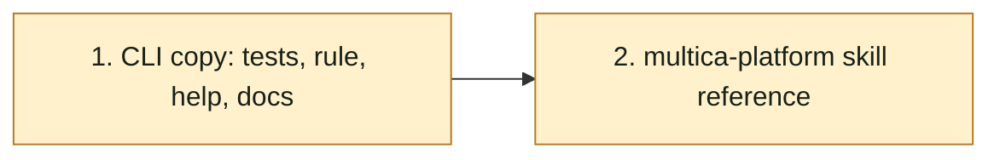

## At a glance

| Group | Builder | Proves it |
|---|---|---|
| 1. CLI copy: tests, rule, help, docs | `madspec-command-builder` | `cd server && go test ./cmd/multica -run 'TestAgentCopy' -count=1` |
| 2. multica-platform skill reference | `madspec-skill-builder` | `cd server && go build ./...` |

## 1. CLI copy: tests, rule, help, docs

- [x] 1.1 `server/cmd/multica/cmd_agent_copy_test.go` -- add a mock server helper that serves the `copyMockServer` routes plus `GET /api/runtimes` (asserting `owner=me`, answering a given list of owned runtime ids or a given error status) and counts the runtimes requests and creates; add the tests of design Decisions 2-4, each failing before 1.2: the owner's copy, without `--runtime-id` and with `--runtime-id runtime-1`, sends both paths in order and leaves stderr empty; a non-owner's copy sends no `instruction_selection`, prints the owner note on stderr, and prints the same `Agent copied` stdout as a copy without a selection; a copy with `--runtime-id runtime-2 --model ""` sends none, prints the machine note and makes no runtimes request; a source with `instruction_selection: []` makes no runtimes request, sends none and leaves stderr empty; a failing runtimes request returns an error naming it and makes no create. Reuse `captureStderr` and `captureStdout`. -- the spec's CLI scenarios as unit tests. Verify: `cd server && go test ./cmd/multica -run 'TestAgentCopy' -count=1` fails on the new tests only.
- [x] 1.2 `server/cmd/multica/cmd_agent_copy.go` -- add `ownsRuntime`, `copiedInstructionSelection` and the two note constants per design Decisions 1-4; in `runAgentCopy`, call it after `sameRuntime`, return its error before the create, set `body["instruction_selection"]` when not empty, and after a successful create print the note to stderr before the stdout output. -- the copy rule of web Duplicate. Verify: `cd server && go test ./cmd/multica -run 'TestAgentCopy' -count=1` passes, the existing copy tests included.
- [x] 1.3 `server/cmd/multica/cmd_agent_copy.go` -- add the Long help sentence of design Decision 4 and name the ownership read in the comment above `agentCopyCmd` and on `runAgentCopy`. -- `--help` tells when the selection comes along. Verify: `cd server && go run ./cmd/multica agent copy --help` shows the sentence.
- [x] 1.4 `apps/docs/content/docs/agents-create.mdx`, `agents-create.zh.mdx`, `agents-create.ja.mdx`, `agents-create.ko.mdx`, `agents-create.fr.mdx` -- append design Decision 5's sentence of each language to the paragraph under the `multica agent copy` code block. -- the docs match the CLI. Verify: `git diff --check` and each page renders in the docs dev server (`pnpm --filter @multica/docs dev`).

## 2. multica-platform skill reference

- [x] 2.1 `server/internal/service/builtin_skills/multica-platform/references/agents.md` -- in "Copying an agent", name `GET /api/runtimes?owner=me` in the opening paragraph as design Decision 5 says, and add one bullet after the runtime-specific bullet: `instruction_selection` is copied unchanged, in order, only when the caller owns the source runtime and the copy stays on it; otherwise the copy has none and one stderr line says why; a failed ownership read stops the copy before the create. -- agents reading the reference copy agents the way the CLI does. Verify: `cd server && go build ./...` (the reference is embedded).

## Implementation Notes

### 1.1 Tests

- Files: `server/cmd/multica/cmd_agent_copy_test.go`.
- `selectionMockServer` returns a `selectionCopyServer` that embeds the `httptest.Server` and counts runtimes reads and creates with `atomic.Int32`, so the counters stay race-free under `-race`. `runAgentCopyCaptured` wraps `captureStderr` around `captureStdout`; `copyStdoutWithoutSelection` runs the same copy of `fullSourceAgent` (no selection) to give the stdout the selection tests compare against.
- The tests spell the two notes as literals (`wantMachineNote`, `wantOwnerNote`) instead of the package constants of 1.2, so the file compiled and failed before 1.2, and so a rewording of a constant shows up as a failing test.
- The machine-note test runs with the default `--output json` and the non-owner test with `--output table`, so both stdout shapes of the spec's scenarios are compared with a copy without a selection.
- Surprise: the empty-selection test (`TestAgentCopyEmptySelectionReadsNoOwner`, on the same runtime and on another) passed before 1.2, since today's copy already sends no selection, reads no runtimes and prints nothing; it guards Decision 2's "no request, no note" rather than failing first. The other four failed before 1.2 as planned.
- Slip: the first edit of the test file landed in the main checkout (`~/Repos/Forks/multica`) through a relative path; it was moved to this worktree with `git diff | git apply` and the main checkout's file restored, leaving it as it was.

### 1.2 The copy rule

- Files: `server/cmd/multica/cmd_agent_copy.go`.
- The constants are `selectionOnSourceMachineNote` and `selectionOwnerOnlyNote`, with Decision 4's wording, printed with `fmt.Fprintln(os.Stderr, …)` right after the POST succeeds and before the stdout output.
- `copiedInstructionSelection` is called after `sameRuntime` and every flag check, just before the POST, rather than straight after `sameRuntime`: a copy that fails on a flag (an empty `--name`, a missing `--model`, invalid `--custom-env`) then makes no runtimes read, and the read still comes before the create.
- `ownsRuntime` decodes only the `id` of each runtime `GET /api/runtimes?owner=me` returns. Its error is wrapped as `check source runtime owner: <err>`, and the wrapped `cli.HTTPError` names the `/api/runtimes` request, as `TestAgentCopyFailedOwnerReadStopsCopy` asserts.
- Verified: `cd server && go test ./cmd/multica -run 'TestAgentCopy' -count=1 -race -v` passes, the 11 existing copy tests and the 5 new ones; `go vet ./cmd/multica` and `gofmt -l` are clean.

### 1.3 Help and comments

- Files: `server/cmd/multica/cmd_agent_copy.go`.
- Decision 4's sentence is its own paragraph in `Long`, between the overridable-fields paragraph and the secret-fields one, wrapped at 80 columns like the rest. The comment above `agentCopyCmd` and the doc comment of `runAgentCopy` name `GET /api/runtimes?owner=me` and when it is made.
- Verified: `cd server && go run ./cmd/multica agent copy --help` prints the paragraph.

### 1.4 Docs

- Files: `apps/docs/content/docs/agents-create.mdx`, `agents-create.zh.mdx`, `agents-create.ja.mdx`, `agents-create.ko.mdx`, `agents-create.fr.mdx`.
- Decision 5's sentence of each language is appended verbatim at the end of the paragraph under the `multica agent copy` code block (line 177), after its "full flags" link sentence. Its terms match each page's Duplicate paragraph (所选文件和文件夹, 選択したファイルとフォルダー, 선택한 파일과 폴더, fichiers et dossiers sélectionnés).
- Verified: `git diff --check` is clean; with `pnpm --filter @multica/docs dev` on port 4000, `/docs/agents-create`, `/docs/zh/agents-create`, `/docs/ja/agents-create`, `/docs/ko/agents-create` and `/docs/fr/agents-create` each answered 200 with the new sentence in the HTML. The server was stopped afterwards.

### 2.1 Skill reference

- Files: `server/internal/service/builtin_skills/multica-platform/references/agents.md`.
- The opening paragraph of "Copying an agent" now names `GET /api/runtimes?owner=me` as the extra read made before the create when the source has a selection and the copy stays on its runtime.
- The new bullet sits right after the runtime-specific bullet and quotes both stderr notes in full, word for word as the constants `selectionOnSourceMachineNote` and `selectionOwnerOnlyNote` in `cmd_agent_copy.go` print them, each on its own line after the case it covers; the two long code spans are left unwrapped so neither note is split.
- Surprise: the first build of this task edited the main checkout's copy of the file instead of this worktree's and ticked the task without the change. The edit was carried over with `git diff | git apply`, and the main checkout's file restored with `git restore`, touching nothing else there.
- Verified: `cd server && go build ./...` and `git diff --check` are clean.

## Plan Change Log
