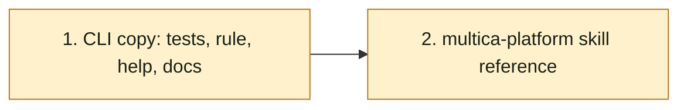

## At a glance

| Group | Builder | Proves it |
|---|---|---|
| 1. CLI copy: tests, rule, help, docs | `madspec-command-builder` | `cd server && go test ./cmd/multica -run 'TestAgentCopy' -count=1` |
| 2. multica-platform skill reference | `madspec-skill-builder` | `cd server && go build ./...` |

## 1. CLI copy: tests, rule, help, docs

- [ ] 1.1 `server/cmd/multica/cmd_agent_copy_test.go` -- add a mock server helper that serves the `copyMockServer` routes plus `GET /api/runtimes` (asserting `owner=me`, answering a given list of owned runtime ids or a given error status) and counts the runtimes requests and creates; add the tests of design Decisions 2-4, each failing before 1.2: the owner's copy, without `--runtime-id` and with `--runtime-id runtime-1`, sends both paths in order and leaves stderr empty; a non-owner's copy sends no `instruction_selection`, prints the owner note on stderr, and prints the same `Agent copied` stdout as a copy without a selection; a copy with `--runtime-id runtime-2 --model ""` sends none, prints the machine note and makes no runtimes request; a source with `instruction_selection: []` makes no runtimes request, sends none and leaves stderr empty; a failing runtimes request returns an error naming it and makes no create. Reuse `captureStderr` and `captureStdout`. -- the spec's CLI scenarios as unit tests. Verify: `cd server && go test ./cmd/multica -run 'TestAgentCopy' -count=1` fails on the new tests only.
- [ ] 1.2 `server/cmd/multica/cmd_agent_copy.go` -- add `ownsRuntime`, `copiedInstructionSelection` and the two note constants per design Decisions 1-4; in `runAgentCopy`, call it after `sameRuntime`, return its error before the create, set `body["instruction_selection"]` when not empty, and after a successful create print the note to stderr before the stdout output. -- the copy rule of web Duplicate. Verify: `cd server && go test ./cmd/multica -run 'TestAgentCopy' -count=1` passes, the existing copy tests included.
- [ ] 1.3 `server/cmd/multica/cmd_agent_copy.go` -- add the Long help sentence of design Decision 4 and name the ownership read in the comment above `agentCopyCmd` and on `runAgentCopy`. -- `--help` tells when the selection comes along. Verify: `cd server && go run ./cmd/multica agent copy --help` shows the sentence.
- [ ] 1.4 `apps/docs/content/docs/agents-create.mdx`, `agents-create.zh.mdx`, `agents-create.ja.mdx`, `agents-create.ko.mdx`, `agents-create.fr.mdx` -- append design Decision 5's sentence of each language to the paragraph under the `multica agent copy` code block. -- the docs match the CLI. Verify: `git diff --check` and each page renders in the docs dev server (`pnpm --filter @multica/docs dev`).

## 2. multica-platform skill reference

- [ ] 2.1 `server/internal/service/builtin_skills/multica-platform/references/agents.md` -- in "Copying an agent", name `GET /api/runtimes?owner=me` in the opening paragraph as design Decision 5 says, and add one bullet after the runtime-specific bullet: `instruction_selection` is copied unchanged, in order, only when the caller owns the source runtime and the copy stays on it; otherwise the copy has none and one stderr line says why; a failed ownership read stops the copy before the create. -- agents reading the reference copy agents the way the CLI does. Verify: `cd server && go build ./...` (the reference is embedded).

## Implementation Notes

## Plan Change Log
