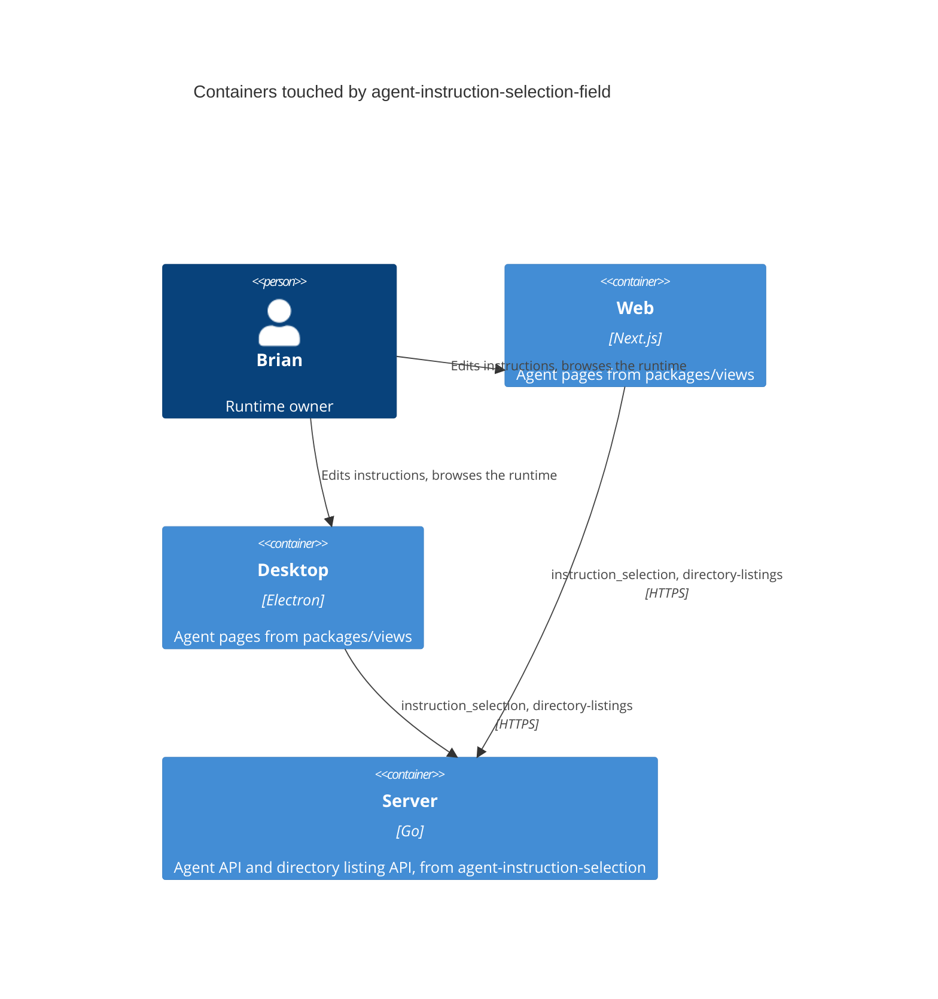
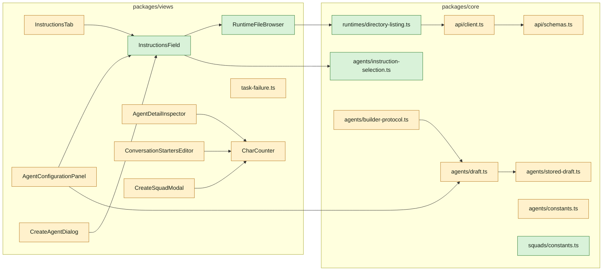
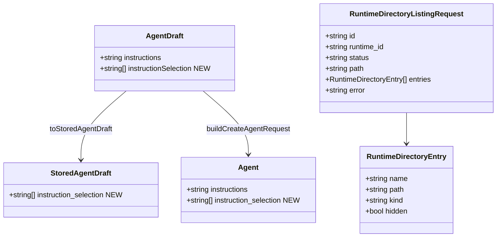

## At a glance

The delta on [the living system design](../../../docs/system-design.md): web and desktop get one instructions field with a runtime browser, the shared packages carry the selection and the directory listing, and the agent text inputs warn instead of stopping. The server, daemon and madspec-sync side is the change `agent-instruction-selection`.







```mermaid
sequenceDiagram
  actor B as Brian
  participant F as InstructionsField
  participant R as RuntimeFileBrowser
  participant Q as directory-listing.ts
  participant S as Server
  B->>F: Browse (owner and online only)
  F->>R: open with the runtime
  R->>Q: runtimeDirectoryListingOptions(runtimeId, "")
  Q->>S: POST /api/runtimes/{id}/directory-listings {path: ""}
  loop every 500 ms, at most 30 s
    Q->>S: GET /api/runtimes/{id}/directory-listings/{requestId}
  end
  S-->>R: skill roots
  B->>R: open a folder or type a path, tick entries
  B->>R: Add
  R-->>F: onAdd(paths)
  F->>F: append new paths; first selection inserts {selection} at the cursor
  B->>F: Save
  F->>S: PUT /api/agents/{id} instructions, instruction_selection (when changed)
```

| Kind | Name | Change | Path |
|---|---|---|---|
| Types | `Agent.instruction_selection`, `CreateAgentRequest`/`UpdateAgentRequest.instruction_selection`, `RuntimeDirectoryListingRequest`, `RuntimeDirectoryEntry` | changed | `packages/core/types/agent.ts` |
| Schemas | `RuntimeDirectoryListingRequestSchema`; `StoredAgentDraftSchema.instruction_selection` | changed | `packages/core/api/schemas.ts`, `packages/core/api/schemas.test.ts` |
| API client | `initiateDirectoryListing`, `getDirectoryListing` | changed | `packages/core/api/client.ts` |
| Query | `resolveRuntimeDirectoryListing`, `runtimeDirectoryListingKeys`, `runtimeDirectoryListingOptions` | new | `packages/core/runtimes/directory-listing.ts`, `packages/core/runtimes/index.ts` |
| Helpers | `SELECTION_PLACEHOLDER`, `insertSelectionPlaceholder`, `appendSelection`, `selectionWarning` | new | `packages/core/agents/instruction-selection.ts`, `packages/core/agents/instruction-selection.test.ts`, `packages/core/agents/index.ts` |
| Draft | `instructionSelection` in draft, stored draft, duplicate and create request; `isDraftDescriptionWithinLimit` removed | changed | `packages/core/agents/draft.ts`, `packages/core/agents/stored-draft.ts`, their tests |
| Builder | keeps starter text whole, keeps the selection | changed | `packages/core/agents/builder-protocol.ts` and its test |
| Constants | warning thresholds | changed | `packages/core/agents/constants.ts` |
| Constants | `SQUAD_DESCRIPTION_MAX_LENGTH` | new | `packages/core/squads/constants.ts`, `packages/core/squads/index.ts` |
| UI | `InstructionsField` | new | `packages/views/agents/components/instructions-field.tsx` and its test |
| UI | `RuntimeFileBrowser` | new | `packages/views/agents/components/runtime-file-browser.tsx` and its test |
| UI | instructions tab, create panel, create dialog use the field | changed | `packages/views/agents/components/tabs/instructions-tab.tsx`, `packages/views/agents/components/agent-overview-pane.tsx`, `packages/views/agents/create/agent-configuration-panel.tsx`, `packages/views/agents/components/create-agent-dialog.tsx` |
| UI | rich instructions editor of the create dialog | removed | `packages/views/agents/components/instructions-editor.tsx` |
| UI | soft counter and inputs without `maxLength` | changed | `packages/views/agents/components/char-counter.tsx`, `agent-detail-inspector.tsx`, `conversation-starters-editor.tsx`, `packages/views/agents/create/use-create-agent-form.ts` |
| UI | squad description keeps 255 | changed | `packages/views/modals/create-squad.tsx` |
| Failure label | `instruction_selection_error` | changed | `packages/views/agents/components/tabs/task-failure.ts` |
| Copy | field, browser, warnings, counter, failure label | changed | `packages/views/locales/{en,fr,ja,ko,zh-Hans}/agents.json` |
| Docs | selection and warnings | changed | `apps/docs/content/docs/agents-create{,.zh,.ko,.ja,.fr}.mdx` |

## Context

Today the instructions tab (`tabs/instructions-tab.tsx`) edits `instructions` in a plain `Textarea` with the conversation starters below it and saves both through `onSave`. The create panel (`create/agent-configuration-panel.tsx`) edits `draft.instructions` in a `Textarea`; the create dialog (`create-agent-dialog.tsx`, still used by squads and DingTalk) uses `InstructionsEditor`, a `ContentEditor` wrapper with no cursor API for inserting text. Description inputs pass `maxLength={AGENT_DESCRIPTION_MAX_LENGTH}` and `CharCounter` shows a red overflow; the inspector and `isDraftDescriptionWithinLimit` block saving above 255. Starter inputs pass `maxLength` 80 and 4000, `use-create-agent-form.ts` marks longer starters invalid, and `builder-protocol.ts` cuts builder starter text to 80 and 4000. The runtime local-skill list (`packages/core/runtimes/local-skills.ts`) is the precedent for a request the daemon answers through the server: initiate, then poll every 500 ms up to 30 s.

The change `agent-instruction-selection` adds `instruction_selection` to the agent API, the directory listing endpoints (`POST /api/runtimes/{runtimeId}/directory-listings`, `GET .../{requestId}`, owner only, 503 when offline), drops the 255, 80 and 4000 API limits, and adds the failure reason `instruction_selection_error`.

## Goals / Non-Goals

**Goals:**

- One instructions field, shared by the tab, the panel and the dialog, that shows the selection as chips and lets the runtime's owner browse and add paths.
- A browser that lists skill roots, opens folders and typed paths, marks hidden entries and adds several entries at once.
- The selection survives drafts and duplicates; the AI builder never sets it.
- Agent description and starter inputs warn above 255, 80 and 4000 and never block; the squad description keeps its 255 limit.
- The task failure label for `instruction_selection_error` in five languages.

**Non-Goals:**

- Mobile and the CLI.
- Reading or previewing file contents in the browser.
- The AI builder setting a selection.
- A size warning on a selection.

## Decisions

### 1. Types, client and schemas

`Agent.instruction_selection?: string[]` (optional, read as `agent.instruction_selection ?? []`, because agent responses are not parsed by zod today and an older server omits it); `CreateAgentRequest.instruction_selection?: string[]`, `UpdateAgentRequest.instruction_selection?: string[]`. `RuntimeDirectoryEntry { name; path; kind: "file" | "folder"; hidden }` and `RuntimeDirectoryListingRequest { id; runtime_id; status: "pending" | "running" | "completed" | "failed" | "timeout"; path; entries; error; created_at; updated_at }`.

`RuntimeDirectoryListingRequestSchema` in `schemas.ts`: `status` falls back to `"failed"` for an unknown value, `entries` to `[]`, each entry's `kind` to `"file"` and `hidden` to `false`, strings to `""`. `api.initiateDirectoryListing(runtimeId, path)` and `api.getDirectoryListing(runtimeId, requestId)` run their responses through `parseWithFallback` with that schema, as the model list calls do. `schemas.test.ts` covers a malformed status, missing entries and a malformed entry.

### 2. Directory listing query

`packages/core/runtimes/directory-listing.ts` copies `local-skills.ts`: `resolveRuntimeDirectoryListing(runtimeId, path)` initiates, polls every 500 ms for at most 30 s, throws the request's `error` on `failed` or `timeout`, and returns `{ path, entries }`. `runtimeDirectoryListingKeys.forPath(runtimeId, path)` = `["runtimes", "directory-listing", runtimeId, path]`; `runtimeDirectoryListingOptions(runtimeId, path)` uses `staleTime: 0` and `retry: false`, so reopening a folder lists it again. Alternative, a shared polling helper for both: rejected, two short copies are clearer than a generic one.

### 3. Pure helpers in core

`packages/core/agents/instruction-selection.ts`, tested in `instruction-selection.test.ts`:

- `SELECTION_PLACEHOLDER = "{selection}"`.
- `appendSelection(current: string[], added: string[]): string[]` keeps the current order and appends the added paths that are not yet in it, in the order given.
- `insertSelectionPlaceholder(text: string, cursor: number | null): { text: string; cursor: number }` inserts `{selection}` at the cursor, or at the end with a blank line before it when there is no cursor and the text is not empty.
- `selectionWarning(instructions: string, selection: string[]): "not_loaded" | "empty_placeholder" | null`: `not_loaded` when the selection is not empty and the text holds no `{selection}`, `empty_placeholder` when the text holds it and the selection is empty.

### 4. InstructionsField

`packages/views/agents/components/instructions-field.tsx`:

```ts
interface InstructionsFieldProps {
  id: string;
  value: string;
  onChange: (value: string) => void;
  selection: string[];
  onSelectionChange: (selection: string[]) => void;
  runtime: RuntimeDevice | null;
  currentUserId: string | null;
  placeholder?: string;
  disabled?: boolean;
}
```

- A `Textarea` with a ref; the chips sit under it, one per path, showing the path relative to the home folder when it starts with it (`~/...`) and the full path in a tooltip.
- `canSelect = runtime?.owner_id === currentUserId`. Only then the chips have a remove button and a "Browse" button shows; for anyone else the chips are read-only and nothing else shows. An empty selection without `canSelect` renders no chip row.
- "Browse" opens `RuntimeFileBrowser`. Its `onAdd(paths)` sets `appendSelection(selection, paths)`; when the selection was empty and the text holds no `{selection}`, it also calls `insertSelectionPlaceholder` with the textarea's `selectionStart` (or `null` when it never had focus) and restores the cursor after the inserted text.
- `selectionWarning` shows one inline warning line under the chips, in `text-warning`; it never disables saving.

### 5. RuntimeFileBrowser

`packages/views/agents/components/runtime-file-browser.tsx`, a `Dialog` with `open`, `onOpenChange`, `runtime` and `onAdd(paths: string[])`:

- When `runtime.status !== "online"` it shows the offline message, lists nothing, and its Add button stays disabled.
- Otherwise it starts at `path = ""` (skill roots) and lists `runtimeDirectoryListingOptions(runtime.id, path)`: a path input showing the listed `path` (Enter lists the typed path), an Up button to the parent (back to the roots from a root), and one row per entry with a checkbox, a folder or file icon, the name, and a "hidden" badge when `hidden`. Clicking a folder's name opens it.
- Ticks are kept by absolute path across folders until Add, which calls `onAdd` with them in the order ticked and closes. A listing error (missing path, not a folder, timeout, 403, 503) shows its message in the list area.
- Built from the existing `Dialog`, `Input`, `Checkbox`, `Button` and `Badge` primitives per `packages/ui/docs/dialog.md` and `button.md`.

### 6. Wiring the three surfaces

- **Instructions tab:** gains `runtime` and `currentUserId` props from `AgentOverviewPane`, which already has both. It holds `selection` state seeded from `agent.instruction_selection ?? []`; `isDirty` also compares the selection; `onSave` sends `instruction_selection` only when the selection changed, so a non-owner's save never carries it and never meets the server's owner gate.
- **Create panel:** `AgentDraft.instructionSelection: string[]` (empty in `EMPTY_AGENT_DRAFT`), edited through `InstructionsField` with the draft's selected runtime and `currentUserId`. Changing the runtime keeps the selection: agents do not move runtimes, and a create flow has no saved selection to lose.
- **Create dialog:** `InstructionsField` replaces `InstructionsEditor`, which has no other user and is removed. The dialog keeps a `selection` state seeded from the template, and sends it when not empty.

### 7. Drafts, duplicates and the builder

`toStoredAgentDraft` writes `instruction_selection`, `fromStoredAgentDraft` reads it (`[]` when missing); `storedAgentDraftsEqual` compares it; `StoredAgentDraftSchema` gains `instruction_selection: z.array(z.string()).catch([])`. `buildDuplicateDraft` copies `source.instruction_selection ?? []`; `buildCreateAgentRequest` sends `instruction_selection` when it is not empty. `mergeBuilderDraft` always keeps `current.instructionSelection` and ignores any `instruction_selection` in a builder payload.

### 8. Limits become warnings

- `constants.ts`: `AGENT_DESCRIPTION_WARN_LENGTH = 255`, `AGENT_CONVERSATION_STARTER_LABEL_WARN_LENGTH = 80`, `AGENT_CONVERSATION_STARTER_WARN_LENGTH = 4000`, `AGENT_CONVERSATION_STARTERS_MAX = 3` stays; the header comment says the first three are warning thresholds. The `*_MAX_LENGTH` names go, every caller moves.
- `packages/core/squads/constants.ts`: `SQUAD_DESCRIPTION_MAX_LENGTH = 255`, used by `create-squad.tsx` for its `maxLength` and counter.
- `CharCounter` gains `soft?: boolean`. Soft: no `near` tone, `text-warning` past the threshold with `char_counter.over_threshold` ("{{count}} over the recommended {{max}}"). Without `soft` it keeps today's hard behaviour for the squad.
- Description inputs in the inspector, the create panel and the create dialog drop `maxLength` and use `soft`; the inspector's save gate drops the length check; `isDraftDescriptionWithinLimit` and its callers go.
- `ConversationStartersEditor` drops `maxLength` on label and prompt and shows a soft counter under each once it passes 80 or 4000. `use-create-agent-form.ts` keeps only the empty label and prompt checks. `builder-protocol.ts` stops slicing label and prompt and keeps `.slice(0, AGENT_CONVERSATION_STARTERS_MAX)`.

### 9. Failure label

`task.failure_reason` is an open string on the wire, so no type changes. `task-failure.ts` maps `instruction_selection_error` to its key, as it does `local_directory_error`; each `agents.json` gets the label ("Instruction selection error" and its translations). `agents-i18n-parity.test.ts` already checks every key in every language.

### 10. Copy and docs

New `agents.json` keys under `instructions.selection` (browse, remove, chip tooltip, `warning_not_loaded`, `warning_empty_placeholder`) and `runtime_browser` (title, path input, up, hidden badge, offline, add, error), plus `char_counter.over_threshold`, in all five languages. Copy follows the UI copy rules: labels only, one warning line per mismatch. `agents-create{,.zh,.ko,.ja,.fr}.mdx` gain a short section on selecting files and `{selection}` and drop the 255/80/4000 limits.

## Risks / Trade-offs

- [The create dialog loses `ContentEditor` formatting for instructions] → Instructions are plain text sent to the agent; the tab and the panel already use a `Textarea`.
- [A non-owner sees chips but cannot see their contents] → The paths are the information the server has; contents live on the owner's machine.
- [Listing a large folder renders many rows] → Folders are listed one level at a time; no virtualisation until a real folder shows a problem.
- [An older server omits `instruction_selection`] → The field reads `?? []` and the tab only sends it when changed.

## Migration Plan

Frontend only; it ships after `agent-instruction-selection` is merged and released with `make local-release`. Rollback is a revert; stored drafts with `instruction_selection` keep parsing because the schema is `.loose()`.

## Open Questions

None.
