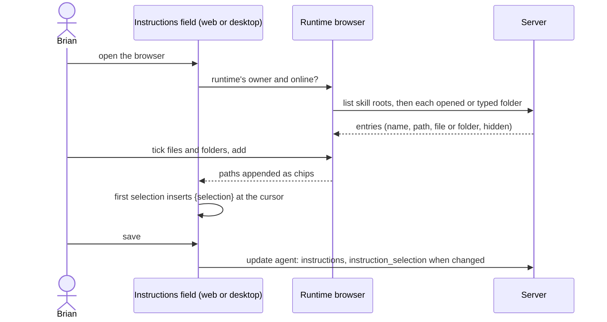
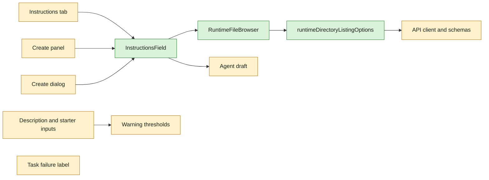

## At a glance

| Kind | Name | Change | Path |
|---|---|---|---|
| Types | `Agent`, `CreateAgentRequest`, `UpdateAgentRequest` carry `instruction_selection`; directory listing types | changed | `packages/core/types/agent.ts` |
| API client and schemas | directory listing calls and their zod schemas; the stored draft's selection | changed | `packages/core/api/client.ts`, `packages/core/api/schemas.ts` |
| Query | directory listing resolve and query options | new | `packages/core/runtimes/directory-listing.ts` |
| Draft | `instructionSelection` in the draft, duplicate and create request | changed | `packages/core/agents/draft.ts`, `packages/core/agents/stored-draft.ts` |
| Limits | 255, 80 and 4000 become warning thresholds; the builder keeps text whole | changed | `packages/core/agents/constants.ts`, `packages/core/agents/builder-protocol.ts` |
| UI | instructions field with chips and warnings | new | `packages/views/agents/components/instructions-field.tsx` |
| UI | runtime browser | new | `packages/views/agents/components/runtime-file-browser.tsx` |
| UI | instructions tab, create panel and create dialog use the field | changed | `packages/views/agents/components/tabs/instructions-tab.tsx`, `packages/views/agents/create/agent-configuration-panel.tsx`, `packages/views/agents/components/create-agent-dialog.tsx` |
| UI | rich instructions editor of the create dialog | removed | `packages/views/agents/components/instructions-editor.tsx` |
| UI | description and starter inputs warn | changed | `packages/views/agents/components/char-counter.tsx`, `packages/views/agents/components/agent-detail-inspector.tsx`, `packages/views/agents/components/conversation-starters-editor.tsx`, `packages/views/agents/create/use-create-agent-form.ts` |
| UI | squad description keeps 255 | changed | `packages/views/modals/create-squad.tsx` |
| Failure label | `instruction_selection_error` | changed | `packages/views/agents/components/tabs/task-failure.ts` |
| Copy | agents strings | changed | `packages/views/locales/{en,fr,ja,ko,zh-Hans}/agents.json` |
| Docs | the selection and the limit warnings | changed | `apps/docs/content/docs/agents-create{,.zh,.ko,.ja,.fr}.mdx` |

## Why

The change `agent-instruction-selection` lets an agent hold a selection of files and folders on its runtime machine and loads them at every task start, and drops the length limits on an agent's description and conversation starters from the API. Brian needs to pick those files in web and desktop the way he picks anything else on an agent, see what is selected, and get a warning instead of a block when text passes the old limits.

Success signal: in the desktop app Brian opens an omp agent's instructions, browses to a skill folder on his machine, adds it, and saves; the agent's next task runs with that folder's files.

## What Changes

- One instructions field in the instructions tab, the create panel and the create dialog: the text, a runtime browser for the runtime's owner, and the selected paths as chips, removable by that owner and read-only for anyone else.
- The first selection inserts `{selection}` at the cursor; the field warns when the selection and `{selection}` do not match, without blocking saving.
- The runtime browser lists the skill roots of the agent's runtime, opens folders and typed paths, marks hidden entries, selects several at once, and says when the runtime is offline.
- Drafts keep the selection, a duplicate copies it, and the AI builder never sets it.
- The description and starter inputs warn above 255, 80 and 4000 characters instead of stopping; the AI builder keeps starter text whole and only the first 3 starters; the squad description keeps 255.
- A task that failed with `instruction_selection_error` shows its label in every supported language.

## Capabilities

### New Capabilities

- `instruction-selection-field`: lets Brian see the selected paths in the instructions field, place `{selection}` in his own text, and be warned when the two do not match.
- `runtime-file-browser`: lets the owner of a runtime browse its machine's skill roots, folders and typed paths and select several at once, in web and desktop.
- `agent-field-limit-warnings`: lets Brian write an agent description and conversation starters of any length, warned above 255, 80 and 4000 characters.

### Modified Capabilities

None: the OpenSpec root is new and holds no specs yet.

## Impact

- Web and desktop: the instructions field in the instructions tab, the create panel and the create dialog; the description and starter inputs; the task failure label.
- Shared packages: agent types, the API client and its schemas, the agent draft, the builder protocol, a directory listing query.
- Copy in five languages and the docs in five languages.

## Constraints

- Builds on the change `agent-instruction-selection`: its API fields and directory listing endpoints exist first.
- Only the owner of the agent's runtime browses that machine and changes an agent's selection.
- AGENTS.md: zod schemas with `parseWithFallback` and malformed-response tests for the new responses, shared components in `packages/views`, no store in `packages/views`, no compatibility shims, every check local.

## Non-goals

- Mobile: it has no instructions editor and ignores the new field.
- The CLI.
- The AI agent builder setting a selection.
- Text limits outside agents.
- A size warning on selections.

## Sources

- Intent: [Pick a local skill as an agent's live system prompt](anytype://object?objectId=bafyreih4afdxypfryync3lzilucl3qwjuvprpnlyypmkrm7iejq52u2dgi) and its Requests.
- Approach, passed by Brian: [Select local files and folders as an agent's instructions](anytype://object?objectId=bafyreib2hcvw46rajqfcbw2f5lpntjsemt3s62lvgcep6zqzoaqudgs5hu); its "Per file or system" section holds the code map for the design.
- Decisions: [The picker is a runtime browser](anytype://object?objectId=bafyreidkzrr6hpp46ry6rvrk2jyympdb4gydn4rbzdfo34e3dzuvuodlvi), [Only the runtime's owner browses and changes a selection](anytype://object?objectId=bafyreicdmlkimhz2z6dgyjydsuxfuc7hvzouiy6ignfgqbn5pzj5z2falu), [A path selected by hand is always read; a selected binary file fails](anytype://object?objectId=bafyreiddodnsgdj66vvavcxfva2y4quzr2q5n4j6cla6r5troe32hylg64), [An empty selected folder runs with an empty tree](anytype://object?objectId=bafyreidge2jqeeqs523jcq2ls46sq2g3fzmtjetps7vrciiivbzpezaw5y), [A file brought in twice comes in once](anytype://object?objectId=bafyreifkvsdzv3ttsyajrrbrqxllmos3rmy4omi26n6i3dgbtlodkv4hci), [Every {selection} gets the full selection](anytype://object?objectId=bafyreifmmh5whedozbywayxyxvcx4yntaj7spgkk2olglp4gezpv4vcosu), [Agents don't change runtimes; no selection rule for it](anytype://object?objectId=bafyreidbtlba4b5j2xcot2lhex4xdkrbbau57kme2ypznppcvwbo2udeg4), [The picker adds nothing while the runtime is offline](anytype://object?objectId=bafyreihmoqyjk77xfrcws6k3ua3jslvfsfdp6s5ian6lcvn2mhlcq67vxq), [The browser lists hidden entries, marked as hidden](anytype://object?objectId=bafyreia5bsfx66xf63mwzz4t54lgoxbwsrsmppapvvvv2cv3e7mp2drcca), [The AI agent builder never sets a selection](anytype://object?objectId=bafyreibfexxb4lejzoku6o3nkl72f4cur2ig2sd7e56awpcr62sdzbb5cy).
- The server, daemon and madspec-sync side: the change `agent-instruction-selection`.
