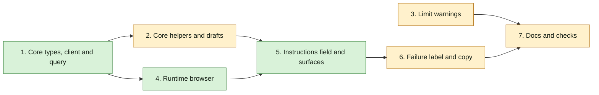

## At a glance

| Group | Builder | Proves it |
|---|---|---|
| 1. Core types, client and query | `madspec-api-builder` | `pnpm --filter @multica/core test -- schemas directory-listing` |
| 2. Core helpers and drafts | `madspec-service-builder` | `pnpm --filter @multica/core test -- instruction-selection draft stored-draft builder-protocol` |
| 3. Limit warnings | `madspec-view-builder` | `pnpm --filter @multica/views test -- char-counter agent-detail-inspector conversation-starters create-squad use-create-agent-form` |
| 4. Runtime browser | `madspec-view-builder` | `pnpm --filter @multica/views test -- runtime-file-browser` |
| 5. Instructions field and surfaces | `madspec-view-builder` | `pnpm --filter @multica/views test -- instructions-field instructions-tab agent-configuration-panel create-agent-dialog` |
| 6. Failure label and copy | `madspec-view-builder` | `pnpm --filter @multica/views test -- agents-i18n-parity task-failure` |
| 7. Docs and checks | `madspec-view-builder` | `pnpm typecheck`, `pnpm lint`, `pnpm test`, `openspec validate` |

## 1. Core types, client and query

- [x] 1.1 In `packages/core/types/agent.ts`, add `Agent.instruction_selection?: string[]`, `CreateAgentRequest.instruction_selection?: string[]`, `UpdateAgentRequest.instruction_selection?: string[]`, `RuntimeDirectoryEntry` and `RuntimeDirectoryListingRequest` per design Decision 1. Verify: `pnpm typecheck`.
- [x] 1.2 In `packages/core/api/schemas.ts`, add `RuntimeDirectoryListingRequestSchema` with the fallbacks of design Decision 1; in `packages/core/api/client.ts`, add `initiateDirectoryListing(runtimeId, path)` (`POST /api/runtimes/{runtimeId}/directory-listings`) and `getDirectoryListing(runtimeId, requestId)` (`GET .../{requestId}`), both through `parseWithFallback`. Verify: `schemas.test.ts` cases for an unknown status, missing entries and an entry without `kind` or `hidden`.
- [x] 1.3 Create `packages/core/runtimes/directory-listing.ts` (`resolveRuntimeDirectoryListing`, `runtimeDirectoryListingKeys`, `runtimeDirectoryListingOptions`) per design Decision 2 and export it from `packages/core/runtimes/index.ts`. Verify: a `// @vitest-environment node` test with `api` mocked at `@multica/core/api`: pending then completed returns the entries; failed throws the request's error; still pending after 30 s throws a timeout (fake timers).

## 2. Core helpers and drafts

- [x] 2.1 Create `packages/core/agents/instruction-selection.ts` (`SELECTION_PLACEHOLDER`, `appendSelection`, `insertSelectionPlaceholder`, `selectionWarning`) per design Decision 3 and export it from `packages/core/agents/index.ts`. Verify: `instruction-selection.test.ts`: appending keeps order and skips paths already selected; the placeholder goes in at the cursor, at the end after a blank line without a cursor, and alone in empty text; each warning case and `null` when both match.
- [x] 2.2 Add `instructionSelection: string[]` to `AgentDraft` and `EMPTY_AGENT_DRAFT` (`draft.ts`); `buildDuplicateDraft` copies `source.instruction_selection ?? []`; `buildCreateAgentRequest` sends `instruction_selection` when not empty. Verify: `draft.test.ts` cases for a duplicate with two paths and a create request with and without a selection.
- [x] 2.3 In `stored-draft.ts`, write and read `instruction_selection` and compare it in `storedAgentDraftsEqual`; in `schemas.ts`, add `instruction_selection: z.array(z.string()).catch([])` to `StoredAgentDraftSchema`. Verify: `stored-draft.test.ts` round trip with a selection and a stored draft without the field reading `[]`.
- [x] 2.4 In `builder-protocol.ts`, `mergeBuilderDraft` keeps `current.instructionSelection` and ignores `instruction_selection` in the payload. Verify: a test whose payload carries `instruction_selection` leaves the draft's selection as it was.

## 3. Limit warnings

- [x] 3.1 In `packages/core/agents/constants.ts`, rename to `AGENT_DESCRIPTION_WARN_LENGTH`, `AGENT_CONVERSATION_STARTER_LABEL_WARN_LENGTH`, `AGENT_CONVERSATION_STARTER_WARN_LENGTH` and rewrite the header comment; create `packages/core/squads/constants.ts` with `SQUAD_DESCRIPTION_MAX_LENGTH = 255`, exported from `packages/core/squads/index.ts`; move every caller; remove `isDraftDescriptionWithinLimit` and its callers and tests. Verify: `pnpm typecheck`.
- [x] 3.2 `CharCounter` gains `soft` per design Decision 8, with `char_counter.over_threshold` in `en/agents.json`. Verify: a test renders 300 of 255 soft (warning tone, the over-threshold text) and hard (destructive tone, today's text).
- [x] 3.3 Description inputs in `agent-detail-inspector.tsx`, `create/agent-configuration-panel.tsx` and `create-agent-dialog.tsx` drop `maxLength` and use a soft counter; the inspector's save gate drops the length check. `create-squad.tsx` uses `SQUAD_DESCRIPTION_MAX_LENGTH`. Verify: an inspector test types 300 characters, sees all of them and the warning, and saves; a 255-character description shows no warning; `create-squad.test.tsx` still stops at 255.
- [x] 3.4 `conversation-starters-editor.tsx` drops `maxLength` and shows a soft counter past 80 and 4000; `use-create-agent-form.ts` keeps only the empty label and prompt checks; `builder-protocol.ts` stops slicing label and prompt and keeps the cut to 3. Verify: an editor test with an 81-character label and a 4,001-character prompt keeps every character and warns at both; `builder-protocol.test.ts` with 4 starters and a 120-character label keeps 3 and the label whole; remove tests that assert truncation.

## 4. Runtime browser

- [x] 4.1 Create `packages/views/agents/components/runtime-file-browser.tsx` per design Decision 5. Verify: `runtime-file-browser.test.tsx` with `api` mocked at `@multica/core/api`: the roots list; opening a folder lists it; a typed path lists it and a missing one shows its error; a hidden entry shows its badge; ticking a file and a folder in two folders then Add calls `onAdd` with both in tick order; an offline runtime shows the offline message, requests nothing and keeps Add disabled.

## 5. Instructions field and surfaces

- [x] 5.1 Create `packages/views/agents/components/instructions-field.tsx` per design Decision 4. Verify: `instructions-field.test.tsx`: the owner sees Browse and removable chips; another member sees read-only chips and no Browse; the first add inserts `{selection}` at the cursor and a later add only appends; removing a chip calls `onSelectionChange` without it; each warning shows and neither disables anything.
- [x] 5.2 `tabs/instructions-tab.tsx` takes `runtime` and `currentUserId` from `agent-overview-pane.tsx`, uses `InstructionsField`, includes the selection in `isDirty`, and sends `instruction_selection` only when it changed. Verify: a tab test where the owner adds a path and saves sends it; a member who edits only the text sends no `instruction_selection`.
- [x] 5.3 `create/agent-configuration-panel.tsx` uses `InstructionsField` on `draft.instructions` and `draft.instructionSelection` with the draft's runtime and `currentUserId`. Verify: a panel test adds a path, sees `{selection}` in the text, and the create request carries the path.
- [x] 5.4 `create-agent-dialog.tsx` uses `InstructionsField` with a `selection` state seeded from the template; remove `instructions-editor.tsx`. Verify: a dialog test for a duplicate of an agent with a selection sends that selection.

## 6. Failure label and copy

- [x] 6.1 Map `instruction_selection_error` in `tabs/task-failure.ts` and add its label to each `agents.json`. Verify: a `task-failure` test resolves the key; `agents-i18n-parity.test.ts` passes.
- [ ] 6.2 Add the `instructions.selection`, `runtime_browser` and `char_counter.over_threshold` keys of design Decision 10 to `packages/views/locales/{en,fr,ja,ko,zh-Hans}/agents.json`, following `apps/docs/content/docs/developers/conventions{,.zh}.mdx`. Verify: `agents-i18n-parity.test.ts` passes.

## 7. Docs and checks

- [ ] 7.1 Update `apps/docs/content/docs/agents-create{,.zh,.ko,.ja,.fr}.mdx`: selecting files and folders, `{selection}`, the owner rule, and the warnings instead of the 255/80/4000 limits. Verify: the docs build (`pnpm --filter @multica/docs build`) passes.
- [ ] 7.2 Run `pnpm typecheck`, `pnpm lint` and `pnpm test` from the worktree root, and `openspec validate agent-instruction-selection-field --type change --strict` in `specs/`. Verify: all pass.
- [ ] 7.3 Smoke on the worktree stack in web and in the desktop app: as Brian, open an omp agent's instructions, browse to `~/Repos/Ventures/madspec/skills/as-ux-designer`, add it, see `{selection}` inserted and the chip, save, reload, and see both; as another member, see the chip read-only and no Browse; stop the daemon and see the offline message.

## Implementation Notes

- Starts once groups 1 to 4 of `agent-instruction-selection` are built: the agent API field and the directory listing endpoints must exist.
- Mobile ignores `instruction_selection`; nothing changes there.
- Mock stores with their Zustand callable shape plus `getState`; views tests do not mock `next/*` or `react-router-dom`.
- Group 1 scope: add only the selection wire fields, directory listing response parsing and client calls, and the dedicated polling query with regression tests; preserve other agent/runtime behaviour.
- 1.1: Added optional selection fields and directory entry/listing request types in `packages/core/types/agent.ts`, and exposed the directory types through the existing explicit `packages/core/types/index.ts` barrel. The explicit barrel was an additional necessary callsite. Existing callers need no changes for the optional selection fields. Typecheck is reserved for the main agent's final verification.
- 1.2: Added lenient listing/entry schemas and an explicit failed-response fallback in `packages/core/api/schemas.ts`; added both directory listing calls through `parseWithFallback` in `packages/core/api/client.ts`. `schemas.test.ts` covers unknown status, missing entries, missing/malformed entry markers, malformed strings and non-object responses; `client.test.ts` covers POST/GET paths, request bodies, boundary parsing and fallback request identity. Unknown statuses fail rather than pretending a directory is empty. No additional surprises; tests remain for the main agent to run.
- 1.3: Added `packages/core/runtimes/directory-listing.ts`, exported from `runtimes/index.ts`, with 500 ms polling, `{ path, entries }` results, server-error propagation, runtime/path query keys, `staleTime: 0` and `retry: false`. Kept polling separate from local skills as designed; use `>= 30_000` to stop at the specified boundary rather than the local-skills loop's extra interval. `directory-listing.test.ts` uses the node environment, API-boundary mocks and fake timers for pending/running/completed, immediate roots, failed/timeout, poll failure and the 30-second cutoff, plus query key/cache policy checks. Tests and typecheck remain for the main agent's final verification; no unresolved implementation blockers.
- 2.1: Added pure helpers in `packages/core/agents/instruction-selection.ts` and exported them from `agents/index.ts`. Paths retain exact spelling and selection order; added duplicates are skipped without mutating either input. Cursor insertion adds no spacing; unfocused insertion adds a blank line only for nonempty text. `instruction-selection.test.ts` covers ordered deduplication, cursor start/middle/end and empty text, unfocused insertion and all warning states. No logging is needed for these pure transformations. Tests await the main agent's final verification; no implementation surprises.
- 2.2: Added `AgentDraft.instructionSelection`, its empty value, an independent ordered copy for duplicates, and conditional create-request submission in `packages/core/agents/draft.ts`. `draft.test.ts` covers two-path duplication, missing source selection, populated/empty create payloads and retention on runtime changes. Updated required draft fixtures in `draft.test.ts`, `builder-protocol.test.ts`, `stored-draft.test.ts` and `packages/views/agents/create/agent-execution-overrides.test.tsx`; the views fixture was the additional type migration identified by references. Core draft tests use the required node environment. Existing runtime/model, access and length behaviour is unchanged. Tests await the main agent's final verification.
- 2.3: Added selection serialization, empty-on-absence restoration and ordered selection equality in `agents/stored-draft.ts`; added the specified catch-to-empty schema in `api/schemas.ts`. The existing `StoredAgentDraft` interface in `types/agent.ts` also needed optional `instruction_selection` to represent persisted drafts that omit the field. Equality normalizes absence to `[]`, so restoring a blank saved draft does not appear as an edit. `stored-draft.test.ts` covers ordered round trips, absent and malformed fields, changed/reordered paths, and absence-versus-empty equality. No other stored fields or autosave rules change. Tests await the main agent's final verification.
- 2.4: `agents/builder-protocol.ts` explicitly preserves `current.instructionSelection`; the builder payload contract exposes no selection field. `builder-protocol.test.ts` parses a real structured payload containing `instruction_selection` and verifies that both an empty and an existing two-path selection stay unchanged while permitted fields merge. Starter truncation and other builder behaviour are intentionally left to group 3. No logging or additional payload fields were introduced. Tests await the main agent's final verification; all group 2 behaviours and task commits are complete.
- 3.1: Renamed the three thresholds in `agents/constants.ts` with a header comment saying they warn and never block; the starter count keeps its hard cap. Added `squads/constants.ts` (`SQUAD_DESCRIPTION_MAX_LENGTH`), exported from `squads/index.ts`, and moved `modals/create-squad.tsx` onto it. Removed `isDraftDescriptionWithinLimit` from `agents/draft.ts`, its test in `draft.test.ts` and its only caller, the `draftReady` gate in `create/use-create-agent-form.ts`. The other callers (`builder-protocol.ts`, the inspector, the create panel, the create dialog, the starter editor and the form's starter check) only switch names here; their behaviour changes in 3.3 and 3.4, so each commit stays one task. No mobile or app caller existed. `pnpm --filter @multica/core --filter @multica/views typecheck` passes.
- 3.2: `char-counter.tsx` takes `soft?: boolean` (default hard, so the squad keeps today's behaviour): soft drops the 90 % near tone, stays muted at the threshold and turns `text-warning` with `char_counter.over_threshold` past it. The English copy carries the same leading ` · ` separator as `over_limit` so it reads after `300 / 255`: ` · {{count}} over the recommended {{max}}`. Only `en/agents.json` gets the key here, as the task says; the other four languages come in 6.2, so `packages/views/locales/parity.test.ts` fails for `agents` in zh-Hans, ko, ja and fr until then (`agents-i18n-parity.test.ts` only checks failure reasons and passes). New `char-counter.test.tsx` covers 300 of 255 soft and hard, soft at and near the threshold, and the hard near tone; it passes, as does the views typecheck.
- 3.3: The inspector, the create panel and the create dialog drop `maxLength` from their description inputs and pass `soft` to `CharCounter`; the panel's comment about the API's 400 went with its `maxLength`. The inspector's profile autosave is enabled on `canEdit` and a non-empty name only. The create dialog never gated on the description, and the create form's gate already lost `isDraftDescriptionWithinLimit` in 3.1. `create-squad.tsx` moved to `SQUAD_DESCRIPTION_MAX_LENGTH` in 3.1. New `agent-detail-inspector.description.test.tsx` pastes 300 characters with `user-event` (which honours `maxLength`), sees all of them and `45 over the recommended 255`, and on blur `onUpdate` receives the whole description; at 255 it shows `255 / 255` and no warning. `create-squad.test.tsx` gains a case that pastes 300 characters and keeps 255. The inspector, squad, create dialog and `agents/create` suites pass (11 files, 53 tests).
- 3.4: `conversation-starters-editor.tsx` drops both `maxLength`s and renders a soft `CharCounter` under the label row or the prompt only once its rune count passes 80 or 4000, so short starters stay as they looked. `use-create-agent-form.ts` marks starters invalid only for an empty label or prompt and no longer imports the thresholds. `builder-protocol.ts` trims label and prompt without slicing and keeps `.slice(0, AGENT_CONVERSATION_STARTERS_MAX)` before the completeness filter, as before. No existing test asserted truncation, so none were removed. `conversation-starters-editor.test.tsx` gains a stateful case that pastes an 81-character label and a 4,001-character prompt, keeps both whole, shows both warnings and no incomplete alert, and a case that shows no counter at exactly 80 and 4000. `builder-protocol.test.ts` gains 4 starters with a 120-character label and a 4,001-character prompt: the first 3 stay, text whole. The editor, `agents/create`, char counter, builder protocol and draft suites pass; the core and views typechecks and ESLint on the touched files pass. Group 3 does not change the server: the API limits are dropped by `agent-instruction-selection`.
- 4.1: `runtime-file-browser.tsx` exports `RuntimeFileBrowser({ open, onOpenChange, runtime, onAdd })`; `runtime` is a non-null `RuntimeDevice`, so the field (5.1) renders it only when `canSelect`, which already implies a runtime. The listing query runs only while the dialog is open and the runtime online. The path input shows the listed (resolved) path unless the user is typing; Enter lists the typed path, and Enter on the listed path refetches it. Up goes to the parent, and to the skill roots from a root: a root is any entry of the cached `""` listing, read with `getQueryData`, and a filesystem root (`/`, `C:\`) also goes back to the roots; parents handle `/` and `\`. Ticks are an ordered array of absolute paths kept across folders; closing, by Add or dismissal, resets the path, the typed text and the ticks. Folder names are buttons that open the folder; each checkbox's accessible name is the entry's name. A listing error shows `runtime_browser.error` with the request's message in a `role="alert"` line; it is logged through `createLogger("agents.runtime-browser")`, as is each Add with its count. The `runtime_browser` keys (title, path, up, hidden, offline, empty, error, add) go into `en/agents.json` only, as 3.2 did; `empty` ("Nothing here.") is one key beyond Decision 10's list, for a folder without entries. The other four languages come in 6.2. New `runtime-file-browser.test.tsx` (8 tests) covers the roots, opening a folder, a typed and a missing path, the hidden badge with a tickable hidden folder, ticks from `/s` and `/n` added in tick order with the dialog closing, Up to a parent and from a root back to the roots, Up from a typed path to `/`, and the offline runtime with no request and Add disabled. It passes, as do the views typecheck and ESLint on both files.
- 5.1: `instructions-field.tsx` exports `InstructionsField` with Decision 4's props plus optional `rows` and `className` for the textarea, so each surface keeps its own height and font. `canSelect` also requires a non-null runtime and user id, so a runtime without an owner never matches a signed-out viewer. The client knows no home folder, so a chip shortens a leading `/Users/<name>`, `/home/<name>` or `<drive>:\Users\<name>` to `~`, the prefixes the server recognises for `relative_work_dir`; the chip's tooltip is the full path itself, so no `chip_tooltip` copy key exists. The placeholder goes in at the textarea's `selectionStart` once it has had focus, else at the end; the cursor is restored with `setSelectionRange` in a layout effect after the new text lands, without taking focus from the browser dialog's own focus return. The browser is mounted only when `canSelect`. The `instructions.selection` keys (list, browse, remove, the two warnings) go into `en/agents.json` only, as 3.2 and 4.1 did; the other languages come in 6.2. New `instructions-field.test.tsx` (9 tests) covers owner and member chips, no chip row for a member without a selection, the cursor insert and a later append-only add, the end insert without focus, chip removal, both warnings with the textarea and Browse enabled, and no warning when text and selection match. It passes, as do the views typecheck and ESLint on both files.
- 5.2: `instructions-tab.tsx` takes `runtime: RuntimeDevice | null` and `currentUserId: string | null`; `agent-overview-pane.tsx` passes its `runtime` and `currentUserId ?? null`. The selection joins the tab's persisted-state sync as a third semantic key beside the instructions and starters, so a refetch keeps a dirty local selection and a clean form adopts a server change, and switching agents loads the new agent's selection. `onSave` gains `instruction_selection?: string[]`, sent only when the selection differs from `agent.instruction_selection ?? []`. The field keeps the textarea's `rows={18}` and `min-h-96`. `instructions-tab.test.tsx` mocks `api` at `@multica/core/api` for the browser, wraps the tab in a `QueryClientProvider`, passes `runtime` and `currentUserId` everywhere, and gains two cases: the owner browses, adds a folder, sees its chip and saves `instructions` with `{selection}` appended plus `instruction_selection`; a member sees the chip without Browse, edits the text and saves without `instruction_selection`, with no listing requested. The tab, overview pane and detail page suites pass (50 tests), as do the views typecheck and ESLint on the touched files.
- 5.3: The panel's instructions `Textarea` became `InstructionsField` with the selected runtime and `currentUserId`, keeping its id (so the row's label still names it), placeholder, rows and monospace style. Surprise: the field reports a first selection as two changes in one event (the text with `{selection}`, then the selection), and the panel's `set` spread the rendered `draft` each time, so the second change dropped the first. `set` now builds on a `latestDraftRef` refreshed every render, which also covers every other field; the builder workspace and the manual page keep passing `setDraft` unchanged. New `agent-configuration-panel.test.tsx` renders the whole panel in a stateful harness with `api` mocked at `@multica/core/api` and only `SkillMultiSelect` stubbed (it needs a workspace route); it browses, adds a folder, sees `Follow this.\n\n{selection}` in the Instructions field, and `buildCreateAgentRequest` on the resulting draft carries that text and the folder. It passes with the rest of `agents/create` (7 files, 31 tests), as do the views typecheck and ESLint on both files.
- 5.4: The dialog holds `selection` seeded from `template?.instruction_selection ?? []` and sends `instruction_selection` only when it is not empty; `InstructionsField` takes the selected runtime and `currentUserId` under a `Label` linked to its id, with `create_dialog.instructions.editor_placeholder` and `rows={6}`. `instructions-editor.tsx` is deleted. Its click-to-expand copy (`create_dialog.instructions.placeholder_blank`, `placeholder_duplicate`, `collapse`) had no other user, so those keys left all five `agents.json` files; `label` and `editor_placeholder` stay. `create-agent-dialog.test.tsx` gains a duplicate of an agent with `{selection}` and one folder on the caller's runtime, which shows the chip and sends both, and a plain create that sends no `instruction_selection`. The dialog suite passes (12 tests), as do the views typecheck and ESLint on the touched files. The whole views suite passes except `locales/parity.test.ts` for `agents` in fr, ja, ko and zh-Hans, whose only missing keys are the en-only `char_counter.over_threshold`, `runtime_browser.*` and `instructions.selection.*` that 6.2 translates (478 files, 5988 of 5992 tests).
- 6.1: `FAILURE_REASON_I18N_KEYS` maps `instruction_selection_error` beside `local_directory_error` among the daemon's operational reasons, and each `agents.json` gets `task_failure.reasons.instruction_selection_error`: "Instruction selection error", "Erreur de sélection des instructions", "指示の選択エラー", "지침 선택 오류", "指令选择出错", using each locale's existing word for instructions. The transcript and activity rows already read the label through `failureReasonLabel`, so no component changes. `task-failure.test.ts` asserts the label in all five locales. `pnpm --filter @multica/views exec vitest run agents/components/tabs/task-failure.test.ts agents/agents-i18n-parity.test.ts` passes (36 tests). Surprise: my first, uncommitted edit to `task-failure.ts` vanished while a sibling committed 5.4 in the same worktree; it was applied again before this commit.

## Plan Change Log

- 2026-10-12: L5 split the work along the roster: this change holds the Frontend team's work from `agent-instruction-selection`, with the specs `runtime-file-browser`, `instruction-selection-field` and the new `agent-field-limit-warnings`.
