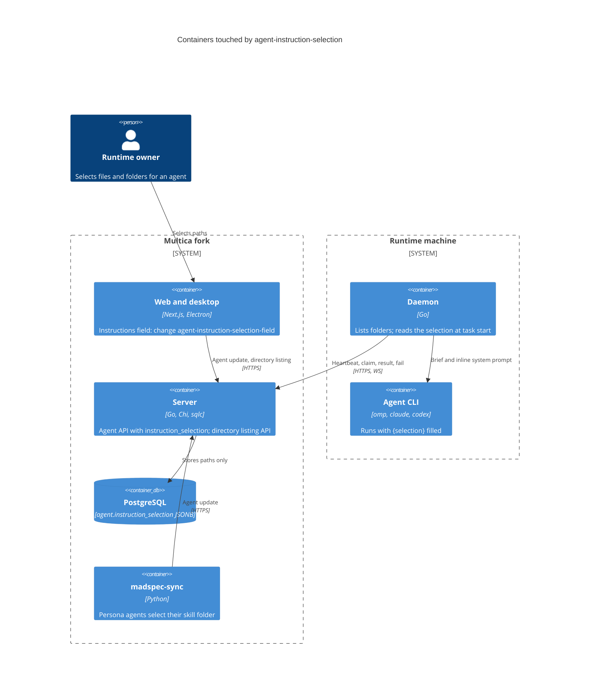
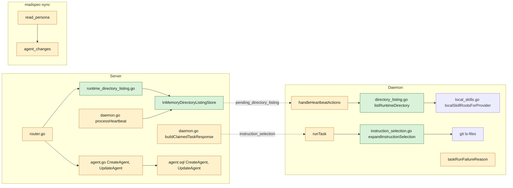
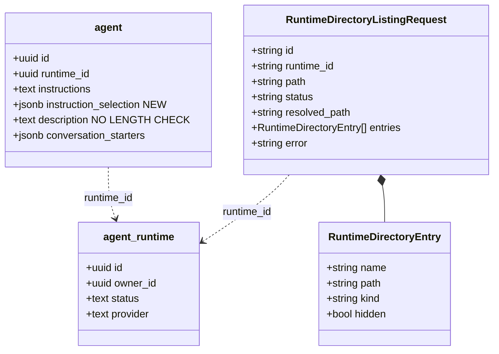
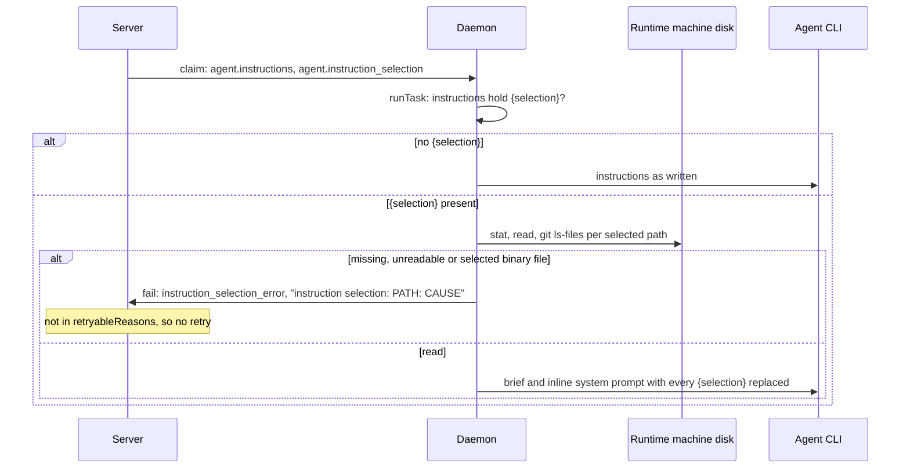

## At a glance

The delta on [the living system design](../../../docs/system-design.md): the server stores and passes paths, the daemon on the runtime machine lists folders and reads the selection, madspec-sync writes persona selections.









| Kind | Name | Change | Path |
|---|---|---|---|
| Migration | add `agent.instruction_selection` | new | `server/migrations/564_agent_instruction_selection.{up,down}.sql` |
| Migration | drop `agent_description_length` | new | `server/migrations/565_drop_agent_description_length.{up,down}.sql` |
| Queries | `CreateAgent`, `UpdateAgent` | changed | `server/pkg/db/queries/agent.sql`, `server/pkg/db/generated/` |
| Handler | agent create, update, response, claim data | changed | `server/internal/handler/agent.go` |
| Handler | directory listing initiate, poll, result, store | new | `server/internal/handler/runtime_directory_listing.go` |
| Handler | heartbeat pops listings; claim copies the selection | changed | `server/internal/handler/daemon.go`, `server/internal/handler/handler.go` |
| Routes | listing routes | changed | `server/cmd/server/router.go` |
| Protocol | `PendingWorkKindDirectoryListing`, `DaemonHeartbeatPendingDirectoryListing` | changed | `server/pkg/protocol/messages.go` |
| Daemon | `AgentData.InstructionSelection`, client report, alias | changed | `server/internal/daemon/types.go`, `server/internal/daemon/client.go` |
| Daemon | directory lister | new | `server/internal/daemon/directory_listing.go` |
| Daemon | selection loader | new | `server/internal/daemon/instruction_selection.go` |
| Daemon | `runTask`, `handleHeartbeatActions`, `taskRunFailureReason` | changed | `server/internal/daemon/daemon.go` |
| Docs | agent reference without 255, 80, 4000 errors; with the selection | changed | `server/internal/service/builtin_skills/multica-platform/references/agents.md`, `server/internal/service/builtin_skills_test.go` |
| Sync | persona selection | changed | `madspec-sync/multica_sync.py`, `madspec-sync/specs/multica-agents.md`, `madspec-sync/README.md`, `madspec-sync/tests/test_multica_sync.py` |

## Context

The team is **Backend** (`as-backend-lead`, Joeri), from `roster.py`. The roster gives one team per change, so the web, desktop and docs work of the same Approach is the change `agent-instruction-selection-field` (Frontend, Thomas). This change reaches `main` first, in its own pull request, because the other one calls its API; `agent-instruction-selection-field` is built after it merges.

Code map:

- **Agent row and API.** `agent.instructions` is TEXT (migration `021`). `agent.conversation_starters` is the JSONB precedent: `agentToResponse` unmarshals it, `CreateAgent` writes `COALESCE(sqlc.narg('conversation_starters')::jsonb, '[]'::jsonb)`, `UpdateAgent` writes `COALESCE(sqlc.narg('conversation_starters'), conversation_starters)`, and `UpdateAgent` in `agent.go` reads field presence through `decodeJSONBodyWithRawFields`. Migration `060_agent_description_length` adds `CHECK (char_length(description) <= 255)`; `agent.go` checks `maxAgentDescriptionLength` and `normaliseAgentConversationStarters` checks 3 starters, required label and prompt, and 80 and 4000 runes.
- **Runtime owner.** `agent_runtime.owner_id`. `requireRuntimeLocalSkillAccess` (`runtime_local_skills.go`) already gates by owner and answers 403 `insufficient permissions`; `InitiateListLocalSkills` answers 503 `runtime is offline`.
- **Heartbeat-carried requests.** `InitiateListLocalSkills` creates a request in `LocalSkillListStore`, calls `requestDaemonPendingWork(runtimeID, kind)`; `processHeartbeat` probes `HasPending` and sets `ack.PendingLocalSkills` from `PopPending`; `DaemonHeartbeat` copies the ack into its response map; the daemon's `handleHeartbeatActions` runs `go d.handleLocalSkillList`, which reports through `client.ReportLocalSkillListResult` and `reportRuntimeResultWithRetry`; `ReportLocalSkillListResult` completes or fails the request; the client polls `GET .../local-skills/{requestId}`. The router wires Redis stores only when `REDIS_URL` is set; the fork's stack runs without Redis.
- **Task start.** `buildClaimedTaskResponse` builds `TaskAgentData` from the agent row (Mika's instructions are composed there). In the daemon, `runTask` sets `instructions = task.Agent.Instructions` and builds `taskCtx`; `taskCtx.AgentInstructions` feeds `InjectRuntimeConfig` (`writeAgentIdentity`), and the brief becomes `execOpts.SystemPrompt` for `providerNeedsInlineSystemPrompt` providers and again on a fresh-session retry. A `runTask` error goes to `reportTerminalTask` with `taskRunFailureReason(err)`; the server retries only reasons in `retryableReasons` (`service/task.go`). `local_directory_error` is a daemon-only reason outside `pkg/taskfailure`, the precedent for `instruction_selection_error`.
- **Daemon helpers.** `localSkillRootsForProvider(provider)` gives the provider's skill roots; `relativizeHomePath` shows `~`; `runGitCommandContext` (`gc.go`) runs git with a timeout.
- **madspec-sync.** `AGENT_FIELDS` lists the fields the sync writes and compares; `read_persona` builds a `Persona` from `origin/main`; `agent_changes` diffs; `specs/multica-agents.md` holds the requirement "An agent runs its persona as the persona command does".

## Goals / Non-Goals

**Goals**

- An agent stores an ordered, absolute selection; the daemon fills every `{selection}` from disk at each task start; an unreadable selection fails the task once.
- The runtime's owner lists the runtime machine's skill roots and folders through the API.
- The description and starter length limits leave the API and the database.
- madspec-sync persona agents select their skill folder.

**Always**

- Read the selection on the daemon only, at task start, from disk, and only when the instructions hold `{selection}`.
- Gate selection changes and listings on `agent_runtime.owner_id`.
- Fail before the agent starts, with the path and the cause in the error.

**Never**

- Read a runtime machine's disk on the server, or store file content anywhere.
- Retry `instruction_selection_error`.
- Cap or warn on selection size.
- Touch mobile, the CLI or the AI builder.

**Non-Goals**: the web and desktop work (change `agent-instruction-selection-field`); text limits outside agents.

## Decisions

### 1. Storage: one JSONB column, paths as strings

Migration `564_agent_instruction_selection`: `ALTER TABLE agent ADD COLUMN instruction_selection JSONB NOT NULL DEFAULT '[]'::jsonb;`, down drops it. No index, no constraint. `CreateAgent` takes `COALESCE(sqlc.narg('instruction_selection')::jsonb, '[]'::jsonb)`, `UpdateAgent` takes `instruction_selection = COALESCE(sqlc.narg('instruction_selection'), instruction_selection)`, as `conversation_starters` does. Alternative, a TEXT[] column: rejected, the JSONB pattern and its tests already exist.

### 2. API shape and validation

- `AgentResponse.InstructionSelection []string` (`json:"instruction_selection"`), always an array; `decodeInstructionSelection(raw []byte) []string` turns empty or invalid JSON into `[]` with a warning log, as `agentToResponse` does for starters, and `buildClaimedTaskResponse` uses the same helper.
- `CreateAgentRequest.InstructionSelection []string`, `UpdateAgentRequest.InstructionSelection *[]string`; on update the field counts only when the raw body holds the key.
- `normaliseInstructionSelection(paths []string) ([]string, error)` trims each path, rejects an empty one or one that does not start with `/` (400 `instruction_selection paths must be absolute`), and keeps order and duplicates; the loader brings each file in once. A path starting with `~` is rejected: the server cannot know the runtime's home, so clients send the absolute paths the listing returns.

### 3. Owner gate

On create, a non-empty selection requires the caller's user ID to equal the target runtime's `owner_id`; on update, a present selection that differs from the stored one (compared after normalising) requires the agent's runtime's `owner_id`. Otherwise 403 `only the runtime owner can change instruction_selection`. An unchanged selection in a body passes, so a member who edits only the text and sends the whole form back is not rejected. The gate sits next to the existing permission check in each handler; no new helper beyond `requireRuntimeOwner(w, runtimeID, userID) bool`, which loads the runtime row.

### 4. Claim carries the paths

`TaskAgentData.InstructionSelection []string` (`json:"instruction_selection"`) and `daemon.AgentData.InstructionSelection []string`. The server sends paths only; it never expands `{selection}`. Mika's composed instructions pass through the same daemon step.

### 5. Loader: where it runs

`expandInstructionSelection(ctx context.Context, instructions string, paths []string) (string, error)` in `instruction_selection.go`, called in `runTask` right after `instructions = task.Agent.Instructions` and before `taskCtx` is built, so `taskCtx.AgentInstructions`, the brief, the inline system prompt and the fresh-session retry all get the filled text. When `instructions` holds no `{selection}`, it returns them unchanged without touching the disk. Otherwise it renders the selection once and runs `strings.ReplaceAll(instructions, "{selection}", rendered)`.

### 6. Loader: what it reads

- Each selected path: `filepath.EvalSymlinks`, then `os.Stat`. A file: read it; a NUL byte in its first 8 KB is an error `not a text file`. A folder: walk it.
- Walk: `os.ReadDir`, entries sorted by name (byte order), depth first. An entry whose name starts with `.` is skipped. A link is resolved with `filepath.EvalSymlinks`: a linked file counts as a file; a linked folder is walked under the link's name unless its real path was already walked in this run (a `visited` set of real folder paths, shared by all selected folders, which stops loops).
- Git: for each walked root (a selected folder or a linked folder's target), `git -C <real dir> rev-parse --show-toplevel` through `runGitCommandContext`. When it succeeds, `git -C <real dir> ls-files --cached --others --exclude-standard -z --full-name` gives the allowed files (joined to the toplevel); a file outside that set is skipped. When git fails or is absent, the root has no ignore rules.
- A file inside a folder with a NUL byte in its first 8 KB is skipped; an inside file or folder that cannot be read fails the run.
- Each included file is keyed by its real path; a real path seen before in this run is left out, so it stays at its first place.

### 7. Loader: the format and its escaping

```text
<selection>
<tree root="/s/as-ux-designer">
as-ux-designer/
  SKILL.md
  references/
    guide.md
</tree>
<file path="/s/as-ux-designer/SKILL.md">
...content...
</file>
<file path="/n/b.md">
...content...
</file>
</selection>
```

Trees come first, one per selected folder in selection order, listing only included files and the folders above them, two spaces per level, folders with a trailing `/`; an empty folder lists its own line only. Files follow in selection order and, within a folder, in walk order. The `path` and `root` attributes are the path as reached under the selected path (the link's path, not its target), with `&`, `<` and `"` escaped as `&amp;`, `&lt;` and `&quot;`. Content is verbatim, never escaped: escaping would change the Markdown and code the agent reads, and a file holding `</file>` is an accepted risk. A file without a trailing newline gets one before `</file>`. An empty selection renders as the empty string.

### 8. Loader: failure

Errors are `*instructionSelectionError{path, cause string}` with the message `instruction selection: <path>: <cause>`; causes are `does not exist`, `permission denied`, `not a text file`, or the OS error text. `taskRunFailureReason` maps it, through `errors.As`, to `instruction_selection_error` (constant `failureReasonInstructionSelection`) before the `environmentSetupError` branch. The reason stays out of `pkg/taskfailure` and `retryableReasons`, like `local_directory_error`, so the server never retries it.

### 9. Directory listing API

- `POST /api/runtimes/{runtimeId}/directory-listings` with `{"path": ""}` or `{"path": "/abs"}` or `{"path": "~/x"}`; `GET /api/runtimes/{runtimeId}/directory-listings/{requestId}`; daemon `POST /api/daemon/runtimes/{runtimeId}/directory-listings/{requestId}/result` under `DaemonAuth` with `requireDaemonRuntimeAccess`.
- Initiate and poll use `requireRuntimeLocalSkillAccess` (owner only, 403) and answer 503 `runtime is offline` when the runtime is not online, then `requestDaemonPendingWork(runtimeID, protocol.PendingWorkKindDirectoryListing)`.
- `DirectoryListingStore` with `InMemoryDirectoryListingStore` only, set in `handler.New` (`handler.go`), with the local-skill list's statuses and timeouts (`applyLocalSkillListTimeout` logic copied for this type). No Redis variant: the fork runs one server without Redis, and a listing lives for seconds.
- `processHeartbeat` probes and pops it after the local-skill list and sets `ack.PendingDirectoryListing = &protocol.DaemonHeartbeatPendingDirectoryListing{ID, Path}` (`json:"pending_directory_listing,omitempty"`); `DaemonHeartbeat` copies it into its response map.
- Result body from the daemon: `{"status": "completed", "path": "/abs", "entries": [{"name", "path", "kind": "file"|"folder", "hidden"}]}` or `{"status": "failed", "error": "..."}`. The poll returns the request with `status`, `path`, `entries` and `error`.

### 10. Directory lister in the daemon

`listRuntimeDirectory(provider, path string) (resolved string, entries []directoryEntry, err error)` in `directory_listing.go`. An empty path lists the roots from `localSkillRootsForProvider(provider)` that exist, each with `name` = `relativizeHomePath(root)`, its absolute `path`, `kind` folder. Otherwise a leading `~` becomes the home folder, a relative path is an error `path must be absolute`, `os.ReadDir` lists the folder, `os.Stat` (which follows links) sets `kind`, a broken link counts as a file, `hidden` is a leading `.`, and entries are sorted by name. A missing path fails with `path does not exist: <path>`, a file with `not a folder: <path>`. `handleHeartbeatActions` runs it in a goroutine, as the local-skill list does, and reports through `client.ReportDirectoryListingResult` and `reportRuntimeResultWithRetry(ctx, "directory_listing", ...)`.

### 11. Limits

Migration `565_drop_agent_description_length`: `ALTER TABLE agent DROP CONSTRAINT IF EXISTS agent_description_length;`; down re-adds it `NOT VALID` without validating, so existing long rows survive a rollback. `agent.go` drops `maxAgentDescriptionLength`, `maxAgentConversationStarterLabel`, `maxAgentConversationStarterLength` and their checks; `normaliseAgentConversationStarters` keeps the cap of 3 and the required label and prompt. The DB check `agent_conversation_starters_check` (count only) stays.

### 12. madspec-sync

`Persona` gets `instruction_selection: list[str]`; `AGENT_FIELDS` adds `"instruction_selection"`. `read_persona` sets the selection to `[str(MADSPEC / "skills" / skill)]` (absolute, from `Path.home()`) and the instructions to `` `{skill-root}` is <that folder>. Your instructions are the <skill> skill below; follow it. `` plus a blank line plus `{selection}`. `agent_changes` compares lists as values, so a stale selection is rewritten. The persona list, models and arguments still come from `origin/main`. `specs/multica-agents.md` and `README.md` say so; the tests cover Guus's selection and instructions and a stale selection.

### 13. Built-in skill reference

`references/agents.md` drops the 255, 80 and 4000 limits, keeps "up to three starters", and adds `instruction_selection` with `{selection}`; `builtin_skills_test.go` stops expecting the limit text.

## Risks / Trade-offs

- [A file holding `</file>` or `</selection>` blurs the format] -> accepted: content stays verbatim, the path attributes make each block's start clear.
- [`git ls-files` on a large repository at every task start] -> it runs only on selected folders, scoped to that folder; Brian's selections are skill folders.
- [A nested repository inside a selected folder lists as one untracked folder, so its files are skipped] -> accepted for now; a skill folder holds no nested repository.
- [The in-memory listing store breaks with several server instances] -> the fork runs one; a Redis variant comes when it runs more.
- [Large selections make a large brief] -> Brian's decision: no size limit and no warning.

## Migration Plan

Run `make migrate-up` in the worktree; `564` adds the column with its default, so every existing agent has `[]` and behaves as today. `565` drops the check. Rollback: `565` down re-adds the check `NOT VALID`; `564` down drops the column and its selections.

## Open Questions

None.
