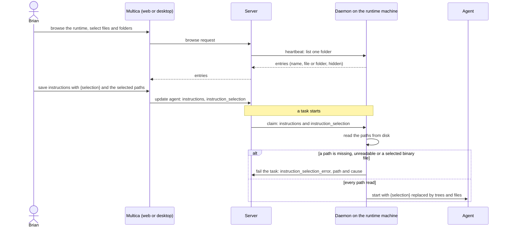
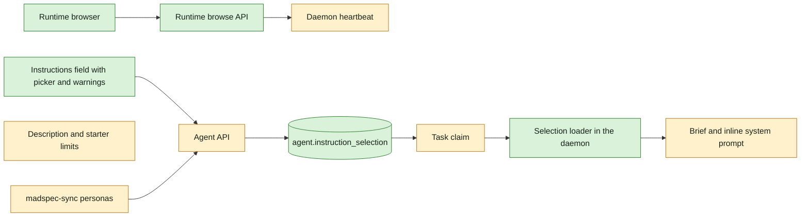

## At a glance

| Kind | Name | Change | Path |
|---|---|---|---|
| Database column | `agent.instruction_selection` | new | `server/migrations/` |
| Database constraint | `agent_description_length` | removed | `server/migrations/` |
| Queries | agent create and update | changed | `server/pkg/db/queries/agent.sql` |
| API | agent create, update, response, duplicate | changed | `server/internal/handler/agent.go` |
| API | runtime browse request and result | new | `server/internal/handler/` |
| Task claim | agent data with the selection | changed | `server/internal/handler/daemon.go`, `server/internal/daemon/types.go` |
| Daemon | folder listing for the browser | new | `server/internal/daemon/` |
| Daemon | selection loader | new | `server/internal/daemon/` |
| Daemon | task start fills `{selection}` | changed | `server/internal/daemon/daemon.go` |
| Failure reason | `instruction_selection_error` | new | `server/internal/daemon/`, `packages/views/agents/components/tabs/task-failure.ts` |
| Types and schemas | `instruction_selection` | changed | `packages/core/types/agent.ts`, `packages/core/api/schemas.ts` |
| Limits | description 255, starter label 80, prompt 4000 as warnings | changed | `packages/core/agents/constants.ts`, `packages/core/agents/draft.ts`, `packages/core/agents/builder-protocol.ts` |
| UI | instructions field with picker, chips and warnings | new | `packages/views/agents/components/` |
| UI | instructions tab, create panel, create dialog | changed | `packages/views/agents/components/tabs/instructions-tab.tsx`, `packages/views/agents/create/agent-configuration-panel.tsx`, `packages/views/agents/components/instructions-editor.tsx` |
| UI | description and starter inputs warn | changed | `packages/views/agents/components/char-counter.tsx`, `packages/views/agents/components/agent-detail-inspector.tsx`, `packages/views/agents/components/conversation-starters-editor.tsx`, `packages/views/agents/components/create-agent-dialog.tsx`, `packages/views/agents/create/use-create-agent-form.ts` |
| Copy | agents strings | changed | `packages/views/locales/{en,fr,ja,ko,zh-Hans}/agents.json` |
| Docs | selection and the limits | changed | `apps/docs/content/docs/agents-create*.mdx`, `server/internal/service/builtin_skills/multica-platform/references/agents.md` |
| Sync | persona agents select their skill folder | changed | `madspec-sync/multica_sync.py`, `madspec-sync/specs/multica-agents.md`, `madspec-sync/README.md`, `madspec-sync/tests/test_multica_sync.py` |

## Why

An agent's instructions are typed text, so a persona agent that should run a MadSpec skill holds only a written link to the skill and depends on the agent reading it, and any other agent holds a copy that goes stale. Brian wants an agent to run with the files on its runtime machine as they are at task start, a whole skill folder included, without a sync or a copy. The length limits on an agent's description and conversation starters get in the way of the same: sizes are his own responsibility.

Success signal: an omp agent whose instructions are `{selection}` with a selected skill folder starts a task, and its brief holds that folder's tree and every text file as they are on disk at that moment; an edit saved to one of those files shows in the next task without any sync.

## What Changes

- An agent gets an ordered list of absolute paths on its runtime machine, `instruction_selection`, beside `instructions`; `{selection}` in the instructions marks where the selection goes.
- At every task start the daemon reads the selected paths from disk and replaces each `{selection}` with a tree per selected folder and every file in an XML tag; the result is the agent's instructions for that run.
- A missing or unreadable path, or a selected binary file, fails the task before the agent starts with the new failure reason `instruction_selection_error`, never retried.
- The instructions field gets a runtime browser for the owner of the agent's runtime, the selected paths as removable chips, and warnings when `{selection}` and the selection do not match.
- The agent description limit (255) and the conversation starter label (80) and prompt (4000) limits go from the API, the database and the forms; the forms warn above them. At most 3 starters stays.
- madspec-sync gives each persona agent its whole skill folder as selection instead of a written link.

## Capabilities

### New Capabilities

- `agent-instruction-selection`: lets the owner of an agent's runtime keep an ordered list of files and folders on that machine as part of the agent's instructions.
- `instruction-selection-loading`: lets an agent run each task with its selected files as they are on disk at task start, and fails the task when they cannot be read.
- `runtime-file-browser`: lets the owner of a runtime browse its machine's skill roots, folders and typed paths and select several at once, in web and desktop.
- `instruction-selection-field`: lets Brian see the selected paths in the instructions field, place `{selection}` in his own text, and be warned when the two do not match.
- `agent-field-limits`: lets Brian write an agent description and conversation starters of any length, warned above 255, 80 and 4000 characters.
- `persona-agent-selection`: lets each madspec-sync persona agent run its whole skill folder as it is on disk.

### Modified Capabilities

None: the OpenSpec root is new and holds no specs yet.

## Impact

- Database: one new column on `agent` and one dropped constraint; no index, no foreign key.
- HTTP API: agent create, update and response carry `instruction_selection`; a new runtime browse request and its result; description and starter lengths are no longer rejected.
- Daemon protocol: the task claim carries the selection; the heartbeat carries browse requests and their results.
- Web and desktop: the instructions field in the instructions tab, the create panel and the create dialog; the description and starter inputs.
- madspec-sync and its spec, README and tests.
- Docs in five languages and the built-in `multica-platform` skill.

## Constraints

- The server never reads a runtime machine's disk and never stores file content; only the daemon on that machine reads the selection.
- Only the owner of the agent's runtime browses that machine and changes an agent's selection.
- No size limit and no size warning on a selection.
- The cap of 3 conversation starters stays, and text limits outside agents stay, the squad description's 255 included.
- AGENTS.md: no foreign keys, zod schemas with `parseWithFallback` and malformed-response tests for changed responses, no compatibility shims, every check local.

## Non-goals

- Mobile: it has no instructions editor and ignores the new field.
- The CLI.
- The AI agent builder setting a selection.
- Text limits outside agents.
- A size warning on selections.

## Sources

- Intent: [Pick a local skill as an agent's live system prompt](anytype://object?objectId=bafyreih4afdxypfryync3lzilucl3qwjuvprpnlyypmkrm7iejq52u2dgi) and its Requests.
- Approach, passed by Brian: [Select local files and folders as an agent's instructions](anytype://object?objectId=bafyreib2hcvw46rajqfcbw2f5lpntjsemt3s62lvgcep6zqzoaqudgs5hu); its "Per file or system" section holds the code map for the design.
- Decisions: [The picker is a runtime browser](anytype://object?objectId=bafyreidkzrr6hpp46ry6rvrk2jyympdb4gydn4rbzdfo34e3dzuvuodlvi), [Only the runtime's owner browses and changes a selection](anytype://object?objectId=bafyreicdmlkimhz2z6dgyjydsuxfuc7hvzouiy6ignfgqbn5pzj5z2falu), [A path selected by hand is always read; a selected binary file fails](anytype://object?objectId=bafyreiddodnsgdj66vvavcxfva2y4quzr2q5n4j6cla6r5troe32hylg64), [An empty selected folder runs with an empty tree](anytype://object?objectId=bafyreidge2jqeeqs523jcq2ls46sq2g3fzmtjetps7vrciiivbzpezaw5y), [A file brought in twice comes in once](anytype://object?objectId=bafyreifkvsdzv3ttsyajrrbrqxllmos3rmy4omi26n6i3dgbtlodkv4hci), [Every {selection} gets the full selection](anytype://object?objectId=bafyreifmmh5whedozbywayxyxvcx4yntaj7spgkk2olglp4gezpv4vcosu), [Agents don't change runtimes; no selection rule for it](anytype://object?objectId=bafyreidbtlba4b5j2xcot2lhex4xdkrbbau57kme2ypznppcvwbo2udeg4), [The picker adds nothing while the runtime is offline](anytype://object?objectId=bafyreihmoqyjk77xfrcws6k3ua3jslvfsfdp6s5ian6lcvn2mhlcq67vxq), [The browser lists hidden entries, marked as hidden](anytype://object?objectId=bafyreia5bsfx66xf63mwzz4t54lgoxbwsrsmppapvvvv2cv3e7mp2drcca), [The AI agent builder never sets a selection](anytype://object?objectId=bafyreibfexxb4lejzoku6o3nkl72f4cur2ig2sd7e56awpcr62sdzbb5cy).
- madspec-sync spec this change alters: `madspec-sync/specs/multica-agents.md`.
