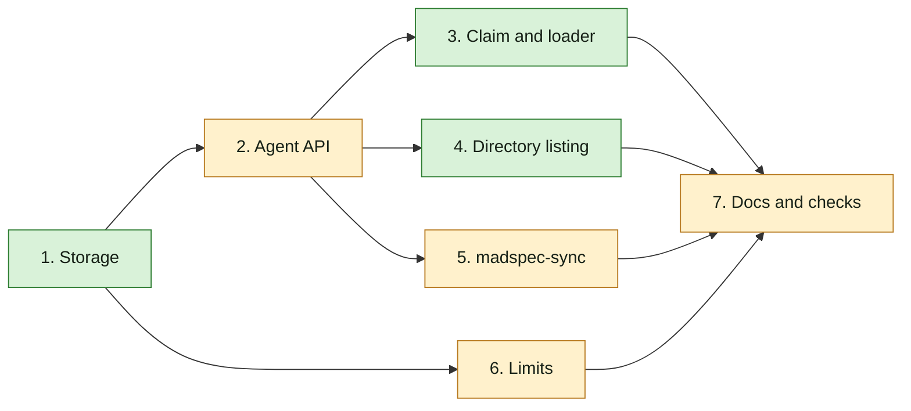

## At a glance

| Group | Builder | Proves it |
|---|---|---|
| 1. Storage | `madspec-api-builder` | `make migrate-up`, `make sqlc`, `go build ./...` |
| 2. Agent API | `madspec-api-builder` | `go test ./internal/handler -run 'Agent'` |
| 3. Claim and loader | `madspec-function-builder` | `go test ./internal/daemon -run 'InstructionSelection'` |
| 4. Directory listing | `madspec-api-builder` | `go test ./internal/handler ./internal/daemon -run 'DirectoryListing'` |
| 5. madspec-sync | `madspec-function-builder` | `uv run --with pytest pytest -p no:cacheprovider madspec-sync/tests` |
| 6. Limits | `madspec-api-builder` | `go test ./internal/handler -run 'Agent'` |
| 7. Docs and checks | `madspec-function-builder` | `make check`, `openspec validate` |

## 1. Storage

- [x] 1.1 Add `server/migrations/564_agent_instruction_selection.{up,down}.sql`: up `ALTER TABLE agent ADD COLUMN instruction_selection JSONB NOT NULL DEFAULT '[]'::jsonb;`, down `ALTER TABLE agent DROP COLUMN IF EXISTS instruction_selection;`. Verify: `make migrate-up`, then `make migrate-down` rolls back 564 before its expected stop at the pre-existing forward-only migration 494 (SQLSTATE P0001), then `make migrate-up` reapplies it cleanly in the disposable worktree database, using `ENV_FILE=.env.worktree`.
- [x] 1.2 Add `server/migrations/565_drop_agent_description_length.{up,down}.sql`: up `ALTER TABLE agent DROP CONSTRAINT IF EXISTS agent_description_length;`, down re-adds `CHECK (char_length(description) <= 255) NOT VALID` without `VALIDATE`. Verify: `make migrate-up`, then `make migrate-down` rolls back 565 and 564 before its expected stop at migration 494 (SQLSTATE P0001), then `make migrate-up` reapplies them cleanly, using `ENV_FILE=.env.worktree`; `\d agent` in the worktree database shows no `agent_description_length`.
- [x] 1.3 In `server/pkg/db/queries/agent.sql`, add `instruction_selection` to `CreateAgent` as `COALESCE(sqlc.narg('instruction_selection')::jsonb, '[]'::jsonb)` and to `UpdateAgent` as `instruction_selection = COALESCE(sqlc.narg('instruction_selection'), instruction_selection)`; run `make sqlc`. Verify: `db.Agent.InstructionSelection` exists and `cd server && go build ./...` passes.

## 2. Agent API

- [x] 2.1 In `server/internal/handler/agent.go`, add `decodeInstructionSelection(raw []byte) []string` (empty or invalid JSON -> `[]` with a warning log) and `AgentResponse.InstructionSelection []string` (`json:"instruction_selection"`), filled in `agentToResponse`. Verify: a handler test reads a new agent and gets `instruction_selection: []`.
- [x] 2.2 Add `normaliseInstructionSelection(paths []string) ([]string, error)` (trim; reject empty or not starting with `/` with 400 `instruction_selection paths must be absolute`; keep order and duplicates) and table tests for it.
- [x] 2.3 Add `InstructionSelection []string` to `CreateAgentRequest` and `*[]string` to `UpdateAgentRequest`; `CreateAgent` and `UpdateAgent` normalise and pass it to the queries, `UpdateAgent` only when the raw body holds the key. Verify: tests for the round trip in order, an update without the field keeping two paths, and `["notes/b.md"]` answering 400 with the stored selection unchanged.
- [x] 2.4 Add `requireRuntimeOwner(w, r, runtimeID, userID) bool` (403 `only the runtime owner can change instruction_selection`) and call it in `CreateAgent` for a non-empty selection and in `UpdateAgent` when the normalised selection differs from the stored one. Verify: DB-backed tests with `server/internal/testutil` fixtures: the owner updates (200); another member on a public runtime changes it (403, unchanged); another member sends it unchanged with new instructions (200); another member reads the agent and gets the path.

## 3. Claim and loader

- [x] 3.1 Add `TaskAgentData.InstructionSelection []string` (`json:"instruction_selection"`) in `agent.go`, fill it in `buildClaimedTaskResponse` (`daemon.go`) with `decodeInstructionSelection`, and add `AgentData.InstructionSelection []string` in `server/internal/daemon/types.go`. Verify: a claim test returns the agent's paths in order.
- [x] 3.2 Create `server/internal/daemon/instruction_selection.go` with `instructionSelectionError{path, cause}`, `failureReasonInstructionSelection = "instruction_selection_error"`, and the reader of design Decision 6: links resolved, hidden entries skipped inside folders, NUL in the first 8 KB skipped inside folders and an error for a selected file, `git ls-files --cached --others --exclude-standard -z --full-name` per walked root through `runGitCommandContext`, a shared `visited` set of real folders, and each real file once. Verify: unit tests in `instruction_selection_test.go` with `t.TempDir()` and a `git init` repository for each scenario in `specs/instruction-selection-loading/spec.md` (hidden and binary files, a git-ignored and an untracked file, a folder outside a repository with a `.gitignore`, a hidden root and a hidden file selected by hand, a selected link, a link loop, a file selected twice, an empty folder).
- [x] 3.3 Add the renderer of design Decision 7 and `expandInstructionSelection(ctx, instructions, paths)`: no `{selection}` -> unchanged without reading; an empty selection -> `""`; every `{selection}` replaced. Verify: tests for the skill-folder-and-file output byte for byte, the placeholder twice, text around it, attribute escaping of `&`, `<` and `"`, and a missing path that is not read when the text has no `{selection}`.
- [x] 3.4 In `runTask` (`daemon.go`), call `expandInstructionSelection` right after `instructions = task.Agent.Instructions` and return its error; in `taskRunFailureReason`, map `*instructionSelectionError` to `failureReasonInstructionSelection` before the `environmentSetupError` branch. Verify: a `newTestDaemon` test with a missing selected file sees the fail report with `instruction_selection_error`, the path and `does not exist`, and no agent run; a test with a readable file sees the filled text in the brief and, for an inline-system-prompt provider, in `SystemPrompt`.
- [x] 3.5 Verify no retry: a `service/task.go` test fails a task with `instruction_selection_error` and finds no retry queued.

## 4. Directory listing

- [ ] 4.1 In `server/pkg/protocol/messages.go`, add `PendingWorkKindDirectoryListing = "directory_listing"`, `DaemonHeartbeatPendingDirectoryListing{ID, Path}` and `DaemonHeartbeatAckPayload.PendingDirectoryListing` (`json:"pending_directory_listing,omitempty"`). Verify: `go build ./...`.
- [ ] 4.2 Create `server/internal/handler/runtime_directory_listing.go`: `RuntimeDirectoryListingRequest`, `RuntimeDirectoryEntry`, the `DirectoryListingStore` interface and `InMemoryDirectoryListingStore` (create, get with timeout, has pending, pop pending, complete, fail) on the local-skill list's statuses and timeouts; set it in `handler.New`. Verify: store tests for pop order, completion, failure and timeout.
- [ ] 4.3 Add `InitiateDirectoryListing` (owner only through `requireRuntimeLocalSkillAccess`, 503 when offline, `requestDaemonPendingWork(..., protocol.PendingWorkKindDirectoryListing)`), `GetDirectoryListingRequest` and `ReportDirectoryListingResult` (`requireDaemonRuntimeAccess`), and their routes in `server/cmd/server/router.go`. Verify: handler tests: owner initiate and poll; another member 403 with nothing queued; offline 503; a daemon result completes and a failed one fails the request.
- [ ] 4.4 In `processHeartbeat` (`daemon.go`), probe and pop the listing store after the local-skill list and set `ack.PendingDirectoryListing`; copy it into the `DaemonHeartbeat` response map. Verify: a heartbeat test returns `pending_directory_listing` with its id and path once.
- [ ] 4.5 Create `server/internal/daemon/directory_listing.go` with `listRuntimeDirectory(provider, path)` per design Decision 10; add `PendingDirectoryListing` to the client aliases and `Client.ReportDirectoryListingResult`; in `handleHeartbeatActions`, run `go d.handleDirectoryListing(ctx, rt, id, path)`, which reports through `reportRuntimeResultWithRetry(ctx, "directory_listing", ...)`. Verify: tests for the roots of `omp` under a temp `HOME`, a folder with a file, a folder, a hidden folder and a link to a folder, `~/x`, a relative path, a missing path, and a file.

## 5. madspec-sync

- [ ] 5.1 In `madspec-sync/multica_sync.py`, add `instruction_selection` to `Persona` and `AGENT_FIELDS`, and set it and the instructions in `read_persona` per design Decision 12. Verify: `uv run --with pytest pytest -p no:cacheprovider madspec-sync/tests` with new tests for Guus's selection and instructions and for a stale selection being rewritten.
- [ ] 5.2 Update `madspec-sync/specs/multica-agents.md` (the requirement "An agent runs its persona as the persona command does" and the module docstring of `multica_sync.py`) and `madspec-sync/README.md`: the persona agent selects its skill folder and reads it from disk at task start; models and arguments still come from `origin/main`. Verify: the README's example matches a dry run of the sync against the worktree stack.

## 6. Limits

- [ ] 6.1 In `server/internal/handler/agent.go`, remove `maxAgentDescriptionLength`, `maxAgentConversationStarterLabel`, `maxAgentConversationStarterLength` and their checks; keep the cap of 3 and the required label and prompt in `normaliseAgentConversationStarters`. Verify: handler tests for a 1,000-character description, a 120-character label with a 5,000-character prompt (both returned whole), 4 starters (400) and an empty label (400); remove the tests that assert the old limits.

## 7. Docs and checks

- [ ] 7.1 Update `server/internal/service/builtin_skills/multica-platform/references/agents.md`: no 255, 80 or 4000 limits, at most three starters, and `instruction_selection` with `{selection}` and its owner rule; update `server/internal/service/builtin_skills_test.go`. Verify: `cd server && go test ./internal/service -run BuiltinSkill`.
- [ ] 7.2 Run `make check` in the worktree with `.env.worktree`, and `openspec validate agent-instruction-selection --type change --strict` in `specs/`. Verify: both pass.
- [ ] 7.3 Smoke on the worktree stack: an omp agent on Brian's runtime with instructions `{selection}` and a selected skill folder runs a task whose brief holds the folder's tree and files; after an edit to one file, the next task holds the edit; a selected missing file fails the task with `instruction_selection_error` and no retry.

## Implementation Notes

- Build groups 1 to 7 in order; the change `agent-instruction-selection-field` starts once group 4 is in place, on the same branch.
- Default tests must not run real agent CLIs; the daemon tests use temp folders and fake executables.
- Squad descriptions have no server-side limit; nothing to keep there.
- Group 1 storage: added `server/migrations/564_agent_instruction_selection.up.sql` and `.down.sql`, with the JSONB default and column drop specified in Decision 1. Joeri approved the full rollback check on the disposable worktree database `multica_agent_instruction_selection_748`.
- Task 1.1 verification: `make migrate-up ENV_FILE=.env.worktree` applied migration 564; `make migrate-down ENV_FILE=.env.worktree` removed migrations 564 through 495, then stopped at the existing forward-only `494_issue_status_category_read_contract.down.sql` (`MUL-7365 is forward-only; apply a corrective migration`, SQLSTATE P0001). Joeri approved treating the change's successful rollback and clean reapplication as the pass, without changing migration 494. The subsequent `make migrate-up ENV_FILE=.env.worktree` succeeded and restored the fully migrated database; task Verify wording reflects this decision.
- Task 1.2: added `server/migrations/565_drop_agent_description_length.up.sql` and `.down.sql`; rollback adds the check `NOT VALID` without scanning or truncating existing descriptions. The approved migrate-up/down/up sequence applied, rolled back, and reapplied 565 and 564 successfully; down stopped at 494 as expected. `psql` through the managed worktree environment showed `instruction_selection` as non-null JSONB with default `[]`, no `agent_description_length` constraint (catalog count 0), and the existing three-starter count constraint intact.
- Task 1.3: updated `server/pkg/db/queries/agent.sql` and regenerated `server/pkg/db/generated/{agent.sql.go,models.go,runtime.sql.go}` with `make sqlc ENV_FILE=.env.worktree`. Create defaults omitted selections to `[]`; update preserves them when omitted. Generated `Agent`, `CreateAgentParams`, and `UpdateAgentParams` carry `InstructionSelection []byte`, and all agent row scanners include the column. `go build ./...` from `server/` passed. Existing keyed callers remain unchanged in this storage group; request/response wiring belongs to group 2.
- Task 2.1: updated `server/internal/handler/agent.go` and added `server/internal/handler/agent_instruction_selection_test.go`. Responses always carry an array; absent, malformed and null stored JSON warn and decode to `[]`, while valid paths retain order and duplicates. The managed `.env.worktree` run of `go -C server test ./internal/handler -run 'Test(DecodeInstructionSelection|AgentInstructionSelectionDefaultsToEmptyArray)' -count=1 -v` passed, including DB-backed create/read. Local verification follows AGENTS.md. The first command failed before Go ran because Make consumed a regex end-anchor; the corrected invocation passed. Joeri approved using request context in `requireRuntimeOwner(w, r, runtimeID, userID)` for task 2.4.
- Task 2.2: added `normaliseInstructionSelection` in `server/internal/handler/agent.go` and table coverage in `server/internal/handler/agent_instruction_selection_test.go`. Trimming preserves path order, duplicates and internal spaces without mutating the input; nil/empty selections return an array, and empty, relative, home-shortcut and Windows paths fail with the specified validation error. The managed `.env.worktree` run of `go -C server test ./internal/handler -run TestNormaliseInstructionSelection -count=1 -v` passed all ten cases.
- Task 2.3: wired request selection fields, normalisation and JSONB query parameters in `server/internal/handler/agent.go`; expanded `server/internal/handler/agent_instruction_selection_test.go`. Update checks raw field presence, preserving omitted selections and treating explicit null/empty input as an empty array. DB-backed coverage passed for ordered create/read, two-path preservation on rename, duplicate-preserving updates, clearing, and invalid create/update with no stored change. Verification: managed `.env.worktree` `go -C server test ./internal/handler -run 'Test(AgentInstructionSelectionRoundTrip|CreateAgentInstructionSelectionRejectsRelativePath)' -count=1 -v`.
- Task 2.4: added the runtime-owner gate in `server/internal/handler/agent.go` and fixture-backed authorization tests in `server/internal/handler/agent_instruction_selection_test.go`. The helper takes `r` in addition to the planned parameters, as Joeri approved, so its database read uses the request context. Existing agent-management checks remain in force; owning an agent or being workspace admin does not grant selection-write access to someone else's runtime. Non-owners may create with an empty selection, preserve omitted selections, or resubmit the same normalised paths with changed instructions. Changed path order, duplicates, clearing and null are real selection changes and are rejected before any write. Another allowed member can read the paths. The complete group proof passed locally with the managed `.env.worktree`: `go -C server test ./internal/handler -run Agent -count=1` (`ok`, 21.215s). This group stores and returns paths only; task claim/daemon expansion and built-in reference updates remain assigned to groups 3 and 7.
- Task 3.1: added the selection to `server/internal/handler/agent.go`'s claim DTO, populated it through the existing decoder in `server/internal/handler/daemon.go`, and added the matching daemon field in `server/internal/daemon/types.go`. `server/internal/handler/daemon_instruction_selection_test.go` proves ordered paths and duplicates survive claim construction and JSON decoding into the daemon. Local managed `.env.worktree` verification passed: `go -C server test ./internal/handler -run TestClaimInstructionSelection -count=1 -v`. No server-side content read was added.
- Task 3.2: created `server/internal/daemon/instruction_selection.go` and `instruction_selection_test.go` with the ordered, depth-first reader, shared real-folder/file sets, git filtering, explicit-path exceptions, binary filtering and typed path/cause errors. `go -C server test ./internal/daemon -run TestInstructionSelectionReader -count=1 -v` passed all eight reader scenarios and four failure scenarios locally through `.env.worktree`, including real permission failures and the first-8-KB boundary. Surprise: `gc.go`'s existing git helper trims whitespace, corrupting NUL-delimited names. Joeri approved sibling `runGitCommandRawContext`, called by the text helper and by the loader's NUL listing; it uses `processtree.Output` to keep stderr out of filenames. The leading-space filename regression passed. No size limits or content escaping were introduced.
- Task 3.3: added expansion and rendering to `server/internal/daemon/instruction_selection.go` and byte-for-byte regressions in `instruction_selection_test.go`. Trees precede ordered file blocks, attributes escape `&`, `<` and `"`, content stays verbatim, and missing final newlines are supplied. Empty selections disappear; absent placeholders perform no disk reads; all placeholders share one rendering. The live-edit regression proves a later invocation reads changed disk bytes. Managed local verification passed: `go -C server test ./internal/daemon -run 'TestInstructionSelection(Expansion|Escaping)' -count=1 -v`.
- Task 3.4: wired expansion immediately after reading agent instructions in `server/internal/daemon/daemon.go`, before task context and environment creation, and classified wrapped selection errors before environment-setup errors. Added `instruction_selection_task_test.go`: a configured `newTestDaemon` drives the real task runner and records a single fail callback with the missing path/cause and no fake-agent launch; a fake Kimi ACP executable proves the brief and inline SystemPrompt receive the same filled instructions on two tasks with a disk edit between them. Managed local `go -C server test ./internal/daemon -run TestInstructionSelectionTask -count=1 -v` passed. The first test attempt exposed an omitted runner in the test fixture; setting the existing `taskRunnerFunc(d.runTask)` fixed the fixture, with no production change for that failure. Gofmt ran on the new Go files.
- Task 3.5: added `server/internal/service/task_instruction_selection_test.go`, using existing DB-backed attribution and `testutil` task fixtures. A failure with five available attempts retains `instruction_selection_error`, its path/cause, and a terminal failure event; neither `FailTask` nor the sweeper's `MaybeRetryFailedTask` queues a retry. No production retry-map or `pkg/taskfailure` change was needed. Managed local `go -C server test ./internal/service -run TestInstructionSelectionFailureNeverRetries -count=1 -v` passed. Final group proof also passed: `go -C server test ./internal/handler ./internal/daemon ./internal/service -run InstructionSelection -count=1`. Full repository checks and the real-agent stack smoke belong to group 7 and were not run here.

## Plan Change Log

- 2026-10-12: L5 split the work along the roster: this change holds Backend's work; web, desktop and docs moved to `agent-instruction-selection-field`. The specs `runtime-file-browser` and `instruction-selection-field` moved there; this change gained `runtime-directory-listing`; the UI scenarios of `agent-field-limits`, `agent-instruction-selection` and `instruction-selection-loading` moved there.
