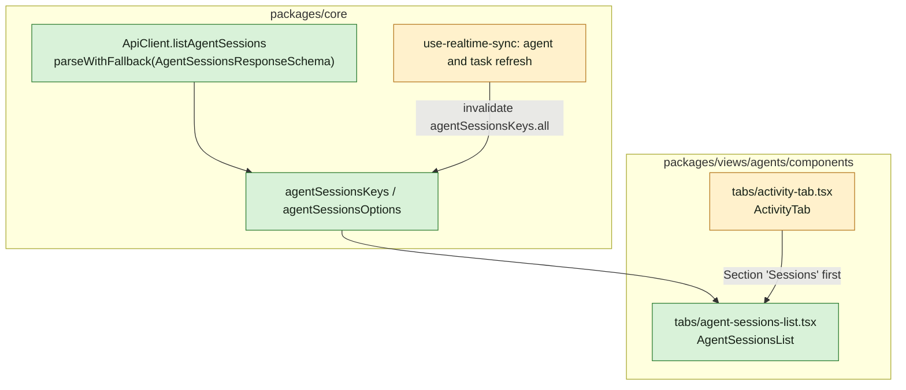

## At a glance



```text
Overview
+-------------------------------------------------------------+
| Sessions  2 active                                          |
|  [pane] w12:p0       ~/Worktrees/das/madspec/work-1057      |
|         appboypov/madspec · work-1057 · Working · 12m ago   |
|  [run]  run on Oh-My-Pi   WORK-1057 (link)                  |
|         ~/multica_workspaces/.../workdir                    |
|         appboypov/multica · work-1057 · Starting · 1m ago   |
| Now ...                                                     |
| Recent work ...                                             |
+-------------------------------------------------------------+
```

| Kind | Name | Change | Path |
|---|---|---|---|
| Data | `listAgentSessions` | new | `packages/core/api/client.ts` |
| Data | `agentSessionsKeys`, `agentSessionsOptions` | new | `packages/core/agents/queries.ts` |
| Data | Invalidation on `agent:*` and `task:*` | changed | `packages/core/realtime/use-realtime-sync.ts` |
| Screen part | `AgentSessionsList` | new | `packages/views/agents/components/tabs/agent-sessions-list.tsx` |
| Screen part | Sessions section in `ActivityTab` | changed | `packages/views/agents/components/tabs/activity-tab.tsx` |
| Strings | `agents.activity.section_sessions` and the rest | changed | `packages/views/locales/*/agents.json` |

## Context

- Team: Frontend (lead Thomas, from `roster.py`). It builds on `agent-session-model` (`AgentSession`, `AgentSessionsResponseSchema`, the event `agent:sessions`) and `agent-active-sessions` (WORK-1087: `GET /api/agents/{id}/sessions`).
- The agent page's Overview renders `ActivityTab` (`tabs/activity-tab.tsx`, used only there) in the left column; it is a stack of `Section`s (title, subtitle, content) - Now, Last 30 days, Recent work - with `EmptyText` for an empty one, `useTimeAgo` for times and `useWorkspacePaths().issueDetail` for issue links.
- `listAgentTasksPage` (`core/api/client.ts` 2943) is the pattern for a parsed agent read: `fetchRaw`, then `parseWithFallback` with a fallback value and the endpoint name. Query keys live in `core/agents/queries.ts` under `["workspaces", wsId, ...]`.
- `use-realtime-sync.ts` refreshes per event prefix: `agent: ()` (824) on every `agent:*` event, `task: ()` (996) on every task lifecycle event, debounced.
- Strings live in `views/locales/{en,fr,ja,ko,zh-Hans}/agents.json`; `parity.test.ts` requires every key in every locale.

## Goals / Non-Goals

**Goals:** the agent page shows the agent's active sessions and keeps them live.

**Non-Goals:** ended sessions; acting on a session.

## Decisions

### 1. The data

`ApiClient.listAgentSessions(agentId, {signal})` calls `GET /api/agents/{id}/sessions` and returns `parseWithFallback(body, AgentSessionsResponseSchema, {sessions: []}, {endpoint: "GET /api/agents/:id/sessions"})`. `agentSessionsKeys.all(wsId)` is `["workspaces", wsId, "agent-sessions"]`, `detail(wsId, agentId)` adds the agent; `agentSessionsOptions(wsId, agentId)` has `staleTime` 30 s and `refetchOnWindowFocus`, as `agentTasksOptions`.

### 2. Live

`agent: ()` and `task: ()` in `use-realtime-sync.ts` each invalidate `agentSessionsKeys.all(wsId)`: `agent:sessions` covers sessions started by hand, task lifecycle events cover runs. Both go through the existing debounce, so a burst refetches once.

### 3. The section

`ActivityTab` renders a first `Section` "Sessions" with subtitle "{{count}} active" (or "None active"), holding `AgentSessionsList`. Each session is one row:

- Where: the pane id with a terminal icon for `terminal`, "run on {{runtime}}" with the runtime's name for `run`, "Unknown" otherwise.
- The issue key linked to `paths.issueDetail(issue.id)` when the session has an issue.
- Folder, with the home folder shown as `~`, truncated from the start with the full path in its title.
- Repository and branch, each left out when empty.
- Status as a label from `agents.activity.session_status.*`, and the start time with `timeAgo(started_at)`.

No sessions: `EmptyText` "No active sessions". Loading shows nothing in the section's body, as the other sections do; an error shows the empty text, since the fallback already gives `[]`.

## Risks / Trade-offs

- A run shows in both Sessions and Now. Now is about the work, Sessions about where it runs; they answer different questions on one page.

## Migration Plan

Ships with the web and desktop release after WORK-1087's server is deployed; until then the route answers `404` and the section shows "No active sessions".

## Open Questions

None.
