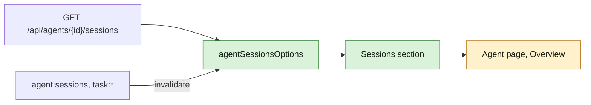

## At a glance

| Kind | Name | Change | Path |
|---|---|---|---|
| Data | `listAgentSessions`, `agentSessionsOptions`, realtime invalidation | new | `packages/core/` |
| Screen part | Sessions section on the agent page | new | `packages/views/agents/components/tabs/` |
| Spec | `agent-page-sessions` | new | `specs/openspec/specs/` |

This change is the Frontend part of WORK-1057 in this repository. It builds on `agent-session-model` (the types and schemas, the event `agent:sessions`) and `agent-active-sessions` (WORK-1087: the route).

## Why

Brian wants to see on each agent's page which sessions of that agent are active, where they run and on what (comment of 15 Oct 18:30).

Success signal: Mitchel's page shows his Herdr session and his run on WORK-1057, each with its folder, repository and branch, and a closed pane drops off the open page.

## What Changes

- The agent page's Overview gets a Sessions section: one row per active session with where it runs, its folder, repository, branch, issue and status, and "No active sessions" when none runs.
- The section stays live: `agent:sessions` and every run lifecycle event refresh it.

## Capabilities

### New Capabilities

- `agent-page-sessions`: an agent's page shows its active sessions.

### Modified Capabilities

None.

## Impact

- `packages/core`: an API method, a query and two invalidations.
- `packages/views`: one section on the Overview and its strings in every locale.

## Constraints

- The response passes `parseWithFallback`, as the house rule for the API boundary asks.

## Non-goals

- Ended sessions.
- Acting on a session from the page.

## Sources

- The Multica issue "Persona repos in ~/Repos/Agents" (WORK-1057): Brian's approval with active sessions on each agent's page (comment of 15 Oct 18:30).
