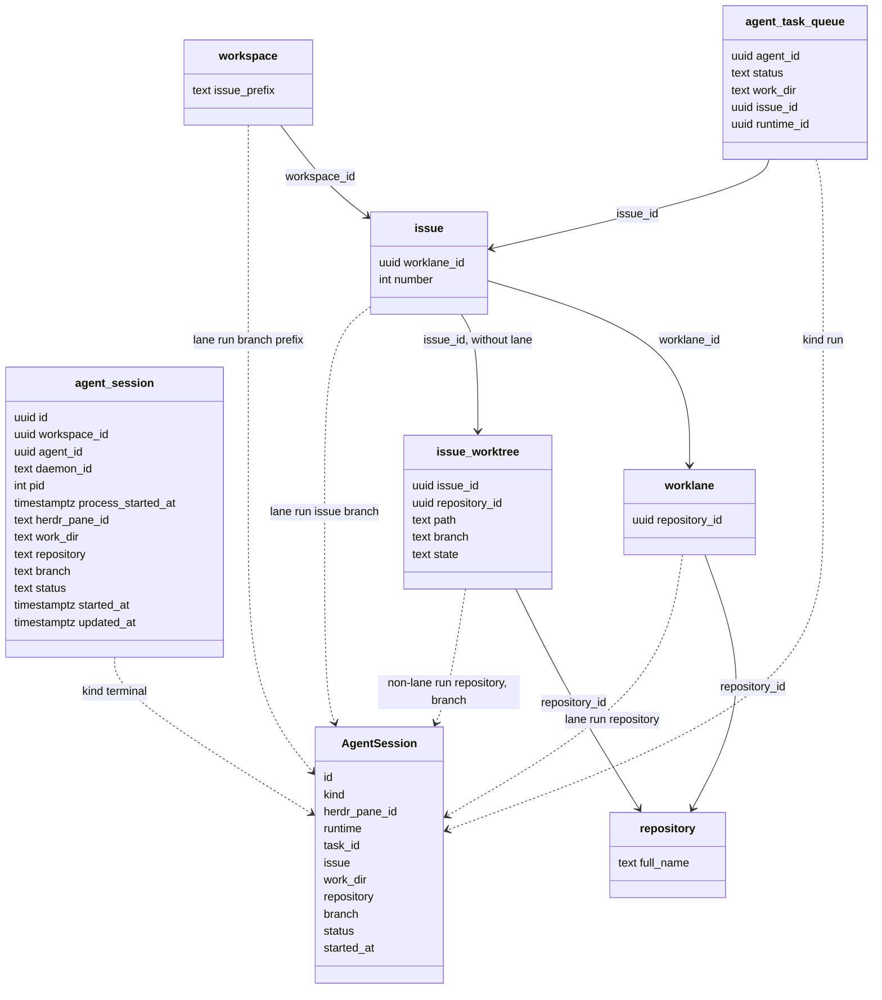

## At a glance

| Kind | Name | Change | Path |
|---|---|---|---|
| Model | `agent_session` | new | `server/migrations/732_agent_session.up.sql` |
| Model | Queries | new | `server/pkg/db/queries/agent_session.sql` |
| Action name | `agent:sessions` | new | `server/pkg/protocol/events.go`, `packages/core/types/events.ts` |
| Type | `AgentSession`, `AgentSessionsResponse` | new | `packages/core/types/agent.ts`, `packages/core/api/schemas.ts` |

## Context

- Team: Data Models (lead Pieter, from `roster.py`). The server API and daemon are Backend's change `agent-active-sessions` (WORK-1087), the CLI and the persona sync Agent Tools' `agent-sessions-cli` (WORK-1088), the page Frontend's `agent-page-sessions` (WORK-1089); `adr/0017` records how the pieces divide the work.
- A run's work folder is on its row while it runs: for omp the daemon pins `work_dir` with `PinTaskSession` as the session starts (`internal/daemon/daemon.go` near 9190, query `UpdateAgentTaskSession`). A worklane issue uses its recorded lane's repository and its own issue branch, including lane `main`, and has no issue worktree (ADR-0014). An issue without a lane uses the daemon-recorded `issue_worktree` rows (ADR-0007).
- House rules: no foreign keys (`migrations/120_runtime_profile.up.sql`), every query filtered by `workspace_id`, zod with `parseWithFallback` at the API boundary. The newest migration on this branch is `731`; migration numbers must be unique (`internal/migrations/migrations_lint_test.go`).
- Herdr's agent statuses are `idle`, `working`, `blocked`, `done` and `unknown` (`herdr api schema --json`, `AgentStatus`).

## Goals / Non-Goals

**Goals:** store sessions started by hand, list an agent's active sessions with its runs, and give the web the types to read them.

**Non-Goals:** storing runs as sessions; ended sessions.

## Decisions

### 1. The table

`agent_session` holds only sessions a persona command registered; a run is never written there (ADR-0017).

| Column | Type | Holds |
|---|---|---|
| `id` | `uuid` | primary key, `gen_random_uuid()` |
| `workspace_id`, `agent_id` | `uuid` | the agent |
| `daemon_id` | `text` | the daemon that follows it, as in `agent_runtime.daemon_id` |
| `pid` | `integer` | omp's process |
| `process_started_at` | `timestamptz` | the process's start time, so a reused PID is never taken for the session |
| `herdr_pane_id` | `text` null | the pane, null outside Herdr |
| `work_dir` | `text` | the folder it started in |
| `repository` | `text` null | `owner/name` of the folder's `origin` |
| `branch` | `text` null | the folder's current branch |
| `status` | `text` | `CHECK (status IN ('idle','working','blocked','done','unknown'))`, default `unknown` |
| `started_at`, `updated_at` | `timestamptz` | default `now()` |

Indexes, each built `CONCURRENTLY` in its own migration as the repository tables were (590 to 596): unique `(daemon_id, pid)`; `(workspace_id, agent_id)`. The workspace delete removes its rows; an archived agent's sessions stay until they end.

Queries, each filtered by `workspace_id`: `UpsertAgentSession` (on `(daemon_id, pid)`, replacing the row), `UpdateAgentSession` (`status`, `repository`, `branch`, by `id` and `daemon_id`), `DeleteAgentSession` (by `id` and `daemon_id`, returning `agent_id`), `ListAgentSessionsForDaemon` (by `daemon_id`), `ListAgentSessions`.

### 2. The list

`ListAgentSessions(workspace_id, agent_id)` is one `UNION ALL`, ordered by start time:

- `agent_session` rows whose `daemon_id` has an `agent_runtime` with status `online` in the workspace: kind `terminal`, with their `pid`, so a session finds its own entry. A sleeping Mac's sessions drop out until its daemon is back and has swept them.
- `agent_task_queue` rows of the agent in `dispatched` or `running`: kind `run`, with the runtime's id and name, `work_dir`, the task id, the issue's id and identifier, status `starting` (`dispatched`) or `working` (`running`), and `started_at`, else `dispatched_at`.
  - With `issue.worklane_id` set, repository is the recorded lane's `repository.full_name`; branch is `lower(workspace.issue_prefix || '-' || issue.number::text)`, not `worklane.branch`. Named lanes and lane `main` use this same rule, without requiring a lane path or task folder. Both lane and repository must belong to the agent's workspace; a missing or foreign lane or repository leaves both fields null. Issue-worktree rows never supply these fields for a lane issue.
  - Without a lane, repository and branch come from the issue's `active` `issue_worktree` row whose `path` is the run's `work_dir`, else its only `active` row; several rows with none at the folder leave both empty, and the issue still names the work. The repository is the workspace-scoped `repository` row's `full_name`.

### 3. The event

`agent:sessions` with payload `{agent_id}`: an agent's sessions changed. It carries no session; a reader lists them again.

### 4. Types and schemas

`AgentSession`: `id`, `kind` (`terminal` | `run` | `unknown`), `pid` (number | null, null for a run), `herdr_pane_id`, `runtime` (`{id, name}` | null), `task_id`, `issue` (`{id, identifier}` | null), `work_dir`, `repository`, `branch`, `status` (`idle` | `working` | `blocked` | `done` | `starting` | `unknown`), `started_at`. `AgentSessionsResponse`: `{sessions: AgentSession[]}`. Their zod schemas default missing strings to `""` and nullable values to `null`, map an unknown `kind` or `status` to `unknown`, and default `sessions` to `[]`.

## Risks / Trade-offs

- A run without a lane, with several issue worktrees and none at its work folder, lists no repository or branch. A lane run with a missing or foreign lane or repository also leaves both null.
- Sessions of a daemon whose runtime shows offline are hidden, though omp may still run on that Mac.

## Migration Plan

The migration only adds a table; the down migration drops it. Nothing reads it until WORK-1087 is deployed.

## Open Questions

None.
