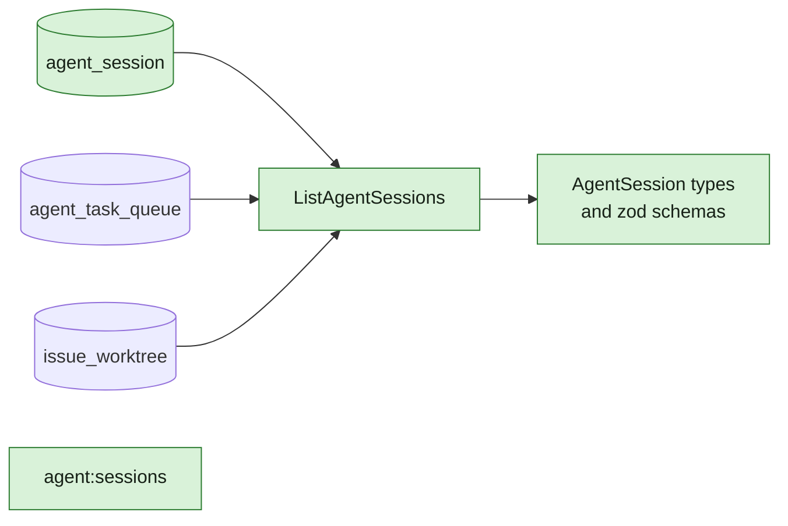

## At a glance

| Kind | Name | Change | Path |
|---|---|---|---|
| Model | `agent_session` table and queries | new | `server/migrations/`, `server/pkg/db/queries/agent_session.sql` |
| Model | `ListAgentSessions`: sessions and runs of an agent | new | `server/pkg/db/queries/agent_session.sql` |
| Action name | `agent:sessions` | new | `server/pkg/protocol/events.go`, `packages/core/types/events.ts` |
| Type | `AgentSession`, `AgentSessionsResponse` and their schemas | new | `packages/core/types/agent.ts`, `packages/core/api/schemas.ts` |

The model under the stack of WORK-1057 in this repository: `agent-active-sessions` (WORK-1087, the server API and the daemon follower) builds on it, and `agent-sessions-cli` (WORK-1088) and `agent-page-sessions` (WORK-1089) build on that.

## Why

Brian wants each agent's active sessions in Multica, sessions started by hand and runs, so two sessions of one agent never work on the same branch without knowing about each other (WORK-1057). Nothing stores a session started by hand, and nothing joins a run to its repository and branch.

## What Changes

- A table for sessions started by hand, with their agent, daemon, process, Herdr pane, folder, repository, branch and status.
- One query that lists an agent's active sessions: those rows, and the agent's running tasks with their work folder and their issue's worktree.
- The event name `agent:sessions`, and the types and schemas of a session for the web and desktop.

## Capabilities

### New Capabilities

None: the behaviour is specified by `agent-active-sessions` in WORK-1087.

### Modified Capabilities

None.

## Impact

- `server/migrations/`, `server/pkg/db/queries/`, `server/pkg/db/generated/`, `server/pkg/protocol/events.go`.
- `packages/core/types/`, `packages/core/api/schemas.ts`.
- Nothing reads them until WORK-1087.

## Sources

- WORK-1057: Pieter's discovery result (comment of 15 Oct 16:44), Brian's approval with active sessions on each agent's page (15 Oct 18:30) and his addition of Paul (15 Oct 18:50); Mitchel's proposal `agent-active-sessions`.
