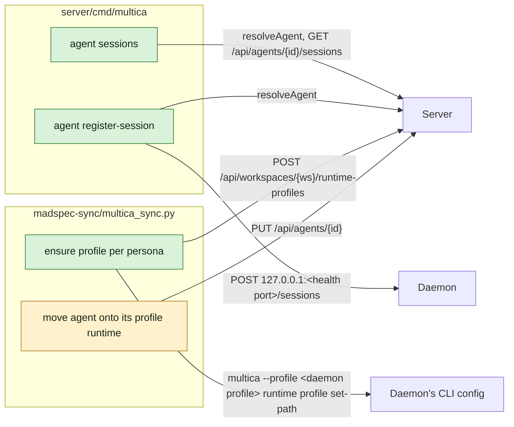

## At a glance

| Kind | Name | Change | Path |
|---|---|---|---|
| CLI command | `agent sessions`, `agent register-session` | new | `server/cmd/multica/cmd_agent_sessions.go` |
| CLI command | `agentCmd` registration | changed | `server/cmd/multica/cmd_agent.go` |
| Script | Runtime profile per persona, agent moved onto it | changed | `madspec-sync/multica_sync.py` |
| Doc | Sync spec | changed | `madspec-sync/specs/multica-agents.md` |

## Context

- Team: Agent Tools (lead Pieter, from `roster.py`): CLI command and the sync script. It builds on `agent-active-sessions` (WORK-1087): `POST /sessions` on the daemon's local listener and `GET /api/agents/{id}/sessions`.
- The CLI's agent reads follow `runAgentTasks` (`cmd/multica/cmd_agent.go` 881): `newAPIClient`, `cli.APIContext`, `cli.PrintJSON` or `cli.PrintTable`. `resolveAgent` (`cmd_autopilot.go` 1024) turns a name into an id, case-insensitive. The daemon's port is `healthPortForProfile(resolveProfile(cmd))` (`cmd_daemon.go` 278), as `daemon status` uses it.
- The sync talks to Multica with the CLI profile `local` (`~/.multica/profiles/local/config.json`). Every persona agent runs on the one local omp runtime from `omp_runtime()`, with `--skills=` and a `--config=` fallback overlay in `custom_args` and its skill folder in `instruction_selection` (spec `persona-agent-selection`).
- Runtime profiles: `POST /api/workspaces/{id}/runtime-profiles` with `display_name`, `runtime_type` and `command_name` (admin-gated). The daemon registers an `agent_runtime` per profile it can resolve on its profile-drift refresh; `/api/runtimes` shows its `profile_id`. `runtime profile set-path` pins a profile's executable in the CLI config of one profile on this machine; the daemon runs under `desktop-localhost-8080` here (`multica daemon status --output json` `.profile`). An omp profile runs `<command> -p --mode json --session <path> --model <model> <custom_args>` (`pkg/agent/pi.go` `buildPiArgs`).
- MadSpec `persona-offices` gives each office its alias in `~/.local/bin`, `roster.py --personas` with a `member` flag, and a persona command that registers only on a terminal without `MULTICA_TASK_ID` and adds `--session-dir` only when the arguments hold no `--session`.

## Goals / Non-Goals

**Goals:** list and register sessions from the command line; each persona agent's runs start through its alias.

**Non-Goals:** runtime profiles of a kind other than omp; profiles for Tika, Herdr, Astra, Fable or Haiku.

## Decisions

### 1. `multica agent sessions <agent>`

Resolves the agent with `resolveAgent` and calls `GET /api/agents/{id}/sessions`. The table shows WHERE (the pane, or `run on <runtime>`), FOLDER, REPOSITORY, BRANCH, ISSUE (the issue key), STATUS and STARTED; `--output json` prints the response as it came. With no session the table prints "No active sessions." and the JSON holds `"sessions": []`. A run's task token passes the route, so it works from every runtime.

### 2. `multica agent register-session <agent> --pid <pid> --cwd <folder> [--pane <id>]`

Resolves the agent, then posts `{workspace_id, agent_id, pid, cwd, herdr_pane_id}` to `http://127.0.0.1:<health port>/sessions` and prints the session id (`--output json`: `{id}`). A refused connection fails with "the Multica daemon is not running; start it with `multica daemon start`"; a `400` fails with the daemon's message. It refuses to run inside a daemon task (`requireHumanLocalCommand`), since a run's session is its task.

### 3. Each persona agent runs through its alias

`madspec-sync` takes the personas from `roster.py --personas` and works on those that are not a member, Paul included:

- **Profile.** `GET /api/workspaces/{ws}/runtime-profiles`; when no profile has `command_name` the alias, `POST` one with `display_name` the persona's name, `runtime_type` `omp`, `command_name` the alias. Then it pins the path: `multica --profile 
 runtime profile set-path <profile id> --path ~/.local/bin/<alias>`, with `
` the running daemon's profile from `multica daemon status --output json`, only when the CLI config does not already hold that path. Outside a task, status probes only the requested profile: discover the daemon among the default and existing local profiles, selecting the one for this sync's server and workspace. No matching daemon, or several matches, fails before writes. So the daemon never depends on its own `PATH`.
- **Runtime.** The agent, when it exists, goes to the local `agent_runtime` whose `profile_id` is that profile. When the daemon has not registered it yet, the sync reports that persona as failed ("start the daemon, then run the sync again") and goes on.
- **Fields.** `instruction_selection` becomes `[]` and `instructions` empty: the alias loads the office `AGENTS.md` and the persona skill, so a selection would load it twice. `custom_args` keeps only the fallback overlay `--config=<file>`; `--skills=` goes, since the alias passes it. New agents take their initial model and thinking level from the current office configuration returned by `roster.py --personas`. Existing agents keep their model and thinking level, including later edits in Multica; updates omit those fields. The daemon's `--model` comes after the alias's own, so it wins.

`omp_runtime()` and its single shared runtime lookup go. A daemon that is not running fails the whole sync before any change, since no profile path can be pinned. `madspec-sync/specs/multica-agents.md` follows: "An agent runs its persona as the persona command does" says the agent runs on its profile with the alias.

## Risks / Trade-offs

- The sync now depends on the running daemon: on its profile for the path and on its registration for the runtime. It fails a persona with a clear message rather than leaving the agent on the shared runtime.
- A session of a persona whose agent does not exist yet (Paul before WORK-1058) has nothing to register against: `register-session` fails and the persona command ignores it.

## Migration Plan

1. Merge `agent-active-sessions` and this change; release the CLI.
2. Merge `persona-offices` in MadSpec and run `make symlinks`, so every alias exists in `~/.local/bin`.
3. Run the sync: 12 profiles, 11 agents moved; Paul's agent follows once it exists.

Rollback: the sync of the commit before puts the agents back on the shared omp runtime with their selections; the profiles stay unused.

## Open Questions

None.
