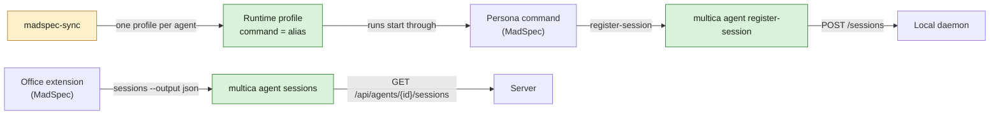

## At a glance

| Kind | Name | Change | Path |
|---|---|---|---|
| CLI command | `multica agent sessions`, `multica agent register-session` | new | `server/cmd/multica/cmd_agent_sessions.go` |
| Script | Persona sync: runtime profiles | changed | `madspec-sync/multica_sync.py` |
| Spec | `agent-active-sessions`, `persona-runtime-profiles` | new | `specs/openspec/specs/` |
| Spec | `persona-agent-selection` | removed | `specs/openspec/specs/` |

This change is the Agent Tools part of WORK-1057 in this repository. It builds on `agent-active-sessions` (WORK-1087), which gives the daemon's `POST /sessions` and the route `GET /api/agents/{id}/sessions`. The persona command and office extension that call these commands are the change `persona-offices` in `appboypov/madspec`, branch `work-1057`.

## Why

A persona session needs to say it started and to see its agent's other sessions, from the command line on any runtime. And a run of a persona agent loads its persona through `instruction_selection` and `custom_args`, not through its office, so a run and a session Brian starts by hand load different things.

Success signal: `multica agent sessions mitchel` lists every running Mitchel session; a run of Mitchel starts `mitchel` and follows his office `AGENTS.md`.

## What Changes

- `multica agent sessions <agent>` lists an agent's active sessions, as a table or JSON.
- `multica agent register-session <agent> --pid --cwd [--pane]` registers a session started by hand with the local daemon.
- `madspec-sync` gives every agent with an office, Tika excluded, its own runtime profile whose command is the agent's alias, and moves the agent onto it. A run then starts the agent the way its alias does by hand. The shared office roster resolves Paul's approved MadSpec persona so the sync creates his active agent on that profile.

## Capabilities

### New Capabilities

- `persona-runtime-profiles`: each persona agent runs on its own runtime profile, through its alias.

### Modified Capabilities

- `agent-active-sessions`: the command-line list and registration.
- `persona-agent-selection`: removed. A run loads the persona skill through the alias, as a session started by hand does, so the agent no longer selects its skill folder (Pieter's technical design, from the check Brian passed on).

## Impact

- CLI: two `agent` subcommands.
- Sync: `madspec-sync/multica_sync.py` and `madspec-sync/specs/multica-agents.md`; the 11 existing persona agents' runtimes, `instruction_selection` and `custom_args`, and 12 runtime profiles, Paul's included.

## Constraints

- Tika gets no runtime profile and no runs: she is a member.
- Herdr, Astra, Fable and Haiku keep their runtimes.
- The sync runs by hand only (ADR-0010).

## Non-goals

- Runtime profiles of a kind other than omp.
- Starting agents in Herdr from Multica.

## Sources

- The Multica issue "Persona repos in ~/Repos/Agents" (WORK-1057): Pieter's discovery result (comment of 15 Oct 16:44), Brian's approval with active sessions on each agent's page (comment of 15 Oct 18:30) and his addition of Paul (comment of 15 Oct 18:50).
- Brian's removal of Roos from MadSpec on 15 Oct (WORK-1058): she has no Multica agent and gets no runtime profile.
