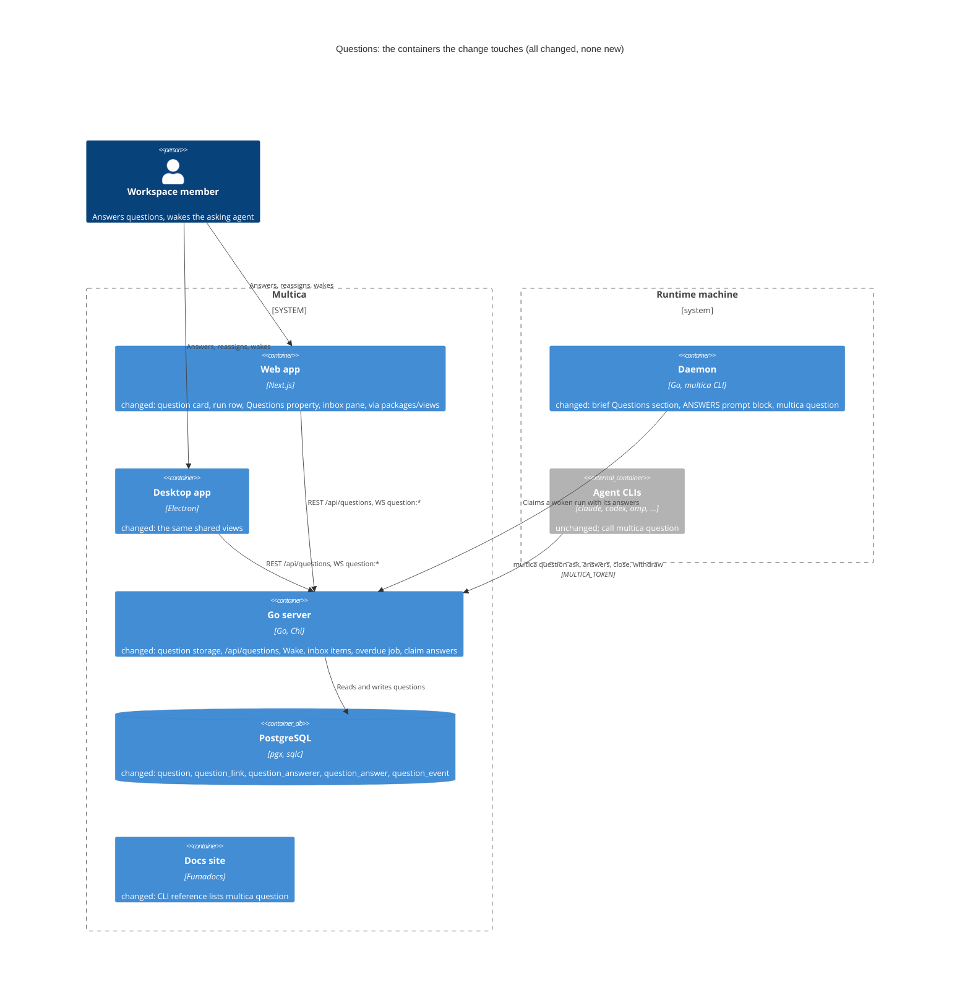
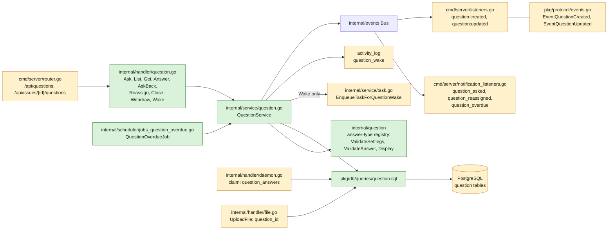
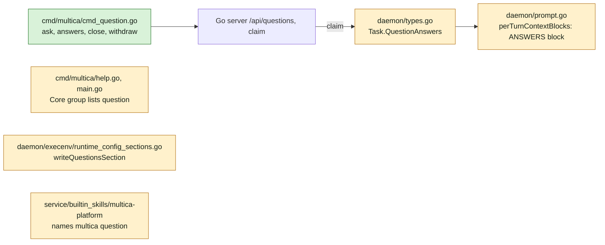
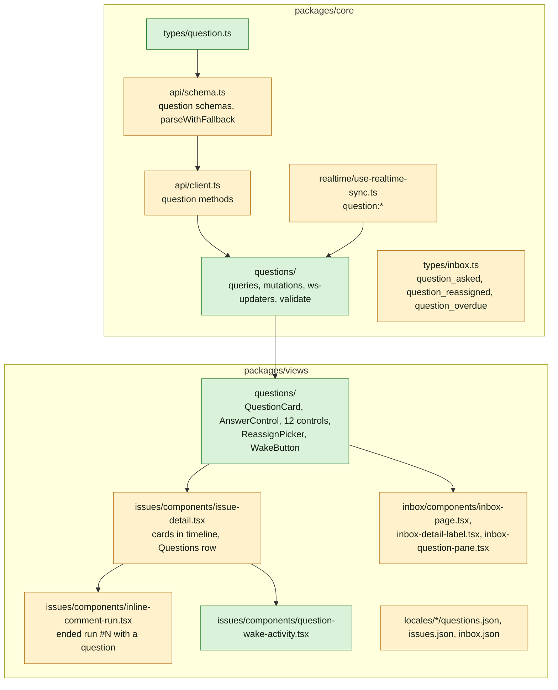
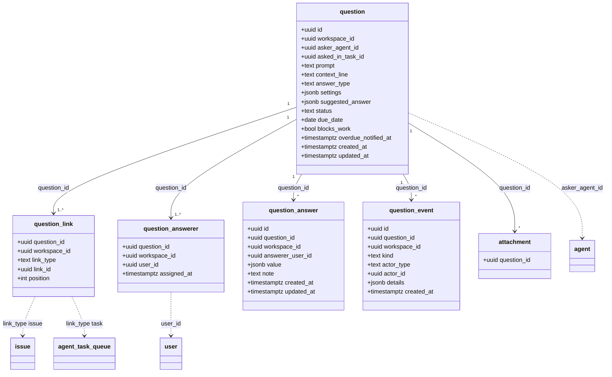
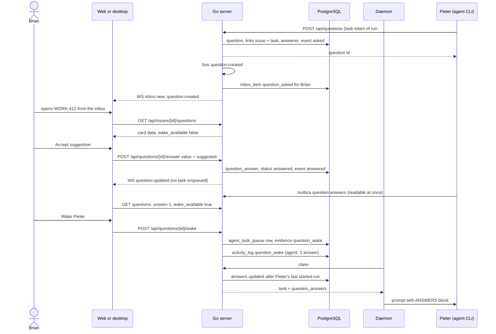

## At a glance

The delta of this change on the living system design, `specs/docs/system-design.md`. Every container it touches already exists; the change adds no container.



Go server component map, delta:



Daemon and CLI component map, delta:



Web and desktop component map, delta:



Models:



Journey sequence and data flow:



| Kind | Name | Change | Path |
|---|---|---|---|
| Migration | Question tables, `attachment.question_id` | new | `server/migrations/564_question.up.sql`, `.down.sql` |
| Migration | One `CONCURRENTLY` index per file: link target, answer per answerer, event per question, overdue sweep, attachment per question | new | `server/migrations/565_…` to `569_…` |
| Queries | Question queries | new | `server/pkg/db/queries/question.sql` |
| Queries | Attachment insert with `question_id` | changed | `server/pkg/db/queries/attachment.sql` |
| Package | Answer-type registry | new | `server/internal/question/` |
| Service | `QuestionService` | new | `server/internal/service/question.go` |
| Service | `EnqueueTaskForQuestionWake` | changed | `server/internal/service/task.go` |
| Handler | Question endpoints | new | `server/internal/handler/question.go` |
| Handler | Upload with `question_id`; claim with `question_answers` | changed | `server/internal/handler/file.go`, `server/internal/handler/daemon.go`, `server/internal/handler/agent.go` |
| Routes | `/api/questions`, `/api/issues/{id}/questions` | changed | `server/cmd/server/router.go` |
| Events | `question:created`, `question:updated` | changed | `server/pkg/protocol/events.go`, `server/cmd/server/listeners.go` |
| Inbox | `question_asked`, `question_reassigned`, `question_overdue` | changed | `server/cmd/server/notification_listeners.go` |
| Job | `QuestionOverdueJob` | new | `server/internal/scheduler/jobs_question_overdue.go`, `server/cmd/server/main.go` |
| CLI | `multica question` ask, answers, close, withdraw | new | `server/cmd/multica/cmd_question.go` |
| CLI help | Core group lists `question` | changed | `server/cmd/multica/main.go` |
| Agent brief | Questions section | changed | `server/internal/daemon/execenv/runtime_config_sections.go` |
| Prompt | `[ANSWERS]` block of a woken run | changed | `server/internal/daemon/types.go`, `server/internal/daemon/prompt.go` |
| Skill | `multica-platform` names `multica question` | changed | `server/internal/service/builtin_skills/multica-platform/SKILL.md` |
| Docs | CLI reference, five languages | changed | `apps/docs/content/docs/cli*.mdx` |
| Type | Question, answer types, inbox types | new, changed | `packages/core/types/question.ts`, `packages/core/types/inbox.ts` |
| Schema and client | Question schemas and API methods | changed | `packages/core/api/schema.ts`, `packages/core/api/client.ts` |
| Feature | Queries, mutations, WS updaters, answer validation | new | `packages/core/questions/` |
| Realtime | `question:*` and task events refresh questions | changed | `packages/core/realtime/use-realtime-sync.ts` |
| Components | Question card and the 12 answer controls | new | `packages/views/questions/` |
| Screen | Issue detail: cards, run row, Questions row, wake activity | changed | `packages/views/issues/components/` |
| Screen | Inbox: labels, question pane with inline answer | changed | `packages/views/inbox/components/` |
| Copy | `questions` namespace and new keys, five languages | new, changed | `packages/views/locales/` |
| Design | Library components for the card and controls | changed | `designs/systems/multica.lib.pen` |
| Design | Screens of this journey | new | `designs/screens/issue-questions.pen`, `designs/screens/issue-questions.md` |
| Prototype | Data-flow and live prototype of this journey | new | `prototypes/web/issue-questions/` |
| System design | Baseline, drawn from the code before this change | new | `specs/docs/system-design.md` |
| ADR | Questions are their own aggregate with typed answers and links | new | `adr/0002-questions-are-their-own-aggregate.md` |
| ADR | Only Wake turns answers into a run | new | `adr/0003-only-wake-turns-answers-into-a-run.md` |

## Context

Journey UJ-1 of [PRD: Questions in Multica](anytype://object?objectId=bafyreiaviofipcl3ymgld2skld4ij6hlarsm2ra55ygufsepgk5laxjf34), journey issue [DAS-432](https://linear.app/skuddy/issue/DAS-432/uj-1-answer-an-agents-question-and-wake-it). It is the base the four later journeys build on: `agent-asks-several-questions-at-once` (UJ-2), `answer-every-open-question-in-one-sitting` (UJ-3), `question-reaches-the-owner-of-the-work-above` (UJ-4) and `turn-agent-questions-off-for-one-issue` (UJ-5).

**Journey steps.** Brian's answer on WORK-378 (2026-10-12, relayed by Skuddy) skips J1, J4 and J10 for every Questions journey, recorded on this journey as the Requests `Skip: J1`, `Skip: J4` and `Skip: J10`. The investigation agrees: J1 Project structure has nothing to change (no new container, app or package: every new module sits in an existing Go module or workspace package), nor J4 Design system (the UX spec introduces no token or colour; `designs/systems/multica.lib.pen` already holds the product tokens), nor J10 Agent tooling for UI (answering is for people only, so the front end gets no agent tooling). Steps with work: J2 Data models, J3 Data-flow prototype, J5 Components, J6 Screens, J7 Live prototype, J8 Backend and agent tooling, J9 Frontend, J11 Acceptance test and archive.

**Design sources.** The UX spec, screens and library changes are in the open [appboypov/multica#6](https://github.com/appboypov/multica/pull/6) (`designs/screens/issue-questions.md`, `designs/screens/issue-questions.pen`, `designs/systems/multica.lib.pen`), the clickable prototype in the open [appboypov/multica#8](https://github.com/appboypov/multica/pull/8) (`prototypes/web/issue-questions/`). Both cover all five journeys and include screens 2a and 2b and the `question_answered` inbox item, which Brian's answers removed. J5, J6 and J7 bring this journey's part to `main` without them.

**Living system design.** `main` has no `specs/docs/system-design.md`. Its baseline, drawn from the code at `146d20e5c`, sits on the open branch `agent-instruction-selection` (#9) as commit `1ffbf7e1e`; `main` has had only design and prototype commits since. This change commits that baseline unchanged and draws itself only as the delta above.

**Code map.** What the build reuses, by area. Paths are under `server/` unless they start with `packages/` or `apps/`.

- Storage: migrations in `migrations/`, highest `563`; one table migration, then one `CREATE INDEX CONCURRENTLY` per file (`561`–`563` are the pattern). Queries per area in `pkg/db/queries/`; `make sqlc`. Workspace-scoped CRUD shape: `pkg/db/queries/project.sql`. IDs from `dbid.NewV7()` as `CreateAgentTask` uses.
- Actors: `middleware.Auth` turns a `mat_` task token into `X-Agent-ID`, `X-Task-ID`, `X-Workspace-ID`, `X-Actor-Source: task_token` and strips forged ones (`internal/middleware/auth.go`). `Handler.resolveActor` (`internal/handler/handler.go:864`) gives `("agent", id)` for task tokens. `RequireHumanActor` (`internal/handler/actor_guards.go:96`) refuses agents. `loadIssueForUser` (`handler.go:1046`), `parseUUIDOrBadRequest` (`handler.go:686`).
- Runs: every issue run goes through `TaskService` (`internal/service/task.go`). `enqueueMentionTask` (`task.go:1425`) enqueues a named agent on an issue with the triage guard, archived and runtime checks, attribution and the `ErrDuplicatePendingTask` dedup; Wake builds on it. Nothing in activity, inbox or a new event type enqueues a run by itself; comments enqueue only through `triggerTasksForComment` in `internal/handler/comment.go`, and issue wakeups only through their own receipts (`internal/service/issue_wakeup.go`).
- Claim: `internal/handler/daemon.go` (~2340–3100) hydrates the claim; the previous-run anchor and `CountNewCommentsSince` (~3017–3047) are the "since the last run" pattern. Wire fields in `internal/handler/agent.go` (~458–540) and `internal/daemon/types.go`. `daemon/prompt.go` `perTurnContextBlocks` appends run-scoped blocks after the cached prefix (MUL-5377); the brief stays byte-stable (`TestBriefByteIdenticalAcrossRunsForEveryKind`).
- Brief: `internal/daemon/execenv/runtime_config_sections.go` `buildMetaSkillContentSlim` (~1051) orders sections per task kind; `writeAvailableCommands` (~256).
- CLI: Cobra, one `cmd/multica/cmd_<topic>.go` per top-level command, groups in `cmd/multica/help.go`, `newAPIClient` carries the task token; `resolveTextFlag` and the workdir-file pattern for long text. Member name resolution as `issue assign --to` does.
- Activity and timeline: `GET /api/issues/{id}/timeline` (`internal/handler/activity.go:156`) merges comments and `activity_log`; runs come from `GET /api/issues/{id}/task-runs` and are merged on the client by `buildCommentRunView` / `orderTimelineWithRuns` (`packages/views/issues/components/comment-runs.ts`). New activity actions are strings handled by the client (`wakeup-activity.tsx` is the pattern).
- Inbox and realtime: `notifyDirect` and `CreateInboxItem` in `cmd/server/notification_listeners.go`; types without a `notifTypeToGroup` entry are always delivered. `inbox:*` goes to the user, other `protocol.Event*` to the workspace (`cmd/server/listeners.go:79`).
- Attachments: `POST /api/upload-file` (`internal/handler/file.go:379`) takes an optional owner id per kind; `task_id` (`migrations/164`) is the pattern for a new owner column.
- Scheduler: `internal/scheduler/jobs_issue_wakeup.go` `IssueWakeupJob` and its registration in `cmd/server/main.go` (~831).
- Frontend: issue page `packages/views/issues/components/issue-detail.tsx` — timeline view (~1731), Virtuoso rows with `comment-${id}` anchors, `jumpToComment`, properties `sidebarContent` (~2664) with `PropRow` (`packages/views/common/prop-row.tsx`) and Priority (~2700). Run rows: `inline-comment-run.tsx`, labels `task-run-labels.ts`. Inbox: `packages/views/inbox/components/inbox-page.tsx` (~696 passes `highlightCommentId`, ~713 generic pane), `inbox-detail-label.tsx`. Core: `packages/core/api/client.ts` with `parseWithFallback` (`api/schema.ts`), feature folders with `queries.ts`, `mutations.ts`, `ws-updaters.ts`, subpath exports in `packages/core/package.json`. Dates: `packages/core/issues/date.ts` (`isPastDateOnly`, date-only strings). Copy: `packages/views/locales/{en,zh-Hans,ko,ja,fr}`, registered in `packages/views/locales/index.ts`.
- Must not change: comment trigger routing, issue wakeup receipts, the pending-task unique indexes, `parseWithFallback` never throwing, the composer's built-in commands (only `/note`), the mobile app.

## Goals / Non-Goals

**Goals:**

- An agent asks one question per `multica question ask` during an issue run, in any of the 12 answer types, of one or more members.
- Members see the question as a card on the issue, are told in the inbox, answer it there or on the card, and only a member's **Wake** starts the asking agent again, with the answers it has not seen.
- The storage and API carry links, answerers and history in a shape the later journeys extend without reshaping it (ADR-0002).

**Always:**

- Only a task token asks, closes or withdraws, and only for its own agent's questions; only a member answers, asks back, reassigns or wakes.
- Answer and settings validation lives in `server/internal/question`; the server refuses what it refuses, the client mirrors it only to gate **Send**.
- Every new endpoint's response goes through a zod schema and `parseWithFallback`, with a malformed-response test.

**Never:**

- No question path calls `TaskService` except Wake; no question event joins the comment triggers or the issue-wakeup event vocabulary (ADR-0003).
- No member way to create a question; no composer toggle or `/question`; no `question_answered` inbox item.
- No foreign keys or cascades; no new design token or colour; no mobile change.
- No brief, help or skill text about when or why to ask.

**Non-Goals:** question sets and answer policies (UJ-2); the Questions page, sidebar item and Answer all (UJ-3); links beyond the issue and run, parents and the indirect audience (UJ-4); the Agent questions setting (UJ-5).

## Decisions

### 1. A question is its own aggregate of five tables

`question` holds what the asker gave and the status; `question_link` (`link_type`, `link_id`, `position`) holds where it belongs, position 0 being where it was asked; `question_answerer` holds the current answerers; `question_answer` holds one row per answerer, edited in place; `question_event` holds the history: `asked`, `answered`, `answer_edited`, `ask_back`, `reassigned`, `closed`, `withdrawn`, `woken`. UJ-1 writes the link types `issue` and `task`; UJ-4 adds more without a new table. Alternatives: a comment subtype (the spec forbids it) or links as columns on `question` (UJ-4 would reshape the table). Recorded as ADR-0002.

`question.asker_agent_id` and `asked_in_task_id` are `NOT NULL`: only agents ask, and only during a run. A task without an issue (chat, quick create) is refused with 422 "questions are asked during an issue run", since its run has no issue to link.

### 2. Answer types live in one Go registry; values are JSONB

`server/internal/question` exposes `ValidateSettings(type, settings)`, `ValidateAnswer(type, settings, value, note)` and `Display(type, settings, value)` (the one-line text for the folded card, the inbox and the `[ANSWERS]` block). `packages/core/questions/validate.ts` mirrors `ValidateAnswer` to gate **Send** and show its message. Shapes:

| Type key | `settings` | `value` | `--suggest` |
|---|---|---|---|
| `text` | `{length: "short"\|"long", placeholder?}` | `{text, attachment_ids?}` | text |
| `yes_no` | `{why_on_no: bool}` | `{choice: "yes"\|"no"}`; No needs the answer's `note` when `why_on_no` | `yes`, `no` |
| `single_choice` | `{options: [label], allow_other: bool}` | `{option: label}` or `{other: text}` | a label |
| `multiple_choice` | `{options: [label], min, max}` | `{options: [label]}`, distinct, `min`–`max` | repeatable labels |
| `confirm_facts` | `{facts: [text]}` | `{facts: [{correct: true} \| {correct: false, correction}]}`, one per fact | not allowed |
| `ranking` | `{items: [label]}` | `{order: [label]}`, a permutation of `items` | repeatable labels |
| `scale` | `{min, max, min_label?, max_label?}`, integers, 2–11 points | `{point}` in range | a point |
| `number` | `{unit?, min?, max?}` | `{number}` in range | a number |
| `date` | `{kind: "date"\|"datetime"\|"range"}` | `{date}`, `{datetime}` (RFC 3339) or `{start, end}` | an ISO value, a range as `start/end` |
| `person` | `{allow: "members"\|"agents"\|"both"}` | `{type: "member"\|"agent", id}` of the workspace | a name |
| `file` | `{accept: [mime or .ext]}` | `{attachment_ids: [id]}`, at least one, each accepted | not allowed |
| `approval` | `{subject, link?: {title, url}}` | `{decision: "approve"\|"request_changes"\|"decline"}`; Request changes needs the answer's `note` | not allowed |

Options, items and facts are unique labels (2–20 options or items, 1–20 facts); a value names labels, which never change because a question is never edited. The "why" of Yes / No and the note of Request changes are the answer's note, so every type keeps one note field. The suggested answer is a `value` and passes `ValidateAnswer`; the error names it (`suggested answer "per week" is not one of the options`). Attachment ids must belong to the question (`attachment.question_id`) and to the uploader.

### 3. Lifecycle and who may do what

| Action | Who | From status | To status |
|---|---|---|---|
| Ask | task token, agent of the run | — | `open` |
| Answer (first) | a current answerer | `open` | `answered` |
| Edit answer | the answerer of that answer | `answered` | `answered` |
| Ask back | a current answerer | `open`, `answered` | unchanged |
| Reassign, with a required note | a current answerer | `open` | `open` |
| Close | task token of the asking agent | `answered` | `closed` |
| Withdraw | task token of the asking agent | `open`, `answered` | `withdrawn` |
| Wake | any member of the workspace | `answered` with unseen answers | unchanged |

Several answerers in UJ-1 behave as **Any one** ("Keep: Any one - first answer takes the question off others' lists; only the asker closes it"): the first answer makes it `answered`; UJ-2 adds the policy column with that default. Overdue is not a status: the card shows it when `status = open` and `isPastDateOnly(due_date)` for the viewer; the overdue job uses the UTC calendar day. Due dates are date-only strings as issue due dates are. Every action writes its `question_event` and publishes `question:updated` with the question's issue id.

### 4. API

| Method and path | Actor | Returns |
|---|---|---|
| `POST /api/questions` | task token | 201 `Question` |
| `GET /api/issues/{id}/questions` | member or task token | `Question[]` linked to the issue, oldest first |
| `GET /api/questions/{id}` | member or task token | `Question` |
| `POST /api/questions/{id}/answer` `{value, note?}` | member, current answerer | `Question` |
| `POST /api/questions/{id}/ask-back` `{text}` | member, current answerer | `Question` |
| `POST /api/questions/{id}/reassign` `{user_id, note}` | member, current answerer | `Question` |
| `POST /api/questions/{id}/close` | task token, asking agent | `Question` |
| `POST /api/questions/{id}/withdraw` | task token, asking agent | `Question` |
| `POST /api/questions/{id}/wake` | member | 202 `{task_id, answer_count}` |

`Question` carries the asker, `asked_in_task_id`, links, answerers, answers (value, display text, note, who, created and updated), events, `unseen_answer_count` and `wake_available` for its asking agent. A member asking gets 403 "only agents ask questions"; an agent id among `answerer_ids` gets 422 naming the agent ("Joeri is an agent; only members answer questions"); a refused value gets 422 with `ValidateAnswer`'s message. Routes sit in the `RequireWorkspaceMember` group; the issue route uses `loadIssueForUser`, question ids `parseUUIDOrBadRequest` and a workspace-filtered load.

### 5. Wake, and what an agent has not seen

One query defines "unseen": the answers to questions asked by agent A and linked to issue I whose `updated_at` is after the `started_at` of A's latest started run on I; the run that asked is always one, so the anchor exists. It serves `unseen_answer_count`, the Wake guard and the claim. `wake_available` is true when the count is above zero and A has no queued, dispatched or running task on I; while one is active, the card offers no Wake, and once it ends, answers given after its start are still unseen and Wake returns. An ask-back is not an answer (FR-20 offers Wake for answers): it counts toward nothing, is readable through `multica question answers`, and rides along in the next woken run, as the prototype says ("Pieter gets your reply when he is woken").

`POST /api/questions/{id}/wake` calls `TaskService.EnqueueTaskForQuestionWake(issue, agentID, actorUserID, answerCount)`, built on `enqueueMentionTask` with no trigger comment, `trigger_evidence_kind = "question_wake"`, `trigger_evidence_ref_id` = the question id and the trigger summary "Woken by Brian with 1 answer". It writes the `activity_log` action `question_wake` with `{agent_id, answer_count, task_id}`; the timeline renders "Pieter was woken by Brian with 1 answer". `ErrDuplicatePendingTask` maps to 409; nothing unseen to 422.

At claim, a task with evidence kind `question_wake` gets `question_answers`: the unseen answers and ask-backs, anchored on A's latest started run on I other than this task, each with question id, prompt, display text, note, who and when. `perTurnContextBlocks` appends:

```text
[ANSWERS]
Brian woke you with 1 answer to your questions:
- 01J…  "Do invoices round per line or per total?" → per line · Brian · 2026-10-12 21:04 · note: as the old system did
`multica question answers <question-id>` shows a question in full.
```

The answers are hydrated at claim, so an edit between Wake and claim reaches the run. Recorded as ADR-0003.

### 6. The issue page

`GET /api/issues/{id}/questions` loads beside the timeline and task runs, and `orderTimelineWithRuns` places each question card by `created_at`, at the place it was asked; the timeline API and `TimelineEntry` stay unchanged. Each card has the anchor `question-${id}`; `IssueDetail` takes `highlightQuestionId` next to `highlightCommentId`, and the Questions row's jump reuses the `jumpToComment` scroll and flash. The Questions row after Priority shows when the issue has an open question: "1 open", or "1 open · blocks work". The run row gets "ended run #N with a question" when its run is terminal and asked a question, N being the run's 1-based place among that agent's runs on the issue by `created_at`, and the "Waiting for answer" badge while one of those questions is `open`. A viewer who is not an answerer sees the card without the overline and without controls; a closed card has no **Edit answer**. `task:*` events refresh the issue's questions too, since a run start changes what is unseen.

### 7. Inbox

`question:created` and `question:updated` (with reason `reassigned` or `overdue`) are on the bus; `notification_listeners.go` creates `question_asked` for every answerer, `question_reassigned` for the new answerer with the note, `question_overdue` for every current answerer, each with `issue_id` and `details.question_id`. None is in `notifTypeToGroup`, so none can be muted, as a direct question to someone is. `QuestionOverdueJob` runs hourly: open questions with `due_date` before the UTC day and no `overdue_notified_at` get the event and the stamp. The inbox pane of a question item shows the card with inline controls for `yes_no`, `single_choice` and `approval`, and for other types the prompt with **Open on WORK-412**, which opens the issue with `highlightQuestionId`.

### 8. Agent tooling

`multica question` is in the Core help group. `ask` takes `--prompt` or `--prompt-file`, `--context`, `--type`, the settings flags of decision 2 (`--option`, `--allow-other`, `--min`, `--max`, `--fact`, `--item`, `--min-label`, `--max-label`, `--unit`, `--date-kind`, `--allow`, `--accept`, `--length`, `--placeholder`, `--why-on-no`, `--subject`, `--link-url`, `--link-title`), `--suggest` (repeatable where the table says), `--answerer` (repeatable; name, email or id; an agent name fails before any request), `--due YYYY-MM-DD` and `--blocks-work`, and prints the question id. `answers <question-id>` prints status, answers and thread; `close` and `withdraw` take the id. All support `--output json`. `--help` lists the types and flags and nothing about when to ask. The brief gets the exact section of the spec for every task kind that runs on an issue; UJ-5 makes it conditional.

## Risks / Trade-offs

- [Run numbers are counted on the client from the task runs list] → the list is the one the issue page already loads; a run list that is cut short would count wrong. Acceptable for a label; a server ordinal waits for a second consumer.
- [Answer validation is written twice, Go and TypeScript] → the server is authoritative and its 422 message shows in the card when the two drift; both have table tests over the same cases from decision 2.
- [The mobile app gets three inbox types it does not know] → its `InboxDetailLabel` falls back to the raw type and the item still opens; the mobile app stays unchanged by the PRD.
- [The baseline `specs/docs/system-design.md` is also added by #9, which changes it after the baseline] → whichever merges second resolves an add/add conflict by keeping #9's version; this change's delta is in this file, not in the baseline.
- [Migration numbers `564`–`569` can be taken by another merge first] → J2 takes the next free numbers; nothing refers to them.

## Migration Plan

Additive tables and one nullable column; no backfill. Rollback is the `.down.sql` files in reverse order. `make local-release` deploys; installed desktop clients ignore the new fields and inbox types until updated.

## Open Questions

None. Brian skipped J1, J4 and J10 (see Context "Journey steps").
