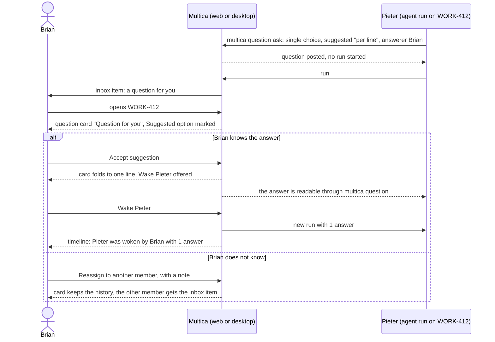
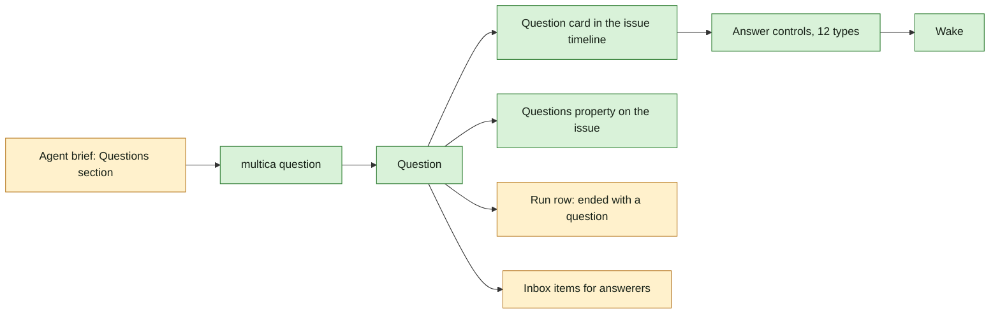

## At a glance

| Kind | Name | Change | Path |
|---|---|---|---|
| Model | Question, answer, link, answerer | new | `server/` |
| CLI | `multica question` ask, answers, close, withdraw | new | `server/cmd/multica/cmd_question.go` |
| Agent brief | Questions section | changed | `server/internal/daemon/execenv/runtime_config_sections.go` |
| Screen | Issue detail: question card, run row, Questions property | changed | `packages/views/issues/components/issue-detail.tsx` |
| Component | Answer controls for the 12 answer types | new | `packages/views/questions/` |
| Type | Inbox item types `question_asked`, `question_reassigned`, `question_overdue` | changed | `packages/core/types/inbox.ts` |
| Screen | Inbox detail pane: inline answer for Yes / No, Single choice, Approval | changed | `packages/views/inbox/` |

## Why

An agent that needs an answer today writes it into a comment. The comment sinks into the timeline, nobody is told it is theirs, and the run guesses or stops without anyone noticing. This change makes a question its own thing: an agent asks one person one question through the CLI, the person is told, answers in the shape the question needs, and decides when the agent goes on.

It is the first journey of [PRD: Questions in Multica](anytype://object?objectId=bafyreiaviofipcl3ymgld2skld4ij6hlarsm2ra55ygufsepgk5laxjf34) (UJ-1) and holds the base every later questions journey builds on: the question, the CLI, the card, answering, the inbox and Wake.

Success signal: Pieter asks Brian a single-choice question on WORK-412 during run #3; Brian gets an inbox item, presses **Accept suggestion** on the card and then **Wake Pieter**, and Pieter's new run reads the answer, while no run started before Brian pressed Wake.

## What Changes

- A question is an object of its own, not a comment: prompt, optional context line, one answer type with its settings, optional suggested answer, member answerers, links, optional due date and the Blocks work flag.
- An agent asks one question with `multica question ask`, reads its answers, and closes or withdraws its questions through `multica question`. People have no way to ask.
- The agent's brief carries a short Questions section and `multica --help` lists `multica question`; neither says when or why to ask.
- On an issue a question is a card in the activity timeline, outlined "Question for you" for its answerers; the run row of an agent that asked reads "ended run #N with a question" with a "Waiting for answer" badge; the issue's properties get a **Questions** row.
- Answerers answer in any of 12 answer types, accept the suggested answer in one action, add a note, ask back or reassign; a sent answer reaches the asker at once and stays editable until the asker closes the question.
- The inbox tells answerers when a question is asked of them, reassigned to them or overdue, and answers Yes / No, Single choice and Approval inline.
- An answer never starts a run: a person wakes the asking agent with the answers it has not seen.

## Capabilities

### New Capabilities

- `questions`: lets agents ask people questions as objects of their own, with answerers, links, a due date, Blocks work and a lifecycle.
- `agent-question-tooling`: lets an agent ask, read answers and close or withdraw questions through `multica question`, and tells it only that the tool exists.
- `question-answering`: lets answerers answer a question in its answer type, accept a suggestion, add a note, ask back, reassign and edit their answer.
- `issue-questions`: lets everyone on an issue see its questions as cards, the run that waits on them, and the open count in the properties.
- `question-inbox`: lets answerers hear about their questions in the inbox and answer simple ones there.
- `agent-wake`: lets a person start an agent with the answers it has not seen; nothing else starts a run.

## Impact

- Server: new question, answer and link storage and API; task wake with answers; inbox item types; timeline entries.
- CLI: new `multica question` command group.
- Daemon: the agent brief's Questions section.
- Web and desktop: issue detail (card, run row, Questions property), answer controls, inbox detail pane.
- The built-in `multica-platform` skill and `multica --help` list `multica question`.

## Constraints

- Only agents ask and only people answer: no human asking surface, no agent answerer.
- No answer, edit or ask starts a run; only Wake does.
- The agent is told only that `multica question` exists and how to call it, never when or why to ask.
- Web and desktop only; the mobile app stays unchanged.
- Questions use Multica's existing tokens and components; no new design token or colour.
- AGENTS.md binds the build: no foreign keys or cascades, `CONCURRENTLY` indexes each in their own migration, zod with `parseWithFallback` for every new response, malformed-response tests for new endpoints.

## Non-goals

- Several questions in one ask, squads as answerers and answer policies: change `agent-asks-several-questions-at-once` (UJ-2).
- The Questions page, sidebar item and Answer all: change `answer-every-open-question-in-one-sitting` (UJ-3).
- Links beyond the issue and run an agent asks on, questions on parents and the indirect audience: change `question-reaches-the-owner-of-the-work-above` (UJ-4).
- The Agent questions setting and the brief without questions: change `turn-agent-questions-off-for-one-issue` (UJ-5).
- Guidance to agents on when to ask or when to end a run.
- The composer's Question toggle, `/question` and question builder of design screens 2a and 2b, and the asker's `question_answered` inbox item: superseded by Brian's answer that only agents ask.

## Sources

- [PRD: Questions in Multica](anytype://object?objectId=bafyreiaviofipcl3ymgld2skld4ij6hlarsm2ra55ygufsepgk5laxjf34): UJ-1; FR-1, FR-2, FR-3, FR-5, FR-6, FR-7, FR-8, FR-9, FR-10, FR-11, FR-12, FR-13, FR-14, FR-19, FR-20, FR-22 for a single question.
- Design and UX spec: [appboypov/multica#6](https://github.com/appboypov/multica/pull/6), `designs/screens/issue-questions.md` and `designs/screens/issue-questions.pen`: screens 1 (issue with a question for you), 3 (answer types), 6 (answered); per-type keys and layout.
- Prototype: [appboypov/multica#8](https://github.com/appboypov/multica/pull/8), `prototypes/web/issue-questions/`, live at [boldly-road-6664](https://designs.magicpath.ai/v1/boldly-road-6664).
- Brian's answers: the WORK-366 comments and [Plannotator Review b8b3060eec0c8d52](https://ctas.de-appspecialist.nl/plannotator/session/b8b3060eec0c8d52/), as the PRD's Addendum lists them.
