## At a glance

```mermaid
flowchart LR
  classDef work fill:#d9f2d9,stroke:#2e7d32,color:#172117
  classDef skip fill:#eeeeee,stroke:#9e9e9e,color:#424242
  P5[P5 Technical design] --> J1
  J1[J1 Project structure<br/>Skip: J1]:::skip --> J2
  J2[J2 Data models<br/>groups 1-3]:::work --> J3
  J3[J3 Data-flow prototype<br/>group 4]:::work --> J4
  J4[J4 Design system<br/>Skip: J4]:::skip --> J5
  J5[J5 Components<br/>group 5]:::work --> J6
  J6[J6 Screens<br/>group 6]:::work --> J7
  J7[J7 Live prototype<br/>group 7]:::work --> J8
  J8[J8 Backend and agent tooling<br/>groups 8-13]:::work --> J9
  J9[J9 Frontend<br/>groups 14-16]:::work --> J10
  J10[J10 Agent tooling for UI<br/>Skip: J10]:::skip --> J11
  J11[J11 Acceptance test and archive<br/>group 17]:::work
```

| Step | Groups | Builder |
|---|---|---|
| J1 Project structure | none: `Skip: J1` | — |
| J2 Data models | 1 new model, 2 DTOs, 3 action names | `madspec-model-builder`, `madspec-dto-builder` |
| J3 Data-flow prototype | 4 | `madspec-prototype-builder` |
| J4 Design system | none: `Skip: J4` | — |
| J5 Components | 5 | `madspec-design-system-designer` |
| J6 Screens | 6 | `madspec-screen-designer` |
| J7 Live prototype | 7 | `madspec-prototype-builder` |
| J8 Backend and agent tooling | 8 rules, 9 services, 10 endpoints, 11 job, 12 CLI command, 13 skill | `madspec-rules-builder`, `madspec-service-builder`, `madspec-api-builder`, `madspec-function-builder`, `madspec-command-builder`, `madspec-skill-builder` |
| J9 Frontend | 14 flow, 15 new component, 16 screen | `madspec-api-builder`, `madspec-component-builder`, `madspec-view-builder` |
| J10 Agent tooling for UI | none: `Skip: J10` | — |
| J11 Acceptance test and archive | 17 | Sarkout |

## 1. J2 Data models: new model

- [x] 1.1 `server/migrations/566_question.up.sql`, `.down.sql` -- create `question`, `question_link`, `question_answerer`, `question_answer`, `question_event` as design.md "Models" draws them, with `CHECK` constraints on `answer_type` (the 12 keys of design.md decision 2), `status` (`open`, `answered`, `closed`, `withdrawn`), `link_type` (`issue`, `task`) and event `kind`; primary keys `(question_id, link_type, link_id)` and `(question_id, user_id)` on the link and answerer tables; add nullable `attachment.question_id` -- one table migration, no foreign keys or cascades (AGENTS.md, ADR-0002).
- [x] 1.2 `server/migrations/567_question_link_target_index.up.sql`, `.down.sql` -- `CREATE INDEX CONCURRENTLY` on `question_link (link_type, link_id)` -- lists an issue's questions.
- [x] 1.3 `server/migrations/568_question_answer_answerer_index.up.sql`, `.down.sql` -- `CREATE UNIQUE INDEX CONCURRENTLY` on `question_answer (question_id, answerer_user_id)` -- one answer per answerer, edited in place.
- [x] 1.4 `server/migrations/569_question_event_question_index.up.sql`, `.down.sql` -- `CREATE INDEX CONCURRENTLY` on `question_event (question_id, created_at)` -- the card's history and thread.
- [x] 1.5 `server/migrations/570_question_overdue_index.up.sql`, `.down.sql` -- partial `CREATE INDEX CONCURRENTLY` on `question (due_date) WHERE status = 'open' AND overdue_notified_at IS NULL` -- the overdue sweep.
- [ ] 1.6 `server/migrations/571_attachment_question_index.up.sql`, `.down.sql` -- partial `CREATE INDEX CONCURRENTLY` on `attachment (question_id) WHERE question_id IS NOT NULL` -- answer attachments, as `164_attachment_task_id` does for tasks.
- [ ] 1.7 `server/pkg/db/queries/question.sql` -- workspace-filtered queries: create question, links, answerers, events; get by id; list by issue link; upsert answer; set status; replace answerer; list open overdue and stamp `overdue_notified_at`; count and list unseen answers for (agent, issue) against the agent's latest started run (design.md decision 5); list ask-backs after that anchor; has active task for (agent, issue) -- the one "unseen" query of ADR-0003.
- [ ] 1.8 `server/pkg/db/queries/attachment.sql` -- `CreateAttachment` takes `question_id`; add `ListAttachmentsByQuestion` -- answers carry files and rich-text attachments.
- [ ] 1.9 `server/pkg/db/generated/` -- run `make sqlc` and commit the output -- generated code stays in step with the queries.

## 2. J2 Data models: DTOs

- [ ] 2.1 `packages/core/types/question.ts` -- `AnswerType`, per-type settings and value unions, `QuestionStatus`, `QuestionLink`, `QuestionAnswer`, `QuestionEvent`, `Question` (with `unseen_answer_count`, `wake_available`) and `QuestionWakeResult`, as design.md decisions 2 and 4 define them; export from `packages/core/types/index.ts` -- one client contract for web and desktop.
- [ ] 2.2 `packages/core/types/inbox.ts` -- add `question_asked`, `question_reassigned`, `question_overdue` to `InboxItemType` -- the three inbox items of the spec.
- [ ] 2.3 `packages/core/api/schema.ts` -- zod schemas for `Question`, `Question[]` and `QuestionWakeResult` with defaults for optional fields and a fallback for an unknown `answer_type`, `status` or event `kind` -- installed desktop clients meet newer servers (AGENTS.md "API Compatibility").
- [ ] 2.4 `packages/core/api/schema.test.ts` -- malformed-response cases for each new schema: missing arrays, unknown enums, wrong value shapes fall back without throwing -- AGENTS.md requires it for every new endpoint.

## 3. J2 Data models: action names

- [ ] 3.1 `server/pkg/protocol/events.go` -- `EventQuestionCreated = "question:created"`, `EventQuestionUpdated = "question:updated"`, payload `{question_id, issue_id, reason}` with reasons `answered`, `answer_edited`, `ask_back`, `reassigned`, `closed`, `withdrawn`, `overdue`, `woken` -- the names the server, listeners and clients share.
- [ ] 3.2 `server/internal/attribution/attribution.go` -- `EvidenceQuestionWake EvidenceKind = "question_wake"` -- marks a run started by Wake for the claim (ADR-0003).
- [ ] 3.3 `server/internal/service/question_actions.go` -- constants for the inbox types `question_asked`, `question_reassigned`, `question_overdue` and the activity action `question_wake` -- one spelling for the listener, the job and the tests.

## 4. J3 Data-flow prototype: data-flow prototype

- [ ] 4.1 `prototypes/web/issue-questions/data-flow/` -- an interactive prototype without UI that runs the journey: ask in run #3, the inbox item, Accept suggestion, the answer readable by the agent, Wake, the woken run's `[ANSWERS]` input; per step its input, output, store and agent action, as design.md "Journey sequence and data flow" draws them -- J3's contract in `madspec-prototyping`.

## 5. J5 Components: component design

- [ ] 5.1 `designs/systems/multica.lib.pen` -- bring the library components this journey's screens use from appboypov/multica#6 (option, radio, checkbox, switch, type icon, badge, kbd, avatar, avatar-agent, buttons, input, nav item), built from the library's existing tokens only -- J6 builds screens only from library components.
- [ ] 5.2 `designs/systems/exports/` -- one PNG per new or changed component -- J5's contract.

## 6. J6 Screens: screen design

- [ ] 6.1 `designs/screens/issue-questions.pen` -- this journey's screens from appboypov/multica#6: 1 issue with a question for you (card, run row, Questions row), 3 the 12 answer types, 6 answered with Wake, and the inbox item with an inline answer; without screens 2a and 2b, the composer Question toggle and the `question_answered` item -- the specs name these screens and Brian's answers removed the others.
- [ ] 6.2 `designs/screens/issue-questions.md` -- the UX spec of these screens with its At a glance flowchart, each arrow naming its action -- J6's contract.
- [ ] 6.3 `designs/screens/exports/` -- one PNG per screen -- J6's contract.

## 7. J7 Live prototype: prototype

- [ ] 7.1 `prototypes/web/issue-questions/` -- bring the clickable prototype of appboypov/multica#8 for this journey's screens, without the composer question builder and the `question_answered` item, matching group 6's screens -- the live prototype of the journey.
- [ ] 7.2 `prototypes/web/issue-questions/exports/` -- one PNG per prototype screen -- J7's contract.

## 8. J8 Backend and agent tooling: rules

- [ ] 8.1 `server/internal/question/types.go` -- the 12 answer-type keys and the settings and value structs of design.md decision 2 -- one registry for every validator.
- [ ] 8.2 `server/internal/question/validate.go` -- `ValidateSettings`, `ValidateAnswer` (including the note rules of Yes / No and Request changes, `min`/`max`, Other, permutations, ranges, date kinds), `ValidateSuggested` (refused for `confirm_facts`, `file`, `approval`; its error names the suggested answer) -- the server's single authority (ADR-0002).
- [ ] 8.3 `server/internal/question/display.go` -- `Display(type, settings, value)` one-line text -- the folded card, the inbox and the `[ANSWERS]` block say the same.
- [ ] 8.4 `server/internal/question/validate_test.go` -- table tests per type: valid, below `min`, above `max`, Other not allowed, Request changes without a note, Not correct without a correction, suggested answer outside the options -- the spec's answer-type scenarios at their canonical layer.

## 9. J8 Backend and agent tooling: services

- [ ] 9.1 `server/internal/service/question.go` -- `QuestionService`: `Ask` (links issue and task from the task, refuses a task without an issue and agent answerers by name), `Answer`, `AskBack`, `Reassign` (note required), `Close`, `Withdraw`, `Get`, `ListForIssue` (with `unseen_answer_count`, `wake_available`), `Wake`; each writes its `question_event` and publishes its bus event in one transaction where it writes more than one row -- design.md decisions 1, 3 and 5.
- [ ] 9.2 `server/internal/service/task.go` -- `EnqueueTaskForQuestionWake(ctx, issue, agentID, actorUserID, answerCount)` on top of `enqueueMentionTask`, with no trigger comment, evidence `question_wake`, ref the question id and trigger summary "Woken by <member> with <n> answer(s)" -- the only question path into `TaskService` (ADR-0003).
- [ ] 9.3 `server/internal/service/question_test.go` -- DB tests with `testutil` fixtures: lifecycle transitions and refusals of design.md decision 3; asking, answering, editing, asking back and reassigning queue no task even when the asker is the assignee; unseen count before and after a started run; Wake refused with an active task and with nothing unseen; Wake queues one task and one `question_wake` activity -- guards the no-run rule.

## 10. J8 Backend and agent tooling: endpoints

- [ ] 10.1 `server/internal/handler/question.go` -- the nine endpoints of design.md decision 4 with their actor checks (`resolveActor`, `RequireHumanActor`, current answerer, asking agent), `loadIssueForUser`, `parseUUIDOrBadRequest` and the response structs -- the API agents and clients call.
- [ ] 10.2 `server/cmd/server/router.go` -- register `/api/questions` routes and `GET /api/issues/{id}/questions` in the `RequireWorkspaceMember` group -- workspace scoping as every resource has.
- [ ] 10.3 `server/internal/handler/file.go` -- `UploadFile` accepts `question_id`, checks it belongs to the workspace, stores it -- File and Text answers carry attachments.
- [ ] 10.4 `server/internal/handler/daemon.go`, `server/internal/handler/agent.go` -- for a claimed task with evidence `question_wake`, hydrate `question_answers` (unseen answers and ask-backs against the agent's latest other started run on the issue) on the claim wire -- the woken run gets its answers at claim.
- [ ] 10.5 `server/cmd/server/listeners.go` -- broadcast `question:created` and `question:updated` to the workspace -- clients refresh cards live.
- [ ] 10.6 `server/cmd/server/notification_listeners.go` -- on `question:created` notify every answerer with `question_asked`; on `question:updated` reason `reassigned` notify the new answerer with `question_reassigned` and the note; reason `overdue` notify current answerers with `question_overdue`; each with `issue_id` and `details.question_id`; no `notifTypeToGroup` entry -- the inbox requirement; direct questions cannot be muted.
- [ ] 10.7 `server/internal/handler/question_test.go` -- a member's ask is 403; an agent answerer is 422 naming the agent; an agent's answer is 403; a non-answerer's answer is 403; an invalid value is 422 with the validator's message; close by another agent is 403; wake by a member is 202 and its second call 409 -- the authorization and error matrix.
- [ ] 10.8 `server/internal/handler/daemon_question_wake_test.go` -- a woken task's claim carries the answer given after the asking run started and an edit made after Wake; a non-wake claim carries none -- the claim contract.
- [ ] 10.9 `server/cmd/server/notification_listeners_test.go` -- asked, reassigned and overdue create one item per recipient with `details.question_id`; answering creates none and no `question_answered` exists -- the inbox scenarios.

## 11. J8 Backend and agent tooling: job

- [ ] 11.1 `server/internal/scheduler/jobs_question_overdue.go` -- `QuestionOverdueJob`, hourly: open questions with `due_date` before the UTC day and no `overdue_notified_at` get `question:updated` reason `overdue` and the stamp -- one overdue item per question.
- [ ] 11.2 `server/cmd/server/main.go` -- register `QuestionOverdueJob` beside `IssueWakeupJob` -- the scheduler runs it.
- [ ] 11.3 `server/internal/scheduler/jobs_question_overdue_test.go` -- a question due yesterday and open is stamped once across two ticks; answered, withdrawn and due-today questions are not -- the overdue boundary.

## 12. J8 Backend and agent tooling: CLI command

- [ ] 12.1 `server/cmd/multica/cmd_question.go` -- `multica question ask|answers|close|withdraw` with the flags of design.md decision 8, member resolution for `--answerer` that fails on an agent name, `--output json`, help that lists the answer types and flags and says nothing about when to ask -- the agent's tool.
- [ ] 12.2 `server/cmd/multica/main.go` -- add the `question` command to the Core help group -- `multica --help` lists it.
- [ ] 12.3 `server/cmd/multica/cmd_question_test.go` -- flag-to-request mapping per type, `--suggest` mapping, an agent answerer refused before any request, `answers` JSON output -- the CLI contract.
- [ ] 12.4 `server/internal/daemon/execenv/runtime_config_sections.go` -- write the spec's Questions section word for word for every task kind that runs on an issue -- the brief tells only that the tool exists.
- [ ] 12.5 `server/internal/daemon/execenv/runtime_config_sections_test.go` -- an issue run's brief holds the section exactly; a chat run's does not; `TestBriefByteIdenticalAcrossRunsForEveryKind` still passes -- the brief scenario.
- [ ] 12.6 `server/internal/daemon/types.go`, `server/internal/daemon/prompt.go` -- `Task.QuestionAnswers` and the `[ANSWERS]` block of design.md decision 5 appended by `perTurnContextBlocks` -- run-scoped data stays out of the cached brief (MUL-5377).
- [ ] 12.7 `server/internal/daemon/prompt_test.go` -- a woken task's prompt ends with the block naming the waker, the count and each answer; a task without answers has no block -- the woken-run scenario.

## 13. J8 Backend and agent tooling: skill

- [ ] 13.1 `server/internal/service/builtin_skills/multica-platform/SKILL.md` -- name `multica question` and point to `multica question --help`, with no word on when or why to ask -- the skill lists the tool as the spec says.
- [ ] 13.2 `apps/docs/content/docs/cli.mdx`, `cli.zh.mdx`, `cli.ja.mdx`, `cli.ko.mdx`, `cli.fr.mdx` -- add `multica question` and its subcommands to the CLI reference -- every documented language lists the command.

## 14. J9 Frontend: flow

- [ ] 14.1 `packages/core/api/client.ts` -- `listIssueQuestions`, `getQuestion`, `answerQuestion`, `askBackQuestion`, `reassignQuestion`, `wakeQuestionAgent`, `uploadFile` with `question_id`, each through `parseWithFallback` -- the client calls of decision 4.
- [ ] 14.2 `packages/core/questions/queries.ts`, `mutations.ts`, `index.ts` -- `questionKeys.byIssue(wsId, issueId)`, `questionKeys.detail(wsId, id)`, query hooks and mutations that invalidate both on settle; add `./questions` to `packages/core/package.json` exports -- TanStack Query owns the questions.
- [ ] 14.3 `packages/core/questions/ws-updaters.ts`, `packages/core/realtime/use-realtime-sync.ts` -- `question:created`, `question:updated` and `task:*` events of an issue invalidate its question keys -- cards, Wake and the run badge stay live.
- [ ] 14.4 `packages/core/questions/validate.ts` -- mirror of `ValidateAnswer` returning the message key and values that gate **Send** -- the card says why it cannot send.
- [ ] 14.5 `packages/core/questions/validate.test.ts`, `packages/core/questions/queries.test.ts` -- the decision 2 cases as in task 8.4; keys include `wsId`; WS events invalidate the right keys -- canonical layer for the client logic.

## 15. J9 Frontend: new component

- [ ] 15.1 `packages/views/questions/answer-controls/` -- one control per answer type (`text`, `yes-no`, `single-choice`, `multiple-choice`, `confirm-facts`, `ranking`, `scale`, `number`, `date`, `person`, `file`, `approval`) on existing `packages/ui` primitives, with the focus keys of the UX spec, and `answer-control.tsx` choosing by type -- the 12 answer types.
- [ ] 15.2 `packages/views/questions/question-card.tsx` -- the card in the comment card's frame: overline "Question for you" for answerers, Suggested badge, **Accept suggestion** while nothing is picked else **Send**, **Add a note**, **Ask back**, **Reassign**, Blocks work and overdue badges, history and thread, the folded line with **Edit answer** until closed, **Wake <agent>** when `wake_available`, no controls for non-answerers -- the card of the specs.
- [ ] 15.3 `packages/views/questions/reassign-picker.tsx` -- members-only picker on `AssigneePicker` with a required note -- reassign with a note.
- [ ] 15.4 `packages/views/locales/{en,zh-Hans,ko,ja,fr}/questions.json`, `packages/views/locales/index.ts` -- the `questions` namespace in all five languages, registered in `RESOURCES` -- copy follows the conventions pages.
- [ ] 15.5 `packages/views/questions/question-card.test.tsx` -- Accept suggestion sends the suggested value; picking turns it into Send; a below-minimum pick disables Send with its message; a non-answerer sees no controls; a closed card has no Edit answer; Wake shows only when available -- the card's named behaviours.

## 16. J9 Frontend: screen

- [ ] 16.1 `packages/views/issues/components/comment-runs.ts` -- `orderTimelineWithRuns` places question cards by `created_at` with the anchor `question-${id}` -- the card sits where it was asked.
- [ ] 16.2 `packages/views/issues/components/issue-detail.tsx` -- load the issue's questions, render cards in the timeline, accept `highlightQuestionId`, add the Questions row after Priority ("1 open", "1 open · blocks work") that jumps to the first open card with `jumpToComment`'s scroll and flash -- the issue-questions requirements.
- [ ] 16.3 `packages/views/issues/components/inline-comment-run.tsx`, `task-run-labels.ts` -- a terminal run that asked reads "ended run #N with a question", N its place among that agent's runs on the issue, with "Waiting for answer" while one of its questions is open -- the run row.
- [ ] 16.4 `packages/views/issues/components/question-wake-activity.tsx`, `issue-detail.tsx` -- render the `question_wake` activity as "Pieter was woken by Brian with 1 answer" -- the timeline records the wake.
- [ ] 16.5 `packages/views/inbox/components/inbox-detail-label.tsx`, `packages/views/locales/{en,zh-Hans,ko,ja,fr}/inbox.json` -- labels for the three question items -- the inbox lists them.
- [ ] 16.6 `packages/views/inbox/components/inbox-question-pane.tsx`, `inbox-page.tsx` -- for question items: the card with inline controls for Yes / No, Single choice and Approval, else the prompt and **Open on <issue>** opening `IssueDetail` with `highlightQuestionId` -- answer simple questions in the inbox.
- [ ] 16.7 `packages/views/locales/{en,zh-Hans,ko,ja,fr}/issues.json` -- the run row, badge, Questions row and wake activity copy -- every language has the new strings.
- [ ] 16.8 `packages/views/issues/components/issue-detail.test.tsx`, `inline-comment-run.test.tsx`, `packages/views/inbox/components/inbox-page.test.tsx` -- the card shows at its place; the Questions row reads and jumps; the run row text and badge appear and leave once answered; a Ranking item opens the issue at the card while a Single choice item answers inline -- the screen scenarios.

## 17. J11 Acceptance test and archive: acceptance test and archive

- [ ] 17.1 `e2e/questions.spec.ts` -- the journey's acceptance test through `TestApiClient`: an agent task token asks Brian a single-choice question on an issue; Brian has the inbox item, accepts the suggestion on the card, no task is queued, presses **Wake**; the new task's claim carries the answer and the timeline reads the wake line -- DAS-432's acceptance test.
- [ ] 17.2 `specs/openspec/changes/answer-an-agents-question-and-wake-it/` -- run `openspec validate answer-an-agents-question-and-wake-it --type change --strict`, sync the specs and archive the change -- the journey closes on its J11 pull request.

## Implementation Notes

## Plan Change Log

- 2026-10-13: J1, J4 and J10 skipped by Brian's answer on WORK-378 (relayed by Skuddy), recorded as the Requests `Skip: J1`, `Skip: J4` and `Skip: J10` on journey UJ-1; design.md Open Questions resolved.
- 2026-10-13: J2 migrations renumbered to `566`–`571`: `564` and `565` were taken on `main` by #9 and a later commit, as design.md "Risks" foresaw.
