## At a glance

```mermaid
flowchart LR
  classDef work fill:#d9f2d9,stroke:#2e7d32,color:#172117
  classDef skip fill:#eeeeee,stroke:#9e9e9e,color:#424242
  P5[P5 Technical design] --> J1
  J1[J1 Project structure<br/>Skip: J1]:::skip --> J2
  J2[J2 Data models<br/>groups 1-3]:::work --> J3
  J3[J3 Data-flow prototype<br/>group 4]:::work --> J4
  J4[J4 Design system<br/>Skip: J4]:::skip --> J5
  J5[J5 Components<br/>group 5]:::work --> J6
  J6[J6 Screens<br/>group 6]:::work --> J7
  J7[J7 Live prototype<br/>group 7]:::work --> J8
  J8[J8 Backend and agent tooling<br/>groups 8-13]:::work --> J9
  J9[J9 Frontend<br/>groups 14-16]:::work --> J10
  J10[J10 Agent tooling for UI<br/>Skip: J10]:::skip --> J11
  J11[J11 Acceptance test and archive<br/>group 17]:::work
```

| Step | Groups | Builder |
|---|---|---|
| J1 Project structure | none: `Skip: J1` | — |
| J2 Data models | 1 new model, 2 DTOs, 3 action names | `madspec-model-builder`, `madspec-dto-builder` |
| J3 Data-flow prototype | 4 | `madspec-prototype-builder` |
| J4 Design system | none: `Skip: J4` | — |
| J5 Components | 5 | `madspec-design-system-designer` |
| J6 Screens | 6 | `madspec-screen-designer` |
| J7 Live prototype | 7 | `madspec-prototype-builder` |
| J8 Backend and agent tooling | 8 rules, 9 services, 10 endpoints, 11 job, 12 CLI command, 13 skill | `madspec-rules-builder`, `madspec-service-builder`, `madspec-api-builder`, `madspec-function-builder`, `madspec-command-builder`, `madspec-skill-builder` |
| J9 Frontend | 14 flow, 15 new component, 16 screen | `madspec-api-builder`, `madspec-component-builder`, `madspec-view-builder` |
| J10 Agent tooling for UI | none: `Skip: J10` | — |
| J11 Acceptance test and archive | 17 | Sarkout |

## 1. J2 Data models: new model

- [x] 1.1 `server/migrations/566_question.up.sql`, `.down.sql` -- create `question`, `question_link`, `question_answerer`, `question_answer`, `question_event` as design.md "Models" draws them, with `CHECK` constraints on `answer_type` (the 12 keys of design.md decision 2), `status` (`open`, `answered`, `closed`, `withdrawn`), `link_type` (`issue`, `task`) and event `kind`; primary keys `(question_id, link_type, link_id)` and `(question_id, user_id)` on the link and answerer tables; add nullable `attachment.question_id` -- one table migration, no foreign keys or cascades (AGENTS.md, ADR-0002).
- [x] 1.2 `server/migrations/567_question_link_target_index.up.sql`, `.down.sql` -- `CREATE INDEX CONCURRENTLY` on `question_link (link_type, link_id)` -- lists an issue's questions.
- [x] 1.3 `server/migrations/568_question_answer_answerer_index.up.sql`, `.down.sql` -- `CREATE UNIQUE INDEX CONCURRENTLY` on `question_answer (question_id, answerer_user_id)` -- one answer per answerer, edited in place.
- [x] 1.4 `server/migrations/569_question_event_question_index.up.sql`, `.down.sql` -- `CREATE INDEX CONCURRENTLY` on `question_event (question_id, created_at)` -- the card's history and thread.
- [x] 1.5 `server/migrations/570_question_overdue_index.up.sql`, `.down.sql` -- partial `CREATE INDEX CONCURRENTLY` on `question (due_date) WHERE status = 'open' AND overdue_notified_at IS NULL` -- the overdue sweep.
- [x] 1.6 `server/migrations/571_attachment_question_index.up.sql`, `.down.sql` -- partial `CREATE INDEX CONCURRENTLY` on `attachment (question_id) WHERE question_id IS NOT NULL` -- answer attachments, as `164_attachment_task_id` does for tasks.
- [x] 1.7 `server/pkg/db/queries/question.sql` -- workspace-filtered queries: create question, links, answerers, events; get by id; list by issue link; upsert answer; set status; replace answerer; list open overdue and stamp `overdue_notified_at`; count and list unseen answers for (agent, issue) against the agent's latest claimed run (design.md decision 5); list ask-backs after that anchor; has active task for (agent, issue) -- the one "unseen" query of ADR-0003.
- [x] 1.8 `server/pkg/db/queries/attachment.sql` -- `CreateAttachment` takes `question_id`; add `ListAttachmentsByQuestion` -- answers carry files and rich-text attachments.
- [x] 1.9 `server/pkg/db/generated/` -- run `make sqlc` and commit the output -- generated code stays in step with the queries.

## 2. J2 Data models: DTOs

- [x] 2.1 `packages/core/types/question.ts` -- `AnswerType`, per-type settings and value unions, `QuestionStatus`, `QuestionLink`, `QuestionAnswer`, `QuestionEvent`, `Question` (with `unseen_answer_count`, `wake_available`) and `QuestionWakeResult`, as design.md decisions 2 and 4 define them; export from `packages/core/types/index.ts` -- one client contract for web and desktop.
- [x] 2.2 `packages/core/types/inbox.ts` -- add `question_asked`, `question_reassigned`, `question_overdue` to `InboxItemType`; `packages/views/inbox/components/inbox-detail-label.tsx`, `packages/views/locales/{en,zh-Hans,ko,ja,fr}/inbox.json` -- labels for the three question items; `apps/mobile/components/inbox/detail-label.tsx` -- its label map falls back to the raw type -- the three inbox items of the spec, the inbox lists them, and every client keeps compiling.
- [x] 2.3 `packages/core/api/schemas.ts` -- zod schemas for `Question`, `Question[]` and `QuestionWakeResult` with defaults for optional fields and a fallback for an unknown `answer_type`, `status` or event `kind` -- installed desktop clients meet newer servers (AGENTS.md "API Compatibility").
- [x] 2.4 `packages/core/api/schemas.test.ts` -- malformed-response cases for each new schema: missing arrays, unknown enums, wrong value shapes fall back without throwing -- AGENTS.md requires it for every new endpoint.

## 3. J2 Data models: action names

- [x] 3.1 `server/pkg/protocol/events.go` -- `EventQuestionCreated = "question:created"`, `EventQuestionUpdated = "question:updated"`, payload `{question_id, issue_id, reason}` with reasons `answered`, `answer_edited`, `ask_back`, `reassigned`, `closed`, `withdrawn`, `overdue`, `woken` -- the names the server, listeners and clients share.
- [x] 3.2 `server/internal/attribution/attribution.go` -- `EvidenceQuestionWake EvidenceKind = "question_wake"` -- marks a run started by Wake for the claim (ADR-0003).
- [x] 3.3 `server/internal/service/question_actions.go` -- constants for the inbox types `question_asked`, `question_reassigned`, `question_overdue` and the activity action `question_wake` -- one spelling for the listener, the job and the tests.

## 4. J3 Data-flow prototype: data-flow prototype

- [x] 4.1 `prototypes/web/issue-questions/data-flow/` -- an interactive prototype without UI that runs the journey: ask in run #3, the inbox item, Accept suggestion, the answer readable by the agent, Wake, the woken run's `[ANSWERS]` input; per step its input, output, store and agent action, as design.md "Journey sequence and data flow" draws them -- J3's contract in `madspec-prototyping`.

## 5. J5 Components: component design

- [x] 5.1 `designs/systems/multica.lib.pen` -- bring the library components this journey's screens use from appboypov/multica#6 (option, radio, checkbox, switch, type icon, badge, kbd, avatar, avatar-agent, buttons, input, nav item), built from the library's existing tokens only -- J6 builds screens only from library components.
- [x] 5.2 `designs/systems/exports/` -- one PNG per new or changed component -- J5's contract.

## 6. J6 Screens: screen design

- [x] 6.1 `designs/screens/issue-questions.pen` -- this journey's screens from appboypov/multica#6: 1 issue with a question for you (card, run row, Questions row), 3 the 12 answer types, 6 answered with Wake, and the inbox item with an inline answer; without screens 2a and 2b, the composer Question toggle and the `question_answered` item -- the specs name these screens and Brian's answers removed the others.
- [x] 6.2 `designs/screens/issue-questions.md` -- the UX spec of these screens with its At a glance flowchart, each arrow naming its action -- J6's contract.
- [x] 6.3 `designs/screens/exports/` -- one PNG per screen -- J6's contract.

## 7. J7 Live prototype: prototype

- [ ] 7.1 `prototypes/web/issue-questions/` -- bring the clickable prototype of appboypov/multica#8 for this journey's screens, without the composer question builder and the `question_answered` item, matching group 6's screens -- the live prototype of the journey.
- [ ] 7.2 `prototypes/web/issue-questions/exports/` -- one PNG per prototype screen -- J7's contract.

## 8. J8 Backend and agent tooling: rules

- [x] 8.1 `server/internal/question/types.go` -- the 12 answer-type keys and the settings and value structs of design.md decision 2 -- one registry for every validator.
- [x] 8.2 `server/internal/question/validate.go` -- `ValidateSettings`, `ValidateAnswer` (including the note rules of Yes / No and Request changes, `min`/`max`, Other, permutations, ranges, date kinds), `ValidateSuggested` (refused for `confirm_facts`, `file`, `approval`; its error names the suggested answer) -- the server's single authority (ADR-0002).
- [x] 8.3 `server/internal/question/display.go` -- `Display(type, settings, value)` one-line text -- the folded card, the inbox and the `[ANSWERS]` block say the same.
- [x] 8.4 `server/internal/question/validate_test.go` -- table tests per type: valid, below `min`, above `max`, Other not allowed, Request changes without a note, Not correct without a correction, suggested answer outside the options -- the spec's answer-type scenarios at their canonical layer.

## 9. J8 Backend and agent tooling: services

- [x] 9.1 `server/internal/service/question.go` -- `QuestionService`: `Ask` (links issue and task from the task, refuses a task without an issue and agent answerers by name), `Answer`, `AskBack`, `Reassign` (note required), `Close`, `Withdraw`, `Get`, `ListForIssue` (with `unseen_answer_count`, `wake_available`), `Wake`; each writes its `question_event` and publishes its bus event in one transaction where it writes more than one row -- design.md decisions 1, 3 and 5.
- [x] 9.2 `server/internal/service/task.go` -- `EnqueueTaskForQuestionWake(ctx, issue, agentID, actorUserID, answerCount)` on top of `enqueueMentionTask`, with no trigger comment, evidence `question_wake`, ref the question id and trigger summary "Woken by <member> with <n> answer(s)" -- the only question path into `TaskService` (ADR-0003).
- [x] 9.3 `server/internal/service/question_test.go` -- DB tests with `testutil` fixtures: lifecycle transitions and refusals of design.md decision 3; asking, answering, editing, asking back and reassigning queue no task even when the asker is the assignee; unseen count before and after a claimed run; Wake refused with an active task and with nothing unseen; Wake queues one task and one `question_wake` activity -- guards the no-run rule.

## 10. J8 Backend and agent tooling: endpoints

- [x] 10.1 `server/internal/handler/question.go` -- the nine endpoints of design.md decision 4 with their actor checks (`resolveActor`, `RequireHumanActor`, current answerer, asking agent), `loadIssueForUser`, `parseUUIDOrBadRequest` and the response structs -- the API agents and clients call.
- [x] 10.2 `server/cmd/server/router.go` -- register `/api/questions` routes and `GET /api/issues/{id}/questions` in the `RequireWorkspaceMember` group -- workspace scoping as every resource has.
- [x] 10.3 `server/internal/handler/file.go` -- `UploadFile` accepts `question_id`, checks it belongs to the workspace, stores it -- File and Text answers carry attachments.
- [x] 10.4 `server/internal/handler/daemon.go`, `server/internal/handler/agent.go` -- for a claimed task with evidence `question_wake`, hydrate `question_answers` (unseen answers and ask-backs against the agent's latest claimed run on the issue outside its retry ancestor chain) on the claim wire -- the woken run gets its answers at claim.
- [x] 10.5 `server/cmd/server/listeners.go` -- broadcast `question:created` and `question:updated` to the workspace -- clients refresh cards live.
- [x] 10.6 `server/cmd/server/notification_listeners.go` -- on `question:created` notify every answerer with `question_asked`; on `question:updated` reason `reassigned` notify the new answerer with `question_reassigned` and the note; reason `overdue` notify current answerers with `question_overdue`; each with `issue_id` and `details.question_id`; no `notifTypeToGroup` entry -- the inbox requirement; direct questions cannot be muted.
- [x] 10.7 `server/internal/handler/question_test.go` -- a member's ask is 403; an agent answerer is 422 naming the agent; an agent's answer is 403; a non-answerer's answer is 403; an invalid value is 422 with the validator's message; close by another agent is 403; wake by a member is 202 and its second call 409 -- the authorization and error matrix.
- [x] 10.8 `server/internal/handler/daemon_question_wake_test.go` -- a woken task's claim carries the answer given after the asking run's claim and an edit made after Wake; an edit while dispatched stays unseen after start; retries retain answers and ask-backs across the complete ancestor chain; a non-wake claim carries none -- the claim contract.
- [x] 10.9 `server/cmd/server/notification_listeners_test.go` -- asked, reassigned and overdue create one item per recipient with `details.question_id`; answering creates none and no `question_answered` exists -- the inbox scenarios.

## 11. J8 Backend and agent tooling: job

- [x] 11.1 `server/internal/scheduler/jobs_question_overdue.go` -- `QuestionOverdueJob`, hourly: open questions with `due_date` before the UTC day and no `overdue_notified_at` get `question:updated` reason `overdue` and the stamp -- one overdue item per question.
- [x] 11.2 `server/cmd/server/main.go` -- register `QuestionOverdueJob` beside `IssueWakeupJob` -- the scheduler runs it.
- [x] 11.3 `server/internal/scheduler/jobs_question_overdue_test.go` -- a question due yesterday and open is stamped once across two ticks; answered, withdrawn and due-today questions are not -- the overdue boundary.

## 12. J8 Backend and agent tooling: CLI command

- [x] 12.1 `server/cmd/multica/cmd_question.go` -- `multica question ask|answers|close|withdraw` with the flags of design.md decision 8, member resolution for `--answerer` that fails on an agent name, `--output json`, help that lists the answer types and flags and says nothing about when to ask -- the agent's tool.
- [x] 12.2 `server/cmd/multica/main.go` -- add the `question` command to the Core help group -- `multica --help` lists it.
- [x] 12.3 `server/cmd/multica/cmd_question_test.go` -- flag-to-request mapping per type, `--suggest` mapping, an agent answerer refused before any request, `answers` JSON output -- the CLI contract.
- [x] 12.4 `server/internal/daemon/execenv/runtime_config_sections.go` -- write the spec's Questions section word for word for every task kind that runs on an issue -- the brief tells only that the tool exists.
- [x] 12.5 `server/internal/daemon/execenv/runtime_config_sections_test.go` -- an issue run's brief holds the section exactly; a chat run's does not; `TestBriefByteIdenticalAcrossRunsForEveryKind` still passes -- the brief scenario.
- [x] 12.6 `server/internal/daemon/types.go`, `server/internal/daemon/prompt.go` -- `Task.QuestionAnswers` and the `[ANSWERS]` block of design.md decision 5 appended by `perTurnContextBlocks` -- run-scoped data stays out of the cached brief (MUL-5377).
- [x] 12.7 `server/internal/daemon/prompt_test.go` -- a woken task's prompt ends with the block naming the waker, the count and each answer; a task without answers has no block -- the woken-run scenario.

## 13. J8 Backend and agent tooling: skill

- [x] 13.1 `server/internal/service/builtin_skills/multica-platform/SKILL.md` -- name `multica question` and point to `multica question --help`, with no word on when or why to ask -- the skill lists the tool as the spec says.
- [x] 13.2 `apps/docs/content/docs/cli.mdx`, `cli.zh.mdx`, `cli.ja.mdx`, `cli.ko.mdx`, `cli.fr.mdx` -- add `multica question` and its subcommands to the CLI reference -- every documented language lists the command.

## 14. J9 Frontend: flow

- [x] 14.1 `packages/core/api/client.ts` -- `listIssueQuestions`, `getQuestion`, `answerQuestion`, `askBackQuestion`, `reassignQuestion`, `wakeQuestionAgent`, `uploadFile` with `question_id`, each through `parseWithFallback` -- the client calls of decision 4.
- [x] 14.2 `packages/core/questions/queries.ts`, `mutations.ts`, `index.ts` -- `questionKeys.byIssue(wsId, issueId)`, `questionKeys.detail(wsId, id)`, query hooks and mutations that invalidate both on settle; add `./questions` to `packages/core/package.json` exports -- TanStack Query owns the questions.
- [x] 14.3 `packages/core/questions/ws-updaters.ts`, `packages/core/realtime/use-realtime-sync.ts` -- `question:created`, `question:updated` and `task:*` events of an issue invalidate its question keys -- cards, Wake and the run badge stay live.
- [x] 14.4 `packages/core/questions/validate.ts` -- mirror of `ValidateAnswer` returning the message key and values that gate **Send** -- the card says why it cannot send.
- [x] 14.5 `packages/core/questions/validate.test.ts`, `packages/core/questions/queries.test.ts` -- the decision 2 cases as in task 8.4; keys include `wsId`; WS events invalidate the right keys -- canonical layer for the client logic.

## 15. J9 Frontend: new component

- [x] 15.1 `packages/views/questions/answer-controls/` -- one control per answer type (`text`, `yes-no`, `single-choice`, `multiple-choice`, `confirm-facts`, `ranking`, `scale`, `number`, `date`, `person`, `file`, `approval`) on existing `packages/ui` primitives, with the focus keys of the UX spec, and `answer-control.tsx` choosing by type -- the 12 answer types.
- [x] 15.2 `packages/views/questions/question-card.tsx` -- the card in the comment card's frame: overline "Question for you" for answerers, Suggested badge, **Accept suggestion** while nothing is picked else **Send**, **Add a note**, **Ask back**, **Reassign**, Blocks work and overdue badges, history and thread, the folded line with **Edit answer** until closed, **Wake <agent>** when `wake_available`, no controls for non-answerers -- the card of the specs.
- [x] 15.3 `packages/views/questions/reassign-picker.tsx` -- members-only picker on `AssigneePicker` with a required note -- reassign with a note.
- [x] 15.4 `packages/views/locales/{en,zh-Hans,ko,ja,fr}/questions.json`, `packages/views/locales/index.ts` -- the `questions` namespace in all five languages, registered in `RESOURCES` -- copy follows the conventions pages.
- [x] 15.5 `packages/views/questions/question-card.test.tsx` -- Accept suggestion sends the suggested value; picking turns it into Send; a below-minimum pick disables Send with its message; a non-answerer sees no controls; a closed card has no Edit answer; Wake shows only when available -- the card's named behaviours.

## 16. J9 Frontend: screen

- [x] 16.1 `packages/views/issues/components/comment-runs.ts` -- `orderTimelineWithRuns` places question cards by `created_at` with the anchor `question-${id}` -- the card sits where it was asked.
- [x] 16.2 `packages/views/issues/components/issue-detail.tsx` -- load the issue's questions, render cards in the timeline, accept `highlightQuestionId`, add the Questions row after Priority ("1 open", "1 open · blocks work") that jumps to the first open card with `jumpToComment`'s scroll and flash -- the issue-questions requirements.
- [x] 16.3 `packages/views/issues/components/inline-comment-run.tsx`, `task-run-labels.ts` -- a terminal run that asked reads "ended run #N with a question", N its place among that agent's runs on the issue, with "Waiting for answer" while one of its questions is open -- the run row.
- [x] 16.4 `packages/views/issues/components/question-wake-activity.tsx`, `issue-detail.tsx` -- render the `question_wake` activity as "Pieter was woken by Brian with 1 answer" -- the timeline records the wake.
- 16.5 moved to 2.2: the inbox labels of the three question items land with their types, so every step's pull request leaves `main` compiling.
- [x] 16.6 `packages/views/inbox/components/inbox-question-pane.tsx`, `inbox-page.tsx` -- for question items: the card with inline controls for Yes / No, Single choice and Approval, else the prompt and **Open on <issue>** opening `IssueDetail` with `highlightQuestionId` -- answer simple questions in the inbox.
- [ ] 16.7 `packages/views/locales/{en,zh-Hans,ko,ja,fr}/issues.json` -- the run row, badge, Questions row and wake activity copy -- every language has the new strings.
- [ ] 16.8 `packages/views/issues/components/issue-detail.test.tsx`, `inline-comment-run.test.tsx`, `packages/views/inbox/components/inbox-page.test.tsx` -- the card shows at its place; the Questions row reads and jumps; the run row text and badge appear and leave once answered; a Ranking item opens the issue at the card while a Single choice item answers inline -- the screen scenarios.

## 17. J11 Acceptance test and archive: acceptance test and archive

- [ ] 17.1 `e2e/questions.spec.ts` -- the journey's acceptance test through `TestApiClient`: an agent task token asks Brian a single-choice question on an issue; Brian has the inbox item, accepts the suggestion on the card, no task is queued, presses **Wake**; the new task's claim carries the answer and the timeline reads the wake line -- DAS-432's acceptance test.
- [ ] 17.2 `specs/openspec/changes/answer-an-agents-question-and-wake-it/` -- run `openspec validate answer-an-agents-question-and-wake-it --type change --strict`, sync the specs and archive the change -- the journey closes on its J11 pull request.

## Implementation Notes

### Group 1. J2 Data models: new model

Files touched: `server/migrations/566_question.{up,down}.sql`, `567_question_link_target_index`, `568_question_answer_answerer_index`, `569_question_event_question_index`, `570_question_overdue_index`, `571_attachment_question_index` (each `.up.sql` and `.down.sql`), `server/cmd/migrate/main.go`, `server/pkg/db/queries/question.sql`, `server/pkg/db/queries/attachment.sql`, `server/pkg/db/queries/workspace_delete.sql`, `server/internal/handler/workspace_delete_manifest_test.go`, `server/pkg/db/generated/{question.sql.go,attachment.sql.go,models.go,workspace_delete.sql.go}`.

Decisions:

- The five tables have no foreign keys; `question_link` and `question_answerer` take the composite primary keys of 1.1, which also serve the per-question reads, so only the cross-question lookups got indexes (567-571).
- `question_answer` and `question_event` stamp `created_at`/`updated_at` with `clock_timestamp()`, not `now()`: the unseen query compares them with a run's `dispatched_at`, and `now()` is the start of the writing transaction, so an answer saved in a transaction that began before a run was claimed would read as seen. `UpsertQuestionAnswer` sets `updated_at = clock_timestamp()` on edit and returns `inserted` (`xmax = 0`) so the service can tell `answered` from `answer_edited`; an id from another workspace returns no row.
- The "unseen" predicate is written once per query in `CountUnseenQuestionAnswers`, `ListUnseenQuestionAnswers` and `ListUnseenQuestionAskBacks`, with a comment that they change together. The anchor is `max(dispatched_at)` of the agent's tasks on the issue; `exclude_task_id` (nullable) leaves the run being claimed and its complete `retry_of_task_id` ancestor chain out of the anchor, so retries receive the answers that woke the first attempt. Questions `closed` or `withdrawn` count nothing.
- Only tasks with `started_at IS NOT NULL` advance the claim-time cutoff: a claim that fails before starting consumes no answers.
- "Has active task for (agent, issue)" reuses the existing `HasActiveTaskForIssueAndAgent` in `agent.sql` (queued, dispatched, running, waiting for a local directory, or the channel-media deferred state) instead of a second copy in `question.sql`; `agent_task_queue` has no `workspace_id`, so the service checks the agent and issue belong to the workspace first.
- `SetQuestionStatus` takes the allowed `from_statuses` and returns no row when a racing transition got there first; `StampQuestionOverdueNotified` is `:execrows` and stamps once, so the overdue inbox item is created once per question. `ListOpenOverdueQuestions` runs across workspaces (it is the sweep) and returns the linked issue id with each question.
- `ReplaceQuestionAnswerer` removes the old answerer and inserts the new one in one statement and returns `removed_count`, 0 when the old user was not an answerer (nothing changes then).
- Workspace deletion removes the five tables in `DeleteWorkspaceIssueRoots`, and the deletion manifest classifies them `workspaceDelete`; `attachment.question_id` needs no new delete, attachments already go by `workspace_id`.

Surprises:

- Every `CREATE INDEX CONCURRENTLY` migration has to be registered in `concurrentIndexCleanups` in `server/cmd/migrate/main.go` (`TestEveryConcurrentUpBuildHasCleanup` fails otherwise); 567-571 are registered.
- sqlc 1.31.1 called `question_id` ambiguous inside the `DELETE ... RETURNING` CTE of `ReplaceQuestionAnswerer`; the columns are table-qualified there.
- The edits of 1.1 to `workspace_delete.sql` were regenerated only in 1.9, so `workspace_delete.sql.go` lands with the generated commit.

Verified: `make migrate-up` on the worktree database, then each of 566-571 down and up again; `go build ./...`; `go test ./cmd/migrate` (index registry tests), the workspace deletion tests in `./internal/handler` (manifest included), the attachment and upload handler tests and `./internal/integrations/channel/engine` (the `CreateAttachment` callers). The queries were exercised against the database with a throwaway test, removed again: create with links, answerers and the `asked` event, list by issue, overdue list and the stamp-once, reassign (and a second reassign changing nothing), upsert insert then edit in place, the guarded status move, unseen count/list/ask-backs before and after a newer started run, with and without `exclude_task_id`, a closed question counting nothing, and a cross-workspace get finding nothing. No permanent test for the queries is in this group; groups 8-13 test them through the service.

### Group 2. J2 Data models: DTOs

Files touched: `packages/core/types/question.ts`, `packages/core/types/index.ts`, `packages/core/types/inbox.ts`, `packages/core/api/schemas.ts`, `packages/core/api/schemas.test.ts`, `packages/views/inbox/components/inbox-detail-label.tsx`, `packages/views/locales/{en,fr,ja,ko,zh-Hans}/inbox.json`, `apps/mobile/components/inbox/detail-label.tsx`, `design.md` (Risks, Never, code map).

Decisions:

- `Question` is a union discriminated by `answer_type`: `TypedQuestion<T>` for each of the twelve types, its `settings`, `suggested_answer` and every answer's `value` typed by `AnswerSettingsByType[T]` and `AnswerValueByType[T]`, plus `UnreadableQuestion` with `answer_type: "unknown"` for a type, settings or value this client cannot read: it keeps the prompt and each answer's `display_text`, so the card still renders, without answer controls.
- The wire names the handler (10.1) writes: `links` (`link_type`, `link_id`, `position`), `answerers` (`user_id`, `assigned_at`), `answers` (`id`, `answerer_user_id`, `value`, `display_text`, `note`, `created_at`, `updated_at`), `events` (`id`, `kind`, `actor_type`, `actor_id`, `details`, `created_at`), `unseen_answer_count`, `wake_available`; `overdue_notified_at` stays server-side. Names are resolved on the client from the ids, as comments do.
- `QuestionEventDetailsByKind` fixes the `details` the service (9.1) writes: `ask_back` `{text}`, `reassigned` `{user_id, note}` (the actor is the old answerer, `user_id` the new one, as the reassign body), `woken` `{task_id, answer_count}`, every other kind `{}`.
- The bodies of decision 4 are typed next to them: `AnswerQuestionRequest` `{value, note?}`, `AskBackQuestionRequest` `{text}`, `ReassignQuestionRequest` `{user_id, note}`, and the 202 `QuestionWakeResult` `{task_id, answer_count}`.
- The three inbox types are labelled "Question for you", "Question reassigned to you" and "Question overdue" (and their four translations); the UX spec of #6 names the types but no label copy, and the overline "Question for you" is the card's own wording.
- Mobile's `TYPE_KEY` became `Partial<Record<InboxItemType, string>>` with `typeKey(type)` returning the key or the raw type, used at every former `TYPE_KEY[item.type]`; i18next prints a missing key as is, so a question item reads `question_asked`. The old default `t(TYPE_KEY[item.type]) ?? item.type` never reached its fallback, since `t(undefined)` returns a string.
- `QuestionSchema` reads the wire loosely and then types it: one settings and one value schema per answer type (`ANSWER_TYPE_SCHEMAS`, shape only; the rules between fields stay with `questions/validate.ts` and the server). When the type is known and its settings, suggested answer and every answer value fit, the question is a `TypedQuestion`; else it reads as `answer_type: "unknown"`. The fallbacks: an unknown `status` reads `closed` (no controls offered); a link or event of an unknown `link_type` or `kind`, or a malformed one, is dropped from its list; missing `links` and `events` read `[]`, missing `answerers` and `answers` read `[]` while a non-list there fails the question; `blocks_work` and `wake_available` default false, `unseen_answer_count` 0, `display_text` "", nullable strings null. Settings booleans missing read false.
- `QuestionListSchema` drops one malformed question instead of the whole list (`.catch(EMPTY_QUESTION)` then filtering the empty id), as `ChatSessionListSchema` does; `EMPTY_QUESTION` is an unreadable, closed question. `QuestionWakeResultSchema` needs a non-empty `task_id`; `EMPTY_QUESTION_WAKE_RESULT` is its fallback.

Surprises:

- The question schemas live in `packages/core/api/schemas.ts` and their tests in `schemas.test.ts`: `schema.ts` holds only `parseWithFallback`, and `schema.test.ts` tests through `ApiClient` methods that arrive in 14.1. Tasks 2.3 and 2.4 and the design's code map name the files accordingly (agreed with Pieter).
- Adding the three inbox types broke the exhaustive `Record<InboxItemType, string>` maps of views and mobile, so 16.5 moved into 2.2 and mobile got its label fallback, contrary to design.md's former "no mobile change" (decided by Pieter).

Verified: `pnpm typecheck` at the root (web, desktop, core, views, ui); `apps/mobile` typecheck, lint and test (the checks of `apps/mobile/AGENTS.md`; no simulator run); `packages/core` vitest (2276 tests, 29 of them the question schemas: every answer type, defaults for missing fields and arrays, unknown answer type, status, link type and event kind, wrongly shaped settings, suggestion and values, malformed core, list and wake result) and eslint on the changed core files; `packages/views` vitest over `locales` (key parity) and `inbox`. i18next was checked to print a missing key as is and `t(undefined)` as `""`.

### Group 3. J2 Data models: action names

Files touched: `server/pkg/protocol/events.go`, `server/internal/attribution/attribution.go`, `server/internal/service/question_actions.go`.

Decisions:
- The payload is a typed `protocol.QuestionEventPayload{QuestionID, IssueID, Reason, EventID}` (JSON `question_id`, `issue_id`, optional `reason` and `event_id`). Service mutations carry their committed event id, so a delayed reassignment notice resolves that event's recipient and note rather than a newer reassignment. The eight reasons are `protocol.QuestionReason*` string constants beside it.
- `question_actions.go` holds `InboxTypeQuestionAsked`, `InboxTypeQuestionReassigned`, `InboxTypeQuestionOverdue` and `ActivityQuestionWake` as untyped string constants: the service package has no typed inbox or activity enum to join.
- No new `TriggerKind`: the task names only the evidence kind; how Wake's run is attributed stays with 9.2.

Surprises: none.

Verified: `gofmt -l` clean, `go build ./...`, `go vet` and `go test` of `./pkg/protocol` and `./internal/attribution`. The constants have no callers yet; groups 9-11 use them.

### Group 4. J3 Data-flow prototype

Files touched: `prototypes/web/issue-questions/data-flow/` (`README.md`, `src/`, one PNG per step).

Decisions:
- Six steps, one per hop of the sequence: ask, told, open the issue, accept the suggestion, Wake, the woken run. "The answer readable by the agent" is the agent action of step 4 (`multica question answers` while a run is active), since no run is active then.
- A Live state panel follows `question.status`, answers, `unseen_answer_count`, `wake_available`, Pieter's task, Brian's inbox item and "Runs started since the ask", the journey's acceptance check, which stays 0 until Wake. Every step that queues nothing says "agent_task_queue: no new row".
- Names and values come from design.md and the J2 code only; ids, the issue title and times are example data.

Surprises: none.

Verified: clicked through all six steps on the hosted build by rail, Back/Next and arrow keys; every step's values checked against design.md and the J2 types; the README flowchart rendered with `mmdc`.

### Group 5. J5 Components: component design

Files touched: `designs/systems/multica.lib.pen`, `designs/systems/exports/` (15 component PNGs and `type-icon-answer-types.png`).

Decisions:
- Reused unchanged: `Avatar/Member`, `Avatar/Agent`, `Button/Primary`, `Button/Outline`, `Button/Ghost`, `Input` and `Sidebar item/*` (#6's nav item) already exist in the library from #7; #6's own copies (24px avatars, `$primary` agent avatar, px12 buttons) are not brought in, so every screen keeps the approved look. The Questions property row uses the existing `Property pill`.
- New, one reusable per state as `Pick row/*` does: `Badge`, `Badge/Warning` ("Waiting for answer"), `Badge/Destructive` ("Blocks work"), `Badge/Brand` ("Suggested"), `Kbd`, `Radio/Unchecked|Checked`, `Checkbox/Unchecked|Checked`, `Switch/Off|On`, `TypeIcon` (answer-type plate, with a reference row of the 12 types and their icons), `Option/Default|Selected` (its control, hint and key are refs to `Radio/*`, `Badge/Brand` and `Kbd`), and `Button/Ghost/Small`, the code's `sm` button for the card's footer actions.
- #6 tints its badges with fills no token holds (`#DCA40024`, `#E7000B14`, `#0070E314`); the variants follow the library's semantic chip (`Release/Next`): `$surface` with a 1px `$warning`, `$destructive` or `$brand` stroke. `Badge/Warning`'s label is `$foreground`, since a `$warning` label on light lacks contrast.
- `Switch` is built as the task lists it, although UJ-1's screens do not show it (#6 uses it on screens 2a, 2b and 7); its track and thumb are #6's 28x16.

Surprises:
- Pencil drops a variable bound to width or height, so `Button/Ghost/Small`'s height 28 is a literal with the value of `$button-height-sm`. Sizes, paddings, the 16px controls and full radii stay literals, as in the existing components: the library has no size or spacing tokens.

Verified: `GetVariables()` deep-equal before and after (70 variables); the 92 existing reusables and the Foundations frame hash-identical before and after (`Get(id,{depth:99})`); 107 reusables after; the Atoms and Components frames exported and checked by eye, nothing overlapping; every PNG opened.

### Groups 8-13. J8 Backend and agent tooling

- Wake requires the asking agent to be active and have a runtime; otherwise the card offers no Wake and the endpoint returns 422.
- Notes and ask-backs occupy one line each in the run's `[ANSWERS]` block. The aggregate retains the original text.
- Question notifications use the existing actor self-skip. Asked events come from the asking agent, overdue events from the system, and reassignment events from the departing answerer.

### Group 14. J9 Frontend: flow

- 14.1: `packages/core/api/client.ts` adds the six member-facing question calls through the existing schemas and `parseWithFallback`; `uploadFile` accepts `questionId` without changing existing owners or cancellation. Existing request/upload logging covers these calls without logging answer content.
- `packages/core/api/question-client.test.ts` covers transport paths and bodies, explicit Wake, server validation errors, malformed responses for every new endpoint and question-owned uploads. No member ask/close/withdraw API was added.
- 14.2: `packages/core/questions/{queries,mutations,index}.ts` and `packages/core/package.json` expose workspace-scoped list/detail query options and hooks, plus answer, ask-back, reassign, Wake and question-file upload mutations. Every mutation awaits list/detail invalidation on settle, including failures; no optimistic answer or enqueue side effect.
- 14.3: `packages/core/questions/ws-updaters.ts`, `packages/core/types/events.ts`, `packages/core/realtime/use-realtime-sync.ts` and question mutations share issue-scoped invalidation. Question events and all issue task events refresh list and linked detail caches, including sibling cards whose Wake count changes. Streamed frames are coalesced per workspace/issue using the existing debounce; task-message handling remains intact. Details without resolved link data are conservatively invalidated within that workspace.
- 14.4: `packages/core/questions/validate.ts` and its barrel export mirror the server registry's twelve answer/settings shapes, notes, selections, limits, corrections, UUIDs and date variants. Validation returns `null` or a translation key with interpolation values. Calendar and RFC3339 checks reject normalized impossible dates; ranges compare instants with nanosecond precision. Lenient response schemas stay unchanged; server membership and attachment ownership/acceptance remain authoritative.
- 14.5: `packages/core/questions/validate.test.ts` ports the server's 88 answer-validation cases and adds named message/interpolation, invalid suggestion, impossible timestamp and sub-millisecond range regressions. `queries.test.ts` covers workspace-key isolation, query options, both question events and every issue task event; `mutations.test.tsx` covers list/detail invalidation on success and failure and the no-implicit-Wake rule for all five mutations.
- Surprise: OpenSpec is rooted in `specs/`, not the repository root. The root invocation reported no changes; the invocation in `specs/` returned the change and its context. Automatic editor diagnostics initially retained the pre-edit client declarations; this tool inconsistency was reported.
- Verification correction for 14.1: the upload fixture omitted required `download_url` and `filename`, so `parseWithFallback` correctly returned `EMPTY_ATTACHMENT`. `packages/core/api/question-client.test.ts` now supplies the real response shape; production upload parsing remains unchanged.
- Verification correction for 14.5: `packages/core/questions/mutations.test.tsx` gives `renderHook` the test's shared `() => Promise<unknown>` result contract, accepting question, Wake and attachment submit callbacks without type assertions or production API changes. Both requested checks pass with this correction.
- At Main's explicit request, this builder ran local core checks using `pnpm --dir packages/core exec tsc --noEmit -p .` (exit 0, no errors) and `pnpm --dir packages/core exec vitest run api questions` (13 test files, 650 tests passed). Checks ran on both corrected test files; no build, lint, formatter or screen test ran.

### Group 15. J9 Frontend: new component

- 15.1: `packages/views/questions/answer-controls/` holds the twelve controls (`text-control.tsx` … `approval-control.tsx`), their shared `control-props.ts`, `option-row.tsx` and `suggested-badge.tsx`, and `answer-control.tsx`, which maps `answer_type` to its control and exports `handleAnswerKey`. The pure draft logic is in `draft.ts` (`valueToSend`, `draftError`, `controlShowsNote`, `toggleOption`) and the UX spec's focus keys in `keys.ts` (`Y`/`N` for Yes / No, `1`-`9` for options, Other after the options); `draft.test.ts` covers both. Send gating calls core's `validateAnswer`; the server stays the authority. Controls use only `packages/ui` primitives and existing tokens: Button, Input, Textarea, Badge, Kbd, the `@dnd-kit` sortable list as in `issue-statuses-tab.tsx` for Ranking, the issue date-only helpers for Date, and the members/agents list queries for Person.
- Decision: a draft is the answer value, except Confirm facts keeps `null` for an unmarked fact, so "every fact" can be told apart from "its correction". An untouched Ranking sends the order as shown, since that order is an answer too.
- Decision: the Approval link opens only for `http(s)` URLs; an asker-given `javascript:` URL renders as plain text.
- Logging: `createLogger` namespaces `questions.text` and `questions.file` log failed uploads with the question id, never answer content.
- 15.4: `packages/views/locales/{en,zh-Hans,ko,ja,fr}/questions.json` hold the `types`, `card` (with Wake), `hints`, `controls`, `validation` (one message per `validateAnswer` key, plurals as `_one`/`_other`) and `reassign` copy; `packages/views/locales/index.ts` registers them in `RESOURCES` and `packages/views/i18n/resources-types.ts` types the namespace. Terms follow the glossary in `apps/docs/content/docs/developers/conventions.mdx` (run, member, agent, issue). The locale parity test passes.
- Surprise: 15.1 and 15.4 land in one commit, since every control reads the `questions` namespace and the package would not typecheck with either alone.
- 15.2: `packages/views/questions/question-card.tsx` renders `QuestionCard({ question, issueId, runNumber? })` in the comment card's frame (`rounded-xl border bg-card`, brand border and the "Question for you" overline for an answerer). Open, an answerer gets the type's `AnswerControl`, the hint or the `validateAnswer` message above the footer, **Add a note** (left out where the control shows the note itself), **Ask back**, **Reassign**, the answerer avatars and **Accept suggestion** while nothing is picked, else **Send**; anyone else gets a read-only summary and "Waiting for …". Blocks work, due and overdue badges come from `blocks_work` and the date-only helpers; ask-back and reassignment events show as the card's history and thread. Answered, closed or withdrawn, it folds to one line with the answer, who and when; **Edit answer** shows only to an answerer of an answered question, and **Wake <agent>** whenever `wake_available`. An `unknown` question shows its prompt and the server's display text, with no controls.
- `packages/views/questions/wake-button.tsx` sends the explicit Wake mutation and `type-icon.tsx` maps each answer type to its icon; `packages/views/questions/index.ts` is the folder's barrel for group 16. Logging: `questions.card`, `questions.wake` and `questions.reassign` log failed mutations with the question id; a refused answer shows the server's 422 message in the card.
- 15.3: `packages/views/questions/reassign-picker.tsx` lists members only, leaving out the viewer and the current answerers, with search and pinyin matching; picking a member opens a required note, sent with **Reassign** or Cmd/Ctrl+Enter.
- Decision: the picker reuses `AssigneePicker`'s popover shell (`PropertyPicker`, `PickerSection`, `PickerItem`, `ActorAvatar`) rather than `AssigneePicker` itself, which always lists agents and squads and writes the issue's assignee; reassigning needs members only and a note.
- 15.5: `packages/views/questions/question-card.test.tsx` renders the card through `renderWithI18n` with a real `QueryClient`, the auth store, actor names and the five question mutations mocked, and covers the six named behaviours plus the `2` focus key picking the second option. The Multiple choice case asserts the English plural message "Pick at least 2 options." from the `validation` copy.
- Checks run by this builder: `pnpm --filter @multica/views exec tsc --noEmit` (no errors), `pnpm --filter @multica/views exec vitest run questions/ locales/` (4 files, 250 tests passed, including locale parity), `pnpm --filter @multica/views exec eslint questions locales/index.ts i18n/resources-types.ts` (clean). No build, screen or end-to-end test ran.

## Plan Change Log

- 2026-10-13: J1, J4 and J10 skipped by Brian's answer on WORK-378 (relayed by Skuddy), recorded as the Requests `Skip: J1`, `Skip: J4` and `Skip: J10` on journey UJ-1; design.md Open Questions resolved.
- 2026-10-13: J2 migrations renumbered to `566`–`571`: `564` and `565` were taken on `main` by #9 and a later commit, as design.md "Risks" foresaw.
- 2026-10-13: 16.5 (the inbox labels of the three question items) moved into 2.2, and mobile's inbox label map falls back to the raw type, so J2 leaves `main` compiling; design.md "Risks" and "Never" say so. Tasks 2.3 and 2.4 point at `api/schemas.ts` and `api/schemas.test.ts`, where the repository keeps its zod schemas.
- 2026-10-13: J6 adds three states the specs name beside the screens of 6.1: 1b, the card for a member who is not an answerer (issue-questions "Another member sees the card without the overline", with the overdue badge of questions "Due date and overdue"); 6b, the timeline after **Wake** (agent-wake "Brian wakes Pieter"); and the inbox item of a type that opens its issue (question-inbox "Other types open the issue").
