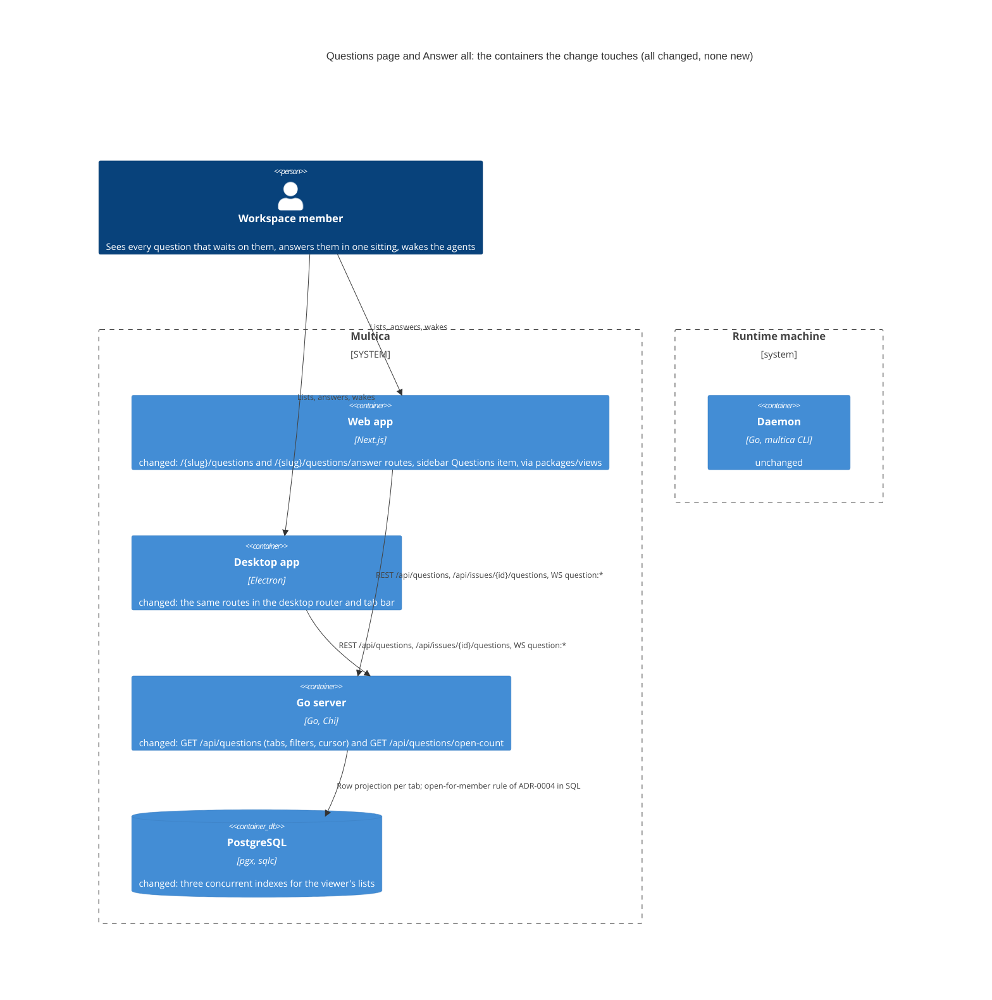
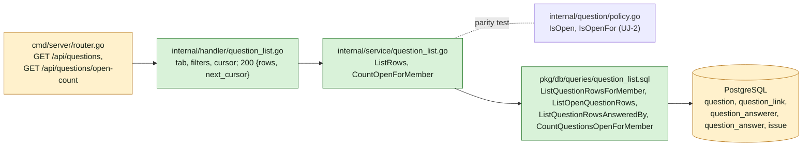
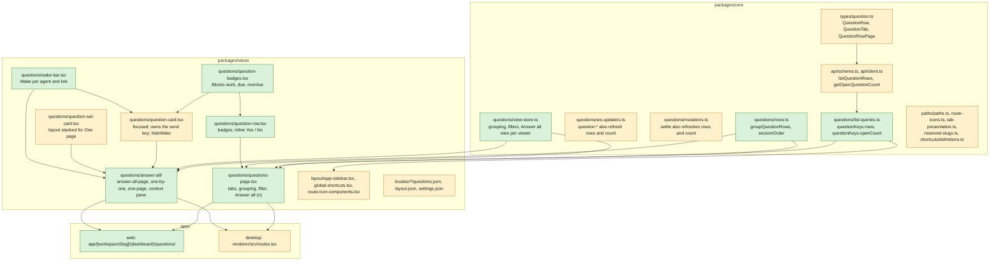
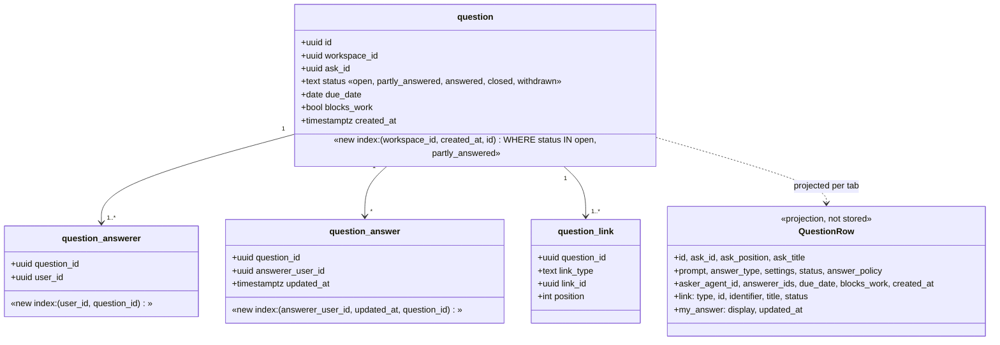

## At a glance

The delta of this change on the living system design, `specs/docs/system-design.md`, as changes `answer-an-agents-question-and-wake-it` (UJ-1) and `agent-asks-several-questions-at-once` (UJ-2) leave it. Every container it touches already exists and already holds questions; the change adds no container, no table and no column, only three indexes.



Go server component map, delta:



Web and desktop component map, delta:



Models: no table or column changes. The lists read UJ-1's and UJ-2's tables through a row projection; three indexes serve them.



Journey sequence and data flow:

```mermaid
sequenceDiagram
  actor B as Brian
  participant UI as Web or desktop
  participant S as Go server
  participant DB as PostgreSQL
  participant P as Pieter (agent)
  UI->>S: GET /api/questions/open-count
  S->>DB: CountQuestionsOpenForMember (ADR-0004 rule)
  S-->>UI: {count: 6}
  Note over UI: sidebar Questions 6
  B->>UI: open Questions, For me
  UI->>S: GET /api/questions?tab=for_me
  S->>DB: ListQuestionRowsForMember + issue refs
  S-->>UI: {rows[6], next_cursor null}
  Note over UI: 4 groups by issue
  B->>UI: Y on a Yes / No row
  UI->>S: POST /api/questions/{id}/answer {value: {choice: yes}} (UJ-1)
  S-->>UI: WS question:updated
  UI->>S: refetch rows and open-count
  Note over UI: row leaves For me, sidebar 5
  B->>UI: Answer all
  Note over UI: session = ids of For me in group order; view = last used (One page)
  UI->>S: GET /api/issues/{id}/questions per issue of the session (UJ-1, cached)
  B->>UI: answer, ⌘↵ per question
  UI->>S: POST /api/questions/{id}/answer
  S-->>UI: Question with unseen_answer_count, wake_available
  P->>S: multica question answers (readable at once)
  Note over UI: card folds; after WORK-398's cards: Wake Pieter
  B->>UI: Wake Pieter
  UI->>S: POST /api/questions/{id}/wake (UJ-1)
  S->>DB: agent_task_queue row, evidence question_wake
```

| Kind | Name | Change | Path |
|---|---|---|---|
| Migration | `CONCURRENTLY` index `question_answerer (user_id, question_id)` | new | `server/migrations/572_question_answerer_user_index.up.sql`, `.down.sql` |
| Migration | `CONCURRENTLY` partial index `question (workspace_id, created_at, id)` on open statuses | new | `server/migrations/573_question_open_workspace_index.up.sql`, `.down.sql` |
| Migration | `CONCURRENTLY` index `question_answer (answerer_user_id, updated_at, question_id)` | new | `server/migrations/574_question_answer_answerer_time_index.up.sql`, `.down.sql` |
| Queries | Row lists per tab with filters and cursor; open-for-member count | new | `server/pkg/db/queries/question_list.sql` |
| Service | `ListRows`, `CountOpenForMember` | new | `server/internal/service/question_list.go` |
| Handler | `ListQuestions`, `CountOpenQuestions` | new | `server/internal/handler/question_list.go` |
| Router | `GET /api/questions`, `GET /api/questions/open-count` | changed | `server/cmd/server/router.go` |
| Reserved slug | `questions` as a workspace route segment | changed | `server/internal/handler/reserved_slugs.json`, `packages/core/paths/reserved-slugs.ts` |
| Type and schema | `QuestionRow`, `QuestionTab`, `QuestionRowPage`; list and count calls | changed | `packages/core/types/question.ts`, `packages/core/api/schema.ts`, `packages/core/api/client.ts` |
| Feature | Row and count queries, grouping, session order, view store | new | `packages/core/questions/list-queries.ts`, `rows.ts`, `view-store.ts` |
| Feature | WS events and mutations also refresh rows and count | changed | `packages/core/questions/ws-updaters.ts`, `mutations.ts` |
| Navigation | `questions()`, `answerAll()`, page key, tab title, `goQuestions` shortcut | changed | `packages/core/paths/`, `packages/core/shortcuts/definitions.ts` |
| Screen | Questions page: tabs, grouping, filter, rows, Answer all (n) | new | `packages/views/questions/questions-page.tsx` |
| Component | Question row with inline Yes / No | new | `packages/views/questions/question-row.tsx` |
| Screen | Answer all: One by one and One page, context pane, progress | new | `packages/views/questions/answer-all/` |
| Component | Wake bar per agent and link | new | `packages/views/questions/wake-bar.tsx` |
| Component | Blocks work, due and overdue badges shared by card and row | new | `packages/views/questions/question-badges.tsx` |
| Component | Question card: `focused` owns the send key; `hideWake` replaces `inSet` | changed | `packages/views/questions/question-card.tsx` |
| Component | Question set card: `layout="stacked"` | changed | `packages/views/questions/question-set-card.tsx` |
| Screen | Sidebar Questions item with count; go-to shortcut | changed | `packages/views/layout/app-sidebar.tsx`, `global-shortcuts.tsx`, `route-icon-components.tsx` |
| Routes | Questions and Answer all on web and desktop | new | `apps/web/app/[workspaceSlug]/(dashboard)/questions/`, `apps/desktop/src/renderer/src/routes.tsx` |
| Copy | Page, row, Answer all, Wake bar, nav and shortcut keys, five languages | changed | `packages/views/locales/` |
| Design | Library components of screens 4, 5 and 8 | changed | `designs/systems/multica.lib.pen` |
| Design | Screens 4 and 5 without Asked by me and On my work, view switch; new screen 8 One page | changed | `designs/screens/issue-questions.pen`, `designs/screens/issue-questions.md` |
| Prototype | Data-flow path and screens 4, 5 and 8 of this journey | changed | `prototypes/web/issue-questions/` |
| ADR | Questions are listed per viewer through one server-side row list | new | `adr/0006-questions-are-listed-per-viewer-through-one-row-list.md` |

## Context

Journey UJ-3 of [PRD: Questions in Multica](anytype://object?objectId=bafyreiaviofipcl3ymgld2skld4ij6hlarsm2ra55ygufsepgk5laxjf34), journey issue [DAS-433](https://linear.app/skuddy/issue/DAS-433/uj-3-answer-every-open-question-in-one-sitting). It builds on UJ-1 ([DAS-432](https://linear.app/skuddy/issue/DAS-432/uj-1-answer-an-agents-question-and-wake-it), branch `das-432-uj-1-answer-an-agents-question-and-wake-it`: five question tables, the API, the card, Wake, ADR-0002 and ADR-0003) and UJ-2 ([DAS-434](https://linear.app/skuddy/issue/DAS-434/uj-2-an-agent-asks-several-questions-at-once), branch `das-434-uj-2-an-agent-asks-several-questions-at-once`: sets, answer policy, `partly_answered`, the set card, ADR-0004). Their requirements hold unchanged. Both are built and merged first; this change's code and tasks assume theirs exist.

**Journey steps.** Brian's answer on WORK-378 (2026-10-12, relayed by Skuddy) skips J1, J4 and J10 for every Questions journey, recorded on this journey as the Requests `Skip: J1`, `Skip: J4` and `Skip: J10`. As in UJ-1 and UJ-2, the investigation agrees: J1 Project structure has nothing to change (every new file sits in an existing Go package, workspace package or app route folder), nor J4 Design system (screens 4, 5 and 8 use no new token or colour; their new parts are components, built at J5), nor J10 Agent tooling for UI (only people answer, so agents get no tooling for the Questions page or Answer all; J8 adds no CLI either, since agents read their answers with UJ-1's `multica question answers`). Steps with work: J2 Data models, J3 Data-flow prototype, J5 Components, J6 Screens, J7 Live prototype, J8 Backend and agent tooling, J9 Frontend, J11 Acceptance test and archive.

**Design sources.** Screens 4 "Questions page" and 5 "Focus mode" of [appboypov/multica#6](https://github.com/appboypov/multica/pull/6) (`designs/screens/issue-questions.md` "Where questions live" 4 and 5, "The Questions page"; exports `4-questions-page.png`, `5-focus-mode.png`) and `QuestionsPage`, `AnswerAll`, `FocusMode` and `OnePage` in `prototypes/web/issue-questions/src/components/generated/pages.tsx` of [appboypov/multica#8](https://github.com/appboypov/multica/pull/8) (export `8-answer-all-one-page.png`). Brian's answers supersede three parts, so J6 and J7 change them: the tab **Asked by me** goes (only agents ask); the tab **On my work** waits for UJ-4; the filter "project" becomes "link". The `.pen` file has no One page screen and no view switch in focus mode, which came with Brian's WORK-366 comment "show multiple questions on one page"; J6 draws screen 8 and the switch, from the prototype.

**Code map.** What the build reuses beyond UJ-1's and UJ-2's code maps. Paths are under `server/` unless they start with `packages/` or `apps/`.

- Sidebar: `packages/views/layout/app-sidebar.tsx` `personalNav` (~147: `inbox`, `myIssues`, `chat`) rendered at ~776-805; the Inbox count is `useInboxUnreadCount(wsId)` (~463) shown with `CappedNumberFlow` from `@multica/ui/components/ui/number-flow` (~790). Icons come from the destination path: `packages/core/paths/route-icons.ts` `WORKSPACE_PAGES` (~89 `inbox: { segment, icon, navKey }`) and `packages/views/layout/route-icon-components.tsx`. Label keys `layout.nav.*` in `packages/views/locales/*/layout.json`.
- Navigation: `packages/core/paths/paths.ts` `workspaceScoped` (~56 `inbox()`, ~62 `myIssues()`); `packages/core/paths/consistency.test.ts` pairs page keys with segments; `packages/core/paths/tab-presentation.ts` gives desktop tab titles (~209 `case "inbox"`). Shortcuts: `packages/core/shortcuts/definitions.ts` `ShortcutActionId` and `SHORTCUT_ACTIONS` (`goInbox` with `defaultShortcut: null`, `send` = primary+Enter), destinations in `packages/views/layout/global-shortcuts.tsx` (~59), labels in `locales/*/settings.json` `shortcuts.actions.*`; `isEditableShortcutTarget`, `isPortalLayerShortcutTarget`, `shortcutMatchesEvent`, `useShortcut("send")` (as `packages/views/modals/run-confirm.tsx` ~100 uses it).
- Routes: web `apps/web/app/[workspaceSlug]/(dashboard)/inbox/page.tsx` re-exports `InboxPage` from `@multica/views/inbox`; desktop `apps/desktop/src/renderer/src/routes.tsx` children of `:workspaceSlug` with `handle: { title }` (~161 `my-issues`, ~223 `inbox`). Reserved segments: `server/internal/handler/reserved_slugs.json` "Workspace route segments" (`inbox`, `my-issues`, ...), regenerated by `pnpm generate:reserved-slugs` into `packages/core/paths/reserved-slugs.ts`. Views exports per folder in `packages/views/package.json` (`"./inbox": "./inbox/index.ts"`).
- List page patterns: `packages/views/inbox/components/inbox-list.tsx` (focusable rows `tabIndex={0}`, ArrowUp/ArrowDown in `handleKeyDown`); filter menu `packages/views/inbox/components/inbox-filter-menu.tsx` over the in-memory per-workspace store `packages/core/inbox/filter-store.ts`; tabs `packages/ui/components/ui/tabs.tsx`; grouping choice as `DropdownMenuRadioGroup` (issues header ~2446). Persisted per-user preference: `packages/core/issues/stores/issue-opening-store.ts` (zustand `persist`, `defaultStorage`, not workspace-aware).
- Paged filtered list on the server: `internal/handler/inbox_archive.go` `ListArchivedInboxPage` (~91): filter params, a base64 JSON cursor `{scope, time, id}` tied to the filters (`archivedInboxScope` ~83), `next_cursor`; sqlc arrays and `sqlc.narg` filters in `pkg/db/queries/inbox_archive.sql`; tests in `internal/handler/inbox_archive_test.go`. Infinite query on the client: `archivedInboxPagesOptions` in `packages/core/inbox/queries.ts`.
- Issue references: `pkg/db/queries/issue.sql` `ListIssueRefsInWorkspace` (id, number, title, status for a set of ids); identifiers from `service.IssueIdentifier(prefix, number)` (`internal/service/task.go` ~7736).
- Dates: `packages/core/issues/date.ts` `isPastDateOnly`, `todayDateOnly`; actor display `packages/views/common/actor-avatar.tsx`.
- From UJ-1 and UJ-2, used as they are: `GET /api/issues/{id}/questions`, `POST /api/questions/{id}/answer`, `POST /api/questions/{id}/wake`, the `Question` fields `unseen_answer_count` and `wake_available`, `questionKeys.byIssue` and `questionKeys.detail`, `packages/views/questions/answer-controls/`, `IssueDetail`'s `highlightQuestionId`, `server/internal/question/policy.go` `IsOpen`, `IsOpenFor`, `packages/core/questions/cards.ts` `groupQuestionCards`, `isOpenFor`.
- Must not change: UJ-1's and UJ-2's tables, endpoints and response shapes, the Wake path and its guard (ADR-0003), the open rules (ADR-0004), the inbox, the mobile app.

## Goals / Non-Goals

**Goals:**

- A sidebar item **Questions** under Inbox counts the questions open for the viewer and drops as they are answered.
- A Questions page lists For me, All open and Answered, groups by link, due date or asker, filters on answer type, asker, answerer, link and blocking, and answers Yes / No rows in place.
- **Answer all** answers the viewer's open questions in One by one or One page, sends each answer on its own, keeps what was sent when left, remembers the view per viewer, and offers Wake per agent and link.

**Always:**

- Which questions a tab holds and every count are decided by the server with ADR-0004's rule, through the one row list of ADR-0006; the client only groups, orders and displays.
- Answers and Wakes go through UJ-1's endpoints and mutations; Answer all shows UJ-1's and UJ-2's cards, so the card behaves the same everywhere.
- New list and count responses go through zod schemas and `parseWithFallback`, with malformed-response tests.
- The Questions page and Answer all are wired into both the web routes and the desktop router.

**Never:**

- No new table or column, no foreign keys or cascades; indexes only, each `CONCURRENTLY` in its own migration file.
- No answer starts a run; only **Wake** does (ADR-0003).
- No tab for questions asked by the viewer, no On my work tab (UJ-4), no mobile change, no new design token or colour, no CLI change.

**Non-Goals:** the On my work tab, questions on parents and the indirect audience (UJ-4); the Agent questions setting (UJ-5); changing what UJ-1's card, UJ-2's set card or the inbox do outside Answer all.

## Decisions

### 1. One row list per viewer, scoped by tab (ADR-0006)

`GET /api/questions` lists question rows for the viewer, in the `RequireWorkspaceMember` group beside UJ-1's routes:

| Param | Meaning |
|---|---|
| `tab` | `for_me` (default), `all_open`, `answered`; anything else is 400 |
| `answer_type`, `asker_id`, `answerer_id`, `link_id` | repeatable; each id through `parseUUIDOrBadRequest`, each type one of UJ-1's 12 keys |
| `blocks_work` | `true` keeps only questions that block work |
| `cursor`, `limit` | base64 JSON `{scope, time, id}` as `inbox_archive.go` makes it, tied to tab and filters; `limit` 1-100, default 50 |

It returns `200 {rows: QuestionRow[], next_cursor: string | null}`. A `QuestionRow` is a projection, not UJ-1's `Question`: `id`, `ask_id`, `ask_position`, `ask_title`, `prompt`, `answer_type`, `settings`, `status`, `answer_policy`, `asker_agent_id`, `answerer_ids`, `due_date`, `blocks_work`, `created_at`, `link` `{type, id, identifier, title, status}` and `my_answer` `{display, updated_at}` or null. `link` is the question's issue link, the one UJ-1 writes at position 0 where it was asked, resolved in one `ListIssueRefsInWorkspace` read per page; `identifier` comes from `service.IssueIdentifier`. `my_answer.display` is UJ-1's `Display(type, settings, value)`.

| Tab | Holds | Order |
|---|---|---|
| `for_me` | open for the viewer (ADR-0004: status `open` or `partly_answered`, the viewer is a current answerer, the viewer has no answer) | `created_at`, `id` ascending |
| `all_open` | open (status `open` or `partly_answered`) in the workspace | `created_at`, `id` ascending |
| `answered` | the viewer has an answer row, whatever the status | the answer's `updated_at`, `question_id` descending |

`GET /api/questions/open-count` returns `200 {count}`: the `for_me` count without filters, from `CountQuestionsOpenForMember`. Chi matches the static segment before UJ-1's `/{id}`.

The SQL repeats ADR-0004's rule; `internal/service/question_list_test.go` runs the same fixtures through `question.IsOpenFor` and the list, so the two cannot drift. UJ-4 adds its tab and link types to this endpoint, as ADR-0006 says.

### 2. Client queries and live updates

`packages/core/questions/list-queries.ts` holds `questionKeys.rows(wsId, tab, filters)` as an infinite query over `next_cursor` and `questionKeys.openCount(wsId)`; both sit under `questionKeys.all(wsId)`. UJ-1's `ws-updaters.ts` handlers for `question:created` and `question:updated` also invalidate `questionKeys.rowsAll(wsId)` and `questionKeys.openCount(wsId)`, and UJ-1's answer, edit, ask-back and reassign mutations do the same on settle. Nothing is patched optimistically: a row leaves For me when the refetch says so, with the row's pending state while the answer is in flight.

### 3. The Questions page

`QuestionsPage` (`packages/views/questions/questions-page.tsx`) is screen 4 without Asked by me and On my work:

- **Tabs** For me, All open, Answered in `Tabs`, kept in the URL as `?tab=` so Back and links work. For me and All open show their counts from the loaded rows; Answered shows none.
- **Header:** filter menu (answer type, asker, answerer, link, blocking) on the in-memory per-workspace `useQuestionsViewStore` filters, as the inbox filter store keeps them; grouping by link (default), due date or asker in a `DropdownMenuRadioGroup`, persisted; **Answer all (n)** with `n` the For me count, disabled at 0.
- **Groups:** `groupQuestionRows(rows, grouping)` in `packages/core/questions/rows.ts`: by link in first-seen order, by due date as Overdue, Today, This week, Later, No date (`isPastDateOnly`, `todayDateOnly`), by asker per agent. A group heading shows the issue identifier, title and status for link groups.
- **Rows** (`QuestionListRow` in `question-row.tsx`, 36 px, `px-4`): type glyph, prompt (truncated), `question-badges.tsx` Blocks work and "any one of 2" or "each of 3" when there is more than one answerer, asker avatar, due in `text-caption` (warning on the due day, destructive and an Overdue badge past it while open), age otherwise. Answered rows read "prompt → answer · when" from `my_answer`.
- **Keys:** rows are focusable; ArrowDown/ArrowUp and `J`/`K` move the focus, `Enter` (or a click) opens the question on its issue the way UJ-1's inbox **Open on WORK-412** does (`paths.issueDetail(id)` with the question highlighted through `highlightQuestionId`), and on a Yes / No row open for the viewer `Y` and `N` answer it, as hovering shows Yes and No buttons. Keys are ignored in editable targets (`isEditableShortcutTarget`).
- **Yes / No with "why on No":** UJ-1's settings may require a note on No; then `N` or the No button opens a note popover on the row whose Send (or `⌘↵`) sends No with the note, and `Esc` closes it without sending.
- **Empty For me:** "No questions waiting for you", with the newest Answered row below it as proof the page works.

Screen 4's live counts per tab (For me, All open) come from the same row queries; no extra count endpoint is added for them.

### 4. Answer all: one session, two views

`AnswerAllPage` (`packages/views/questions/answer-all/answer-all-page.tsx`, route `/{slug}/questions/answer`) opens on Answer all:

1. It loads every For me page, then freezes the **session**: the question ids in `sessionOrder(rows)` order (link groups in first-seen order; a set's questions together by `ask_position`) and their issue ids. The session is component state for the life of the page: answered questions stay in it, folded, so the flow does not jump as rows leave For me.
2. Each issue of the session reads UJ-1's `questionKeys.byIssue(wsId, issueId)`, already live through UJ-1's WS updaters and shared with the issue page. Its cards are UJ-1's `Question` objects, so they carry the full card data, `unseen_answer_count` and `wake_available`.
3. The header has **← Questions**, the title, the view switch One by one / One page (`Tabs`), progress segments per question (answered, current, skipped, open), "N answered · M skipped" and **Leave** (`Esc`).
4. Leaving keeps every sent answer (each was sent on its own) and drops unsent drafts; the unanswered questions are still open under For me.

The view switch writes `useQuestionsViewStore.answerAllView[userId]` (`"one"` or `"page"`, default `"one"`), persisted with `defaultStorage` like `issue-opening-store.ts`, so Answer all opens in the view the viewer used last on that device, and two people on one browser keep their own.

### 5. One by one

`OneByOne` (`answer-all/one-by-one.tsx`), screen 5: the current question as UJ-1's `QuestionCard` with `focused` and `hideWake`; a question of a set shows the set's title and "2 of 3" above the card. Beside it, `AnswerAllContext` shows the issue's identifier, status and title (opens the issue), its description's first paragraph read-only, who asked it and when, and the session's **Up next** list (click to jump). Progress reads "2 of 6", counted per question.

Keys: `J` next, `K` previous, `S` skip (the question stays open and is marked skipped), `Esc` leave (not when the target is in a portal layer, `isPortalLayerShortcutTarget`), `⌘↵` (the `send` shortcut) sends, through the focused card. After a send the flow moves to the next question that is still open for the viewer, wrapping to skipped ones; when none is left it shows "All 6 answered" with **Back to Questions**.

### 6. One page

`OnePage` (`answer-all/one-page.tsx`), screen 8: every session question on one scrolling page, grouped by issue with the group heading of decision 3. Single questions render `QuestionCard`; a set renders UJ-2's `QuestionSetCard` with `layout="stacked"`: every question of the set in order, each with its own answer control and Send, no tabs, no footer Wake. Each card is answerable where it stands and folds when sent.

Keys: `J`/`K` move the focus between questions and scroll it into view (`data-question-id`); `⌘↵` sends the focused one. The focused card owns the send key (decision 8), so a typed Text answer sends with `⌘↵` from inside its field.

### 7. Wake within Answer all

`WakeBar` (`packages/views/questions/wake-bar.tsx`) shows, per agent and issue with `wake_available`, "Pieter has 1 answer from you on WORK-412" and **Wake Pieter**, which calls UJ-1's wake mutation on one of that agent's questions on that issue; after a Wake it reads "Pieter was woken with your answers" until the next answer. The numbers are UJ-1's `unseen_answer_count`, so the count, the guard and the claim stay one query (ADR-0003).

- **One by one:** under the card, one bar per agent and issue of the session that has `wake_available`, the current card's issue first. A Wake therefore does not disappear when Send moves the flow to another issue, and the done state shows the same bars.
- **One page:** after the last card of each issue group, one bar per agent with `wake_available` on that issue.

UJ-1's `QuestionCard` renders the same `WakeBar` for its own Wake, so the bar looks and behaves the same on the issue page; UJ-2's `inSet` prop becomes `hideWake`, used by the set card and by Answer all.

### 8. The card owns the send key when focused

`QuestionCard` gets `focused?: boolean`. While focused it handles the `send` shortcut itself and sends its current draft when its own Send is enabled, the same rule its button follows (`validate.ts`). One by one and One page only decide which card is focused; nothing outside the card reads a draft.

### 9. Routes and navigation

`paths.workspace(slug).questions()` is `/{slug}/questions` (tab in `?tab=`) and `.answerAll()` is `/{slug}/questions/answer`. `WORKSPACE_PAGES.questions` is `{ segment: "questions", icon: "CircleHelp", navKey: "questions" }`; `personalNav` puts it after `inbox`, with `useQuestionsOpenCount(wsId)` in `CappedNumberFlow` as the Inbox item does. Web adds `app/[workspaceSlug]/(dashboard)/questions/page.tsx` and `questions/answer/page.tsx`; desktop adds `questions` ("Questions") and `questions/answer` ("Answer all") to `routes.tsx`, and `tab-presentation.ts` gives both the Questions icon. `questions` joins the reserved workspace route segments. `goQuestions` (no default chord) joins the navigation shortcuts, as every Personal item has one.

## Risks / Trade-offs

- [For me and All open are paged like Answered] -> Answer all loads every For me page before it freezes the session; one person's open questions are few, so this is one request in practice. Grouping on the page runs over loaded rows, so a link group can grow when the next page loads.
- [Answer all reads one `byIssue` query per issue of the session] -> a session over many issues makes as many requests; they are cached with the issue page and live already, and the alternative (a second full-question list) would duplicate UJ-1's aggregate read.
- [The Wake bar copy says "from you"] -> `unseen_answer_count` counts every member's unseen answers on that issue, so with two answerers the number can include someone else's answer. It is the copy of the spec; the count is right, the wording is a simplification.
- [The Answer all view is remembered per viewer on the device] -> it lives in local storage keyed by user id; on another device Answer all starts in One by one once, then remembers there too. A server preference would need a table for one value.
- [Every question event refetches the viewer's rows and count] -> events are workspace-wide; the lists are small and the refetch is one request each. The alternative, per-viewer events, would change UJ-1's event contract.
- [Migration and ADR numbers collide with UJ-1 to UJ-5, all designed at the same time, and `main` already holds `564` and `565`] -> each journey takes the next free numbers when it merges; nothing refers to them by number except this change's files.
- [A workspace slug `questions` could exist] -> reserving the segment blocks new ones; an existing workspace named `questions` would shadow nothing because its own pages are `/{slug}/...`, but `/questions/...` reads ambiguously, as the reserved list's description says.

## Migration Plan

Three additive concurrent indexes, `700` to `702`, one per file, inside this change's range 700 to 709; no data changes and no backfill. Rollback runs the `.down.sql` files (`DROP INDEX CONCURRENTLY IF EXISTS`) in reverse order. `make local-release` deploys. Installed desktop clients that do not know the new routes keep working: the new endpoints are only called by the new pages.

## Open Questions

None. Brian skipped J1, J4 and J10 (see Context "Journey steps").
