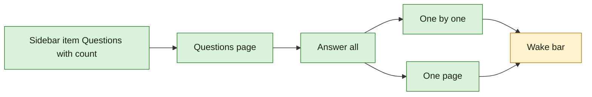

## At a glance

```mermaid
sequenceDiagram
  actor B as Brian
  participant M as Multica (web or desktop)
  participant A as Agents with unseen answers
  M-->>B: sidebar Questions shows 6
  B->>M: open the Questions page, For me
  M-->>B: 6 open questions over four issues, grouped by issue
  B->>M: answer two Yes / No rows inline (Y, N)
  B->>M: Answer all
  alt One by one
    M-->>B: one question at a time, its issue beside it, "2 of 6"
  else One page
    M-->>B: every open question on one page, grouped by issue, sets expanded
  end
  loop each question
    B->>M: answer and send
    M-->>A: answer readable at once
  end
  M-->>B: Wake offered per agent with unseen answers
  B->>M: Wake Pieter
  M->>A: Pieter's new run with his answers
  Note over B,M: leaving halfway keeps every sent answer; Answer all reopens in the view used last
```



| Kind | Name | Change | Path |
|---|---|---|---|
| Screen | App sidebar: Questions item with count | changed | `packages/views/layout/app-sidebar.tsx` |
| Screen | Questions page: tabs, grouping, filter, inline Yes / No | new | `packages/views/questions/` |
| Screen | Answer all: One by one and One page | new | `packages/views/questions/` |
| Routes | Questions page on web and desktop | new | `apps/web/`, `apps/desktop/src/renderer/src/` |
| Preference | Answer all's last view per viewer | new | `packages/core/` |

## Why

Brian has questions spread over several issues and no way to see them together. One place for every question that waits on him, and a way to answer them all in one sitting, turns a morning of hunting through issues into minutes.

It is UJ-3 of [PRD: Questions in Multica](anytype://object?objectId=bafyreiaviofipcl3ymgld2skld4ij6hlarsm2ra55ygufsepgk5laxjf34) and builds on changes `answer-an-agents-question-and-wake-it` (UJ-1) and `agent-asks-several-questions-at-once` (UJ-2).

Success signal: with 6 open questions for Brian over four issues, the sidebar shows 6; from the Questions page Brian answers two Yes / No rows inline and the other four through **Answer all** in One page, wakes each agent with unseen answers there, and the sidebar shows no count.

## What Changes

- A sidebar item **Questions** with the count of open questions for the viewer.
- A Questions page with the tabs **For me**, **All open** and **Answered**, grouped by link, due date or asker, filtered on type, asker, answerer, link and blocking; Yes / No rows answer inline.
- **Answer all** answers the viewer's open questions in **One by one** or **One page**, switched in its header and remembered per viewer; each answer is sent on its own; the keyboard moves and sends.
- **Wake** shows under the card in One by one and after a link's cards in One page.

## Capabilities

### New Capabilities

- `questions-page`: lets a member see and filter every question that concerns them in one place and answer Yes / No questions there.
- `answer-all`: lets a member answer all their open questions in one flow, one at a time or on one page.
- `agent-wake`: (adds to it) lets a member wake agents from within Answer all.

## Impact

- Web and desktop: sidebar, new Questions route in both apps, the Questions page and Answer all views.
- Core: queries for the viewer's questions; the per-viewer view preference.
- Server: listing questions by viewer, tab, grouping and filter.

## Constraints

- Builds on changes `answer-an-agents-question-and-wake-it` and `agent-asks-several-questions-at-once`; their requirements hold unchanged.
- The page is wired into both the web routes and the desktop router, as AGENTS.md requires for shared features.
- No tab for questions asked by the viewer: only agents ask.
- No answer sent from the page or Answer all starts a run; only Wake does.
- Web and desktop only; no new design token or colour.

## Non-goals

- The **On my work** tab and questions on parents: change `question-reaches-the-owner-of-the-work-above` (UJ-4).
- The **Asked by me** tab of the design: superseded by Brian's answer that only agents ask.

## Sources

- [PRD: Questions in Multica](anytype://object?objectId=bafyreiaviofipcl3ymgld2skld4ij6hlarsm2ra55ygufsepgk5laxjf34): UJ-3; FR-17 (without On my work), FR-18, FR-20 (Wake in Answer all).
- Design and UX spec: [appboypov/multica#6](https://github.com/appboypov/multica/pull/6), `designs/screens/issue-questions.md` "Where questions live" 5 and 6: screens 4 (Questions page), 5 (focus mode), 8 (answer all on one page); keys `J`, `K`, `S`, `Esc`, `⌘↵`.
- Prototype: [appboypov/multica#8](https://github.com/appboypov/multica/pull/8), `prototypes/web/issue-questions/`.
- Brian's answers: the WORK-366 comments ("show multiple questions on one page") and [Plannotator Review b8b3060eec0c8d52](https://ctas.de-appspecialist.nl/plannotator/session/b8b3060eec0c8d52/).
