## At a glance

```mermaid
flowchart LR
  classDef work fill:#d9f2d9,stroke:#2e7d32,color:#172117
  classDef skip fill:#eeeeee,stroke:#9e9e9e,color:#424242
  P5[P5 Technical design] --> J1
  J1[J1 Project structure<br/>Skip: J1]:::skip --> J2
  J2[J2 Data models<br/>groups 1-3]:::work --> J3
  J3[J3 Data-flow prototype<br/>group 4]:::work --> J4
  J4[J4 Design system<br/>Skip: J4]:::skip --> J5
  J5[J5 Components<br/>group 5]:::work --> J6
  J6[J6 Screens<br/>group 6]:::work --> J7
  J7[J7 Live prototype<br/>group 7]:::work --> J8
  J8[J8 Backend and agent tooling<br/>groups 8-12]:::work --> J9
  J9[J9 Frontend<br/>groups 13-16]:::work --> J10
  J10[J10 Agent tooling for UI<br/>Skip: J10]:::skip --> J11
  J11[J11 Acceptance test and archive<br/>group 17]:::work
```

| Step | Groups | Builder |
|---|---|---|
| J1 Project structure | none: `Skip: J1` | — |
| J2 Data models | 1 model change, 2 DTOs, 3 action names | `madspec-model-builder`, `madspec-dto-builder` |
| J3 Data-flow prototype | 4 | `madspec-prototype-builder` |
| J4 Design system | none: `Skip: J4` | — |
| J5 Components | 5 | `madspec-design-system-designer` |
| J6 Screens | 6 | `madspec-screen-designer` |
| J7 Live prototype | 7 | `madspec-prototype-builder` |
| J8 Backend and agent tooling | 8 rules, 9 services, 10 endpoints and inbox, 11 job, 12 CLI command | `madspec-rules-builder`, `madspec-service-builder`, `madspec-api-builder`, `madspec-function-builder`, `madspec-command-builder` |
| J9 Frontend | 13 flow, 14 new components, 15 changed component, 16 screens | `madspec-api-builder`, `madspec-component-builder`, `madspec-view-builder` |
| J10 Agent tooling for UI | none: `Skip: J10` | — |
| J11 Acceptance test and archive | 17 | Sarkout |

Every group builds on UJ-1's code (change `answer-an-agents-question-and-wake-it`), merged first; paths it names exist once UJ-1's J2 to J9 are built.

## 1. J2 Data models: model change

- [x] 1.1 `server/migrations/575_question_ask.up.sql`, `.down.sql` -- add `question.ask_id uuid`, `ask_position int`, `ask_title text`, `answer_policy text NOT NULL DEFAULT 'any_one' CHECK (answer_policy IN ('any_one', 'each'))`; backfill `ask_id = id, ask_position = 0`; set `ask_id` and `ask_position` `NOT NULL`; replace the status `CHECK` with one that adds `partly_answered`; the down migration refuses while a question is `partly_answered`, then reverses -- design.md decisions 1 and 3, no foreign keys (AGENTS.md, ADR-0004).
- [x] 1.2 `server/migrations/576_question_ask_index.up.sql`, `.down.sql` -- `CREATE INDEX CONCURRENTLY` on `question (ask_id, ask_position)` -- loads a set's questions in order; one concurrent index per file (AGENTS.md).
- [x] 1.3 `server/pkg/db/queries/question.sql` -- `CreateQuestion` takes the four new columns; add `ListQuestionsByAsk` (workspace-filtered, by `ask_position`) and `ListCurrentAnswers` (the answers of the question's current answerers, joined on `question_answerer`); the overdue sweep returns `ask_id`; the status update takes `partly_answered` -- the reads the policy rule and the per-ask inbox need.
- [x] 1.4 `server/pkg/db/generated/` -- run `make sqlc` and commit the output -- generated code stays in step with the queries.
- [x] 1.5 `server/migrations/577_question_overdue_index_v2.up.sql`, `.down.sql` and `578_drop_question_overdue_index.up.sql`, `.down.sql` -- `CREATE INDEX CONCURRENTLY` on `question (due_date) WHERE status IN ('open', 'partly_answered') AND overdue_notified_at IS NULL`, then drop UJ-1's open-only `idx_question_overdue` -- the overdue sweep reads partly answered questions too; one concurrent index per file (AGENTS.md).

## 2. J2 Data models: DTOs

- [x] 2.1 `packages/core/types/question.ts` -- add `AnswerPolicy = "any_one" | "each"`, `partly_answered` to `QuestionStatus`, `ask_id`, `ask_position`, `ask_title: string | null`, `answer_policy` to `Question`, and `QuestionAskResult = {ask_id, questions: Question[]}` -- the contract of design.md decision 2.
- [x] 2.2 `packages/core/api/schemas.ts` -- the `Question` schema defaults `ask_id` to the question's `id`, `ask_position` to 0, `ask_title` to null and an absent or unknown `answer_policy` to `any_one`; `partly_answered` is a known status -- a newer client on a UJ-1 server shows each question as its own card (AGENTS.md "API Compatibility").
- [x] 2.3 `packages/core/api/schemas.test.ts` -- malformed-response cases: a question without the ask fields gets `ask_id = id`; an unknown policy falls back to `any_one`; `partly_answered` parses -- AGENTS.md requires it for a changed response.

## 3. J2 Data models: action names

- [x] 3.1 `server/pkg/protocol/events.go` -- the `question:created` payload and the `question:updated` payload with reason `overdue` gain `ask_id` and `question_ids`; `question_id` stays the first question -- one event per ask (design.md decision 5).
- [x] 3.2 `server/internal/service/question_actions.go` -- constants for the inbox `details` keys `ask_id` and `question_count` and the answer policies `any_one`, `each` -- one spelling for the service, the listener, the job and the tests.

## 4. J3 Data-flow prototype: data-flow prototype

- [ ] 4.1 `prototypes/web/issue-questions/data-flow/` -- add this journey's path to UJ-1's data-flow prototype: ask a set of three of squad Finance under Any one, Brian answers the first, the asker reads it, the card shows "1 of 3 answered", Wake from the footer, the woken run's `[ANSWERS]` input; and an Each question with two of three answers; per step its input, output, store and agent action, as design.md "Journey sequence and data flow" draws them -- J3's contract in `madspec-prototyping`.

## 5. J5 Components: component design

- [ ] 5.1 `designs/systems/multica.lib.pen` -- bring the library components screen 6 uses from appboypov/multica#6 that UJ-1's J5 did not bring: question tab with check or number, folded question row with **Change**, collapsed question row with type, set footer, answerer chip (answer or waiting) and the "N of M answered" pill, built from the library's existing tokens only -- J6 builds screens only from library components.
- [ ] 5.2 `designs/systems/exports/` -- one PNG per new or changed component -- J5's contract.

## 6. J6 Screens: screen design

- [ ] 6.1 `designs/screens/issue-questions.pen` -- screen 6 "Answered and question set" from appboypov/multica#6, with the Each question asked by an agent instead of Sarah and without **Remind Eva** and **Close question** -- only agents ask and only the asker closes (design.md Context "Design sources").
- [ ] 6.2 `designs/screens/issue-questions.md` -- screen 6 and the Answer policy wording: under Any one the first answer makes the question answered and only the asker closes it -- the `questions` spec's Answer policy.
- [ ] 6.3 `designs/screens/exports/` -- the PNG of screen 6 -- J6's contract.

## 7. J7 Live prototype: prototype

- [ ] 7.1 `prototypes/web/issue-questions/` -- bring the `SetCard` and `EachCard` part of appboypov/multica#8's clickable prototype, matching group 6's screen 6: an agent asks the Each question, no **Remind**, no member **Close question** -- the live prototype of the journey.
- [ ] 7.2 `prototypes/web/issue-questions/exports/` -- the PNG of the prototype's screen 6 -- J7's contract.

## 8. J8 Backend and agent tooling: rules

- [x] 8.1 `server/internal/question/policy.go` -- `DeriveStatus(policy, answererIDs, answers)` as design.md decision 3's table says (answers by people no longer answerers do not count; `closed` and `withdrawn` are never recomputed), `IsOpen(status)` and `IsOpenFor(question, userID)` -- the one rule of ADR-0004.
- [x] 8.2 `server/internal/question/ask.go` -- `ValidateAsk`: 1 to 20 questions, a 1-200 character title required with several questions and refused with one, a known policy, each question through `ValidateSettings` and the suggested-answer check, every error prefixed with `question N:` -- the refusals of design.md decision 2.
- [x] 8.3 `server/internal/question/policy_test.go`, `ask_test.go` -- table tests: Any one none/one/two answers; Each none/some/all; a reassigned answerer's answer not counted; `IsOpenFor` for an answerer with and without an answer and a non-answerer; 0, 1, 20 and 21 questions; title missing with three and given with one; `question 2:` in a refused suggested answer -- the spec's policy and set scenarios at their canonical layer.

## 9. J8 Backend and agent tooling: services

- [x] 9.1 `server/internal/service/question.go` -- `Ask` takes `AskInput{Title, Questions, AnswererIDs, SquadID, Policy, DueDate, BlocksWork *bool}`: `ValidateAsk`; load the squad with `GetSquadInWorkspace`, refuse it when archived, take its `member` rows that are workspace members and refuse a squad without any; merge with `AnswererIDs` without duplicates; `BlocksWork` nil means true; one transaction writes every question with `ask_id` = the first question's id, its links, answerers and `asked` event with `ask_id`, `answer_policy` and `squad_id`; publish one `question:created` -- design.md decision 2.
- [x] 9.2 `server/internal/service/question.go` -- `Answer`, `EditAnswer`, `Reassign` set the status through `DeriveStatus`; the from-states of design.md decision 3's table, including `Close` and `Withdraw` from `partly_answered`; under Any one a second answerer's answer to an answered question is refused; `Wake` drops its status check and keeps the unseen and active-task guard -- the policy and the set's Wake (ADR-0003, ADR-0004).
- [x] 9.3 `server/internal/service/question_test.go` -- DB tests with `testutil` fixtures: a set of three gets one `ask_id` and positions 0-2; a refused third question writes nothing; squad Finance with three members and two agents gives three answerers, an archived squad and an agents-only squad are refused; Blocks work is on without the field and off with `false`; Each goes open, partly answered, answered and a reassignment recomputes it; Any one refuses a second answer; answering one question of a set leaves the others open; Wake succeeds on an open question of a set whose other question has an unseen answer; no ask or answer queues a task -- the spec's scenarios and the no-run rule.

## 10. J8 Backend and agent tooling: endpoints and inbox

- [x] 10.1 `server/internal/handler/question.go` -- `POST /api/questions` parses design.md decision 2's body (`squad_id` with `parseUUIDOrBadRequest`) and returns 201 `{ask_id, questions}`; the `Question` response gains `ask_id`, `ask_position`, `ask_title`, `answer_policy` -- the API of the CLI and the clients.
- [x] 10.2 `server/cmd/server/notification_listeners.go` -- on `question:created`, one `question_asked` per answerer per ask with `details.question_id` (first), `ask_id` and `question_count`; on `question:updated` reason `overdue`, one `question_overdue` per current answerer per ask -- one inbox item per ask (design.md decision 5).
- [x] 10.3 `server/internal/handler/question_test.go` -- a three-question ask returns 201 with three questions in order; a 21-question ask, a set without a title and an unknown policy are 422; a squad of another workspace is 422; Each answers move the response status to `partly_answered` then `answered` -- the API's refusals and results.
- [x] 10.4 `server/cmd/server/notification_listeners_test.go` -- a set of three asked of three members gives three `question_asked` items, each with `question_count` 3; three overdue questions of one ask give one `question_overdue` per answerer -- the inbox per ask.

## 11. J8 Backend and agent tooling: job

- [x] 11.1 `server/internal/scheduler/jobs_question_overdue.go` -- group the overdue questions by `ask_id`, stamp each, and publish one `question:updated` reason `overdue` per ask with `question_ids` -- one overdue item per ask.
- [x] 11.2 `server/internal/scheduler/jobs_question_overdue_test.go` -- three overdue open questions of one ask publish one event with three ids and are stamped once; a partly answered overdue question is included; an answered one is not -- the overdue boundary with sets.

## 12. J8 Backend and agent tooling: CLI command

- [x] 12.1 `server/cmd/multica/cmd_question.go` -- `ask` gains `--questions-file`, `--title`, `--squad` (resolved with `resolveAssignee` and `assigneeKinds{squad: true}`), `--policy any_one|each`, and `--blocks-work` defaulting to true; `--questions-file` excludes the one-question flags; several questions without `--title` fail before any request; the text output prints the ask id and each question's id and prompt, `--output json` the API response; `--help` shows the file's shape and nothing about when to ask -- design.md decision 6.
- [x] 12.2 `server/cmd/multica/cmd_question_test.go` -- a questions file maps to the request's `questions`; `--questions-file` with `--prompt` fails; three questions without `--title` fail without a request; `--squad Finance` sends the squad id; no `--blocks-work` sends true and `--blocks-work=false` sends false -- the CLI contract.
- [x] 12.3 `apps/docs/content/docs/cli.mdx`, `cli.zh.mdx`, `cli.ja.mdx`, `cli.ko.mdx`, `cli.fr.mdx` -- the new `ask` flags and the questions file -- every documented language lists them.

## 13. J9 Frontend: flow

- [x] 13.1 `packages/core/questions/cards.ts` -- `groupQuestionCards(questions)` (by `ask_id`, ordered by `ask_position`, each card placed by its first question's `created_at`), `isOpen`, `isOpenFor(question, userId)`, `setProgress(questions)` ("answered" or "closed" over those not withdrawn) and `countOpen(questions)`; export from `packages/core/questions/index.ts` -- the client mirror of ADR-0004.
- [ ] 13.2 `packages/core/questions/cards.test.ts` -- grouping of one ask and two asks in creation order; a UJ-1-shaped question alone in its card; Any one answered is open for nobody; Each partly answered is open for the one without an answer; `setProgress` with a withdrawn question; `countOpen` counts a set of three as 3 -- canonical layer for the client logic.

## 14. J9 Frontend: new components

- [x] 14.1 `packages/views/questions/answerer-progress.tsx` -- for an Each question with several answerers: the "2 of 3 answered" pill, a chip per answerer with their answer's display text or "waiting", and the line "Pieter sees each answer as it arrives and closes the question when he has enough." -- the Each card of screen 6, without Remind and Close.
- [x] 14.2 `packages/views/questions/question-set-card.tsx` -- design.md decision 4: header with overline, Blocks work, asker line and title; one tab per question; the active question's `AnswerControl`; folded rows with **Change** until closed; collapsed rows that activate; footer with **Ask back** and **Reassign** for the active question, "N of M answered", **Wake <agent>** while `wake_available`, and **Accept suggestion** or **Send**, which sends and opens the next question open for the viewer; `activeQuestionId` from `highlightQuestionId` -- the set card of screen 6.
- [x] 14.3 `packages/views/locales/{en,zh-Hans,ko,ja,fr}/questions.json` -- set overlines, "N questions", "N of M answered", "waiting", the Each line, tab and row labels, with plural forms -- copy follows the conventions pages.
- [ ] 14.4 `packages/views/questions/question-set-card.test.tsx`, `answerer-progress.test.tsx` -- Send on the first question opens the second and the footer reads "1 of 3 answered"; Wake shows only with `wake_available`; a non-answerer sees no controls; a closed set's folded rows have no **Change**; Each shows "2 of 3 answered" with one waiting chip and the answer control for the member still to answer -- the card's named behaviours.

## 15. J9 Frontend: changed component

- [x] 15.1 `packages/views/questions/question-card.tsx` -- render `AnswererProgress` for an Each question with several answerers; take `inSet` to hide its own Wake; treat `partly_answered` as open for a member who has not answered -- one card shape for single and set questions.

## 16. J9 Frontend: screens

- [x] 16.1 `packages/views/issues/components/comment-runs.ts`, `issue-detail.tsx` -- one timeline row per card from `groupQuestionCards`, a set rendered with `QuestionSetCard`, anchor `question-${first id}`; `highlightQuestionId` and the Questions row's jump resolve a question to its card and open it there; the Questions row reads `countOpen` and "blocks work" when an open question blocks -- the `issue-questions` Question set card requirement.
- [x] 16.2 `packages/views/issues/components/inline-comment-run.tsx`, `task-run-labels.ts`, `packages/views/locales/{en,zh-Hans,ko,ja,fr}/issues.json` -- "ended run #N with 3 questions" by the number of questions the run asked; "Waiting for answer" while one is open, `partly_answered` included -- the run row with sets.
- [x] 16.3 `packages/views/inbox/components/inbox-question-pane.tsx`, `inbox-detail-label.tsx`, `packages/views/locales/{en,zh-Hans,ko,ja,fr}/inbox.json` -- a set's item reads "Pieter asked you 3 questions"; its pane shows the title and each question: inline controls for open Yes / No, Single choice and Approval, **Open on <issue>** with that question active for the others, a folded line for one no longer open for the viewer -- design.md decision 5.
- [ ] 16.4 `packages/views/issues/components/issue-detail.test.tsx`, `inline-comment-run.test.tsx`, `packages/views/inbox/components/inbox-page.test.tsx` -- a set of three shows one card and "3 open · blocks work"; the jump opens the first open question; the run row reads "with 3 questions"; a set's inbox pane answers a Yes / No inline and opens the issue for a Ranking -- the screen scenarios.

## 17. J11 Acceptance test and archive: acceptance test and archive

- [ ] 17.1 `e2e/questions-set.spec.ts` -- the journey's acceptance test through `TestApiClient`: an agent task token asks three questions of squad Finance (three members, two agents) under Any one on WORK-412; the issue shows one card and "3 open · blocks work"; Brian sends one answer; the agent reads it through the API at once; the card shows "1 of 3 answered"; the question is not open for the other members; no task is queued until Brian presses **Wake Pieter** -- DAS-434's acceptance test.
- [x] 17.2 `specs/openspec/changes/agent-asks-several-questions-at-once/` -- run `openspec validate agent-asks-several-questions-at-once --type change --strict`, sync the specs and archive the change -- the journey closes on its J11 pull request.

## Implementation Notes

- J2 builds on UJ-1's open J11 pull request; group 1 edits UJ-1's tables and group 9 UJ-1's service. The ask migrations use 575 to 578 because UJ-1 uses 566 to 571 and the organisation migrations use 572 to 574.
- The ask's request and response change together with `multica question ask` (group 12); no web or desktop code posts questions.
- J8 exposes transactional asks through the service, API and CLI; notifications and overdue sweeps group by ask, and policy transitions count current answerers. Set rendering remains in J9.
- The overdue read includes `partly_answered`; J2's `idx_question_overdue_v2` covers both open states with no overdue notice.
- J8 verification on Crabbox: question rules, service, handler, inbox, overdue and CLI tests pass. A real server/CLI smoke creates three squad questions, reads the first answer immediately, exercises Each, and queues exactly one run only through explicit Wake. Lint and typecheck pass; Go, docs, web, desktop and UI Lab builds pass. The combined frontend build hit exit 137 and was split by application. After restacking on J2, the pure rules pass and the resolved server and scheduler test packages compile. Full-suite verification and browser acceptance belong to Sarkout.

## Plan Change Log

- 2026-10-12: technical design (P5) written from the proposal, the spec deltas, UJ-1's design and ADRs, screen 6 of appboypov/multica#6 and the prototype of appboypov/multica#8; ADR-0004 added; J1, J4 and J10 wait for Brian under design.md Open Questions.
- 2026-10-13: J1, J4 and J10 skipped by Brian's answer on WORK-378 (relayed by Skuddy), recorded as the Requests `Skip: J1`, `Skip: J4` and `Skip: J10` on journey UJ-2; design.md Open Questions resolved.
