## At a glance

```mermaid
flowchart LR
  classDef work fill:#d9f2d9,stroke:#2e7d32,color:#172117
  classDef skip fill:#eeeeee,stroke:#9e9e9e,color:#424242
  P5[P5 Technical design] --> J1
  J1[J1 Project structure<br/>Skip: J1]:::skip --> J2
  J2[J2 Data models<br/>groups 1-2]:::work --> J3
  J3[J3 Data-flow prototype<br/>group 3]:::work --> J4
  J4[J4 Design system<br/>Skip: J4]:::skip --> J5
  J5[J5 Components<br/>group 4]:::work --> J6
  J6[J6 Screens<br/>group 5]:::work --> J7
  J7[J7 Live prototype<br/>group 6]:::work --> J8
  J8[J8 Backend and agent tooling<br/>groups 7-9]:::work --> J9
  J9[J9 Frontend<br/>groups 10-13]:::work --> J10
  J10[J10 Agent tooling for UI<br/>Skip: J10]:::skip --> J11
  J11[J11 Acceptance test and archive<br/>group 14]:::work
```

| Step | Groups | Builder |
|---|---|---|
| J1 Project structure | none: `Skip: J1` | — |
| J2 Data models | 1 model change, 2 DTOs | `madspec-model-builder`, `madspec-dto-builder` |
| J3 Data-flow prototype | 3 | `madspec-prototype-builder` |
| J4 Design system | none: `Skip: J4` | — |
| J5 Components | 4 | `madspec-design-system-designer` |
| J6 Screens | 5 | `madspec-screen-designer` |
| J7 Live prototype | 6 | `madspec-prototype-builder` |
| J8 Backend and agent tooling | 7 queries, 8 services, 9 endpoints | `madspec-model-builder`, `madspec-service-builder`, `madspec-api-builder` |
| J9 Frontend | 10 flow, 11 new components, 12 changed components, 13 screens | `madspec-api-builder`, `madspec-component-builder`, `madspec-view-builder` |
| J10 Agent tooling for UI | none: `Skip: J10` | — |
| J11 Acceptance test and archive | 14 | Sarkout |

Every group builds on UJ-1's and UJ-2's code (changes `answer-an-agents-question-and-wake-it` and `agent-asks-several-questions-at-once`), merged first; paths they name exist once their J2 to J9 are built.

## 1. J2 Data models: model change

- [x] 1.1 `server/migrations/700_question_answerer_user_index.up.sql`, `.down.sql` -- `CREATE INDEX CONCURRENTLY IF NOT EXISTS` on `question_answerer (user_id, question_id)`; down drops it `CONCURRENTLY IF EXISTS` -- the viewer's answerer rows for For me and the count (design.md "Models"); one concurrent index per file (AGENTS.md).
- [x] 1.2 `server/migrations/701_question_open_workspace_index.up.sql`, `.down.sql` -- partial `CREATE INDEX CONCURRENTLY` on `question (workspace_id, created_at, id) WHERE status IN ('open', 'partly_answered')` -- All open in its order with its cursor.
- [x] 1.3 `server/migrations/702_question_answer_answerer_time_index.up.sql`, `.down.sql` -- `CREATE INDEX CONCURRENTLY` on `question_answer (answerer_user_id, updated_at, question_id)` -- Answered newest first with its cursor.

## 2. J2 Data models: DTOs

- [x] 2.1 `packages/core/types/question.ts` -- add `QuestionTab = "for_me" | "all_open" | "answered"`, `QuestionRow` with the fields of design.md decision 1 (`id`, `ask_id`, `ask_position`, `ask_title`, `prompt`, `answer_type`, `settings`, `status`, `answer_policy`, `asker_agent_id`, `answerer_ids`, `due_date`, `blocks_work`, `created_at`, `link {type, id, identifier, title, status}`, `my_answer {display, updated_at} | null`), `QuestionRowPage {rows, next_cursor}` and `QuestionRowFilters` -- the contract of the list.
- [x] 2.2 `packages/core/api/schema.ts` -- zod schemas for `QuestionRow`, `QuestionRowPage` and `{count}` used through `parseWithFallback`: `rows` defaults to `[]`, `next_cursor` to null, `my_answer` to null, an unknown `answer_type` or `status` falls back as UJ-1's `Question` schema does, absent ask fields default as UJ-2's do -- AGENTS.md "API Compatibility".
- [ ] 2.3 `packages/core/api/schema.test.ts` -- malformed-response cases: a page without `rows`, a row without `link.identifier`, an unknown status, a count that is not a number falls back to 0 -- AGENTS.md requires them for a new endpoint.
- [x] 2.4 `server/internal/handler/question_list.go` -- the response structs `QuestionRowResponse`, `QuestionRowPageResponse` and `QuestionOpenCountResponse` with their JSON tags, matching 2.1 field for field -- the Go side of the same contract.

## 3. J3 Data-flow prototype: data-flow prototype

- [ ] 3.1 `prototypes/web/issue-questions/data-flow/` -- add this journey's path to UJ-1's data-flow prototype: the sidebar count from `open-count`, For me rows grouped by issue, a Yes / No answered inline and the row leaving For me, Answer all freezing its session, One by one and One page sending each answer on its own, the Wake bar per agent and issue, leaving after three answers; per step its input, output, store (Query key or view store) and agent action -- J3's contract.

## 4. J5 Components: component design

- [ ] 4.1 `designs/systems/multica.lib.pen` -- bring the library components screens 4, 5 and 8 use from appboypov/multica#6 and the prototype of appboypov/multica#8 that UJ-1's and UJ-2's J5 did not bring: question list row (open, answered, focused, hover with Yes / No), group heading per link, due-date and Overdue badges, progress segments, Answer all context pane, Wake bar, and the One by one / One page switch, from the library's existing tokens only -- J6 builds screens only.
- [ ] 4.2 `designs/systems/exports/` -- one PNG per new or changed component -- J5's contract.

## 5. J6 Screens: screen design

- [ ] 5.1 `designs/screens/issue-questions.pen` -- screen 4 "Questions page" without the tab **Asked by me** and without **On my work**, the filter "project" renamed "link"; screen 5 "Focus mode" with the One by one / One page switch in its header and the Wake bar under the card -- Brian's answers (design.md Context "Design sources").
- [ ] 5.2 `designs/screens/issue-questions.pen` -- new screen 8 "Answer all - One page" from the prototype's `OnePage`: every session question on one page grouped by issue, a set stacked, a Wake bar after each issue group -- Brian's WORK-366 comment "show multiple questions on one page".
- [ ] 5.3 `designs/screens/issue-questions.md` -- "Where questions live" 4 and 5 and "The Questions page" match 5.1 and 5.2; screen 8 in At a glance and its flow `S5 -->|One page| S8`; the keys of decisions 3, 5 and 6 -- one UX spec for the journey.
- [ ] 5.4 `designs/screens/exports/` -- the PNGs of screens 4, 5 and 8 -- J6's contract.

## 6. J7 Live prototype: prototype

- [ ] 6.1 `prototypes/web/issue-questions/` -- align `QuestionsPage`, `AnswerAll`, `FocusMode` and `OnePage` with group 5: drop **Asked by me** and **On my work**, rename the project filter to link, remember the view per viewer, the Wake bar wording "Pieter has 1 answer from you on WORK-412" -- the live prototype of the journey.
- [ ] 6.2 `prototypes/web/issue-questions/exports/` -- the PNGs of the prototype's screens 4, 5 and 8 -- J7's contract.

## 7. J8 Backend and agent tooling: queries

- [x] 7.1 `server/pkg/db/queries/question_list.sql` -- `ListQuestionRowsForMember` (For me: `status IN ('open','partly_answered')`, the viewer a current answerer, no `question_answer` of theirs; order `created_at, id`), `ListOpenQuestionRows` (All open; same order), `ListQuestionRowsAnsweredBy` (the viewer's answers; order `question_answer.updated_at DESC, question_id DESC`) and `CountQuestionsOpenForMember`; each workspace-filtered, with `sqlc.narg` filters `answer_type`, `asker_agent_id`, `answerer_user_id`, `link_ids` (`ANY(sqlc.narg('link_ids')::uuid[])`), `blocks_work`, the cursor pair and `limit`; the issue link at position 0 -- design.md decision 1, ADR-0004's rule in SQL (ADR-0006).
- [x] 7.2 `server/pkg/db/generated/` -- run `make sqlc` and commit the output -- generated code stays in step with the queries.

## 8. J8 Backend and agent tooling: services

- [x] 8.1 `server/internal/service/question_list.go` -- `ListRows(ctx, workspaceID, viewerID, tab, filters, cursor, limit)`: picks the tab's query, reads the page's issue links in one `ListIssueRefsInWorkspace`, builds `identifier` with `service.IssueIdentifier`, `my_answer.display` with UJ-1's `Display(type, settings, value)`, and the next cursor; `CountOpenForMember(ctx, workspaceID, viewerID)` -- one place that turns rows into the projection.
- [ ] 8.2 `server/internal/service/question_list_test.go` -- DB-backed with `testutil` fixtures: For me holds an open question for Brian and drops it once he answers; Any one answered by Anouk leaves it out of For me for Roos; Each partly answered stays in Roos's For me; a non-answerer never sees it in For me but sees it in All open; Answered lists Brian's answers newest first; filters on type, asker, link and blocking; a page of 2 then its cursor gives the rest; another workspace's questions never show -- the `questions-page` spec's tabs and filters.
- [ ] 8.3 `server/internal/service/question_list_parity_test.go` -- the same fixture matrix of statuses, policies, answerers and answers through `question.IsOpenFor` and through `ListRows(for_me)` and `CountOpenForMember`, which must agree for every viewer -- ADR-0006's guard against drift from ADR-0004.

## 9. J8 Backend and agent tooling: endpoints

- [x] 9.1 `server/internal/handler/question_list.go` -- `ListQuestions` parses `tab` (default `for_me`, anything else 400), `answer_type` (one of UJ-1's 12 keys, else 400), `asker_id`, `answerer_id` and repeated `link_id` with `parseUUIDOrBadRequest`, `blocks_work`, `limit` 1-100 (default 50) and the base64 JSON cursor `{scope, time, id}` tied to tab and filters as `inbox_archive.go` makes it (a cursor of another scope is 400); `CountOpenQuestions` returns `{count}` -- design.md decision 1.
- [x] 9.2 `server/cmd/server/router.go` -- `GET /api/questions` and `GET /api/questions/open-count` in the `RequireWorkspaceMember` group beside UJ-1's question routes, the static `open-count` segment before `/{id}` -- reachable to members only.
- [x] 9.3 `server/internal/handler/reserved_slugs.json`, `packages/core/paths/reserved-slugs.ts` -- reserve `questions` among the workspace route segments, run `pnpm generate:reserved-slugs` and commit the output -- AGENTS.md "Change and Delivery Rules".
- [ ] 9.4 `server/internal/handler/question_list_test.go` -- with `testutil.Call(h, req).Want(status).JSON(&out)`: 200 with rows and `next_cursor` for For me; 400 for an unknown tab, an unknown answer type, a malformed `link_id`, `limit=0` and a cursor from another tab; a non-member gets 403; `open-count` returns 6 for Brian's six open questions -- the endpoint's contract.

## 10. J9 Frontend: flow

- [x] 10.1 `packages/core/api/client.ts` -- `listQuestionRows(tab, filters, cursor)` and `getOpenQuestionCount()` through the schemas of 2.2 -- the client calls of the list.
- [x] 10.2 `packages/core/questions/list-queries.ts`, `packages/core/questions/index.ts` -- `questionKeys.rows(wsId, tab, filters)` as an infinite query over `next_cursor` and `questionKeys.openCount(wsId)`, both under `questionKeys.all(wsId)`, plus `questionKeys.rowsAll(wsId)` for invalidation -- design.md decision 2.
- [x] 10.3 `packages/core/questions/ws-updaters.ts`, `mutations.ts` -- `question:created` and `question:updated` and the settle of UJ-1's answer, edit, ask-back and reassign mutations also invalidate `rowsAll(wsId)` and `openCount(wsId)`; nothing is patched optimistically -- AGENTS.md "State Rules".
- [x] 10.4 `packages/core/questions/rows.ts` -- `groupQuestionRows(rows, grouping)` (link in first-seen order; due date as Overdue, Today, This week, Later, No date with `isPastDateOnly` and `todayDateOnly`; asker per agent) and `sessionOrder(rows)` (link groups in first-seen order, a set's questions together by `ask_position`) -- decisions 3 and 4.
- [ ] 10.5 `packages/core/questions/rows.test.ts` -- grouping by each key, a question due today in Today and yesterday's in Overdue, a set of three kept together and ordered in the session even when other rows sit between them -- the helper's matrix (AGENTS.md "Testing").
- [x] 10.6 `packages/core/questions/view-store.ts`, `view-store.test.ts` -- `useQuestionsViewStore`: per-workspace in-memory filters, a persisted grouping, and `answerAllView[userId]` (`"one"` or `"page"`, default `"one"`) persisted with `defaultStorage` -- the `answer-all` spec's Reopening; two users on one device keep their own view.
- [x] 10.7 `packages/core/paths/paths.ts`, `route-icons.ts`, `tab-presentation.ts`, `consistency.test.ts` -- `questions()` and `answerAll()`; `WORKSPACE_PAGES.questions` with icon `CircleHelp` and nav key `questions`; desktop tab titles for both routes; the page key paired with its segment -- decision 9.
- [x] 10.8 `packages/core/shortcuts/definitions.ts` -- `goQuestions` in category `navigation`, `defaultShortcut: null`, as every Personal item has its go-to action -- decision 9.

## 11. J9 Frontend: new components

- [x] 11.1 `packages/views/questions/question-row.tsx` -- `QuestionListRow`: type glyph, prompt, Blocks work and policy badges, asker avatar, due or age, the answered line from `my_answer`; Yes / No buttons on hover or focus for an open Yes / No row of the viewer; the "why on No" note popover -- decision 3 "Rows" and "Yes / No with why on No".
- [x] 11.2 `packages/views/questions/question-badges.tsx` -- Blocks work, due (warning on the due day), Overdue (destructive, past the due date while open), shared by the row and UJ-1's card -- the `questions-page` spec's Rows show overdue and blocking.
- [x] 11.3 `packages/views/questions/wake-bar.tsx` -- per agent and issue with `wake_available`: "Pieter has 1 answer from you on WORK-412" and **Wake Pieter**, calling UJ-1's wake mutation; after a Wake "Pieter was woken with your answers" -- decision 7.
- [ ] 11.4 `packages/views/questions/question-row.test.tsx`, `question-badges.test.tsx`, `wake-bar.test.tsx` -- `Y` sends Yes and calls UJ-1's answer mutation; a required note opens the popover and `Esc` sends nothing; an Overdue badge on 2026-10-15 for a due date of 2026-10-14; the Wake bar hidden without `wake_available` and calling Wake with the question id -- the named behaviours, with `@multica/core/api` mocked.

## 12. J9 Frontend: changed components

- [x] 12.1 `packages/views/questions/question-card.tsx` -- props `focused?: boolean` (the focused card handles `useShortcut("send")` and sends its draft when its Send is enabled) and `hideWake` replacing UJ-2's `inSet` -- decision 8; the issue page renders the card unchanged.
- [x] 12.2 `packages/views/questions/question-set-card.tsx` -- `layout?: "tabs" | "stacked"`: stacked renders every question of the set in order with its own control and Send, no footer Wake -- decision 6.
- [ ] 12.3 `packages/views/questions/question-card.test.tsx`, `question-set-card.test.tsx` -- `⌘↵` sends only from the focused card; a stacked set shows three cards and no Wake -- the changed behaviours.

## 13. J9 Frontend: screens

- [x] 13.1 `packages/views/questions/questions-page.tsx`, `packages/views/questions/index.ts`, `packages/views/package.json` -- `QuestionsPage`: tabs For me, All open, Answered in `?tab=`; header with the filter menu, the grouping menu and **Answer all (n)**; grouped rows; `J`/`K` and arrows move, `Enter` opens on the issue with `highlightQuestionId`; the empty For me with the newest Answered row; export `./questions` -- decision 3.
- [x] 13.2 `packages/views/questions/answer-all/answer-all-page.tsx`, `one-by-one.tsx`, `one-page.tsx`, `answer-all-context.tsx` -- the frozen session, the header (back, title, view switch, progress, "N answered · M skipped", **Leave** and `Esc`), One by one with the context pane and **Up next**, `J`/`K`/`S` and wrap to skipped, the done state "All 6 answered"; One page grouped by issue with Wake bars after each group -- decisions 4 to 7.
- [x] 13.3 `packages/views/layout/app-sidebar.tsx`, `global-shortcuts.tsx`, `route-icon-components.tsx` -- `personalNav` puts **Questions** after Inbox with `useQuestionsOpenCount(wsId)` in `CappedNumberFlow`; `goQuestions` navigates there; the `CircleHelp` icon -- the `questions-page` spec's Questions sidebar item.
- [x] 13.4 `apps/web/app/[workspaceSlug]/(dashboard)/questions/page.tsx`, `questions/answer/page.tsx`, `apps/desktop/src/renderer/src/routes.tsx` -- both routes on web and desktop with titles "Questions" and "Answer all" -- AGENTS.md "Sharing Rules".
- [x] 13.5 `packages/views/locales/{en,zh-Hans,ko,ja,fr}/questions.json`, `layout.json`, `settings.json`, `packages/views/locales/index.ts` -- the page, row, Answer all and Wake bar copy, the nav label and the shortcut label in five languages -- one copy per language (conventions.mdx).
- [ ] 13.6 `packages/views/questions/questions-page.test.tsx`, `answer-all/answer-all-page.test.tsx`, `packages/views/layout/app-sidebar.test.tsx` -- six open questions over four issues show "6" in the sidebar and four groups; answering a row drops it from For me and the count after the refetch; the Only blocking filter; Answer all starts on the first For me question with "1 of 6"; `S` skips and the flow wraps to it; One page sends the focused card with `⌘↵`; the view reopens as last used; leaving after three keeps them answered and three open -- the spec scenarios, with `@multica/core/api` mocked.

## 14. J11 Acceptance test and archive: acceptance test and archive

- [ ] 14.1 `e2e/questions-page.spec.ts` -- the journey's acceptance test through `TestApiClient`: agent tasks ask Brian six questions over four issues; the sidebar shows 6; Brian answers two Yes / No rows inline; the sidebar shows 4; **Answer all** in One page answers the other four; a Wake bar per agent with unseen answers; pressing **Wake Pieter** queues Pieter's run with his answers; the sidebar shows no count -- DAS-433's acceptance test.
- [x] 14.2 `specs/openspec/changes/answer-every-open-question-in-one-sitting/` -- run `openspec validate answer-every-open-question-in-one-sitting --type change --strict`, sync the specs and archive the change -- the journey closes on its J11 pull request.

## Implementation Notes

- `main` already holds migrations 564 and 565. This change owns migrations 700 to 709 (Brian, WORK-366 comment `01a13915-3db8`) and uses 700 to 702; it never takes a number outside that range.
- The list reads UJ-1's per-question data for nothing but the row: opening a question and every answer beyond Yes / No go through UJ-1's card and endpoints.
- UJ-4 adds its tab `on_my_work`, parents and the indirect audience to `GET /api/questions` as ADR-0006 says; this change leaves the `tab` parameter open to that by refusing unknown values with 400 rather than ignoring them.
- 1.1: migration 700 builds `idx_question_answerer_user`; its `concurrentIndexCleanups` entry in `server/cmd/migrate/main.go` sits at the top of the map, newest first like the question entries below it. The down file only drops, so `concurrentDownIndexCleanups` gets no entry.
- design.md's change table still names the migrations `572` to `574`; its Migration Plan, the tasks and the last spec commit say `700` to `702`, and `main` already uses `572` to `578`, so the build follows `700` to `702`.
- 1.2: `server/migrations/701_question_open_workspace_index.up.sql` and `.down.sql` add and remove `idx_question_open_workspace`, covering both open statuses in the workspace's `(created_at, id)` cursor order. `server/cmd/migrate/main.go` registers its invalid-index cleanup alongside migration 700. No table, column, data or backfill changes.
- 1.3: `server/migrations/702_question_answer_answerer_time_index.up.sql` and `.down.sql` add and remove `idx_question_answer_answerer_time`; with the viewer fixed, a backward scan gives `(updated_at DESC, question_id DESC)`. `server/cmd/migrate/main.go` registers its cleanup above 701 and 700. Every new up/down file is a single idempotent concurrent statement.
- Group 1 delivery: only migrations 700–702, their cleanup registrations and this task log changed. No tests were written or run, and no typecheck, lint, formatter, build, install or migration execution ran; runtime verification is left to the team lead on Crabbox.
- 2.1: `packages/core/types/question.ts` adds `QuestionTab`, `QuestionRowLink`, `QuestionRowAnswer`, `QuestionRow` (a union of `TypedQuestionRow<T>` per answer type and `UnreadableQuestionRow` with `answer_type: "unknown"`, the same split as UJ-1's `Question`, so a Yes / No row reads its settings typed), `QuestionRowPage`, `QuestionRowFilters` and `QuestionOpenCount` (the `{count}` body, typed here so 2.2's fallback has a type); `packages/core/types/index.ts` re-exports them. `link.type` is `QuestionLinkType`, `link.status` is the open `IssueStatus`. `QuestionRowFilters` holds readonly lists `answer_types`, `asker_ids`, `answerer_ids`, `link_ids` (one repeated query parameter per entry, empty filters nothing) and `blocks_work: boolean`, in the wire's snake case like the rest of the file.
- 2.2: the schemas sit in `packages/core/api/schemas.ts`, not `schema.ts`: `schema.ts` holds only `parseWithFallback`, and every endpoint schema, UJ-1's `QuestionSchema` included, lives in `schemas.ts`, whose `ANSWER_TYPE_SCHEMAS`, `isAnswerType`, `listDroppingUnreadable` and `BooleanWithDefaultSchema` the row reuses. Added `QuestionRowSchema`, `QuestionRowPageSchema` with `EMPTY_QUESTION_ROW_PAGE`, and `QuestionOpenCountSchema` with `EMPTY_QUESTION_OPEN_COUNT`. Fallbacks: `rows` missing or not a list reads `[]` and a malformed row is dropped from the page; `next_cursor` missing, empty or malformed reads null; `my_answer` missing or malformed reads null, a malformed `display` or `updated_at` inside it reads `""`; an unknown or unreadable `answer_type`/`settings` reads `answer_type: "unknown"` with `settings` kept as a record (UJ-1's rule); an unknown `status` reads `closed`; `ask_id` reads the row's `id`, `ask_position` 0, `ask_title` null, `answer_policy` `any_one` (UJ-2's rule); `answerer_ids` missing reads `[]`, `blocks_work` false; a `count` that is not a non-negative integer reads 0. Decision: a row needs `link.id` and `link.identifier` (the group heading and the open-on-issue action rest on them) and a known link type, so a row without `link.identifier` is dropped from its page, which is the case 2.3's malformed-response test should assert; `link.title` and `link.status` fall back to `""`.
- 2.4: `server/internal/handler/question_list.go` is new and holds only the wire structs for now: `QuestionRowResponse`, its `QuestionRowLinkResponse` and `QuestionRowAnswerResponse`, `QuestionRowPageResponse` and `QuestionOpenCountResponse`, each JSON tag equal to its 2.1 field. Nullable fields are pointers (`ask_title`, `due_date`, `my_answer`, `next_cursor`), `settings` is `json.RawMessage` like UJ-1's `QuestionDTO`, `ask_position` is `int32` like the generated `Question` model, `count` is `int64`. 9.1 adds `ListQuestions` and `CountOpenQuestions` to the same file; since `handler` imports `service`, 8.1's `ListRows` returns its own row type and the handler maps it onto these structs. `Rows` must be sent as `[]`, never `null`, when a page is empty (the client reads `null` as `[]` too).
- Group 2 delivery: 2.3 (`schema.test.ts`) is a test task and stays unticked by Brian's scope for this build; its malformed-response cases belong in `packages/core/api/schemas.test.ts`, beside UJ-1's question schema tests, since the schemas live in `schemas.ts`. No tests were written or run, and no typecheck, lint, formatter, build or install ran; the team lead runs them on Crabbox.
- 7.1: added `server/pkg/db/queries/question_list.sql` with `ListQuestionRowsForMember :many`, `ListOpenQuestionRows :many`, `ListQuestionRowsAnsweredBy :many` and `CountQuestionsOpenForMember :one`. Every join and correlated read is workspace-scoped. For me checks the current answerer and absence of their answer alongside both open statuses; All open has no viewer-answerer restriction; Answered includes the viewer's stored answers under every status, even after reassignment. Lists project the issue link at position 0, raw own-answer value and timestamp, and ordered current answerer IDs; issue metadata and answer display remain group 8's responsibility. Each list selects its limited page before collecting answerer IDs.
- 7.1 contract decisions (confirmed by Joeri): design decision 1's unfiltered sidebar count wins over 7.1's wording that every query has filters and pagination; the count takes only `workspace_id` and `viewer_id`. Repeatable list filters keep the task's singular `sqlc.narg` names: `answer_type` is `text[]`, `asker_agent_id`, `answerer_user_id` and `link_ids` are `uuid[]`, matched with `ANY`; NULL and empty lists disable a filter. Nullable `blocks_work` filters only when true. Nullable `cursor_time` and `cursor_id` are a pair; list `limit` is an integer. Open lists use `(created_at, id) > (cursor_time, cursor_id)` ascending; Answered uses `(answer.updated_at, answer.question_id) < (cursor_time, cursor_id)` descending.
- 7.1 sqlc handoff [INFERENCE, generation deliberately deferred]: `ListQuestionRowsForMemberParams` / `ListQuestionRowsForMemberRow`, `ListOpenQuestionRowsParams` / `ListOpenQuestionRowsRow`, and `ListQuestionRowsAnsweredByParams` / `ListQuestionRowsAnsweredByRow`. Each params type has `WorkspaceID`, `ViewerID`, `CursorID` (`pgtype.UUID`), `AnswerType` (`[]string`), `AskerAgentID`, `AnswererUserID`, `LinkIds` (`[]pgtype.UUID`), `BlocksWork` (`pgtype.Bool`), `CursorTime` (`pgtype.Timestamptz`) and `Limit` (`int32`). Row columns are `id`, `ask_id`, `ask_position`, `ask_title`, `prompt`, `answer_type`, `settings`, `status`, `answer_policy`, `asker_agent_id`, `due_date`, `blocks_work`, `created_at`, `link_type`, `link_id`, `my_answer_value`, `my_answer_updated_at`, `answerer_ids`. `CountQuestionsOpenForMemberParams` has `WorkspaceID`, `ViewerID` (`pgtype.UUID`); the single `count(*)::bigint` result is `int64`, with no row struct.
- Group 7 delivery: task 7.1 is complete; 7.2 remains unticked by Brian's override. No generated files were handwritten or changed, no tests were written or run, and no sqlc, typecheck, lint, formatter, build, install or other generator ran. The team lead must run `make sqlc` and the backend checks on Crabbox, including group 8's list/count parity matrix. Only the SQL source and this task log changed.
- 7.2: `make sqlc` ran on Crabbox; it adds only `server/pkg/db/generated/question_list.sql.go`, whose names and field types match the 7.1 handoff above.
- 8.1: added `server/internal/service/question_list.go` with methods on the existing `QuestionService`: `ListRows(ctx context.Context, workspaceID, viewerID pgtype.UUID, tab string, filters QuestionRowFilters, cursor *QuestionRowCursor, limit int) (QuestionRowPageDTO, error)` and `CountOpenForMember(ctx context.Context, workspaceID, viewerID pgtype.UUID) (int64, error)`. The exported filters hold `AnswerTypes []string`, `AskerIDs`, `AnswererIDs`, `LinkIDs []pgtype.UUID`, and `BlocksWork bool`; empty lists and false do not filter. Only `for_me`, `all_open`, and `answered` are accepted; limit must be 1–100.
- 8.1 projection: `QuestionRowDTO`, `QuestionRowLinkDTO` and `QuestionRowAnswerDTO` carry the UJ-3 row contract; `QuestionRowPageDTO` holds non-nil `Rows` and `NextCursor *QuestionRowCursor`. The service reads `limit + 1`, excludes the extra row from projection and issue hydration, and emits the last returned `(created_at, id)` for open tabs or `(my_answer.updated_at, id)` for Answered only when another row exists. `QuestionRowCursor` holds `Time time.Time` and `ID pgtype.UUID`; group 9 must parse/validate the incoming base64 JSON cursor and encode the returned pair with a scope bound to workspace, viewer, tab and filters, as the inbox handler does. It is not directly the wire `next_cursor` string.
- 8.1 hydration: the three generated parameter and row structs have identical fields, so named struct conversions share projection without allocating an intermediate row slice. Raw issue UUIDs are kept alongside rows for one `ListIssueRefsInWorkspace` call per non-empty page; `GetWorkspace` supplies the prefix for `IssueIdentifier`. Missing workspace issue references fail the page rather than emitting a fabricated identifier. `question.Display` supplies the viewer's own one-line answer; optional title, due date and answer stay null when absent. SQL alone decides membership in tabs, and the unfiltered count delegates to `CountQuestionsOpenForMember`.
- Group 8 delivery: 8.1 is complete; 8.2 and 8.3 are test tasks and remain unticked under Brian's scope. Read the real generated query signatures and existing service/display/identifier helpers before implementation. No tests were written or run, and no generator, typecheck, lint, formatter, build or install ran. The team lead must compile and run the list/count fixture and policy-parity checks on Crabbox. Existing UJ-4 additions to handler row structs were preserved; group 9 maps this service projection to its wire structs.
- 9.1: `server/internal/handler/question_list.go` adds `ListQuestions` and `CountOpenQuestions` beside the 2.4 wire structs. Both read the viewer as the request's user and the workspace from the `RequireWorkspaceMember` context, as `inbox_archive.go` does. `answer_type`, `asker_id`, `answerer_id` and `link_id` are all repeated parameters (one per entry, as 2.1's `QuestionRowFilters` sends them); each list is sorted and de-duplicated before parsing so the same selection always gives the same cursor scope. UUID lists go through `parseUUIDSliceOrBadRequest` (the slice form of `parseUUIDOrBadRequest`); `blocks_work` accepts only `true` or `false`. The cursor is `base64.RawURLEncoding` JSON `{scope, time, id}` with `time` in RFC3339Nano; `scope` is the SHA-256 of workspace, viewer, tab and filters, so a cursor of another tab, viewer or filter set is 400. Service refusals and failures go through UJ-1's `writeQuestionError`.
- 9.1 answer types: `server/internal/question/validate.go` gains `ValidAnswerType`, read from the same registry as `ValidateSettings`, so the handler checks the 12 keys without a second list (mirrors `ValidLinkType`).
- 9.1 mapping: the handler maps `service.QuestionRowDTO` onto `QuestionRowResponse`. UJ-3's SQL projects only the issue link at position 0, so `open_issue` is that issue and `via` is null; `link.identifier` and `link.status` are always set. UJ-4's 8.4 replaces this when non-issue links and `via` arrive.
- 9.1 surprise: UJ-4's data group (commit `0df0a4d14`) added `blocking_count` to `QuestionOpenCountResponse`. UJ-3's `CountOpenForMember` returns only the count, so `open-count` sends `blocking_count: 0` until UJ-4's 8.4/9.3 `CountOpen(ctx, workspaceID, viewerID, tab, parent)` supplies it; UJ-3's sidebar reads only `count`.
- 9.2: `server/cmd/server/router.go` adds `r.Get("/", h.ListQuestions)` and `r.Get("/open-count", h.CountOpenQuestions)` inside UJ-1's `r.Route("/api/questions", …)`, which sits in the `RequireWorkspaceMember` group; `open-count` is registered before `r.Route("/{id}", …)`. No `RequireHumanActor`: like the inbox, the list is the authenticated member's own, and the task asks only for membership.
- 9.3 (source only, unticked): `server/internal/handler/reserved_slugs.json` reserves `questions` in "Workspace route segments", after `inbox` as the sidebar orders them. By Brian's scope the generator did not run here: the team lead runs `pnpm generate:reserved-slugs` on Crabbox and commits `packages/core/paths/reserved-slugs.ts`, then ticks 9.3. Until then CI's generator diff check fails on this branch.
- Group 9 delivery: 9.1 and 9.2 are complete; 9.3 waits only on the generator; 9.4 is a test task and stays unticked under Brian's scope. No tests were written or run, and no typecheck, lint, formatter, build, install or generator ran; the team lead compiles and runs the handler checks on Crabbox.
- 9.3: `pnpm generate:reserved-slugs` ran on Crabbox; `packages/core/paths/reserved-slugs.ts` gains only `questions`.

## Plan Change Log

- 2026-10-12: technical design (P5) written from the proposal, the spec deltas, UJ-1's and UJ-2's designs and ADRs, screens 4 and 5 of appboypov/multica#6 and the prototype of appboypov/multica#8; ADR-0006 added; J1, J4 and J10 wait for Brian under design.md Open Questions.
- 2026-10-13: J1, J4 and J10 skipped by Brian's answer on WORK-378 (relayed by Skuddy), recorded as the Requests `Skip: J1`, `Skip: J4` and `Skip: J10` on journey UJ-3; design.md Open Questions resolved.
