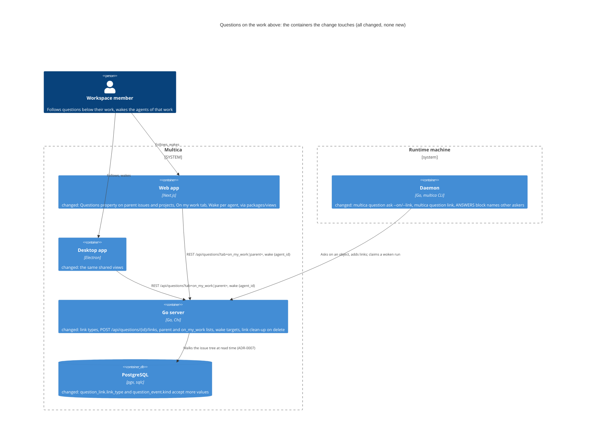
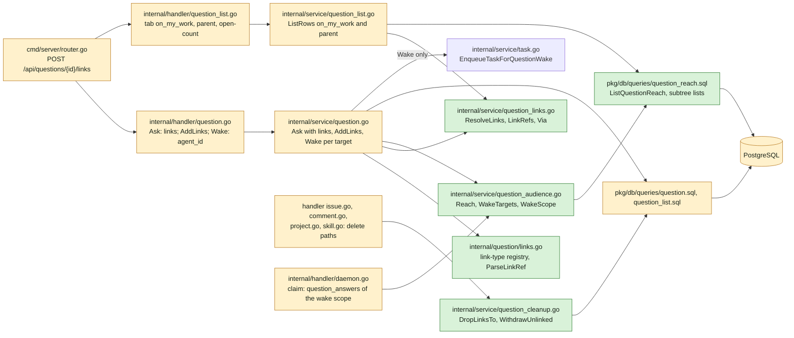
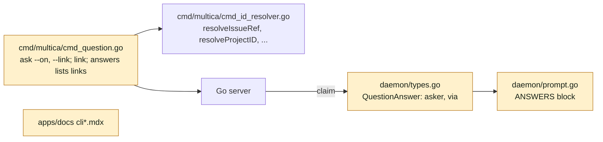
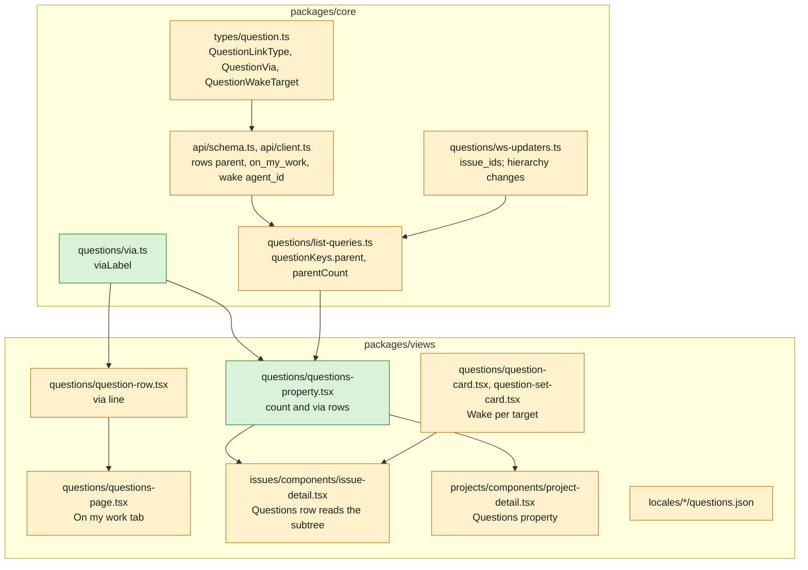
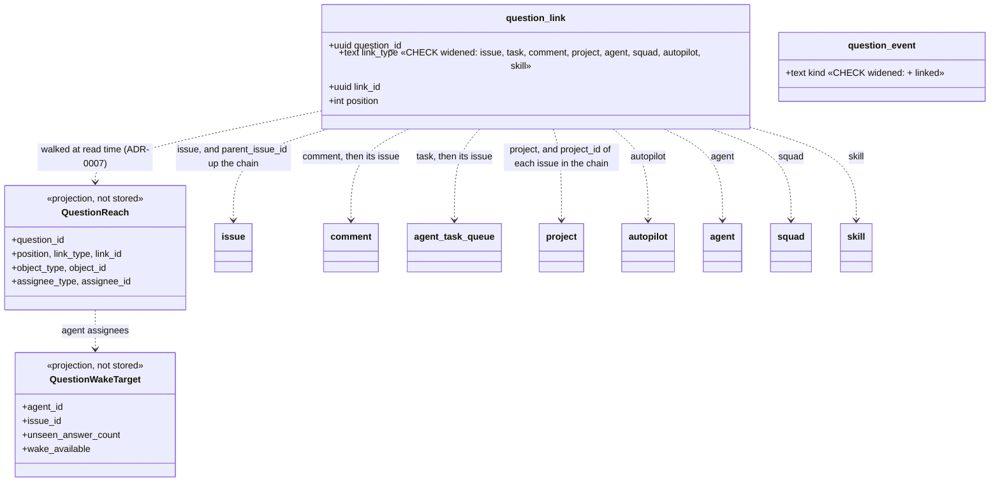

## At a glance

The delta of this change on the living system design, `specs/docs/system-design.md`, as changes `answer-an-agents-question-and-wake-it` (UJ-1), `agent-asks-several-questions-at-once` (UJ-2) and `answer-every-open-question-in-one-sitting` (UJ-3) leave it. Every container it touches already exists and already holds questions. The change adds no container, table or column. It widens two `CHECK` constraints.



Go server component map, delta:



Daemon and CLI component map, delta:



Web and desktop component map, delta:



Models: no table or column changes. The constraints and the read-time reach change:



Journey sequence and data flow:

```mermaid
sequenceDiagram
  actor B as Brian (assignee of WORK-410)
  actor A as Anouk (answerer)
  participant UI as Web or desktop
  participant S as Go server
  participant DB as PostgreSQL
  participant P as Pieter (run on WORK-415)
  participant J as Joeri (agent, assignee of WORK-410)
  P->>S: POST /api/questions {links: [comment on WORK-415]}, answerer Anouk
  S->>DB: question, links comment (0) + task (1), event asked
  P->>S: multica question link Q project:"Agent runtime"
  S->>DB: link project at position 2, event linked
  S-->>UI: WS question:updated reason linked, issue_ids [WORK-415]
  B->>UI: opens WORK-410
  UI->>S: GET /api/questions?tab=all_open&parent=issue:WORK-410 and open-count
  S->>DB: subtree of WORK-410, questions on it (ADR-0007)
  S-->>UI: row via sub-issue WORK-415, count 1
  B->>UI: Questions page, On my work
  UI->>S: GET /api/questions?tab=on_my_work
  S-->>UI: the row, via sub-issue WORK-415; Brian is no answerer: no controls
  A->>S: POST /api/questions/{id}/answer (UJ-1)
  UI->>S: GET /api/issues/WORK-415/questions
  S-->>UI: wake_targets: Pieter on WORK-415, Joeri on WORK-410
  B->>UI: Wake Joeri
  UI->>S: POST /api/questions/{id}/wake {agent_id: Joeri}
  S->>DB: agent_task_queue row for Joeri on WORK-410, evidence question_wake
  J->>S: claim: question_answers = Anouk's answer, asked by Pieter via sub-issue WORK-415
```

| Kind | Name | Change | Path |
|---|---|---|---|
| Migration | `question_link.link_type` and `question_event.kind` constraints widened | new | `server/migrations/575_question_link_types.up.sql`, `.down.sql` |
| Rule | Link-type registry and link references | new | `server/internal/question/links.go` |
| Queries | Reach of questions upward; questions below an issue or project; questions on a member's work; link clean-up | new | `server/pkg/db/queries/question_reach.sql` |
| Queries | Append link, list links, questions on an issue's page, withdraw unlinked | changed | `server/pkg/db/queries/question.sql` |
| Service | Link resolution, refs and via | new | `server/internal/service/question_links.go` |
| Service | Reach, wake targets, wake scope | new | `server/internal/service/question_audience.go` |
| Service | Ask with links, `AddLinks`, Wake per target, `ListForIssue` with comments and runs | changed | `server/internal/service/question.go` |
| Service | Rows for `on_my_work` and `parent`; counts | changed | `server/internal/service/question_list.go` |
| Service | Links to deleted objects dropped, unlinked questions withdrawn | new | `server/internal/service/question_cleanup.go` |
| Handler | Ask body `links`, `POST /api/questions/{id}/links`, Wake body `agent_id` | changed | `server/internal/handler/question.go` |
| Handler | `tab=on_my_work`, `parent`, open-count `tab`, `parent`, `blocking_count` | changed | `server/internal/handler/question_list.go` |
| Handler | Delete paths call the clean-up in their transaction | changed | `server/internal/handler/issue.go`, `comment.go`, `project.go`, `skill.go` |
| Handler | Claim hydrates the wake scope's answers | changed | `server/internal/handler/daemon.go` |
| Router | `POST /api/questions/{id}/links` | changed | `server/cmd/server/router.go` |
| Events | Reason `linked`; payload `issue_ids` | changed | `server/pkg/protocol/events.go` |
| CLI | `ask --on`, `--link`; `link`; `answers` lists links | changed | `server/cmd/multica/cmd_question.go` |
| Daemon | `[ANSWERS]` names the asker and the via of others' questions | changed | `server/internal/daemon/types.go`, `prompt.go` |
| Docs | CLI reference | changed | `apps/docs/content/docs/cli.mdx`, `cli.zh.mdx`, `cli.ja.mdx`, `cli.ko.mdx`, `cli.fr.mdx` |
| Type and schema | Link types, via, wake targets, on_my_work, parent | changed | `packages/core/types/question.ts`, `packages/core/api/schema.ts`, `packages/core/api/client.ts` |
| Feature | Parent row and count queries; via label; hierarchy invalidation | changed | `packages/core/questions/list-queries.ts`, `via.ts`, `ws-updaters.ts` |
| Component | Questions property with via rows | new | `packages/views/questions/questions-property.tsx` |
| Component | Card and set card offer Wake per target; row shows via | changed | `packages/views/questions/question-card.tsx`, `question-set-card.tsx`, `question-row.tsx`, `wake-bar.tsx` |
| Screen | Issue Questions row counts the subtree and lists via rows | changed | `packages/views/issues/components/issue-detail.tsx` |
| Screen | Project Questions property | changed | `packages/views/projects/components/project-detail.tsx` |
| Screen | Questions page tab On my work | changed | `packages/views/questions/questions-page.tsx` |
| Copy | Via labels, property, tab | changed | `packages/views/locales/{en,zh-Hans,ko,ja,fr}/questions.json`, `projects.json` |
| Design | Library: questions property row, two Wake buttons | changed | `designs/systems/multica.lib.pen` |
| Design | Parent issue, project, On my work, answered card with Wake per agent | changed | `designs/screens/issue-questions.pen`, `designs/screens/issue-questions.md` |
| Prototype | Data-flow path and screens of this journey | changed | `prototypes/web/issue-questions/` |
| ADR | ADR-0007: A question reaches its parents at read time | new | `adr/0007-a-question-reaches-its-parents-at-read-time.md` |

## Context

Journey UJ-4 of [PRD: Questions in Multica](anytype://object?objectId=bafyreiaviofipcl3ymgld2skld4ij6hlarsm2ra55ygufsepgk5laxjf34), journey issue [DAS-430](https://linear.app/skuddy/issue/DAS-430/uj-4-a-question-reaches-the-owner-of-the-work-above-it). It builds on UJ-1 ([DAS-432](https://linear.app/skuddy/issue/DAS-432/uj-1-answer-an-agents-question-and-wake-it), branch `das-432-uj-1-answer-an-agents-question-and-wake-it`: five question tables, the card, Wake, ADR-0002 and ADR-0003) and UJ-3 ([DAS-433](https://linear.app/skuddy/issue/DAS-433/uj-3-answer-every-open-question-in-one-sitting), branch `das-433-uj-3-answer-every-open-question-in-one-sitting`: the row list per viewer, the Questions page, the Wake bar, ADR-0006), and through UJ-3 on UJ-2 (sets, answer policy, ADR-0004). Their requirements hold unchanged. UJ-1 to UJ-3 are built and merged first, so this change's code and tasks assume theirs exist.

**Journey steps.** Brian's answer on WORK-378 (2026-10-12, relayed by Skuddy) skips J1, J4 and J10 for every Questions journey, recorded on this journey as the Requests `Skip: J1`, `Skip: J4` and `Skip: J10`. The investigation agrees: every new file sits in an existing Go package or workspace package (J1); no token or colour is new (J4); only people follow and wake, and the agent's tooling is the CLI built at J8 (J10). Steps with work: J2 Data models, J3 Data-flow prototype, J5 Components, J6 Screens, J7 Live prototype, J8 Backend and agent tooling, J9 Frontend, J11 Acceptance test and archive.

**Design sources.** `designs/screens/issue-questions.md` of [appboypov/multica#6](https://github.com/appboypov/multica/pull/6): "Concepts" (Link, Parents, Indirect audience), "Where questions live" 2 and "Waking agents". The tab **On my work** of screen 4 in `issue-questions.pen`. The prototype of [appboypov/multica#8](https://github.com/appboypov/multica/pull/8): `QuestionsPage` tab `work` and `via: 'via sub-issue WORK-415'` (`model.ts` ~133, `pages.tsx` ~135), and the Wake bar after a link's cards. Neither the `.pen` file nor the prototype draws a parent issue's or project's Questions property, or a card that offers Wake to two agents, so J6 draws those. Brian's Keep "questions can be asked on issues, sub-issues, their runs, projects, comments and other objects" (Plannotator Review `b8b3060eec0c8d52`) and "Questions link to anything and reach every parent" (WORK-366) are the scope.

**Code map.** What the build reuses beyond UJ-1's to UJ-3's code maps. Paths are under `server/` unless they start with `packages/` or `apps/`.

- Issue tree: `issue.parent_issue_id` (`migrations/001_init.up.sql:65`, `ON DELETE SET NULL`), `issue.project_id` (`034_projects.up.sql:18`). Indexes `idx_issue_parent`, `idx_issue_project`, `idx_issue_assignee (assignee_type, assignee_id)`, `idx_comment_issue`, `idx_agent_task_queue_issue_id`. A recursive CTE over `parent_issue_id` exists in `pkg/db/queries/subscriber.sql` `HasAncestorOptOut` (~206-230), the pattern to follow. Cycles are only checked on update, 10 levels deep (`internal/handler/issue.go` ~3888-3900), so a read-time walk must stop on cycles itself.
- Owners: issue `assignee_type`/`assignee_id` (`member`, `agent`, `squad`); project `lead_type`/`lead_id` (`member`, `agent`; `034_projects.up.sql:10-11`); autopilot `assignee_type`/`assignee_id` (`agent`, `squad`). Agents, squads and skills have no assignee.
- Loads in the workspace: `GetIssueInWorkspace`, `GetProjectInWorkspace` (`pkg/db/queries/project.sql`), `GetAgentTaskInWorkspace` (`pkg/db/queries/agent.sql` ~739), comments by `comment.workspace_id`, and the agent, squad, autopilot and skill gets by workspace. Issue references for many ids: `ListIssueRefsInWorkspace` with `service.IssueIdentifier`.
- Hard deletes and their transactions: `deleteIssuesAndCollectAttachmentURLs` (`internal/handler/issue.go` ~4362, used by `DeleteIssue` and `BatchDeleteIssues`), `deleteComment` (`internal/handler/comment.go` ~3836), `DeleteProject` (`internal/handler/project.go` ~600-658), `DeleteSkill` (`internal/handler/skill.go` ~712-733). Agents, squads and autopilots are archived, not deleted.
- CLI references: `cmd/multica/cmd_id_resolver.go` `resolveIssueRef` (~146), `resolveProjectID` (~352), `resolveAutopilotID` (~223), `resolveTaskRunID` (~287), `resolveIDByPrefix` (~78); `resolveAgent` in `cmd_autopilot.go` (~1024).
- Web and desktop: the issue sidebar's `PropRow` (`packages/views/common/prop-row.tsx`) in `packages/views/issues/components/issue-detail.tsx` (`sidebarContent` ~2664; parent query ~2044); the project page's local `PropRow` (`packages/views/projects/components/project-detail.tsx` ~81-96, properties ~282-415, `projectDetailOptions` ~110), routed on web (`apps/web/app/[workspaceSlug]/(dashboard)/projects/[id]/page.tsx`) and desktop (`apps/desktop/src/renderer/src/routes.tsx` ~146). Realtime: `packages/core/realtime/use-realtime-sync.ts` (`issue:updated` ~1076-1097 to `onIssueUpdated`; `project:*` prefix ~787-837).
- From UJ-1 to UJ-3, extended here: `question_link (link_type, link_id, position)` and its target index, `QuestionService.Ask`, `ListForIssue`, `Wake`, the unseen query and the claim's `question_answers`; `GET /api/questions` with `QuestionRow`, `ListRows`, `CountOpenForMember`; `QuestionCard`, `QuestionSetCard`, `WakeBar`, `QuestionListRow`, `QuestionsPage`; `questionKeys`.
- Must not change: the five tables' columns, the answer rules, the open rules (ADR-0004), who answers, the sidebar count, the inbox. Wake stays the only path into `TaskService` (ADR-0003).

## Goals / Non-Goals

**Goals:**

- A question links to an issue, a sub-issue, a comment, a run, a project, an agent, a squad, an autopilot or a skill, and to several; the asking agent chooses the first link when it asks and adds links afterwards.
- A parent issue and a project show, in their Questions property, the open questions of everything below them, each marked "via" the link it came from, and count them.
- **On my work** lists the open questions on links and parents whose member assignee is the viewer.
- Wake is offered for the asking agent and for each agent assignee of the question's links and parents, each woken on its own issue with the answers it has not seen.

**Always:**

- What is below what is read from the live issue tree, project and comment at the moment of the read (ADR-0007): moving a sub-issue moves its questions with it.
- Lists and counts come from `GET /api/questions` and its open count (ADR-0006); the client only formats "via".
- Every Wake goes through `POST /api/questions/{id}/wake` and one unseen rule per agent and issue (ADR-0003).
- Links to deleted objects are removed in the deleting transaction, in application code.
- New and changed responses go through zod schemas and `parseWithFallback`, with malformed-response tests.

**Never:**

- No new table or column, no stored parents, no foreign keys or cascades.
- The indirect audience never answers, gets no inbox item and no answer controls; only answerers answer.
- No member way to add links; no link picker in the web or desktop app.
- No mobile change, no new design token or colour.

**Non-Goals:** making the indirect audience answerers; notifying it; squads as assignees in the audience (an issue or autopilot assigned to a squad adds no member and no agent); links to members, runtimes or chats; the Agent questions setting (UJ-5).

## Decisions

### 1. Link types are a closed registry

`internal/question/links.go` names the eight link types and, for each, how the CLI writes it:

| `link_type` | Object | Parent of the link | Assignee |
|---|---|---|---|
| `issue` | issue (a sub-issue is an issue with a parent) | its parent issues up the chain, and the project of each | `assignee_*` when `member` or `agent` |
| `comment` | comment | its issue, then as `issue` | — |
| `task` | agent run | its issue, then as `issue` | — |
| `project` | project | none | `lead_*` |
| `autopilot` | autopilot | none | `assignee_*` when `agent` |
| `agent`, `squad`, `skill` | the object | none | — |

The service resolves a `{type, id}` with the workspace-filtered load of its type and refuses an unknown type or an object of another workspace with 422 naming it (`project 01J… is not in this workspace`). A task link must be a run with an issue. Migration `575_question_link_types` drops UJ-1's two `CHECK` constraints and adds them back with the eight link types and the event kind `linked`. A comment is the comment row; a tombstoned comment counts as deleted (decision 7). Alternative: free-form `link_type` checked only in Go. Rejected: the database keeps refusing what no loader reads.

### 2. Asking on an object, and adding links

UJ-2's `POST /api/questions` body gains `links: [{type, id}]`, at most 10, the same for every question of an ask:

- With `links`, `links[0]` is position 0, where the question was asked, and the rest follow in order. Without `links`, position 0 is the run's issue, as in UJ-1.
- The asking run's `task` link is always written after them. The run row ("ended run #N with a question") and the asker's Wake stay as UJ-1 made them.
- Duplicates are written once (the primary key is `(question_id, link_type, link_id)`).

`POST /api/questions/{id}/links {links: [{type, id}]}`, task token of the asking agent from any of its runs, appends links after the highest position, skips links the question already has, writes one `linked` event per added link and publishes `question:updated` reason `linked`. A question that is `closed` or `withdrawn` refuses with 422. It returns `Question`.

The CLI writes a link as `<type>:<ref>`, or as a bare issue key or id. `issue:` takes what `resolveIssueRef` takes, `project:` what `resolveProjectID` takes, `autopilot:` what `resolveAutopilotID` takes, `agent:` what `resolveAgent` takes, `run:` a run id (`task` on the wire), and `comment:`, `squad:` and `skill:` an id or a unique prefix through `resolveIDByPrefix`. `multica question ask` takes `--on <link>` (position 0) and `--link <link>` (repeatable). `multica question link <question-id> <link>...` adds links. `multica question answers` lists the links with their positions. Each resolves before any request, and an unknown reference fails without a request.

### 3. Parents are read from the live tree (ADR-0007)

Nothing stores what is below what. Two SQL forms read the same rule from `question_reach.sql`:

- **Upward**, for given questions: `ListQuestionReach(question_ids)` returns one row per question, link and reached object. The reached objects are the link's object and, for `issue`, `comment` and `task`, the issue, its ancestors through `parent_issue_id` and each of their projects, with each object's assignee. The recursive CTE uses `UNION`, so a cycle in the tree ends the walk instead of looping. Wake targets (decision 6) read it.
- **Downward**, for lists: the subtree of seed issues (`UNION` again) and the questions with an `issue` link in the subtree, a `comment` or `task` link whose issue is in it, or a `project` link to a seed project. The parent list seeds the parent issue, or the issues of the project. On my work seeds the viewer's issues and the issues of the projects the viewer leads.

`internal/service/question_reach_test.go` runs one fixture tree (sub-issue chain, comment, run, project on an ancestor only, a cycle, another workspace) through both forms. A question is in X's downward list exactly when X is in its upward reach.

**Via.** A row on a page or tab carries `via`: the question's first link, by position, that reaches the page's object (or the viewer's work). It is `null` when that link is the object itself (or is assigned to the viewer). `via` is `{type, id, identifier, issue_identifier}`, where `type` is `issue` or `sub_issue` (the link issue has a parent), `comment` or `task`. The client's `viaLabel` makes "via sub-issue WORK-415", "via issue WORK-416", "via comment" (on its own issue's page), "via comment on WORK-415", "via run" or "via run on WORK-415".

### 4. Where a question shows

- **Issue timeline.** UJ-1's `GET /api/issues/{id}/questions` lists the questions with a link to the issue, to one of its comments or to one of its runs, so a question asked on a comment has its card on that issue. Every question has its run's `task` link, so its card always shows on the asking run's issue.
- **Issue Questions row.** UJ-1's Questions row counts the open questions of the issue and everything below it: `GET /api/questions/open-count?tab=all_open&parent=issue:{id}` returns `{count, blocking_count}`, read as "2 open · blocks work". Under the row, `QuestionsProperty` lists the open rows of `GET /api/questions?tab=all_open&parent=issue:{id}` that carry a `via`, each as type glyph, prompt and via ("via sub-issue WORK-415", "via comment"); rows without a `via` are linked to the issue itself and are cards on this page. A click opens the question as a Questions page row does. The row shows while the count is above 0. Its label still jumps to the first open card on the page when there is one.
- **Project Questions property.** `project-detail.tsx` gets a **Questions** property with the same count for `parent=project:{id}` and `QuestionsProperty` listing every open row, with a via mark only on rows that came through an issue.
- A link to an agent, squad, autopilot or skill shows the question on its asking run's issue and in the lists. Those pages get no property.

### 5. The row list grows a tab and a parent (ADR-0006)

`GET /api/questions`:

| Param | Change |
|---|---|
| `tab` | adds `on_my_work`: open (`open` or `partly_answered`) questions on the viewer's work as decision 3's downward form reads it, whether or not the viewer answers; order `created_at`, `id` |
| `parent` | `issue:{id}` or `project:{id}`, with `tab=all_open` only (else 400), loaded with `loadIssueForUser` or `GetProjectInWorkspace`; `via` is relative to it |
| cursor | its scope includes `parent` |

`QuestionRow` changes:

- `link` becomes the page object of the first link: the issue for `issue`, `comment` and `task` links, else the object itself. Its `type` takes `issue`, `project`, `agent`, `squad`, `autopilot` or `skill`; `identifier` and `status` are null where the object has none. UJ-3's grouping by link groups projects and other objects with their icon.
- `via` is added: decision 3, null outside `on_my_work` and `parent`.
- `open_issue {id, identifier}` is added: where the row opens, the issue of the first `issue`, `comment` or `task` link (always present, decision 4). UJ-3's row opens there with `highlightQuestionId`.

`GET /api/questions/open-count` takes `tab` (`for_me` default, `on_my_work`, `all_open`) and `parent`, and returns `{count, blocking_count}`; without parameters it is UJ-3's sidebar count. The Questions page gets **On my work** after **For me**: the same rows with the via line, Yes / No buttons only where the viewer answers (UJ-3's rule), and the empty state "Nothing waits on your work".

### 6. Who is offered Wake

A question's wake targets are pairs (agent, issue):

- the asking agent on its asking run's issue (UJ-1);
- each agent assignee of a reached issue, on that issue;
- each agent lead of a reached project and each agent assignee of a linked autopilot, on the asking run's issue, the one issue the question surely has.

Pairs are unique and archived agents are left out. For a target (B, I), the **wake scope** is every question that has (B, I) among its targets. **Unseen** is the answers of the wake scope updated after the start of B's latest started run on I, or all of them when B has never run on I. ADR-0003's "that agent's questions on the issue" becomes the wake scope. For the asking agent the two are the same, so UJ-1's tests keep passing. `wake_available` is unseen above 0 and no queued, dispatched or running task of B on I.

`Question` gains `wake_targets: [{agent_id, issue_id, unseen_answer_count, wake_available}]`, asker first. UJ-1's `unseen_answer_count` and `wake_available` stay as the asker's values. `POST /api/questions/{id}/wake` takes `{agent_id?}`. Absent means the asker. An agent that is no target of the question is 422 "Joeri is not offered Wake on this question". It enqueues B on I through UJ-1's `EnqueueTaskForQuestionWake`, and the timeline of I reads "Joeri was woken by Brian with 1 answer". At claim, `question_answers` is the unseen answers and ask-backs of the claiming task's wake scope. Each one now carries `asker_name` and `via`, and the `[ANSWERS]` block marks answers to other agents' questions:

```text
[ANSWERS]
Brian woke you with 1 answer to questions on your work:
- 01J…  "Do invoices round per line or per total?" → per line · Anouk · 2026-10-12 21:04 · asked by Pieter via sub-issue WORK-415
`multica question answers <question-id>` shows a question in full.
```

The header keeps UJ-1's wording when every answer is to the woken agent's own questions. The card and UJ-2's set footer render one `WakeBar` per target with `wake_available` ("Wake Pieter", "Wake Joeri"). UJ-3's Answer all bars are per (agent, issue) already and read the targets.

### 7. Deleted objects

`question_cleanup.go` runs inside each deleting transaction, before the row goes:

- `DropLinksTo(type, ids)` for a deleted comment (deleted or tombstoned), project or skill.
- For deleted issues, `DropLinksOfIssues(ids)` drops their `issue` links and the `comment` and `task` links on them, since comments and runs go with the issue.
- `WithdrawUnlinked(question_ids)` then sets every question of those links that has no link left and is `open`, `answered` or `partly_answered` to `withdrawn`, with a `withdrawn` event `{reason: "links_deleted"}`.

The handler publishes `question:updated` for those after commit. Sub-issues whose parent is deleted are detached by the existing `DetachDirectChildIssues`; their questions then reach whatever is above them now. Archived agents, squads and autopilots keep their links.

### 8. Live updates

`question:created` and `question:updated` carry `issue_ids`: the issues whose page shows the card (issue links, and the issues of comment and task links). UJ-1's `issue_id` stays the first of them. The ws updaters invalidate `questionKeys.byIssue` for each of them, and UJ-3's `rowsAll` and `openCount` keys, under which the parent rows and counts sit (`questionKeys.parent(wsId, parent)`, `questionKeys.parentCount(wsId, parent)`). An `issue:updated` that changes an issue's parent, project or assignee, an `issue:deleted` and any `project:*` event invalidate `questionKeys.all(wsId)`, because what reaches what and who is offered Wake moved. The change is read from the event against the cached issue; an issue that is not cached counts as changed.

## Risks / Trade-offs

- [Every list walks the issue tree at read time] -> a workspace's tree is shallow and indexed on `parent_issue_id` and `project_id`. The walk runs once per page or count, with the subtree seeded from one issue, one project or the viewer's work. Stored parents would need a write on every move, re-parent, project change and delete, and could go stale.
- [Two SQL forms of one rule] -> the reach test runs both over the same fixtures, as ADR-0006's parity test does for the open rule.
- [A project lead or autopilot agent is woken on the asking run's issue, which it may not own] -> a run needs an issue, and a mention already starts any agent on any issue. The `[ANSWERS]` block says whose question it was and via what.
- [An agent assignee that never ran on the issue has every answer unseen] -> its first Wake gets every answer of its wake scope. That is what it has not seen.
- [`via` and `link` change the meaning of UJ-3's `QuestionRow.link` for questions not asked on an issue] -> before this change every question's first link was an issue, so existing rows read the same. The schema falls back to `issue` for an unknown `link.type`.
- [Invalidating every question query on a hierarchy change] -> such changes are rare next to status changes, which do not trigger it.
- [The down migration deletes links of the new types and `linked` events] -> it must, to restore the narrower constraints. Rollback loses those links. Their questions keep their `issue` and `task` links.
- [Another change takes migration `710`] -> it cannot: this change owns 710 to 719 (Brian, WORK-366 comment `01a13915-3db8`).

## Migration Plan

One migration widens two `CHECK` constraints: drop, then add `NOT VALID` and `VALIDATE`, so the table is not locked while the check runs. No data change and no backfill. Rollback runs the `.down.sql`: it deletes links of the new types and `linked` events, then restores UJ-1's constraints. `make local-release` deploys. Installed desktop clients ignore `via`, `open_issue`, `wake_targets` and `blocking_count`, keep the asker's Wake, and meet no new route.
